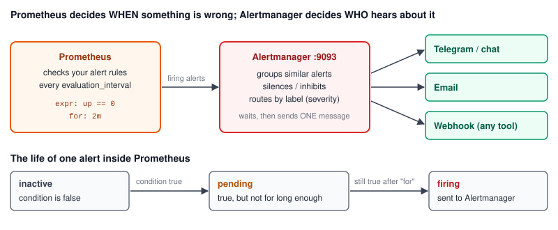

# Chapter 6 — Alerting That Helps Instead of Annoys

> **Course:** Monitoring & Logging · **Chapter:** 6 of 8
> Read on the website: [learn.bazardev.com/monitoring/06-alerting](https://learn.bazardev.com/monitoring/06-alerting)
>
> 🇧🇩 **Prefer Bangla?** [Read this chapter in Bangla →](https://learn.bazardev.com/monitoring/06-alerting?lang=bn)

A dashboard (Chapter 5) only helps while someone is **looking** at it. At 3 a.m. nobody is. An **alert** flips this around: the system watches the numbers for you and **taps your shoulder** when something needs a human. Done well, an alert means "get up, this matters". Done badly, you get fifty messages a day, you start ignoring all of them, and the one real alert is lost in the noise. This chapter is about the first kind.

> **Honesty note: what was and was not run.** Prometheus, Alertmanager and `promtool` are **not installed on the server used to write this course**, and nothing was installed for it. So the rules, configs and commands below are written from the official documentation and are **not executed**. What *was* checked: every YAML snippet below parses as valid YAML (by a tool), the field names, defaults (`group_wait` 30s, `group_interval` 5m, `repeat_interval` 4h, `evaluation_interval` 1m, port 9093) and the `promtool`/`amtool` command forms were read from the official docs and source repositories, and every external link was opened. The PromQL rules reuse the metric names from Chapters 2 and 4. Whether a rule fires correctly **on your server** is something to prove yourself with the test in section 9. Package versions and menu or flag names can differ on your system.



## 1. Two jobs, two programs

Alerting is split between two programs, and mixing them up is the most common beginner confusion:

| Program | Its one job |
|---|---|
| **Prometheus** | **Decides when something is wrong.** It runs your *alert rules* (a PromQL condition) on a timer. When a condition stays true long enough, the alert becomes *firing* and Prometheus pushes it onwards. |
| **Alertmanager** | **Decides who hears about it, and how.** It receives firing alerts, **groups** similar ones, **silences** the ones you muted, picks the right **receiver** (email, Telegram, a webhook) and sends **one** tidy message. |

Why split them? Because "is the disk full?" and "who should wake up, by what channel, at what hour?" are different questions, and the second one changes often (on-call people change, channels change) without the first one changing at all.

## 2. What deserves an alert? (the most important section)

Anyone can write fifty alerts. The skill is writing the few that matter. The official Prometheus alerting guidance says to keep alerting simple, avoid pages "where there is nothing to do", and "aim to have as few alerts as possible". Four rules to live by:

1. **Alert on symptoms, not causes.** A symptom is what a *user* feels: the site is down, pages are slow, checkout errors. A cause is *why*: CPU is at 90%, a process restarted. A busy CPU with a happy site needs no human. Alert on the symptom; keep the causes on the dashboard for the investigation afterwards.
2. **Every alert must be actionable.** Ask: "If this fires at 3 a.m., what exactly will I do?" If the honest answer is "nothing, I'll go back to sleep", it is not an alert; make it a dashboard panel or a daily report.
3. **Two levels are enough.**
   - **critical** ("page"): something is broken **now** and users are affected. Wakes a person up.
   - **warning** ("ticket"): something will become a problem soon (a disk filling up). It can wait until morning; send it to a chat channel or email, not to a phone that rings.
4. **Give context.** The message should say *what* is wrong, *where*, and *how bad*, and ideally link to a dashboard or a short "what to do" page. A message that says only "alert!" costs five minutes of detective work at the worst possible time.

**Alert fatigue** is the real danger. If people get alerts they cannot act on, they learn to ignore alerts, and then they miss the real one. Every noisy alert you keep makes your monitoring *worse*. Delete or fix an alert that keeps crying wolf.

## 3. Anatomy of an alert rule

Alert rules live in a YAML file that Prometheus loads. The format is from the official documentation:

```yaml
# /etc/prometheus/rules/server.yml
groups:
  - name: server-health
    rules:
      - alert: InstanceDown
        expr: up{job="node"} == 0
        for: 2m
        labels:
          severity: critical
        annotations:
          summary: "{{ $labels.instance }} is down"
          description: "Prometheus could not scrape {{ $labels.instance }} for 2 minutes."
```

Read it line by line:

- **`alert`**: the name. Pick one that reads like a problem: `InstanceDown`, not `Check1`.
- **`expr`**: a PromQL condition. Prometheus runs it every `evaluation_interval` (default **1 minute**). Every series the expression returns is an *active alert*. Here `up == 0` returns one series per target that could not be scraped. (`up` is from Chapter 4.)
- **`for`**: **how long the condition must stay true before the alert fires.** This is your main weapon against false alarms. A server that blips for 20 seconds during a reboot should not wake anyone; one that is down for 2 full minutes should. Without `for`, the alert fires on the very first evaluation.
- **`labels`**: extra labels attached to the alert. `severity` is not magic: it is just a label *you* choose, which Alertmanager can then use for **routing** (section 6).
- **`annotations`**: human-readable text. Two template variables are available: **`$labels`** (the labels of that alert, for example `$labels.instance`) and **`$value`** (the number the expression produced).

### The three states

While Prometheus watches a condition, the alert is in one of three states (see the picture above):

| State | Meaning |
|---|---|
| **inactive** | The condition is false. All is well. |
| **pending** | The condition is true, but not for the full `for` time yet. Nothing is sent. |
| **firing** | The condition stayed true for the whole `for` time. Sent to Alertmanager. |

If the condition becomes false while the alert is pending, it silently goes back to inactive: that is exactly how a 20-second blip is ignored. (Prometheus also records these as a series named `ALERTS`, so you can graph "what was firing, and when" in Grafana.) A related setting, `keep_firing_for`, keeps an alert firing for a while *after* the condition clears, to stop an alert that flaps on and off from sending message after message.

## 4. A starter set of rules for one server

These use the `node_exporter` metrics from Chapters 2 and 4. Five rules, each answering "does a human need to act?":

```yaml
# /etc/prometheus/rules/server.yml  (the complete file)
groups:
  - name: server-health
    rules:
      # Critical: the server (or its exporter) is unreachable.
      - alert: InstanceDown
        expr: up{job="node"} == 0
        for: 2m
        labels:
          severity: critical
        annotations:
          summary: "{{ $labels.instance }} is down"
          description: "Prometheus could not scrape {{ $labels.instance }} for 2 minutes."

      # Warning: the root disk is getting full. Fix it before it becomes critical.
      - alert: DiskAlmostFull
        expr: (1 - node_filesystem_avail_bytes{mountpoint="/"} / node_filesystem_size_bytes{mountpoint="/"}) * 100 > 85
        for: 10m
        labels:
          severity: warning
        annotations:
          summary: "Disk / is {{ $value | printf \"%.0f\" }}% full on {{ $labels.instance }}"

      # Warning: at the current pace, the disk will be full within a day.
      - alert: DiskFullWithin24h
        expr: predict_linear(node_filesystem_avail_bytes{mountpoint="/"}[6h], 24 * 3600) < 0
        for: 30m
        labels:
          severity: warning
        annotations:
          summary: "Disk / on {{ $labels.instance }} is on track to fill up within 24 hours"

      # Warning: very little memory left for programs (uses AVAILABLE, as in Chapter 2).
      - alert: MemoryLow
        expr: node_memory_MemAvailable_bytes / node_memory_MemTotal_bytes * 100 < 10
        for: 10m
        labels:
          severity: warning
        annotations:
          summary: "Only {{ $value | printf \"%.0f\" }}% memory available on {{ $labels.instance }}"

      # Warning: the CPUs have been overloaded for a long time (load per core, as in Chapter 5).
      - alert: HighLoad
        expr: node_load5 / on (instance) count by (instance) (node_cpu_seconds_total{mode="idle"}) > 1.5
        for: 15m
        labels:
          severity: warning
        annotations:
          summary: "Load is {{ $value | printf \"%.1f\" }} per core on {{ $labels.instance }}"
```

Why these choices:

- **Only one is `critical`.** "Server unreachable" is a real emergency. The rest are *warnings*: they say "look at this today", not "wake up now".
- **Long `for` values (10 to 30 minutes)** on the resource alerts. A CPU spike or a brief memory peak is normal life; only a *sustained* problem deserves a message.
- **`predict_linear`** looks at the last 6 hours of data, draws a straight line forward, and asks "where will this be in 24 hours?". It turns "disk is 70% full" (not urgent) into "disk will be full tomorrow morning" (urgent). It is one of the best alerts you can have, because it gives you time to act calmly. Its result is a *prediction*, so it is a good fit for a warning, not a page.
- **Disk uses 85%, not 99%.** Alert early enough that you can fix it during working hours.
- **`$value | printf "%.0f"`** is a Go-template way to round the number so the message reads "87%" instead of "87.31928".

> **Alert on the user's pain too.** The five rules above watch the *machine*. For a web app, the most valuable alert is on the symptom: the share of requests that fail. If your app exposes a request counter (the name varies; the one below is an illustration), a rule can look like this:
>
> ```yaml
>       - alert: HighErrorRate
>         expr: sum(rate(http_requests_total{status=~"5.."}[5m])) / sum(rate(http_requests_total[5m])) * 100 > 5
>         for: 5m
>         labels:
>           severity: critical
>         annotations:
>           summary: "More than 5% of requests are failing with a server error"
> ```
>
> In Chapter 8 you will add real metrics to a Laravel app.

## 5. Tell Prometheus about the rules and about Alertmanager

In `prometheus.yml` you add two things: where the rule files are, and where Alertmanager lives. (Alertmanager's own port is **9093**.) The shape is from the official example config:

```yaml
# /etc/prometheus/prometheus.yml (the new parts)
global:
  evaluation_interval: 1m     # how often rules are checked (1m is the default)

rule_files:
  - "rules/*.yml"

alerting:
  alertmanagers:
    - static_configs:
        - targets: ["localhost:9093"]
```

Then ask Prometheus to reload (or restart it) and open **Alerts** in its web page: you will see each rule and its state (inactive, pending or firing).

Check the files **before** you reload. `promtool` ships with Prometheus:

```bash
promtool check rules /etc/prometheus/rules/server.yml
promtool check config /etc/prometheus/prometheus.yml
```

A typo in a rule file is the classic way to have *no alerts at all* and not know it. Run the check every time (and in your CI pipeline, as in the CI/CD course).

## 6. Alertmanager: groups, routes, receivers

Alertmanager has three ideas. Each one exists to stop a flood of messages.

**Grouping.** The official definition: "Grouping categorizes alerts of similar nature into a single notification." If a whole rack of servers loses network, you get **one** message listing them, not 40.

**Inhibition.** "Suppressing notifications for certain alerts if certain other alerts are already firing." If a server is *down*, you do not also need "disk check failed on that server", "memory alert on that server"... they are all consequences. One alert (the cause) is enough.

**Silences.** "A straightforward way to simply mute alerts for a given time." Planned maintenance? Silence the alerts for that server for two hours, so the planned reboot does not page anyone. Silences expire by themselves, which is what makes them safe.

And **routing**: a tree that sends each alert to the right receiver based on its labels, for example `severity`. Here is a small complete config. The field names and the three timing defaults are from the official docs; the values below are the defaults written out so you can see them:

```yaml
# /etc/alertmanager/alertmanager.yml
global:
  smtp_smarthost: 'smtp.example.com:587'
  smtp_from: 'alerts@example.com'
  smtp_auth_username: 'alerts@example.com'
  smtp_auth_password_file: /etc/alertmanager/smtp_password   # the password lives in a file, not here

route:
  receiver: team-chat                  # the default: everything goes here
  group_by: [alertname, instance]
  group_wait: 30s                      # wait this long to collect alerts into the first message
  group_interval: 5m                   # wait this long before telling about NEW alerts in a group
  repeat_interval: 4h                  # remind this often while an alert is still firing
  routes:
    - matchers:
        - severity="critical"
      receiver: on-call                # critical alerts: chat AND email

inhibit_rules:
  - source_matchers: [alertname="InstanceDown"]   # if the server is down...
    target_matchers: [severity="warning"]         # ...mute its warnings
    equal: [instance]                             # ...but only for the SAME instance

receivers:
  - name: team-chat
    telegram_configs:
      - bot_token_file: /etc/alertmanager/telegram_token
        chat_id: -1001234567890
  - name: on-call
    telegram_configs:
      - bot_token_file: /etc/alertmanager/telegram_token
        chat_id: -1001234567890
    email_configs:
      - to: 'oncall@example.com'
        send_resolved: true
```

Notes, because each of these lines matters:

- **`group_wait` / `group_interval` / `repeat_interval`** control the flood. Short `group_wait` means fast but possibly several messages; long `repeat_interval` means fewer reminders. The defaults (30 seconds, 5 minutes, 4 hours) are sensible to start with.
- **`equal: [instance]` is important.** Without it, "InstanceDown on server A" would silence the warnings of *every* server. (The official example config even carries a caution: if every label listed in `equal` is missing from both alerts, the rule applies anyway.)
- **Secrets stay out of the file.** The SMTP password and the Telegram bot token are read from separate files (`smtp_auth_password_file`, `bot_token_file`), which you create with tight permissions (`chmod 600`, owned by the Alertmanager user, as in the Linux course) and **never commit to Git**. Replace the example chat id and addresses with your own; a Telegram bot is made by chatting with **@BotFather** (see the Telegram docs below).
- **`send_resolved: true`** also sends a "problem is over" message. Webhooks and Telegram do this by default; email does not unless you ask.
- **A webhook receiver** (`webhook_configs` with a `url`) sends the alert as JSON to any tool you like: your own Laravel route, a chat bot, a ticket system.
- **Keep port 9093 private**, exactly as Chapter 5 said for Prometheus and Grafana. Out of the box Alertmanager asks for no login: anyone who can reach it can **silence your alerts**. Listen on the local machine only (set the listen address with the command-line flag; see `alertmanager --help` for the name in your version) and use the firewall.

## 7. Test the pipeline: does an alert really reach you?

An alert you have never seen fire is an alert you cannot trust. Test **three** things, in this order:

1. **The notification path.** Send a fake alert to Alertmanager, so you can see a message arrive in Telegram or your inbox. The simplest way that needs no extra tool is the third test below (stop `node_exporter` on a test machine); the Alertmanager documentation also describes its HTTP API for sending a test alert by hand. `amtool` (which comes with Alertmanager) can also inspect and validate things: see `amtool --help`.
2. **The rule itself,** with a **unit test** (next section), without breaking anything.
3. **The whole chain, once, for real.** On a test machine, stop `node_exporter` and watch: pending after about a minute, firing after the `for` time, then a message. Start it again and watch it resolve.

Then **practice the silence**, so you know how at 3 a.m. `amtool` talks to Alertmanager (its default address in the docs is `http://localhost:9093`, settable in `~/.config/amtool/config.yml`):

```bash
amtool alert                                   # list what is firing right now
amtool silence add alertname=DiskAlmostFull    # mute one alert (see --help for duration and comment options)
amtool silence query                           # list silences
amtool silence expire <id>                     # remove a silence early
```

## 8. A silent monitoring system is dangerous

What if Prometheus itself dies, or Alertmanager can no longer send mail? Then **no alerts arrive, and you think everything is fine.** That is the worst kind of failure. The official guidance says to alert on monitoring itself and to add checks from *outside* that "catch problems that are otherwise invisible". Practical steps:

- Keep an alert on `up` for **Prometheus itself** and for Alertmanager's scrape job, not just for your servers.
- A common pattern is a "**heartbeat**" alert: a rule that is *always* firing (`expr: vector(1)`), sent regularly to an **outside** service that raises the alarm if the heartbeat **stops**. The silence itself becomes the signal. A free external uptime checker (Chapter 7) watching your site from the outside gives you the same protection with less setup.
- Do not rely on a single channel. If email and Telegram are both down at once, you want a third path for the critical alert.

## 9. Unit-test your rules with `promtool`

`promtool` can test an alert rule **with made-up data**, with no real server: you describe a few minutes of fake metrics and say which alerts you expect. The format is from the official "Unit testing for rules" page:

```yaml
# /etc/prometheus/rules/server_test.yml
rule_files:
  - server.yml
evaluation_interval: 1m
tests:
  - interval: 1m
    input_series:
      - series: 'up{job="node", instance="web1:9100"}'
        values: '1 1 0 0 0 0'          # up for 2 minutes, then down
    alert_rule_test:
      - eval_time: 3m                  # down for only 1 minute so far: still pending
        alertname: InstanceDown
        exp_alerts: []
      - eval_time: 5m                  # down for 3 minutes (> for: 2m): firing
        alertname: InstanceDown
        exp_alerts:
          - exp_labels:
              severity: critical
              job: node
              instance: "web1:9100"
            exp_annotations:
              summary: "web1:9100 is down"
              description: "Prometheus could not scrape web1:9100 for 2 minutes."
```

Run it:

```bash
promtool test rules server_test.yml
```

This proves two things at once: the rule fires when it should (at minute 5) and **does not** fire too early (at minute 3, the `for` still counting). Put these tests next to your rules in Git and run them in CI: then nobody can break an alert without a failing test telling them.

## 10. Keeping alerts healthy over time

Alerting is not "set and forget". A short routine keeps it useful:

1. **Every alert gets a "what to do" note.** Put a link in an annotation (a runbook: a short page or wiki entry with the first three things to check). It turns a panicked 3 a.m. into a checklist.
2. **Review monthly.** For each alert that fired, ask: was it real? Did someone act? If an alert fired ten times and nobody did anything, **delete it or raise its threshold or `for`**. The goal is fewer, better alerts.
3. **Every incident teaches an alert.** After an outage, ask: "Would we have been told in time?" If not, add the missing alert (on the *symptom*) and write a test for it.
4. **Match the channel to the urgency.** Critical goes to a loud channel; warnings go to a quiet chat room or a daily email digest. If warnings are as loud as criticals, people tune out both.
5. **Use maintenance silences,** never "I'll just ignore it tonight".

### A word on Grafana's own alerting

Grafana (Chapter 5) has its own alerting feature, which can alert straight from a dashboard query, and sends to the same kinds of receivers. Both work. A simple rule of thumb: if Prometheus is your main data source, keep the rules in **Prometheus + Alertmanager** as code in Git, as this chapter showed; use Grafana alerting when you want to alert on data sources that Prometheus does not hold. Pick one place for each alert, so you never wonder which system sent a message.

## 11. Key takeaways

- A dashboard needs eyes; an **alert** goes and finds you. Prometheus **decides when** (rules), Alertmanager **decides who** (grouping, routing, silences, receivers).
- Alert on **symptoms**, keep every alert **actionable**, use **two levels** (critical wakes you, warning waits), give **context**. Fewer alerts are better: **alert fatigue** makes monitoring worse.
- A rule = `expr` + **`for`** (how long it must stay true) + labels + annotations. States: **inactive, pending, firing**.
- `predict_linear` can warn you that a disk **will** fill up, in time to act calmly.
- Grouping, inhibition and silences stop floods. Use **`equal`** in inhibit rules. Defaults: `group_wait` 30s, `group_interval` 5m, `repeat_interval` 4h.
- **Secrets in files, not in Git.** Keep Alertmanager (port 9093) private: whoever reaches it can silence your alerts.
- **Check files** with `promtool check rules`, **unit-test rules** with `promtool test rules`, and **watch the watcher**: alert if monitoring itself dies.

## 12. Test yourself (exam prep)

<details>
<summary><strong>Q1. What is the job of Prometheus and what is the job of Alertmanager in alerting?</strong></summary>

Prometheus evaluates the alert rules and decides when something is wrong (an alert fires). Alertmanager receives firing alerts and decides who is told and how: it groups, silences, inhibits and routes them, then sends the notification (email, Telegram, webhook).
</details>

<details>
<summary><strong>Q2. Why is "alert on symptoms, not causes" good advice? Give an example.</strong></summary>

A symptom is what users feel (site down, slow pages, failed checkouts); a cause is only one possible reason (high CPU). A busy CPU with a healthy site needs no human, so alerting on it just creates noise. Alert on the failing requests; keep CPU on the dashboard for investigating.
</details>

<details>
<summary><strong>Q3. What does `for: 10m` do in an alert rule?</strong></summary>

The condition must stay true for 10 minutes before the alert fires. Until then it is "pending" and nothing is sent. This avoids waking someone for short blips.
</details>

<details>
<summary><strong>Q4. Name the three states of an alert in Prometheus.</strong></summary>

Inactive (the condition is false), pending (true, but not yet for the full `for` time) and firing (true for the whole `for` time, sent to Alertmanager).
</details>

<details>
<summary><strong>Q5. What is `alert fatigue`, and how do you fight it?</strong></summary>

When people get so many alerts (especially ones they cannot act on) that they start ignoring all of them, including the real one. Fight it with fewer, actionable alerts: delete or tune noisy ones, use `for`, group related alerts, and send warnings to a quiet channel.
</details>

<details>
<summary><strong>Q6. Why is `predict_linear` useful for a disk alert?</strong></summary>

It projects the recent trend forward, so you can be warned that the disk will be full in, say, 24 hours, while there is still time to fix it calmly, instead of only learning at 99% full.
</details>

<details>
<summary><strong>Q7. What do grouping, inhibition and silences each do?</strong></summary>

Grouping combines similar alerts into one notification; inhibition suppresses certain alerts while another (the cause) is already firing; a silence mutes matching alerts for a set time, for example during planned maintenance.
</details>

<details>
<summary><strong>Q8. Why must an inhibit rule usually have `equal`?</strong></summary>

So the muting applies only to alerts about the same thing (for example the same `instance`). Without it, one server being down could mute the warnings of every other server.
</details>

<details>
<summary><strong>Q9. Why keep Alertmanager's port private, and where should the email password go?</strong></summary>

Out of the box Alertmanager asks for no login, so anyone who can reach it can silence your alerts; bind it to the local machine and block it in the firewall. The password belongs in a separate permission-restricted file (for example via `smtp_auth_password_file`), not in a config committed to Git.
</details>

<details>
<summary><strong>Q10. How do you test an alert rule without breaking anything, and what if monitoring itself dies?</strong></summary>

Write a `promtool test rules` unit test with fake input series and the alerts you expect at given times. For a dead monitoring system, alert on Prometheus/Alertmanager health and use a heartbeat or an outside uptime check, so silence itself raises the alarm.
</details>

## 13. Free resources

- Prometheus docs: [Alerting rules](https://prometheus.io/docs/prometheus/latest/configuration/alerting_rules/) and [Unit testing for rules](https://prometheus.io/docs/prometheus/latest/configuration/unit_testing_rules/)
- Alertmanager docs: [Overview (grouping, inhibition, silences)](https://prometheus.io/docs/alerting/latest/alertmanager/) and [Configuration](https://prometheus.io/docs/alerting/latest/configuration/)
- [Alerting best practices](https://prometheus.io/docs/practices/alerting/) (the "few alerts, on symptoms" guidance quoted above)
- [Alertmanager on GitHub](https://github.com/prometheus/alertmanager) (README with `amtool` examples) and its [example config](https://github.com/prometheus/alertmanager/blob/main/doc/examples/simple.yml)
- Telegram: [Bot API](https://core.telegram.org/bots/api)
- Grafana: [Alerting](https://grafana.com/docs/grafana/latest/alerting/)

---

**Next:** [Chapter 7 — Central Logging, Uptime Checks, and Error Tracking](07-central-logging-uptime-and-errors.md)
