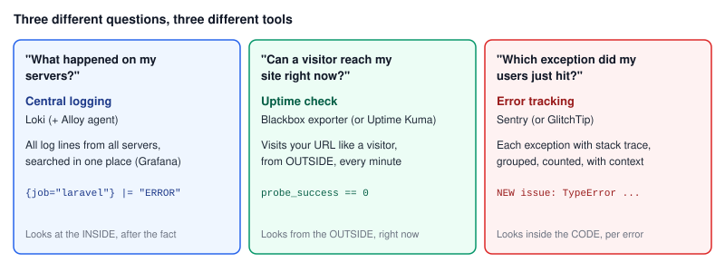

# Chapter 7 — Central Logging, Uptime Checks, and Error Tracking

> **Course:** Monitoring & Logging · **Chapter:** 7 of 8
> Read on the website: [learn.bazardev.com/monitoring/07-central-logging-uptime-and-errors](https://learn.bazardev.com/monitoring/07-central-logging-uptime-and-errors)
>
> 🇧🇩 **Prefer Bangla?** [Read this chapter in Bangla →](https://learn.bazardev.com/monitoring/07-central-logging-uptime-and-errors?lang=bn)

So far you can **measure** (Prometheus), **draw** (Grafana) and **get told** (Alertmanager). Three gaps remain, and each one has its own small tool:



1. You have more than one server (or container), and `ssh` + `grep` on each one is slow. → **Central logging.**
2. Your own monitoring runs *inside* your network. If the whole server is down, it is down too. → **Uptime checks from outside.**
3. A log line says "error", but you want the exception, the stack trace and *how many users it hit*. → **Error tracking.**

> **Honesty note: what was and was not run.** Loki, Grafana Alloy, Blackbox exporter, Sentry and GlitchTip are **not installed on the server used to write this course**, and nothing was installed for them. So everything below is written from the official documentation and is **not executed**; version numbers, menu names and some setting names change, so check the linked docs for yours. What *was* checked: the component names and arguments of the Alloy config, Loki's default port and example config, the LogQL examples, Loki's label guidance, the Blackbox exporter's `/probe` usage and metric names (read from its source code), the Sentry Laravel commands, and that every YAML snippet parses. Every external link was opened. The Alloy snippet uses Alloy's own syntax, which no tool here could parse, so test it on your machine.

## Part A. Central logging

### 1. The problem with `ssh` and `grep`

In Chapter 3 you read logs with `tail` and `grep`. That works for one server. It breaks when:

- You have **several servers or containers**: which one served that failed request?
- A container is **replaced or a server is rebuilt**: its logs are **gone** with it.
- You want to see "all errors **across everything**, in the last hour" on a graph.
- The person investigating should not need **shell access** to production just to read logs.

**Central logging** means every server sends its log lines to **one place**, where you search them together. (This is also a safety gain: if an attacker or an accident wipes a server's files, the copy of its logs is elsewhere.)

### 2. Loki: "Prometheus, but for logs"

**Loki** is Grafana's log system. Its official description: a log aggregation system inspired by Prometheus. Its big idea is cheap storage: Loki "does not index the contents of the logs, but only indexes metadata about your logs", and that metadata is **labels**. Compare with a full-text search engine, which indexes every word and so needs far more disk and memory. With Loki you first narrow down by labels, then Loki scans the matching text.

Since you already know Grafana, there is nothing new to learn for the screen: Loki is added as another **data source**, and you search it in **Explore** or show it in a **Logs** panel (Chapter 5).

The pieces:

| Piece | Job |
|---|---|
| **Your app** | Writes a log file, as in Chapter 3 (`storage/logs/laravel.log`). |
| **Agent: Grafana Alloy** | Runs on each server, reads the log files, adds labels and **pushes** the lines to Loki over HTTP. |
| **Loki** | Stores the lines and answers queries (its default HTTP port is **3100**). |
| **Grafana** | Where you search and draw. |

> **Which agent? Use Alloy, not Promtail.** Older tutorials tell you to use **Promtail**. Grafana's documentation now states "Promtail is end of life (EOL) as of March 2, 2026": no more support or updates, and all new development is in **Grafana Alloy**. Alloy has a tool that converts an old Promtail config to an Alloy one. If you copy a tutorial that uses Promtail, you are copying something that is no longer maintained.

### 3. Getting Loki and Alloy running (a plan, not run here)

Follow Grafana's official install pages ([Loki](https://grafana.com/docs/loki/latest/setup/install/), [Alloy](https://grafana.com/docs/alloy/latest/)) for your system; both can run as a package, or in Docker. For learning, Loki's own repository ships an example config for a single machine with local disk storage, where the important lines are:

```yaml
# from Loki's example config (loki-local-config.yaml), shortened
auth_enabled: false

server:
  http_listen_port: 3100

common:
  path_prefix: /tmp/loki
  storage:
    filesystem:
      chunks_directory: /tmp/loki/chunks
      rules_directory: /tmp/loki/rules
  replication_factor: 1
```

Two warnings about that file: its storage paths are under `/tmp`, so for real use change them to a proper directory (such as `/var/lib/loki`), and `auth_enabled: false` means **Loki asks nobody for a login**. Treat it like Prometheus (Chapter 5): keep port 3100 **private** (listen on the local machine and block it in the firewall, see the Loki configuration reference for the listen address). Servers that send logs from elsewhere should do it over a private network or a VPN, not an open port.

The Alloy configuration that ships a Laravel log to Loki. Alloy uses its own syntax (not YAML). This follows the shape of the official `loki.source.file` example, where each file target must carry a `__path__` label:

```
// /etc/alloy/config.alloy
local.file_match "laravel" {
  path_targets = [{
    "__path__" = "/var/www/shop/storage/logs/*.log",
    "job"      = "laravel",
    "env"      = "production"
  }]
}

loki.source.file "laravel" {
  targets    = local.file_match.laravel.targets
  forward_to = [loki.write.local.receiver]
}

loki.write "local" {
  endpoint {
    url = "http://localhost:3100/loki/api/v1/push"
  }
}
```

Read it as a pipeline: **find the files** (`local.file_match`) → **read them** (`loki.source.file`) → **send them** (`loki.write`). Notes:

- Alloy remembers how far it has read in each file (a "positions" file), so after a restart it carries on, and does not send everything again. For a new file with no stored position it starts from the beginning unless you set `tail_from_end = true`.
- Alloy's user needs **permission to read** the log files. As in the Linux course, the clean way is to add that user to the group that owns the logs, never to make logs world-readable.
- Log **rotation** from Chapter 3 still applies. Check Alloy's documentation on how it handles rotated files before relying on it, and test it once by forcing a rotation.

### 4. Labels: the one rule that matters

Loki's speed depends on keeping the number of different label combinations (each combination is a **stream**) small. Grafana's guidance: use labels for values that are "fixed for a given system/app and have bounded values": the application, the environment, the server, the region. And the warning: "Too many label value combinations leads to too many streams", which makes the index large and queries slow.

So:

| Good labels | Bad labels |
|---|---|
| `job="laravel"`, `env="production"`, `host="web1"` | `user_id`, `order_id`, `request_id`, a trace ID |
| A handful of values each | Values that are different on nearly every line |

Grafana's guide says plainly not to extract ephemeral values like a trace ID or an order ID into a label. That is exactly what you want to *search* for, though: for that you do not use a label, you use a **line filter** (next section), which scans the text.

### 5. LogQL: searching your logs

**LogQL** is Loki's query language, and it deliberately looks like PromQL. A query starts with a **stream selector** in curly braces (the labels), then optional **filters**.

```
{job="laravel", env="production"}                  all production Laravel logs
{job="laravel"} |= "ERROR"                          lines that CONTAIN ERROR
{job="laravel"} |= "ERROR" != "timeout"             ...but not the word timeout
{job="laravel"} |~ "ERROR|CRITICAL"                 lines matching a regular expression
{job="laravel"} | json | level="error"              parse JSON logs (Chapter 3), then filter on a field
```

The operators from the official docs: `=`, `!=`, `=~`, `!~` for **labels** in the selector; `|=`, `!=`, `|~`, `!~` for **text inside the line**. The `| json` parser pulls fields out of a JSON log line at query time, which is why **structured JSON logs (Chapter 3)** pay off here: you can filter on `user_id` without ever making it a label.

You can also turn logs **into numbers**: "metric queries". From the official examples:

```
count_over_time({job="mysql"}[5m])
sum by (host) (rate({job="mysql"} |= "error" != "timeout" [1m]))
```

For a Laravel app, "how many errors per minute?" becomes:

```
sum(rate({job="laravel"} |= "ERROR" [1m]))
```

Put that in a Grafana time series panel and a sudden jump is visible at once. (Loki can also send alerts from queries like this, but for most readers the simpler path is to alert on *metrics* as in Chapter 6, and use logs to investigate.)

### 6. Keep logs under control

- **Logs cost disk.** Decide how long to keep them (for example 14 or 30 days) and configure Loki's retention to match (see its documentation). Keeping everything forever is not a plan.
- **Do not log secrets or personal data** (passwords, tokens, card numbers, full personal details). Central logging copies mistakes to more places and keeps them longer. Chapter 3's rule applies doubly.
- **Control who can read them.** Logs often reveal more than you think (emails, IPs, internal paths). Give Grafana access only to people who need it.

## Part B. Uptime checks

### 7. Why check from the outside

Everything so far looks from the *inside*. Prometheus runs on your server, so if the **whole server loses power or network**, Prometheus is down too, and says nothing. Also the server can be perfectly healthy while visitors **cannot reach the site**: a DNS mistake, an expired certificate, a firewall rule, a crashed web server. The only way to see what a visitor sees is to **act like a visitor**: request the public URL regularly, from somewhere else.

### 8. Blackbox exporter: Prometheus visits your site

The **Blackbox exporter** is made by the Prometheus project. It "probes" a URL (HTTP, HTTPS, TCP, ping and more) and reports the result as metrics. Prometheus scrapes it like any other exporter (Chapter 4). It listens on port **9115**, and you ask it to probe a target with `/probe?target=...&module=...`, for example `http://localhost:9115/probe?target=prometheus.io&module=http_2xx`. The `http_2xx` module means "make an HTTP request and expect a success (2xx) status".

The scrape configuration below has the shape given in the official README. The trick is the `relabel_configs`: they pass the website's address to the exporter as the `target` parameter, but make Prometheus send the request to the **exporter** (`127.0.0.1:9115`):

```yaml
# prometheus.yml (added to scrape_configs)
scrape_configs:
  - job_name: blackbox
    metrics_path: /probe
    params:
      module: [http_2xx]
    static_configs:
      - targets:
          - https://shop.example.com
          - https://shop.example.com/login
    relabel_configs:
      - source_labels: [__address__]
        target_label: __param_target
      - source_labels: [__param_target]
        target_label: instance
      - target_label: __address__
        replacement: 127.0.0.1:9115
```

Now you get these metrics for every URL:

| Metric | Meaning |
|---|---|
| **`probe_success`** | `1` if the check passed, `0` if it failed. The one that matters. |
| `probe_duration_seconds` | How long the whole probe took (a good "is it slow?" signal) |
| `probe_ssl_earliest_cert_expiry` | When the HTTPS certificate expires (as a Unix time). Great for a "renew soon" alert. |

You can also define your own modules in the exporter's own config file. The official example shows options such as `valid_status_codes`, `fail_if_not_ssl`, and **`fail_if_body_matches_regexp`**, which marks the probe failed if the page *contains* a given text. That one is surprisingly useful: a site can return status 200 and still show "Could not connect to database" on the page.

### 9. Alerts for it (using Chapter 6)

```yaml
groups:
  - name: website
    rules:
      - alert: SiteDown
        expr: probe_success{job="blackbox"} == 0
        for: 2m
        labels:
          severity: critical
        annotations:
          summary: "{{ $labels.instance }} is not reachable"

      - alert: CertificateExpiresSoon
        expr: probe_ssl_earliest_cert_expiry{job="blackbox"} - time() < 14 * 24 * 3600
        for: 1h
        labels:
          severity: warning
        annotations:
          summary: "The HTTPS certificate of {{ $labels.instance }} expires in less than 14 days"
```

`SiteDown` is the most valuable alert in this whole course, because it is a **symptom** (Chapter 6): the user cannot reach you. The certificate alert saves you from the classic embarrassment of an expired certificate (Caddy renews them automatically, but an alert tells you if renewal ever quietly fails).

### 10. The honest limit: "outside" must really be outside

A Blackbox exporter running on the *same server* as your website still dies with it. For a true outside view, do one of these:

- Run the Blackbox exporter and Prometheus on a **different machine** (a small second VPS, ideally at another provider).
- Use an **uptime service** that checks your URL from outside and notifies you: a hosted one (many have a free plan; check the current terms), or the open-source **Uptime Kuma** that you host yourself on a different machine.

Remember the "monitor the monitor" idea from Chapter 6: an external check is the simplest protection against your whole monitoring setup going quiet.

## Part C. Error tracking

### 11. Logs tell you "something broke"; error tracking tells you what and who

When your code throws an exception, the log has a line and maybe a stack trace buried in thousands of other lines. An **error tracker** is built for exactly this:

- It receives each exception **with its stack trace** and surrounding **context** (URL, user ID, server, version).
- It **groups** identical errors into one *issue* with a **count** ("this error happened 312 times to 48 users"), instead of 312 separate lines.
- It tells you when an issue is **new**, or comes **back after you fixed it**.

The best-known one is **Sentry**. **GlitchTip** is an open-source alternative you can host yourself; its own site says it works with Sentry's open-source client SDKs, so your code does not change. Both are third-party services: using a hosted one means your error data (which can include personal details) is sent outside your server. Read the privacy settings and decide what you are willing to send.

### 12. Adding Sentry to Laravel

From Sentry's Laravel documentation (the steps for your Laravel version are on that page; the exception hook below is the one for Laravel 11 and newer, in `bootstrap/app.php`; older versions use a different file, and the docs show it):

```bash
composer require sentry/sentry-laravel
php artisan sentry:publish          # creates config/sentry.php (the docs show how to pass your DSN)
php artisan sentry:test             # sends a test exception to your Sentry project
```

```php
// bootstrap/app.php
use Sentry\Laravel\Integration;

->withExceptions(function (Exceptions $exceptions): void {
    Integration::handles($exceptions);
})
```

```
# .env  (never commit this file)
SENTRY_LARAVEL_DSN=https://<key>@<your-sentry-host>/<project-id>
```

- The **DSN** is the address your app sends errors to. Treat it like a secret: it belongs in `.env` or your secret store, not in Git (the CI/CD course covered this).
- Run **`sentry:test`** after setup. An error tracker you never saw receive an error is like an alert you never saw fire (Chapter 6).
- Sentry can also record **performance traces**. That setting (`SENTRY_TRACES_SAMPLE_RATE`) is a fraction of requests to trace; keep it **low** at first, because tracing everything costs both money and speed.
- Tag each report with the **environment** (`production`, `staging`) so a test error on your laptop does not page anyone, and filter out noise you do not care about (for example "404 not found" from bots).

### 13. Do not fire-hose yourself

Error trackers can send a notification for every error. Use the Chapter 6 rules: notify on **new issues** and **regressions** (an old issue returns), not on every occurrence of a known one. Fix or ignore the noisy ones.

## 14. Which tool for which question?

| Your question | Tool | Why |
|---|---|---|
| "Can visitors reach the site *right now*?" | Uptime check (Blackbox / Uptime Kuma) | Looks from outside |
| "Is the server healthy, is something trending badly?" | Prometheus + Grafana | Numbers over time |
| "What did the app say around 14:02?" | Loki logs | Full text, all servers |
| "Which exception, in which line, how many users?" | Sentry / GlitchTip | Grouped, with stack trace |
| "Wake me when it matters" | Alertmanager | Chapter 6 |

None replaces the others. A typical 3 a.m.: **Alertmanager** wakes you (SiteDown) → **Grafana** shows when it started → **Sentry** names the exception → **Loki** shows what happened around it.

## 15. Key takeaways

- `ssh` + `grep` does not scale. **Central logging** sends every server's logs to one place. **Loki** indexes only **labels** (cheap) and you search the text with **LogQL**; **Grafana** is the screen.
- Use **Grafana Alloy** as the agent: **Promtail is end of life** (March 2, 2026).
- **Few, stable labels** (`job`, `env`, `host`); never put user IDs, order IDs or trace IDs in labels. Use `|= "text"` or `| json` instead. Keep Loki's port private; don't log secrets; set retention.
- **Uptime checks must come from outside.** Blackbox exporter gives `probe_success`; alert on it (`SiteDown`) and on certificate expiry. A checker on the same server dies with it.
- **Error tracking** (Sentry, GlitchTip) gives exceptions with stack traces, grouped with counts. Keep the DSN in `.env`, run `sentry:test`, keep trace sampling low, notify only on new and returning issues.
- Four tools, four questions: **outside** (uptime), **numbers** (Prometheus/Grafana), **text** (Loki), **exceptions** (Sentry).

## 16. Test yourself (exam prep)

<details>
<summary><strong>Q1. Give two reasons `ssh` + `grep` stops being enough.</strong></summary>

You have several servers or containers and do not know which one served the request, and logs disappear when a container is replaced or a server rebuilt. Also, you cannot easily graph or search all errors across everything, and people investigating should not need shell access to production.
</details>

<details>
<summary><strong>Q2. What does Loki index, and why does that make it cheap?</strong></summary>

Only the labels (metadata) of each log stream, not the contents of the lines. A small index needs far less disk and memory than indexing every word; queries first narrow down by labels and then scan the matching text.
</details>

<details>
<summary><strong>Q3. Which agent should you use to ship logs to Loki today, and why not the older one?</strong></summary>

Grafana Alloy. Promtail reached end of life on March 2, 2026: no more support or updates, and all new development is in Alloy.
</details>

<details>
<summary><strong>Q4. Why is `order_id` a bad Loki label, and how do you still find one order's logs?</strong></summary>

It has a different value on nearly every line, so it creates a huge number of streams, bloating the index and slowing queries. Search for it with a line filter such as `{job="laravel"} |= "1042"`, or with `| json` on structured logs.
</details>

<details>
<summary><strong>Q5. What is the difference between `{job="laravel"} |= "ERROR"` and `{job="laravel", level="ERROR"}`?</strong></summary>

The first selects the stream by the label `job` and then keeps only lines whose text contains "ERROR" (a line filter). The second needs a label `level` to exist on the stream; labels are for a few stable values, so filtering the text (or parsing JSON) is the usual way.
</details>

<details>
<summary><strong>Q6. Why can Prometheus on the same server not tell you the whole server is down?</strong></summary>

It goes down with the server, so nothing reports the failure. A real uptime check must run from another machine or a separate external service.
</details>

<details>
<summary><strong>Q7. Which Blackbox metric tells you a check passed, and what would you alert on for HTTPS certificates?</strong></summary>

`probe_success` is 1 for success and 0 for failure. For certificates alert when `probe_ssl_earliest_cert_expiry - time()` is less than some number of seconds (for example 14 days).
</details>

<details>
<summary><strong>Q8. Why might a site with status 200 still be "down", and how can a probe notice?</strong></summary>

The page can load with an error message in the body, such as a database connection error. A Blackbox module with `fail_if_body_matches_regexp` marks the probe failed when the body contains that text.
</details>

<details>
<summary><strong>Q9. What does an error tracker give you that a log file does not?</strong></summary>

Each exception with its stack trace and context, grouped into one issue with a count of occurrences and affected users, plus notice when an issue is new or returns after a fix.
</details>

<details>
<summary><strong>Q10. Where should a Sentry DSN be kept, and what should you run after setup?</strong></summary>

In `.env` or a secrets store, never in Git. Run `php artisan sentry:test` to confirm that a test exception really arrives in your project.
</details>

## 17. Free resources

- Loki: [Overview](https://grafana.com/docs/loki/latest/get-started/overview/), [Install](https://grafana.com/docs/loki/latest/setup/install/), [Label best practices](https://grafana.com/docs/loki/latest/get-started/labels/bp-labels/), [LogQL queries](https://grafana.com/docs/loki/latest/query/) and [metric queries](https://grafana.com/docs/loki/latest/query/metric_queries/)
- Promtail's end-of-life notice: [Promtail docs](https://grafana.com/docs/loki/latest/send-data/promtail/)
- Alloy: [documentation](https://grafana.com/docs/alloy/latest/) and [`loki.source.file`](https://grafana.com/docs/alloy/latest/reference/components/loki/loki.source.file/), [GitHub](https://github.com/grafana/alloy)
- [Blackbox exporter](https://github.com/prometheus/blackbox_exporter) (README, configuration, example config)
- [Uptime Kuma](https://github.com/louislam/uptime-kuma) (self-hosted uptime monitor)
- [Sentry for Laravel](https://docs.sentry.io/platforms/php/guides/laravel/) and [GlitchTip](https://glitchtip.com/documentation)

---

**Next:** [Chapter 8 — Real Project: Monitoring a Laravel App](08-real-project-monitoring-a-laravel-app.md)
