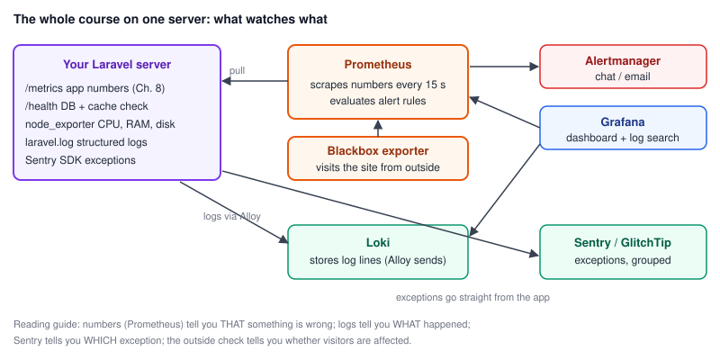

# Chapter 8 — Real Project: Monitoring a Laravel App

> **Course:** Monitoring & Logging · **Chapter:** 8 of 8
> Read on the website: [learn.bazardev.com/monitoring/08-real-project-monitoring-a-laravel-app](https://learn.bazardev.com/monitoring/08-real-project-monitoring-a-laravel-app)
>
> 🇧🇩 **Prefer Bangla?** [Read this chapter in Bangla →](https://learn.bazardev.com/monitoring/08-real-project-monitoring-a-laravel-app?lang=bn)

Time to put the whole course together. We take the Laravel app that you deployed in the Cloud course and give it **eyes and a voice**: numbers, a dashboard, logs, exceptions, an outside check and alerts that wake you only when it matters.



> **Honesty note: what was and was not run.** The **PHP code in this chapter was really run**, on a fresh Laravel 13.40 project (PHP 8.5, SQLite, the built-in PHP web server): the request-counting middleware, the `/metrics` endpoint with its token check, the queue and failed-job gauges, and the `/health` endpoint, including its failure case with a broken database. The outputs shown are real. The Caddyfile snippet was checked with `caddy adapt`, and every YAML snippet parses. **Prometheus, Alertmanager, Grafana, `node_exporter`, Blackbox exporter, Loki, Alloy and Sentry are not installed on the server used to write this course**, so the configuration for them is written from the official documentation (as in Chapters 4 to 7) and is **not executed**. Adjust names, paths and versions for your machine, and do the "fire drill" in section 11 to prove the whole chain works.

## 0. The plan: what do we want to know?

Start from questions, not tools (Chapter 1). For a Laravel shop we want to know:

| Question | Signal | Tool (chapter) |
|---|---|---|
| Can a visitor open the site **right now**? | `probe_success` | Blackbox, from outside (7) |
| Is the app **really healthy** (database, cache)? | `/health` returns 200 | Blackbox probe on `/health` (7, 8) |
| Are users getting **errors**? | share of 5xx responses | App metric (8) + Prometheus (4) |
| Is it **slow**? | average response time | App metric (8) |
| Is **background work** stuck? | jobs waiting, jobs failed | App metric (8) |
| Is the **server** healthy? | CPU, memory, disk | `node_exporter` (2, 4) |
| **What exactly** broke? | exception + stack trace | Sentry (7) |
| **What happened** around 14:02? | structured logs | Loki (3, 7) |
| Wake me **only when it matters** | alert rules | Alertmanager (6) |

You already know every tool. The new part of this chapter is the first row of "(8)": teaching **your own app** to report its numbers.

## 1. Step 1: logs that help (Chapter 3, five minutes)

Do this first, because it costs nothing. In `.env`:

```bash
LOG_CHANNEL=daily
LOG_LEVEL=warning
LOG_DAILY_DAYS=14
```

Add the request-id middleware from Chapter 3 (`Log::shareContext(['request_id' => $id])`), so every line of one request carries the same id, and put the id in an `X-Request-Id` response header. When a customer complains, you ask for that id and `grep` (or search Loki for) it.

## 2. Step 2: a real health check

Laravel (11 and newer) already has a route, **`/up`**, configured in `bootstrap/app.php` (`health: '/up'`). It answers 200 when the application **boots** without an exception. That is useful, but it is a *shallow* check, and we tested exactly how shallow: with the database path deliberately broken, `/up` **still answered 200**. A site whose database is down is not healthy.

So add a **deeper** check that touches the things the app cannot live without:

```php
<?php
// app/Http/Controllers/HealthController.php

namespace App\Http\Controllers;

use Illuminate\Support\Facades\Cache;
use Illuminate\Support\Facades\DB;

class HealthController extends Controller
{
    public function __invoke()
    {
        $checks = [];

        try {
            DB::select('select 1');
            $checks['database'] = 'ok';
        } catch (\Throwable $e) {
            report($e);
            $checks['database'] = 'fail';
        }

        try {
            Cache::put('health-check', 'ok', 10);
            $checks['cache'] = Cache::get('health-check') === 'ok' ? 'ok' : 'fail';
        } catch (\Throwable $e) {
            report($e);
            $checks['cache'] = 'fail';
        }

        $healthy = ! in_array('fail', $checks, true);

        // The word "fail" is in the body only when something is wrong,
        // so a probe can also check the body text (Chapter 7).
        return response()->json(['status' => $healthy ? 'ok' : 'fail'] + $checks, $healthy ? 200 : 503);
    }
}
```

What was run: with a working database, `/health` answered `200` and `{"status":"ok","database":"ok","cache":"ok"}`. With the database path broken it answered **`503`** and `{"status":"fail","database":"fail","cache":"fail"}` (this project's cache is stored in the database too, so both failed), while `/up` on the same broken server still said `200`.

Two design rules:

- **Keep it cheap and fast.** It runs every minute. One `select 1`, one cache write: yes. A full table scan or a call to a slow external API: no (a payment gateway being slow should not make your *own* health check fail).
- **Return the right status code.** A probe judges by the status code (200 vs 503) first; the JSON helps a human.

## 3. Step 3: teach the app to report its numbers

Prometheus (Chapter 4) reads a **text page** with metrics. Your Laravel app can serve that page. There are packages that do this for you (search for "Prometheus" on Packagist and judge by recent releases, downloads and the Laravel versions they support). But the format is so simple that writing a small version yourself is the best way to understand it, and it has no dependencies. We expose five numbers:

| Metric | Type | Why |
|---|---|---|
| `app_http_requests_total{status="..."}` | counter | How many requests, by status code: gives the **error rate** |
| `app_http_request_duration_seconds_sum` and `_count` | counters | Total time and number of requests: gives the **average response time** |
| `app_queue_jobs_waiting` | gauge | Jobs waiting in the queue: **is the worker stuck?** |
| `app_queue_jobs_failed` | gauge | Rows in `failed_jobs`: **is background work failing?** |

(Counters only go up and you graph their `rate()`; gauges go up and down. See Chapter 4.)

### 3a. A middleware that counts

```php
<?php
// app/Http/Middleware/CountRequests.php

namespace App\Http\Middleware;

use Closure;
use Illuminate\Http\Request;
use Illuminate\Support\Facades\Cache;
use Symfony\Component\HttpFoundation\Response;

class CountRequests
{
    public function handle(Request $request, Closure $next): Response
    {
        $request->attributes->set('metrics_start', hrtime(true));

        return $next($request);
    }

    // Runs AFTER the response was sent, so it never slows the visitor down.
    public function terminate(Request $request, Response $response): void
    {
        if ($request->is('metrics', 'up', 'health')) {
            return; // do not count the monitoring requests themselves
        }

        $ms = (int) ((hrtime(true) - $request->attributes->get('metrics_start', hrtime(true))) / 1_000_000);
        $status = $response->getStatusCode();

        // Cache::add sets the key to 0 only if it does not exist yet; increment then adds.
        Cache::add("metrics:http:$status", 0);
        Cache::increment("metrics:http:$status");
        Cache::add('metrics:http:ms', 0);
        Cache::increment('metrics:http:ms', $ms);
    }
}
```

Register it for **every** request in `bootstrap/app.php`:

```php
->withMiddleware(function (Middleware $middleware): void {
    $middleware->append(\App\Http\Middleware\CountRequests::class);
})
```

Why `terminate()`? It runs after the response has gone to the visitor, so the counting costs them nothing. We skip `/metrics`, `/up` and `/health`, so the monitoring itself does not inflate the numbers.

### 3b. The `/metrics` page, protected by a token

```php
<?php
// app/Http/Controllers/MetricsController.php

namespace App\Http\Controllers;

use Illuminate\Http\Request;
use Illuminate\Support\Facades\Cache;
use Illuminate\Support\Facades\DB;
use Illuminate\Support\Facades\Queue;

class MetricsController extends Controller
{
    // Status codes we count. A short, fixed list keeps the label values bounded.
    private const STATUSES = [200, 201, 204, 301, 302, 304, 401, 403, 404, 419, 422, 429, 500, 502, 503];

    public function __invoke(Request $request)
    {
        $token = (string) config('services.metrics_token');

        // No token configured, or the wrong one: pretend the page does not exist.
        abort_unless($token !== '' && hash_equals($token, (string) $request->bearerToken()), 404);

        $lines = [];
        $lines[] = '# HELP app_http_requests_total Requests handled, by status code.';
        $lines[] = '# TYPE app_http_requests_total counter';
        $total = 0;
        foreach (self::STATUSES as $status) {
            $n = (int) Cache::get("metrics:http:$status", 0);
            $total += $n;
            $lines[] = "app_http_requests_total{status=\"$status\"} $n";
        }

        $lines[] = '# HELP app_http_request_duration_seconds_sum Total time spent handling requests.';
        $lines[] = '# TYPE app_http_request_duration_seconds_sum counter';
        $lines[] = 'app_http_request_duration_seconds_sum '.((int) Cache::get('metrics:http:ms', 0) / 1000);
        $lines[] = '# HELP app_http_request_duration_seconds_count Number of requests timed.';
        $lines[] = '# TYPE app_http_request_duration_seconds_count counter';
        $lines[] = "app_http_request_duration_seconds_count $total";

        $lines[] = '# HELP app_queue_jobs_waiting Jobs waiting in the default queue.';
        $lines[] = '# TYPE app_queue_jobs_waiting gauge';
        $lines[] = 'app_queue_jobs_waiting '.Queue::size();

        $lines[] = '# HELP app_queue_jobs_failed Jobs in the failed_jobs table.';
        $lines[] = '# TYPE app_queue_jobs_failed gauge';
        $lines[] = 'app_queue_jobs_failed '.DB::table('failed_jobs')->count();

        return response(implode("\n", $lines)."\n", 200, [
            'Content-Type' => 'text/plain; version=0.0.4; charset=utf-8',
        ]);
    }
}
```

The routes. Monitoring requests need no session or cookies, so we take them out of the `web` group (when we first ran it, `/metrics` was sending session cookies for nothing):

```php
// routes/web.php
Route::withoutMiddleware('web')->group(function () {
    Route::get('/health', \App\Http\Controllers\HealthController::class);
    Route::get('/metrics', \App\Http\Controllers\MetricsController::class);
});
```

And the token, read from configuration (never hard-code it):

```php
// config/services.php  (add one line inside the returned array)
'metrics_token' => env('METRICS_TOKEN'),
```

```bash
# .env  (never commit this file). Make a long random value, for example: openssl rand -hex 32
METRICS_TOKEN=put-a-long-random-value-here
```

**What was run, with real results.** After a few visits (two requests to `/` and one to a missing page), then adding two queued jobs and one row in `failed_jobs`:

```
$ curl -s -o /dev/null -w "%{http_code}\n" http://127.0.0.1:18101/metrics                      # no token
404
$ curl -s -o /dev/null -w "%{http_code}\n" -H "Authorization: Bearer wrong" .../metrics         # wrong token
404
$ curl -s -H "Authorization: Bearer <the token>" .../metrics                                    # right token
# HELP app_http_requests_total Requests handled, by status code.
# TYPE app_http_requests_total counter
app_http_requests_total{status="200"} 2
app_http_requests_total{status="404"} 1
...
app_http_request_duration_seconds_sum 0.148
app_http_request_duration_seconds_count 3
...
app_queue_jobs_waiting 2
app_queue_jobs_failed 1
```

(Only the non-zero lines are shown. `/health`, `/up` and `/metrics` were called in between and are, as designed, **not** counted.)

### 3c. Honest limits of this small version

- **The counters live in the cache.** If you run `php artisan cache:clear` (for example in a deploy script, Cloud course), they **reset to zero**. That is fine: Prometheus's `rate()` copes with counters that restart, as you saw in Chapter 4.
- **Use a fast cache.** With the `database` cache store (as in our test project), each request adds a few small writes. Use **Redis** for production if you have it; `Cache::increment` is made for this.
- **One server.** If you run several web servers behind a load balancer, each should keep its own counters (a local cache) and Prometheus should scrape each one. A shared cache would count requests from all servers together and be scraped several times. When you reach that size, a ready-made package or an agent such as an OpenTelemetry setup is worth the extra complexity.
- **The queue gauge** `Queue::size()` is for the default queue of your default connection. Add other queues the same way.

### 3d. Keep `/metrics` private (two locks)

Metrics reveal traffic, errors and queue sizes. We use **two locks**: the token (above) and, in Caddy, a rule that only the monitoring server may even reach the path. This Caddyfile was checked with `caddy adapt` (203.0.113.10 is a reserved documentation address; use your monitoring server's address):

```
shop.example.com {
	# /metrics is reachable only from the monitoring server
	@metrics_outside {
		path /metrics
		not remote_ip 203.0.113.10
	}
	respond @metrics_outside 404

	root * /var/www/shop/public
	php_fastcgi unix//run/php/php8.3-fpm.sock
	encode gzip
	file_server
}
```

If Prometheus runs on the **same** server as the site, its requests to your public name arrive from that server's own address, so put that address in `remote_ip` instead (check what the access log shows as the source).

## 4. Step 4: the server (Chapters 2 and 4)

Install `node_exporter` on the server (see Chapter 4) so that CPU, memory, disk and network are measured. Keep its port 9100 **private** (firewall), as before.

## 5. Step 5: Prometheus scrapes everything

All the jobs together, in `prometheus.yml`. The new one is `laravel`. Prometheus supports sending a token with each scrape through the `authorization` block, and reading the token from a **file** (`credentials_file`) keeps it out of the config:

```yaml
# /etc/prometheus/prometheus.yml
global:
  scrape_interval: 15s
  evaluation_interval: 15s

rule_files:
  - "rules/*.yml"

alerting:
  alertmanagers:
    - static_configs:
        - targets: ["localhost:9093"]

scrape_configs:
  - job_name: node
    static_configs:
      - targets: ["localhost:9100"]

  - job_name: laravel
    metrics_path: /metrics
    scheme: https
    authorization:
      type: Bearer
      credentials_file: /etc/prometheus/laravel_metrics_token
    static_configs:
      - targets: ["shop.example.com"]

  - job_name: blackbox
    metrics_path: /probe
    params:
      module: [http_2xx]
    static_configs:
      - targets:
          - https://shop.example.com
          - https://shop.example.com/health
    relabel_configs:
      - source_labels: [__address__]
        target_label: __param_target
      - source_labels: [__param_target]
        target_label: instance
      - target_label: __address__
        replacement: 127.0.0.1:9115
```

Put the token in that file (`chmod 600`, owned by the Prometheus user) and **not** in Git. Then check the file before reloading, as in Chapter 6: `promtool check config /etc/prometheus/prometheus.yml`. In Prometheus's **Status → Targets** page, all jobs should show **UP**.

Because `/health` is also probed, `probe_success` for that URL is 0 whenever the app answers 503: you get "database is down" detected from the outside, for free. (You can write a stricter Blackbox module with `fail_if_body_matches_regexp: ["fail"]`, as in Chapter 7.)

## 6. Step 6: alert rules for the app

Reuse Chapter 6's philosophy: **symptoms first, few alerts, `for` to avoid blips**, and a runbook note in each.

```yaml
# /etc/prometheus/rules/laravel.yml
groups:
  - name: laravel-app
    rules:
      # Symptom, critical: visitors cannot open the site (or the health check fails).
      - alert: SiteDown
        expr: probe_success{job="blackbox"} == 0
        for: 2m
        labels:
          severity: critical
        annotations:
          summary: "{{ $labels.instance }} is not reachable or unhealthy"
          runbook: "Check the web server and PHP-FPM, then the database. See /health."

      # Symptom, critical: more than 5% of requests end in a server error.
      - alert: HighErrorRate
        expr: sum(rate(app_http_requests_total{status=~"5.."}[5m])) / sum(rate(app_http_requests_total[5m])) * 100 > 5
        for: 5m
        labels:
          severity: critical
        annotations:
          summary: "{{ $value | printf \"%.1f\" }}% of requests are failing with a server error"
          runbook: "Open Sentry for the new issue, then search Loki for ERROR around the start time."

      # Symptom, warning: pages are slow (average above one second for 10 minutes).
      - alert: SlowResponses
        expr: rate(app_http_request_duration_seconds_sum[5m]) / rate(app_http_request_duration_seconds_count[5m]) > 1
        for: 10m
        labels:
          severity: warning
        annotations:
          summary: "Average response time is {{ $value | printf \"%.2f\" }} s"

      # Warning: background work is piling up (is the queue worker running?).
      - alert: QueueBacklog
        expr: app_queue_jobs_waiting > 100
        for: 10m
        labels:
          severity: warning
        annotations:
          summary: "{{ $value }} jobs are waiting in the queue"
          runbook: "Check that the queue worker is running (systemctl status, see the Cloud course)."

      # Warning: jobs have failed and nobody has looked.
      - alert: FailedJobs
        expr: app_queue_jobs_failed > 0
        for: 15m
        labels:
          severity: warning
        annotations:
          summary: "{{ $value }} failed jobs: run php artisan queue:failed"

      # Warning: the HTTPS certificate is close to expiry (Chapter 7).
      - alert: CertificateExpiresSoon
        expr: probe_ssl_earliest_cert_expiry{job="blackbox"} - time() < 14 * 24 * 3600
        for: 1h
        labels:
          severity: warning
        annotations:
          summary: "The certificate of {{ $labels.instance }} expires in less than 14 days"
```

Together with the five server rules from Chapter 6 (`InstanceDown`, `DiskAlmostFull`, `DiskFullWithin24h`, `MemoryLow`, `HighLoad`) this is a complete, small, *symptom-first* set. Notes:

- **Two criticals about the user** (`SiteDown`, `HighErrorRate`). Everything about causes (disk, memory, queue) is a warning, as Chapter 6 taught.
- The error-rate division returns no data when there is **no traffic** at all (nothing divided by nothing), so a quiet night does not page you. Your `SiteDown` still watches from outside.
- Test each rule with `promtool test rules`, as in Chapter 6. Keep the files in Git (without secrets).

Remember Alertmanager's routing from Chapter 6: `severity="critical"` goes to the loud channel, warnings to the quiet one.

## 7. Step 7: logs to Loki (Chapter 7)

Run Alloy on the server with the config from Chapter 7, pointing at `/var/www/shop/storage/logs/*.log`, with labels `job="laravel"` and `env="production"` only. Then in Grafana **Explore**:

```
{job="laravel"} |= "ERROR"
sum(rate({job="laravel"} |= "ERROR" [1m]))
```

and search for a customer's `request_id` with a line filter (`|= "req-7f3a"`), **not** as a label.

## 8. Step 8: exceptions to Sentry (Chapter 7)

```bash
composer require sentry/sentry-laravel
php artisan sentry:publish
php artisan sentry:test
```

with `Integration::handles($exceptions);` in `bootstrap/app.php` and the DSN in `.env` (`SENTRY_LARAVEL_DSN`). Set the environment name to `production`, keep the trace sample rate low, and notify only on **new** and **returning** issues.

## 9. Step 9: one dashboard, "answers first" (Chapter 5)

Build **one** dashboard called "Shop: is it OK?". Top row = the five-second answer; detail below. Nine panels is plenty:

| Row | Panel | Type | Query (PromQL unless noted) |
|---|---|---|---|
| **Answers** | Site reachable | Stat (1 = UP) | `probe_success{instance="https://shop.example.com"}` |
| | Health check | Stat (1 = OK) | `probe_success{instance="https://shop.example.com/health"}` |
| | Error rate % | Stat, red above 5 | `sum(rate(app_http_requests_total{status=~"5.."}[$__rate_interval])) / sum(rate(app_http_requests_total[$__rate_interval])) * 100` |
| | Cert days left | Stat, red below 14 | `(probe_ssl_earliest_cert_expiry{job="blackbox"} - time()) / 86400` |
| **Trends** | Requests per second by status | Time series | `sum by (status) (rate(app_http_requests_total[$__rate_interval]))` |
| | Average response time (s) | Time series | `rate(app_http_request_duration_seconds_sum[$__rate_interval]) / rate(app_http_request_duration_seconds_count[$__rate_interval])` |
| | Queue: waiting and failed | Time series | `app_queue_jobs_waiting` and `app_queue_jobs_failed` |
| **Server** | CPU, memory, disk % | Gauges | the three queries from Chapter 5 |
| **Logs** | Recent errors | Logs (Loki) | `{job="laravel"} \|= "ERROR"` |

Export it as JSON and keep it in Git with provisioning (Chapter 5). Add **annotations** for deploys, so "it broke right after the deploy" is visible.

## 10. What if the monitoring needs monitoring?

Apply Chapter 6's last warning. Prometheus and Alertmanager run on the same server in this simple setup, so an **outside** check is essential: either run Blackbox (and ideally Prometheus) on a **second machine**, or add a free external uptime service (or Uptime Kuma on another machine) watching `https://shop.example.com/health`. A test message to your phone that you receive when you **break something on purpose** (next section) is worth more than any amount of configuration.

## 11. The fire drill: prove it works

Monitoring you have never seen react is a guess. On a **test or staging copy** (not on the live shop during business hours), do these, and write down what you saw:

| Break this | Expect to see | Within |
|---|---|---|
| Stop PHP-FPM (`systemctl stop php8.3-fpm`) | `SiteDown` pending, then firing, message in chat; dashboard stat turns red | about 3 minutes |
| Make the database unreachable | `/health` returns 503; `SiteDown` fires (probe on `/health`) | about 3 minutes |
| Throw an exception on one route | A **new issue** in Sentry; error lines in Loki | seconds |
| Return errors on many requests (a route that always fails, hit in a loop) | `HighErrorRate` fires after about 5 minutes | about 6 minutes |
| Stop the queue worker, dispatch 150 jobs | `QueueBacklog` after 10 minutes | about 11 minutes |
| `systemctl stop` the monitoring itself | The **outside** check tells you | per your setup |

Then **start everything again** and make sure each alert **resolves** and you get the "resolved" message. Finally, write a **runbook**: for each alert, three lines (what it means, what to check first, who to call). The `runbook` annotation above is where you link it.

## 12. Key takeaways

- Start from **questions**; every tool in this course answers one: Prometheus (numbers), Grafana (pictures), Loki (log text), Sentry (exceptions), Blackbox (the outside view), Alertmanager (who gets told).
- **Laravel's `/up` is shallow**: it said 200 even with the database broken. Add a **deeper `/health`** that touches the database and cache, returns **503** on failure and stays cheap.
- Your app can serve **its own metrics** in Prometheus's text format: a middleware counts requests in `terminate()` (after the response), a token-protected `/metrics` prints counters and queue gauges. Keep labels **few and bounded**.
- **Protect `/metrics` twice** (a secret token, and a Caddy rule limiting it to the monitoring server). Token in `.env` or a file, never in Git.
- Alert on **user-visible symptoms** (site down, error rate), keep resource problems as **warnings**, give every alert a **runbook** note.
- One **answers-first dashboard**, kept as code in Git.
- Counters in the cache reset on `cache:clear`: `rate()` copes. Use Redis; single-server design; packages exist for bigger setups.
- **Run a fire drill.** Break things on purpose in staging and watch every alert fire **and resolve**.

## 13. Test yourself (exam prep)

<details>
<summary><strong>Q1. Why is Laravel's `/up` route not enough as a health check?</strong></summary>

It only shows that the application boots. In our test it still answered 200 with the database broken. A deeper health route should touch the database and cache and return 503 when something fails.
</details>

<details>
<summary><strong>Q2. Why count requests in `terminate()` instead of `handle()`?</strong></summary>

`terminate()` runs after the response has been sent to the visitor, so the counting costs them no waiting time.
</details>

<details>
<summary><strong>Q3. Why does the code skip `/metrics`, `/up` and `/health` when counting?</strong></summary>

So the monitoring's own requests (every few seconds) do not inflate the request counts and distort the error rate and traffic graphs.
</details>

<details>
<summary><strong>Q4. How is `/metrics` protected, and what does a request with a wrong token get?</strong></summary>

By a secret token in `.env` compared with `hash_equals` against the bearer token, and by a web-server rule that only lets the monitoring server reach the path. A wrong or missing token gets a 404, as if the page did not exist.
</details>

<details>
<summary><strong>Q5. Why is the status-code list in the metrics controller fixed instead of using whatever codes occur?</strong></summary>

To keep the number of label values small and bounded (a cardinality rule from Chapters 4 and 7), so the metric cannot grow without limit.
</details>

<details>
<summary><strong>Q6. What happens to the counters when you run `php artisan cache:clear`, and why is that acceptable?</strong></summary>

They restart from zero. Prometheus's `rate()` handles a counter that resets, so graphs and alerts stay correct.
</details>

<details>
<summary><strong>Q7. Which alerts in this chapter are `critical`, and why only those?</strong></summary>

`SiteDown` and `HighErrorRate`: they describe what users feel right now. Causes such as slow responses, queue backlog, failed jobs and certificate expiry are warnings that can wait until working hours.
</details>

<details>
<summary><strong>Q8. How do you give Prometheus the `/metrics` token without writing it in the config?</strong></summary>

Use the `authorization` block of the scrape job with `credentials_file`, pointing to a file (permissions 600) that holds the token.
</details>

<details>
<summary><strong>Q9. Why run a "fire drill", and what do you check besides the alert firing?</strong></summary>

Monitoring you have never seen react cannot be trusted. Break things on purpose in staging, confirm each alert fires and the message arrives, then confirm it resolves, and write a runbook for each alert.
</details>

<details>
<summary><strong>Q10. Why must some check come from outside the server in this setup?</strong></summary>

Prometheus and Alertmanager run on the same server, so if the whole machine or its network dies they die too and send nothing. An outside check (a second machine or an external uptime service) notices the silence.
</details>

## 14. Free resources

- Laravel docs: [Deployment](https://laravel.com/docs/13.x/deployment), [Queues](https://laravel.com/docs/13.x/queues) and [Logging](https://laravel.com/docs/13.x/logging)
- Prometheus: [Exposition formats (the text page)](https://prometheus.io/docs/instrumenting/exposition_formats/), [scrape configuration](https://prometheus.io/docs/prometheus/latest/configuration/configuration/) (`authorization`, `credentials_file`)
- [Blackbox exporter](https://github.com/prometheus/blackbox_exporter), [Alerting best practices](https://prometheus.io/docs/practices/alerting/)
- Caddy: [`remote_ip` matcher](https://caddyserver.com/docs/caddyfile/matchers#remote-ip) and [`php_fastcgi`](https://caddyserver.com/docs/caddyfile/directives/php_fastcgi)
- [Sentry for Laravel](https://docs.sentry.io/platforms/php/guides/laravel/)
- Earlier chapters of this course for Grafana, Loki and Alertmanager

---

**Next:** the Monitoring & Logging final exam, on the website, once you have passed all eight chapter quizzes.
