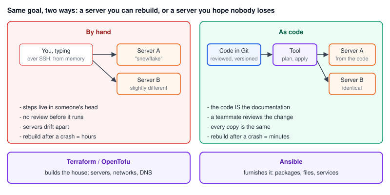

# Chapter 1 — Why Infrastructure as Code? Terraform and Ansible in One Picture

> **Course:** Infrastructure as Code & Ansible · **Chapter:** 1 of 8
> Read on the website: [learn.bazardev.com/iac/01-why-infrastructure-as-code](https://learn.bazardev.com/iac/01-why-infrastructure-as-code)
>
> 🇧🇩 **Prefer Bangla?** [Read this chapter in Bangla →](https://learn.bazardev.com/iac/01-why-infrastructure-as-code?lang=bn)

In the Cloud course you created a server by clicking in a web console, then logged in over SSH and typed commands until the app ran. It worked. Now imagine the server dies tonight, or your boss says "we need three more, identical to that one, by Friday". Could you rebuild it **exactly**? From memory? This course teaches the answer: write the setup down as **code**, so a tool can build it for you, again and again, the same way every time.

> **Honesty note: what was and was not run.** Terraform, OpenTofu and Ansible are **not installed on the server used to write this course**, and nothing was installed for it. So the code in this chapter is **illustrative and not executed**: it only shows the *shape* of each tool, and each tool is taught properly, with its real commands, in the later chapters. What *was* checked: the definitions below were read from the official Terraform, Ansible and OpenTofu documentation, the YAML snippet parses as valid YAML (by a tool), and every external link was opened. Nothing here touches a real cloud account or costs money.



## 1. A story you will recognise

You set up the production server a year ago. You installed PHP, tweaked a config file, added a cron job, opened a firewall port, and fixed one odd permission problem at midnight. None of it was written down, because it "just worked".

Now you need a second server for staging. You try to repeat the steps, but you forget the midnight permission fix. Staging behaves differently from production, and a bug appears in one but not the other. Nobody can say why, because **nobody knows exactly what is on the production server**. It has become a *snowflake*: unique, fragile, and impossible to copy.

## 2. The problem with doing it by hand

| Problem | What it looks like |
|---|---|
| **Not repeatable** | Every new server is slightly different, because a human forgot a step |
| **Not documented** | The real setup lives in someone's memory and shell history |
| **Not reviewable** | Nobody can check a change before it happens; a typo goes straight to production |
| **Slow to recover** | When the server dies, rebuilding takes hours of remembering |
| **Drift** | Over time people tweak things directly, and the server slowly stops matching any description of it |

## 3. The idea: Infrastructure as Code (IaC)

**Infrastructure as Code** means describing your servers, networks, software and settings in **text files**, and letting a tool read those files and make the real world match.

The files are plain text, so you get everything you already know from software development:

- **Git history**: who changed what, when, and why
- **Code review**: a teammate reads the change *before* it runs
- **Copy and reuse**: the same files build staging and production
- **Rebuild on demand**: a dead server is replaced by running the code again

The Git course and the CI/CD course apply here directly: infrastructure code goes through branches and pull requests exactly like application code.

## 4. Declarative vs imperative

There are two ways to tell a computer what to do:

| Style | You say | Example |
|---|---|---|
| **Imperative** | **How**: the exact steps, in order | "Run `apt install git`, then edit this file, then restart that service" |
| **Declarative** | **What**: the end result you want | "Git is installed; this file has this content; the service is running" |

The official Terraform documentation describes its configurations as *declarative*: they "describe the end state of your infrastructure". You describe the result and the tool works out the steps. Ansible playbooks are also written to describe the **state you want** a system to be in.

A shell script is the classic imperative approach. Run it twice and it may fail on the second run ("user already exists") or do something twice. A declarative tool compares *what you want* with *what exists* and changes only the difference.

## 5. Idempotency: running it twice is safe

A very important word: **idempotent**. An operation is idempotent if doing it **once or ten times gives the same result**.

The Ansible documentation puts it this way: running a playbook against a system that is already in the described state changes nothing, "even if the playbook runs multiple times".

This is what makes IaC safe. You do not need to remember "did I already run this?". You run it again, and only what is missing or different gets fixed. The same idea lets you **repair drift**: run the code, and the server is pulled back to what the code says.

## 6. Two tools, two jobs

You will meet two tools. This course teaches **Ansible** properly; **Terraform** has its own course on this site. They are **not rivals**. They do different jobs, and real projects often use both.

| | **Terraform** (and OpenTofu) | **Ansible** |
|---|---|---|
| **Main job** | **Provisioning**: creating the infrastructure itself (servers, networks, firewalls, DNS records, databases) | **Configuration**: setting up what runs *on* a machine (packages, config files, users, services) |
| **House analogy** | Builds the house: walls, rooms, doors | Furnishes the house: beds, lights, kitchen |
| **How it talks** | Through a cloud provider's API, using a *provider* plugin | Over **SSH**, with **no agent** installed on the target machine |
| **Language** | Its own configuration language (HCL) | YAML playbooks |
| **Remembers things?** | Yes: it keeps a **state file** of what it created | No state file: it checks the machine each time |

From the official docs: Terraform is "an infrastructure as code tool that lets you build, change, and version cloud and on-prem resources". Terraform shows an **execution plan** (what it will create, update or destroy) and, **on approval**, performs it. Ansible is described as **agentless**: it connects over SSH with existing credentials, so nothing extra needs installing on managed machines.

A simple way to remember: **Terraform makes the server exist. Ansible makes the server useful.** The boundary is not strict (Ansible can create cloud servers too, and Terraform can run some setup commands), but this split is the common, clean one, and it is the one this course follows.

### A note on OpenTofu

In 2023 HashiCorp moved Terraform from an open-source license to the *Business Source License (BUSL)*. In response, a group of companies started **OpenTofu**, an open-source **fork** of Terraform, now under the Linux Foundation. Per its FAQ it aims to keep **feature parity** with Terraform and works with existing Terraform providers. For a learner, the ideas, the language and the workflow are the same. This course says "Terraform" and notes where OpenTofu is different. Check each tool's license against your own use before choosing one for work.

## 7. A first taste of the code (just the shape)

You do **not** need to understand every line yet. Look at the *shape*: both are short, readable, and describe a result.

**Terraform** (declares *a server should exist*): illustrative only, the image ID is a placeholder.

```hcl
resource "aws_instance" "web" {
  ami           = "ami-0123456789abcdef0"   # placeholder, not a real image
  instance_type = "t3.micro"
}
```

**Ansible** (declares *a package should be installed*):

```yaml
- name: Set up the web server
  hosts: web
  become: true
  tasks:
    - name: Git is installed
      ansible.builtin.apt:
        name: git
        state: present
```

Read the Ansible part aloud: "On the hosts called `web`, as an administrator, make sure the package `git` is **present**." The word `present` is the declarative idea in one word: you do not say "install"; you say what must be true. If Git is already there, nothing happens.

Chapters 2-4 teach Ansible properly. Terraform is taught in its own course, which is coming soon.

## 8. What IaC does *not* fix

- **It is not magic.** The code can be wrong. A bad rule applied to ten servers breaks ten servers faster. This is why *review* and a *plan/dry-run step* matter, and you will use both.
- **It needs discipline.** If people still change servers by hand, the code and reality drift apart. The rule is: **change the code, not the server.**
- **Secrets need care.** Never put passwords or keys in the code you commit. Chapter 4 covers Ansible Vault, and the Terraform course covers keeping secrets out of Terraform code and state.
- **It is another thing to learn.** For one small server that never changes, a written checklist can be enough. IaC pays off as soon as you need a **second** copy, or a **repeatable** rebuild.

## 9. Your roadmap

| Chapter | You will learn |
|---|---|
| 2 | Ansible basics: inventory and ad-hoc commands |
| 3 | Ansible playbooks, modules, handlers, idempotency |
| 4 | Ansible roles, templates, and Vault for secrets |
| 5 | Ansible variables, facts, conditions, and `register` |
| 6 | Ansible roles for a Laravel stack: PHP, Caddy, MySQL |
| 7 | Running Ansible safely: tags, limits, lint, and CI |
| 8 | Real project: a Laravel server, built with Ansible |

Terraform has its own course, **Terraform**, which is coming soon. It covers providers, `plan` and `apply`, state, modules, and, in its last chapter, building a server with Terraform and configuring it with Ansible.

## 10. Self-check

<details>
<summary><strong>Q1. What is a "snowflake server", and why is it a problem?</strong></summary>

A server whose exact setup only exists in the server itself (and someone's memory), because it was built by hand and changed over time. It cannot be reliably copied or rebuilt, and nobody knows precisely what is on it.
</details>

<details>
<summary><strong>Q2. What does "Infrastructure as Code" mean?</strong></summary>

Describing servers, networks and software in text files that a tool reads to make the real infrastructure match, so the setup can be versioned in Git, reviewed, reused and rebuilt.
</details>

<details>
<summary><strong>Q3. Declarative vs imperative: which one says "what" and which says "how"?</strong></summary>

Declarative says **what** end state you want. Imperative says **how**, as an exact list of steps.
</details>

<details>
<summary><strong>Q4. What does "idempotent" mean, and why does it matter for IaC?</strong></summary>

Running the operation once or many times gives the same result. It makes IaC safe to re-run, because only what is missing or different is changed, and it lets you repair drift.
</details>

<details>
<summary><strong>Q5. In one sentence each, what do Terraform and Ansible mainly do?</strong></summary>

Terraform **provisions** the infrastructure (creates servers, networks, DNS and so on). Ansible **configures** what runs on a machine (packages, files, users, services).
</details>

<details>
<summary><strong>Q6. What does "agentless" mean for Ansible?</strong></summary>

Nothing extra has to be installed on the machines being managed. Ansible connects to them over SSH using existing credentials.
</details>

<details>
<summary><strong>Q7. What is OpenTofu?</strong></summary>

An open-source fork of Terraform, started after Terraform's license changed to BUSL and now under the Linux Foundation. It aims for feature parity with Terraform and works with existing Terraform providers.
</details>

<details>
<summary><strong>Q8. What is the golden rule once you use IaC?</strong></summary>

Change the code, not the server. Hand edits on the server cause drift, and the code stops describing reality.
</details>

## 11. Free resources

- Terraform docs: [What is Terraform?](https://developer.hashicorp.com/terraform/intro)
- Ansible docs: [Introduction to Ansible](https://docs.ansible.com/ansible/latest/getting_started/introduction.html)
- OpenTofu: [FAQ](https://opentofu.org/faq/)

---

**Next:** [Chapter 2 — Ansible Basics: Inventory and Ad-hoc Commands](02-ansible-basics.md)
