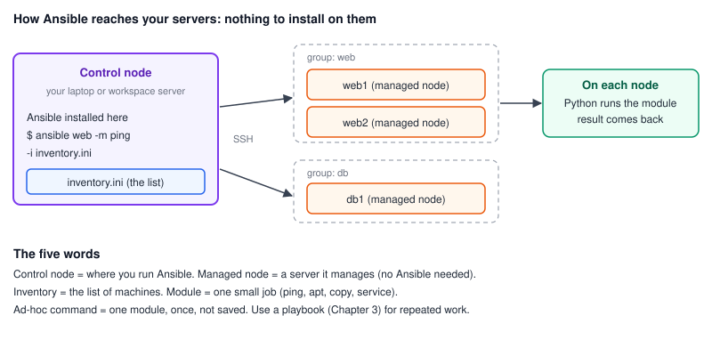

# Chapter 2 — Ansible Basics: Inventory and Ad-hoc Commands

> **Course:** Infrastructure as Code & Ansible · **Chapter:** 2 of 8
> Read on the website: [learn.bazardev.com/iac/02-ansible-basics](https://learn.bazardev.com/iac/02-ansible-basics)
>
> 🇧🇩 **Prefer Bangla?** [Read this chapter in Bangla →](https://learn.bazardev.com/iac/02-ansible-basics?lang=bn)

Chapter 1 gave you the idea. Now you meet the first tool. In this chapter you will tell Ansible **which machines** to manage (the *inventory*) and run **one-off commands** on all of them at once (*ad-hoc commands*). By the end you can answer "is the disk full on all five of my servers?" with a single line.

> **Honesty note: what was and was not run.** Ansible is **not installed on the server used to write this course**, and nothing was installed for it. So every command and file below is written from the official Ansible documentation and is **not executed here**. What *was* checked: the command forms (`ansible-inventory -i inventory.ini --list`, `ansible myhosts -m ping -i inventory.ini`, the ad-hoc flags, the Ubuntu install commands, the `ansible.cfg` search order) were read from the official docs, the YAML inventory below parses as valid YAML (by a tool), and every external link was opened. Output blocks are **copied in shape from the docs**, not from a run on a real machine, and your IP addresses and versions will differ. Treat the first run on your own machines as the real test, and start with a practice machine, never production.



## 1. The vocabulary (five words)

| Word | Meaning |
|---|---|
| **Control node** | The machine where you run Ansible, usually your laptop or a workspace server. It needs Ansible installed. |
| **Managed node** | A server Ansible manages. It needs **no Ansible installed** (Chapter 1: *agentless*). |
| **Inventory** | A file listing the managed nodes, and grouping them (web servers, database servers). |
| **Module** | A small tool that does one job on a managed node: install a package, copy a file, restart a service. |
| **Ad-hoc command** | A one-line `ansible ...` command that runs **one module** once. Fast, but not saved or reusable. |

The flow is simple: you run a command on the control node; Ansible reads the inventory to find the machines, connects to each over **SSH**, runs the module there, and shows you the result.

## 2. What you need first

The official docs give these requirements:

- **Control node:** "nearly any UNIX-like machine with Python installed". **Windows is supported only through WSL** (the Windows Subsystem for Linux). It is not supported natively.
- **Managed node:** a user account that can connect over **SSH** with an interactive POSIX shell, and **Python** on the node, because Ansible runs Python code there. (A few modules, such as network modules, are exceptions.) Ansible itself does **not** need to be installed on the managed node.

So before Ansible, make sure you can already log in to your servers with an **SSH key**. That is covered in the Linux course (SSH chapter) and the Cloud course (your first VPS). The Ansible quick-start also expects your public key to be in each host's `authorized_keys`. Test it first with plain SSH:

```bash
ssh deploy@192.0.2.50
```

If that does not log you in without a password prompt for your account, fix it first. Ansible cannot do better than SSH.

## 3. Installing Ansible on the control node

The docs describe more than one way. Two common ones:

**With `pipx`** (the docs call it a widely available alternative when `pip` is restricted by the OS):

```bash
pipx install --include-deps ansible
```

**On Ubuntu, with the Ansible PPA** (the docs say the PPA has more recent versions than Ubuntu's standard repositories):

```bash
sudo apt update
sudo apt install software-properties-common
sudo add-apt-repository --yes --update ppa:ansible/ansible
sudo apt install ansible
```

These need `sudo`, because they change the system's package sources. Read each line before you run it, as always. Then check it worked:

```bash
ansible --version
```

(Package names, versions and the exact output vary by system.)

## 4. The inventory file

An inventory is a list of your machines. The simplest form is an **INI** file. The docs' quick-start uses a group named `myhosts`:

```ini
[myhosts]
192.0.2.50
192.0.2.51
192.0.2.52
```

The addresses `192.0.2.x` are reserved for documentation, so they are safe examples. Put your own server IPs or domain names there. Save it as `inventory.ini`.

**Check the inventory** before you use it. This only reads the file, so it is safe:

```bash
ansible-inventory -i inventory.ini --list
```

### Groups: put machines in meaningful boxes

Real projects have different kinds of servers. Groups let you target them separately. The docs suggest grouping by **what** (web, db), **where** (region) and **when** (staging, production). Group names are case sensitive and the docs advise avoiding spaces, hyphens and leading numbers, so use `web_servers`, not `web-servers`.

```ini
[web]
web1.example.com
web2.example.com

[db]
db1.example.com

[production:children]
web
db
```

`[production:children]` makes `production` a group **of groups**. The docs recommend putting each group under only one parent, so variable inheritance stays predictable.

### The YAML form, and giving hosts friendly names

When the list grows, the docs say YAML becomes sensible. The same hosts, with a friendly name each, and `ansible_host` holding the real address:

```yaml
myhosts:
  hosts:
    my_host_01:
      ansible_host: 192.0.2.50
    my_host_02:
      ansible_host: 192.0.2.51
    my_host_03:
      ansible_host: 192.0.2.52
```

### Variables: which user, which address

An inventory can also carry **variables**. Two are used constantly:

| Variable | Meaning |
|---|---|
| `ansible_host` | The real address to connect to, so the host can have a logical name like `webserver01` |
| `ansible_user` | The SSH user to log in as |

Variables can be set on one host, or for a whole group with `vars:`. The docs' example sets one user for every host in `webservers`:

```yaml
webservers:
  hosts:
    webserver01:
      ansible_host: 192.0.2.140
      http_port: 80
    webserver02:
      ansible_host: 192.0.2.150
      http_port: 443
  vars:
    ansible_user: my_server_user
```

Never put passwords in an inventory you commit to Git. Chapter 4 teaches Ansible Vault for secrets.

### Practising on your own machine

You do not need a second server to practise. Ansible can target the machine it runs on, using the `local` connection instead of SSH. A one-line inventory such as `localhost ansible_connection=local` does that (see the Ansible docs on connection plugins for details). It is a safe place to try ad-hoc commands, as long as you stay with read-only ones such as `ping` and `setup`.

## 5. Your first command: ping

With the inventory ready, the docs' first test is:

```bash
ansible myhosts -m ping -i inventory.ini
```

Read it left to right:

| Part | Meaning |
|---|---|
| `ansible` | the ad-hoc command |
| `myhosts` | **the pattern**: which hosts or group to run on (`all` means every host) |
| `-m ping` | **module**: use the `ping` module |
| `-i inventory.ini` | **inventory**: which file lists the machines |

A good result looks like this for each host (shape from the docs):

```
192.0.2.50 | SUCCESS => {
    "ansible_facts": {
        "discovered_interpreter_python": "/usr/bin/python3"
    },
    "changed": false,
    "ping": "pong"
}
```

Two things to notice. `"ping": "pong"` is **not** a network ping (ICMP). It means Ansible logged in over SSH and could run Python on the host, which is exactly what you need before anything else works. And `"changed": false` means the command changed nothing on the machine. If your username differs between the control node and the managed nodes, add `-u username` to the command, or set `ansible_user` in the inventory.

If the first connection asks you to confirm the host's fingerprint, that is SSH doing its normal job. Compare the fingerprint as you learned in the SSH chapter. Do not turn host checking off just to make the message go away.

## 6. Ad-hoc commands: the pattern

The general form from the docs is:

```
ansible [pattern] -m [module] -a "[module options]"
```

| Flag | Meaning |
|---|---|
| `-m` | The module to use. If you leave it out, the default is `ansible.builtin.command` |
| `-a` | The module's options, as `key=value` pairs |
| `-i` | Which inventory file to read |
| `-u` | Connect as this user |
| `--become` | Escalate privileges, like `sudo` on the remote machine. Add `--ask-become-pass` (or `-K`) to be asked for the password |
| `-f` | How many machines to work on in parallel (the docs say the default is five) |
| `-C` or `--check` | **Check mode**: report what *would* change, without changing anything |

### Useful examples (adapted from the docs)

Run a command everywhere (the default module is `command`):

```bash
ansible web -i inventory.ini -a "uptime"
```

Copy a file to the machines:

```bash
ansible web -i inventory.ini -m ansible.builtin.copy -a "src=/etc/hosts dest=/tmp/hosts"
```

Install a package on Ubuntu or Debian (the docs show `yum` for Red Hat family systems; on Ubuntu the matching module is `apt`):

```bash
ansible web -i inventory.ini --become -m ansible.builtin.apt -a "name=git state=present"
```

Start or restart a service (the docs use `httpd`; the name differs per system):

```bash
ansible web -i inventory.ini --become -m ansible.builtin.service -a "name=caddy state=restarted"
```

Show everything Ansible knows about each machine (called **facts**: OS, memory, IP addresses):

```bash
ansible web -i inventory.ini -m ansible.builtin.setup
```

Notice the `state=` words: `present`, `restarted`, `started`, `stopped`, `absent`. They are the declarative idea from Chapter 1. You say what should be true, and Ansible changes only what it must. The docs say ad-hoc commands use the same declarative, idempotent model as playbooks.

### `command` versus `shell`

- `ansible.builtin.command` is the default. It does **not** understand pipes (`|`) or redirects (`>`).
- `ansible.builtin.shell` runs through a shell, so use it when you need pipes or redirects.
- **Quotes matter.** In `ansible web -m ansible.builtin.shell -a 'echo $TERM'` the single quotes let the **remote** machine expand `$TERM`. Double quotes would let **your** machine expand it first.

## 7. Safe habits for ad-hoc commands

An ad-hoc command can change many servers in one keystroke, so build habits early:

1. **Start narrow.** Run on one group, or one host, before `all`. Practise on a test machine first.
2. **Read-only first.** `ping`, `setup` and `uptime` change nothing. Learn on those.
3. **Use check mode for changes.** Add `-C` to see what *would* change before it does. (The docs use it like this: `ansible all -m copy -a "content=foo dest=/root/bar.txt" -C`. Note that not every module can predict its result in check mode.)
4. **Be careful with `--become`.** It runs with administrator rights. A reboot or a removed package on `all` hits every server at once.
5. **Remember ad-hoc is not saved.** The docs call these commands "not reusable". If you will do it again, write a playbook. That is Chapter 3.

## 8. `ansible.cfg`: stop typing `-i` every time

Typing `-i inventory.ini` gets old. Ansible reads settings from a configuration file. The docs list where it looks, in this order, and uses the **first** one it finds:

1. the `ANSIBLE_CONFIG` environment variable, if set
2. `ansible.cfg` in the **current directory**
3. `~/.ansible.cfg`
4. `/etc/ansible/ansible.cfg`

A project-level `ansible.cfg` next to your inventory is the usual choice, because it travels with the project in Git:

```ini
[defaults]
inventory = inventory.ini
```

Now `ansible web -m ping` works with no `-i`. One security note from the docs: Ansible will **not** load a config file from the current directory if that directory is **world-writable**, so a stranger cannot slip in a config. The `ansible-config` command can list every available setting, where it comes from, and its default.

## 9. A first checklist you can reuse

1. Can I `ssh` to the machine with my key? (If not, stop here.)
2. Is it listed in the inventory, in the right group? (`ansible-inventory -i inventory.ini --list`)
3. Does `ansible <group> -m ping` say `pong`?
4. For a change: did I run it with `-C` first, on a **small** group?
5. Will I need this again? Then it belongs in a playbook (Chapter 3).

## 10. Self-check

<details>
<summary><strong>Q1. What is the difference between a control node and a managed node?</strong></summary>

The control node is where you run Ansible, and it has Ansible installed. Managed nodes are the servers it manages, and they need no Ansible installed, only SSH access and Python.
</details>

<details>
<summary><strong>Q2. What is an inventory?</strong></summary>

A file that lists the machines Ansible manages and groups them, for example into web and db, optionally with variables such as `ansible_host` and `ansible_user`.
</details>

<details>
<summary><strong>Q3. What does `"ping": "pong"` in the output mean?</strong></summary>

Not a network ping. It means Ansible connected over SSH and could run Python on that host, so the machine is ready to be managed.
</details>

<details>
<summary><strong>Q4. Read this command: `ansible web -i inventory.ini --become -m ansible.builtin.apt -a "name=git state=present"`</strong></summary>

On the hosts in group `web`, from the file `inventory.ini`, with administrator rights, use the `apt` module to make sure the package `git` is present. If Git is already installed, nothing changes.
</details>

<details>
<summary><strong>Q5. What does `-C` (`--check`) do?</strong></summary>

Check mode. It reports what would change without changing anything, so you can preview a change first.
</details>

<details>
<summary><strong>Q6. When should you use `shell` instead of `command`?</strong></summary>

When you need shell features such as pipes or redirects, which the default `command` module does not support.
</details>

<details>
<summary><strong>Q7. Why are ad-hoc commands not enough for repeated work?</strong></summary>

They run one module once and are not saved or reusable. Repeated or multi-step work belongs in a playbook.
</details>

<details>
<summary><strong>Q8. In which order does Ansible look for `ansible.cfg`?</strong></summary>

The `ANSIBLE_CONFIG` environment variable, then `ansible.cfg` in the current directory, then `~/.ansible.cfg`, then `/etc/ansible/ansible.cfg`. It uses the first one found.
</details>

## 11. Free resources

- Ansible docs: [Building an inventory](https://docs.ansible.com/ansible/latest/getting_started/get_started_inventory.html)
- Ansible docs: [Introduction to ad-hoc commands](https://docs.ansible.com/ansible/latest/command_guide/intro_adhoc.html)
- Ansible docs: [Installing Ansible](https://docs.ansible.com/ansible/latest/installation_guide/intro_installation.html) and [on specific operating systems](https://docs.ansible.com/projects/ansible/latest/installation_guide/installation_distros.html)
- Ansible docs: [Configuring Ansible](https://docs.ansible.com/ansible/latest/reference_appendices/config.html)

---

**Next:** [Chapter 3 — Ansible Playbooks: Modules, Handlers, and Idempotency](03-ansible-playbooks.md)
