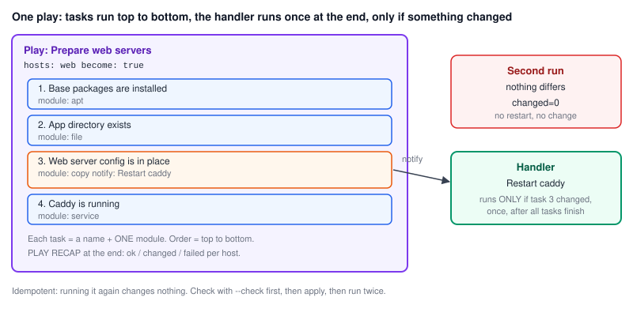

# Chapter 3 — Ansible Playbooks: Modules, Handlers, and Idempotency

> **Course:** Infrastructure as Code (Terraform & Ansible) · **Chapter:** 3 of 8
> Read on the website: [learn.bazardev.com/iac/03-ansible-playbooks](https://learn.bazardev.com/iac/03-ansible-playbooks)
>
> 🇧🇩 **Prefer Bangla?** [Read this chapter in Bangla →](https://learn.bazardev.com/iac/03-ansible-playbooks?lang=bn)

In Chapter 2 you ran one-line **ad-hoc** commands. They are quick, but nothing is saved, so you cannot repeat them, review them, or put them in Git. A **playbook** fixes that. It is a YAML file that lists what you want, in order, and Ansible makes the machines match. This is the file that finally lets you say "rebuild that server" and mean it.

> **Honesty note: what was and was not run.** Ansible is **not installed on the server used to write this course**, and nothing was installed for it. So the playbooks and commands below are written from the official Ansible documentation and are **not executed here**. What *was* checked: the playbook structure, the `ansible-playbook` flags (`--check`, `--diff`, `--syntax-check`, `--list-tasks`, `--verbose`), the module parameters (`apt`, `file`, `copy`, `command`), the handler rules (`notify`, run once at the end of the play, only when changed, `flush_handlers`), the variable rules and `become` were read from the official docs, every YAML block below parses as valid YAML (by a tool), and every external link was opened. The **output blocks are illustrative in shape**, taken from the docs' sample, not from a real run, and your numbers will differ. Whether a playbook works on **your** servers is something to prove on a practice machine first, using the safe steps in section 8.



## 1. From ad-hoc to playbook

| | Ad-hoc command | Playbook |
|---|---|---|
| **Where it lives** | Typed in the terminal | A YAML file in Git |
| **Steps** | One module, once | Many tasks, in order |
| **Reusable?** | No (the docs call ad-hoc commands "not reusable") | Yes, run it any time |
| **Reviewable?** | No | Yes, through a pull request |

A playbook is, in the docs' words, an **ordered list of plays**. Each play "executes part of the overall goal of the playbook, running one or more tasks". Plays and tasks run **top to bottom**.

## 2. Your first playbook

The official quick-start playbook is tiny. With indentation shown properly:

```yaml
- name: My first play
  hosts: myhosts
  tasks:
    - name: Ping my hosts
      ansible.builtin.ping:

    - name: Print message
      ansible.builtin.debug:
        msg: Hello world
```

Run it with:

```bash
ansible-playbook -i inventory.ini playbook.yaml
```

Read the structure, because every playbook has the same four layers:

| Layer | In the file | Meaning |
|---|---|---|
| **Play** | the `- name: My first play` item | One block of work aimed at one set of machines |
| **hosts** | `hosts: myhosts` | Which inventory hosts or group this play targets (a *pattern*, as in Chapter 2) |
| **tasks** | `tasks:` | The ordered list of jobs |
| **Task** | each `- name: ...` under `tasks` | One job: a `name` (a label for humans) plus **one module** and its options |

Always give every task a `name`. It is what you read in the output when something fails at 2 a.m.

### Reading the output

The docs' sample output has this shape:

```
PLAY [My first play] ****

TASK [Gathering Facts] ****
ok: [192.0.2.50]

TASK [Ping my hosts] ****
ok: [192.0.2.50]

TASK [Print message] ****
ok: [192.0.2.50] => {
    "msg": "Hello world"
}

PLAY RECAP ****
192.0.2.50: ok=3    changed=0    unreachable=0    failed=0    skipped=0    rescued=0    ignored=0
```

`Gathering Facts` is an automatic first task that collects information about each machine (the same facts as the `setup` module in Chapter 2). The **PLAY RECAP** at the end is a one-line summary per host. Learn to read it first:

| Word | Meaning |
|---|---|
| `ok` | The task ran and the machine was already right (or it gave a result) |
| `changed` | The task **changed** something on the machine |
| `failed` / `unreachable` | Something is wrong. Read the red text above it |
| `skipped` | A condition said "not needed here" |

## 3. A real playbook: preparing a web server

Here is a playbook that does real, useful setup. Read it as a recipe. It assumes Caddy is already installed (as in the Cloud course) and that you have a `files/Caddyfile` next to the playbook.

```yaml
- name: Prepare web servers
  hosts: web
  become: true
  vars:
    app_dir: /var/www/myapp
    packages:
      - git
      - unzip

  tasks:
    - name: Base packages are installed
      ansible.builtin.apt:
        name: "{{ packages }}"
        state: present
        update_cache: true
        cache_valid_time: 3600

    - name: App directory exists
      ansible.builtin.file:
        path: "{{ app_dir }}"
        state: directory
        mode: '0755'

    - name: Web server config is in place
      ansible.builtin.copy:
        src: files/Caddyfile
        dest: /etc/caddy/Caddyfile
        mode: '0644'
        backup: true
      notify: Restart caddy

    - name: Caddy is running
      ansible.builtin.service:
        name: caddy
        state: started

  handlers:
    - name: Restart caddy
      ansible.builtin.service:
        name: caddy
        state: restarted
```

Read the task names aloud: "Base packages **are** installed. App directory **exists**. Caddy **is** running." Every name states a **result**, not an action. That is the declarative style from Chapter 1.

### The modules you just used

| Module | What it does | The parameters used above (from the docs) |
|---|---|---|
| `ansible.builtin.apt` | Manages packages on Debian and Ubuntu | `name` takes a **list** of packages. `state: present` is the default. `update_cache` runs the equivalent of `apt-get update`. `cache_valid_time` (seconds) skips the update if the cache is newer than that. |
| `ansible.builtin.file` | Manages files, directories and links | `path`, `state` (`directory`, `absent`, `touch`, ...), `mode`, `owner`, `group`. |
| `ansible.builtin.copy` | Copies a file **from the control node** to the machine | `src`, `dest`, `mode`, `owner`, `group`, `backup`. It replaces the remote file only when the contents differ. |
| `ansible.builtin.service` | Starts, stops or restarts a service | `name`, `state` (`started`, `stopped`, `restarted`). |

**Quote the `mode`.** The docs advise quoting octal numbers, such as `'0644'`, for consistent results. An unquoted number can be read the wrong way.

**`backup: true`** on `copy` saves a timestamped copy of the old file before replacing it. A cheap safety net when you change a live config.

## 4. Idempotency, shown properly

Run the playbook above on a fresh server. Most tasks report `changed`: packages installed, directory created, config copied. Run it again straight away. Nothing needs doing, so the recap shows `changed=0`. This is the **idempotency** from Chapter 1, and it is what you check to know a playbook is healthy:

```
# first run on a fresh server (illustrative shape)
192.0.2.50: ok=5    changed=4    ...

# second run, nothing left to do
192.0.2.50: ok=5    changed=0    ...
```

The docs explain why: most modules "check whether the desired state already exists and make no changes if it does", so "repeating the task does not change the final state". They also warn that **"not all playbooks and not all modules behave this way"**, so test before relying on repeated runs in production.

### The trap: `command` and `shell`

The `ansible.builtin.command` and `shell` modules run a raw command. Ansible cannot tell whether the command *needed* to run, so by default it just runs it every time and reports `changed`. That breaks the `changed=0` test. Two fixes:

1. **Use a real module** whenever one exists (`apt` instead of `command: apt install`). This is almost always the best answer.
2. If you truly need `command`, add `creates` or `removes`. Per the docs, with `creates`, "if a matching file already exists, this step will not be run":

```yaml
- name: Create the database once
  ansible.builtin.command: /usr/bin/make_database.sh db_user db_name creates=/path/to/database
```

The docs also say `command` does **not** go through a shell, so `*`, `<`, `>`, `|`, `;` and `&` will not work there. For those, use `ansible.builtin.shell`.

## 5. Handlers: do it only when something changed

Look back at the config task. It has `notify: Restart caddy`. The **handler** named `Restart caddy` sits in the `handlers:` section. How handlers behave, from the docs:

- A handler is a task that **only runs when notified**.
- It runs **only if the task that notified it reported `changed`**. If the Caddyfile already matched, nothing happens, so Caddy is **not** restarted for no reason.
- By default handlers run **after all the tasks in the play** have finished.
- Notified several times, a handler still runs **once**.
- Handlers run in the order they are **defined** in `handlers:`, not the order in `notify`.

This is exactly what you want for "restart the service after its config changed". You can also force notified handlers to run earlier with a task `meta: flush_handlers`, and a handler can subscribe to a topic name with `listen`.

## 6. Variables

You already used some. Variables remove repeated values, so a path or a package list is written **once**.

```yaml
vars:
  app_dir: /var/www/myapp
```

Use a variable with double curly braces: `{{ app_dir }}`. Four rules from the docs:

1. **Quote a value that starts with `{{`.** `name: "{{ packages }}"` and `app_path: "{{ base_path }}/22"` need quotes. Without them YAML fails with `Syntax Error while loading YAML`.
2. **Names** may contain only letters, numbers and underscores, and cannot start with a number. They cannot be Python or playbook keywords such as `async` or `environment`.
3. **Play `vars`** are visible only to tasks in that play. `vars_files:` loads variables from an external YAML file, which keeps values out of the playbook itself.
4. **Extra vars** passed on the command line with `-e` have the **highest** precedence of all the places a variable can come from. The docs list 22 levels, so when a value is "not what I set", precedence is the first place to look.

Never put passwords in plain variables you commit to Git. Chapter 4 covers Ansible Vault.

## 7. `become`: running as administrator

Installing packages needs root. In a playbook you ask for it with `become: true`, either on the **play** (as above, so every task escalates) or on a single **task**:

```yaml
- name: Ensure the web service is running
  ansible.builtin.service:
    name: caddy
    state: started
  become: true
```

`become_user` chooses the account to escalate to; the default is `root`, and the docs note it does **not** imply `become: true`. On the command line, `--become` (or `-b`) and `--ask-become-pass` (or `-K`) exist, and `-K` only asks for the password, it does not turn escalation on by itself. Keep `become` as narrow as you can: if only two tasks need root, put it on those two.

## 8. Running safely: check before you apply

Make these your habit, in this order. All flags below are listed in the docs' "Verifying playbooks" section:

```bash
ansible-playbook -i inventory.ini web.yml --syntax-check   # is the YAML/structure valid?
ansible-playbook -i inventory.ini web.yml --list-tasks     # what would run, in what order
ansible-playbook -i inventory.ini web.yml --check          # report what WOULD change, change nothing
ansible-playbook -i inventory.ini web.yml --check --diff   # ...and show the text differences
ansible-playbook -i inventory.ini web.yml                  # now really apply
ansible-playbook -i inventory.ini web.yml                  # second run: expect changed=0
```

The docs say that in check mode, "instead of implementing any modifications, Ansible provides a report on the changes it would have made." Two cautions: not every module can predict its result in check mode (a task using `command` without `creates` is skipped), and a dry run is not a guarantee. Use `--verbose` to see detailed output from tasks, and `-f 10` to work on 10 machines in parallel. And as in Chapter 2: practise on a test machine, start with a small group.

## 9. YAML survival tips

YAML is unforgiving about spaces, and playbooks are YAML.

- **Indent with spaces, never tabs.** Use 2 spaces per level, and keep it consistent.
- A list item starts with `- `. Tasks are a list.
- `key: value` needs a space after the colon.
- Quote values that could be misread: `'0644'`, and anything starting with `{{`.
- If `--syntax-check` complains, the problem is almost always an indentation line near the one it names.

## 10. Self-check

<details>
<summary><strong>Q1. Why use a playbook instead of ad-hoc commands for repeated work?</strong></summary>

A playbook is a saved YAML file: repeatable, reviewable in Git, and able to run many tasks in order. Ad-hoc commands run one module once and are not reusable.
</details>

<details>
<summary><strong>Q2. What are the four layers of a playbook?</strong></summary>

A play (a block of work), its `hosts` (which machines), its `tasks` (an ordered list), and each task (a name plus one module with options).
</details>

<details>
<summary><strong>Q3. Why should a task be named "Caddy is running" rather than "Start Caddy"?</strong></summary>

It describes the desired result, which matches the declarative, idempotent style: Ansible only acts if the machine is not already like that.
</details>

<details>
<summary><strong>Q4. You run a playbook twice. What should the second PLAY RECAP show, and what does it prove?</strong></summary>

`changed=0`. It proves the playbook is idempotent: the first run brought the machine to the desired state, so the second run had nothing to do.
</details>

<details>
<summary><strong>Q5. Why can a task using `command` break idempotency, and what are two fixes?</strong></summary>

Ansible cannot tell whether a raw command needed to run, so it runs it every time and reports `changed`. Use a real module where one exists, or add `creates` or `removes` so the command is skipped when the result already exists.
</details>

<details>
<summary><strong>Q6. When does a handler run, and how many times?</strong></summary>

Only when a task that notifies it reports `changed`, by default after all the tasks in the play have finished, and only once even if notified several times.
</details>

<details>
<summary><strong>Q7. Why must you write `name: "{{ packages }}"` with quotes?</strong></summary>

A YAML value that starts with `{{` must be quoted, otherwise YAML cannot tell a variable from the start of a dictionary and fails with a syntax error.
</details>

<details>
<summary><strong>Q8. Name the safe order of commands before applying a playbook.</strong></summary>

`--syntax-check`, then `--list-tasks`, then `--check` (and `--diff`), then the real run, then a second run that should show `changed=0`, always starting on a practice machine or a small group.
</details>

## 11. Free resources

- Ansible docs: [Creating a playbook](https://docs.ansible.com/ansible/latest/getting_started/get_started_playbook.html) and [Ansible playbooks](https://docs.ansible.com/ansible/latest/playbook_guide/playbooks_intro.html)
- Ansible docs: [Handlers](https://docs.ansible.com/ansible/latest/playbook_guide/playbooks_handlers.html)
- Ansible docs: [Using variables](https://docs.ansible.com/ansible/latest/playbook_guide/playbooks_variables.html) and [Understanding privilege escalation: become](https://docs.ansible.com/ansible/latest/playbook_guide/playbooks_privilege_escalation.html)
- Module pages: [apt](https://docs.ansible.com/ansible/latest/collections/ansible/builtin/apt_module.html), [file](https://docs.ansible.com/ansible/latest/collections/ansible/builtin/file_module.html), [copy](https://docs.ansible.com/ansible/latest/collections/ansible/builtin/copy_module.html), [command](https://docs.ansible.com/ansible/latest/collections/ansible/builtin/command_module.html)

---

**Next:** [Chapter 4 — Ansible Roles, Templates, and Vault for Secrets](04-ansible-roles-templates-and-vault.md)
