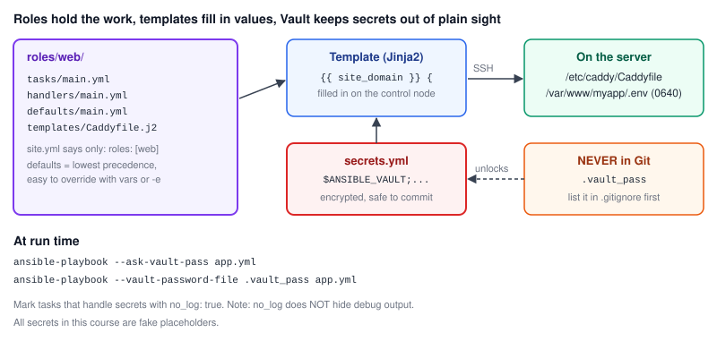

# Chapter 4 — Ansible Roles, Templates, and Vault for Secrets

> **Course:** Infrastructure as Code (Terraform & Ansible) · **Chapter:** 4 of 8
> Read on the website: [learn.bazardev.com/iac/04-ansible-roles-templates-and-vault](https://learn.bazardev.com/iac/04-ansible-roles-templates-and-vault)
>
> 🇧🇩 **Prefer Bangla?** [Read this chapter in Bangla →](https://learn.bazardev.com/iac/04-ansible-roles-templates-and-vault?lang=bn)

Your Chapter 3 playbook worked, but real projects grow. One long file becomes hard to read. The same config differs slightly between servers. And sooner or later you need a **password** in the setup, which must never sit in plain text in Git. This chapter gives you the three tools for those three problems:

| Problem | Tool |
|---|---|
| One huge playbook, copy-pasted tasks | **Roles**: a standard folder layout that packages related work |
| The same file with small differences per server | **Templates**: one file with blanks, filled in per machine |
| Passwords and keys in the setup | **Vault**: encrypt secrets so they are safe in Git |

> **Honesty note: what was and was not run.** Ansible is **not installed on the server used to write this course**, and nothing was installed for it. So the files and commands below are written from the official Ansible and Jinja2 documentation and are **not executed here**. What *was* checked: the role folder layout and execution order, the `template` module parameters (`src`, `dest`, `mode`, `validate` with `%s`), the Jinja2 delimiters, the `loop` syntax, the `ansible-vault` commands (`create`, `encrypt`, `encrypt_string`, `view`, `edit`, `decrypt`, `rekey`), the ways to supply the vault password, the password-file rules and the `no_log` advice were read from the official docs, every YAML block parses as valid YAML (by a tool), and every external link was opened. **Every secret in this chapter is a fake placeholder.** No real password, key or `.env` was used or created. Prove each step on a practice machine, with throwaway secrets, before you trust it with a real one.



## 1. Roles: a folder layout for reusable work

A **role** is a standard way to package related tasks, files, templates and variables, so a playbook can say "this server is a `web` server" in one line. The docs give the layout. Each role needs **at least one** of these directories, and you leave out any you do not use:

```
roles/
    web/
        tasks/        # main.yml: the tasks the role runs
        handlers/     # main.yml: the role's handlers
        templates/    # Jinja2 templates (.j2)
        files/        # static files for copy
        defaults/     # main.yml: low-precedence variables (easy to override)
        vars/         # main.yml: high-precedence variables
        meta/         # main.yml: dependencies and Galaxy metadata
```

| Folder | What goes in it |
|---|---|
| `tasks/main.yml` | The task list the role adds to the play |
| `handlers/main.yml` | Handlers (restart this service). They are imported into the play that uses the role |
| `defaults/main.yml` | The role's **settings**, with "very low precedence": anything else overrides them |
| `vars/main.yml` | High-precedence role variables, for values that should not be overridden casually |
| `templates/` and `files/` | The role's own template and static files, found without long paths |
| `meta/main.yml` | Role dependencies. Not needed just to use a role |

None of these files is mandatory. The docs note that a role holding only `files/something.txt` is still valid. (`ansible-galaxy` is Ansible's client for sharing roles, and the docs describe it as providing a default framework for creating your own. See its help for the exact command.)

**Rule of thumb for variables:** put every setting a user might want to change in `defaults/main.yml`. That is the easiest place to override, and it documents the role's knobs in one file.

### A small `web` role

`roles/web/defaults/main.yml` is the role's settings:

```yaml
site_domain: example.com
app_dir: /var/www/myapp
php_version: "8.3"
```

`roles/web/tasks/main.yml` is the work (note the `loop`, explained in section 3):

```yaml
- name: App directory exists
  ansible.builtin.file:
    path: "{{ app_dir }}"
    state: directory
    mode: '0755'

- name: Shared directories exist
  ansible.builtin.file:
    path: "{{ item }}"
    state: directory
    mode: '0755'
  loop:
    - "{{ app_dir }}/storage"
    - "{{ app_dir }}/releases"

- name: Web server config is in place
  ansible.builtin.template:
    src: Caddyfile.j2
    dest: /etc/caddy/Caddyfile
    owner: root
    group: root
    mode: '0644'
    backup: true
  notify: Restart caddy

- name: Caddy is running
  ansible.builtin.service:
    name: caddy
    state: started
```

`roles/web/handlers/main.yml`:

```yaml
- name: Restart caddy
  ansible.builtin.service:
    name: caddy
    state: restarted
```

### Using the role

The playbook becomes very short. The `roles:` keyword is the classic way, and roles run in the order you list them:

```yaml
- name: Web servers
  hosts: web
  become: true
  roles:
    - web
```

The docs give the order of execution for a play: `pre_tasks`, then each role in `roles:` (listed order, with role dependencies first), then the play's own `tasks`, then handlers, then `post_tasks`. Ansible searches for roles in a `roles/` directory **next to the playbook** first, among other places, so keeping `roles/` beside `site.yml` just works.

Other ways to use a role: `import_role` (static) and `include_role` (dynamic, can be conditional) as a task, or as a `dependencies` entry in `meta/main.yml`.

### Overriding a role's settings

Because `defaults/` has the **lowest** precedence, you can override from the play, the inventory, or the command line:

```yaml
- name: Web servers
  hosts: web
  become: true
  vars:
    site_domain: shop.example.com
  roles:
    - web
```

Per the docs, play `vars` rank above role defaults, and extra vars (`-e site_domain=...`) beat everything.

## 2. Templates: one file, many servers

Chapter 3 used `copy`, which sends the **same** file everywhere. But a web server config differs by domain and path. The `ansible.builtin.template` module sends a file that is first **filled in** using variables. The docs: "Templates are processed by the Jinja2 templating language", and "all templating happens on the Ansible control node before the task is sent and executed on the target machine."

The parameters you will use (from the docs): `src` (the template, on the control node, UTF-8), `dest` (where it is written on the machine), `owner`, `group`, `mode` (quote octal values), `backup`, and `validate`.

### Jinja2 in one minute

A template is an ordinary text file with three kinds of markers (from the Jinja2 docs):

| Marker | Purpose |
|---|---|
| `{{ ... }}` | **Expression**: print a value |
| `` | **Statement**: `for` loops, `if` conditions |
| `{# ... #}` | **Comment**: not included in the output |

`roles/web/templates/Caddyfile.j2`:

```text
{# Managed by Ansible: edit the template, not this file #}
{{ site_domain }} {
    root * {{ app_dir }}/public

    encode gzip

    php_fastcgi unix//run/php/php{{ php_version }}-fpm.sock
    file_server
}
```

Three things to notice. `{{ site_domain }}` is replaced by the variable's value. The `if` block includes `encode gzip` only when `enable_gzip` is true. And the `default` filter, which per the Jinja2 docs returns the given default **if the value is undefined**, makes `enable_gzip` optional: the role does not fail when nobody set it. The `.j2` file extension is only a naming habit, not a rule.

A `for` loop works the same way, for repeating a line for each item in a list:

```text

allow {{ ip }}

```

Caddyfile blocks use single `{` `}` braces, which Jinja2 ignores. Take care only if your file contains `{{`, `{%` or `{#`, which Jinja2 reads as its own markers. Extra blank lines may appear where `` lines were; Caddy does not mind them.

### `validate`: do not install a broken config

The `template` module has a `validate` option: "the validation command to run before copying the updated file into the final destination", where the temporary file is passed in through `%s`. If validation fails, the bad file is **not** copied over the good one. The docs' own example protects SSH, where a broken config could lock you out:

```yaml
- name: Update sshd configuration safely, avoid locking yourself out
  ansible.builtin.template:
    src: etc/ssh/sshd_config.j2
    dest: /etc/ssh/sshd_config
    owner: root
    group: root
    mode: '0600'
    validate: /usr/sbin/sshd -t -f %s
    backup: yes
```

For other programs, look in *their* docs for a "check the config" command, and test it on a practice machine before using it as a `validate` line.

## 3. Loops: the same task for a list

You already saw `loop` in the `web` role. The docs' form is:

```yaml
- name: Add several users
  ansible.builtin.user:
    name: "{{ item }}"
    state: present
  loop:
    - testuser1
    - testuser2
```

Each entry becomes `{{ item }}` in turn. For a list of dictionaries, use `{{ item.name }}` and so on. Quote `"{{ item }}"` as Chapter 3 taught. The docs say the older `with_<lookup>` forms are not deprecated and remain valid, but they recommend `loop` for most cases. Note that `apt` already accepts a **list** in `name`, so you rarely need a loop for packages.

## 4. Vault: secrets that are safe in Git

Your setup needs secrets: database passwords, API keys. The golden rule from Chapter 1 still stands: **never commit them in plain text.** Ansible's answer is **Vault**: "a way to encrypt and manage sensitive data such as passwords." You encrypt a file or a single value with a **vault password**, commit the *encrypted* result, and supply the password only when you run Ansible.

### Two things you can encrypt

| What | How | Trade-off (from the docs) |
|---|---|---|
| **A whole file** | `ansible-vault encrypt` / `create` | It hides the values **and the variable names**. Any content, including tasks, can be encrypted this way. |
| **One value** | `ansible-vault encrypt_string` | The surrounding file stays easy to read, but you can only encrypt the value, not other content. |

Also remember: "Ansible cannot know if it needs content from an encrypted file unless it decrypts the file", so a run that touches an encrypted file needs the password.

### The commands

Every command below is from the docs. **Use a throwaway file and a fake password to practise.**

```bash
ansible-vault create secrets.yml           # make a new encrypted file (asks for a new password, opens your editor)
ansible-vault encrypt secrets.yml          # encrypt an existing plain file
ansible-vault view secrets.yml             # read it without keeping a plain copy
ansible-vault edit secrets.yml             # change it in place
ansible-vault decrypt secrets.yml          # turn it back into plain text (be careful)
ansible-vault rekey secrets.yml            # change the vault password
```

Inside `secrets.yml`, after `create`, you type ordinary YAML. A **fake** value:

```yaml
vault_db_password: not-a-real-password
```

On disk the file is now unreadable ciphertext. For a single value, the docs show:

```bash
ansible-vault encrypt_string --vault-password-file a_password_file 'foobar' --name 'the_secret'
```

**Three warnings from the docs, read them twice:**

1. "Typing secret content directly at the command line (without a prompt) leaves the secret string in your **shell history**." Prefer the prompt form, or the `--stdin-name` form that reads the value from standard input. (When you use the prompt, the docs say not to press Enter after the string.)
2. **Your editor can leak secrets** through plaintext backup or swap files, because Vault opens a normal editor. The docs give settings for vim and Emacs to turn those off. Check yours.
3. **Mistyped passwords at a prompt are a common cause of accidental mismatches** (the docs suggest `rekey` to fix one). Type carefully, and keep the real password in a password manager, because without it the encrypted data cannot be read.

### Giving Ansible the password at run time

From the docs, three ways:

```bash
ansible-playbook --ask-vault-pass site.yml                              # type it when asked
ansible-playbook --vault-password-file /path/to/my/vault-password-file site.yml   # read it from a file
ansible-playbook --vault-id dev@prompt site.yml                         # a labelled vault ID: label@source
```

The password file is **one line of text** holding the password. It can also be an **executable script** that prints the password, which is how teams plug in a secrets manager. You can set a default file with the `DEFAULT_VAULT_PASSWORD_FILE` config option or the `ANSIBLE_VAULT_PASSWORD_FILE` environment variable.

The rules for a password file, from the docs:

- "Make sure the permissions on the file are appropriate." Only you should be able to read it (for example `chmod 600`).
- **"Do not add password files to source control."** Put its name in `.gitignore` before it exists, so a careless `git add .` cannot take it.

Vault IDs (`label@source`) let you use **different passwords** for different environments, for example `dev` and `prod`. The docs warn the label is only a hint by default: Ansible does not enforce that you use the same password every time for a label.

### Using the secret in a playbook

Load the encrypted file with `vars_files`, then use the variable like any other. A Laravel-style example that writes a `.env` from templates and a vaulted password (all values are fake):

```yaml
- name: App configuration
  hosts: web
  become: true
  vars_files:
    - secrets.yml
  tasks:
    - name: App env file is in place
      ansible.builtin.template:
        src: env.j2
        dest: /var/www/myapp/.env
        owner: root
        group: www-data
        mode: '0640'
      no_log: true
```

And `env.j2`:

```text
APP_ENV=production
DB_PASSWORD={{ vault_db_password }}
```

Run it with `ansible-playbook --ask-vault-pass app.yml`. The `.env` on the server is **not** encrypted (the application must read it), so the permissions `0640` with group `www-data` matter: only root and the web server's group can read it.

A convention many teams use, which is a habit and **not** an Ansible rule: prefix vaulted names (`vault_db_password`) and keep a normal variable pointing at them (`db_password: "{{ vault_db_password }}"`), so you can still search your code for where each secret is used.

### `no_log`: do not print secrets in the output

Ansible prints task results. If a task handles a secret, mark it `no_log: true` (as above). The docs: "To keep sensitive values out of your logs, mark tasks that expose them with the `no_log: True` attribute." Know its limit: the docs state that **`no_log` does not affect debugging output**, so be careful not to debug playbooks in production, and never leave a `debug` task printing a secret.

## 5. A project you could commit

Put it together. Everything below can go in Git **except** the password file:

```text
iac-demo/
  ansible.cfg           # [defaults] inventory = inventory.ini
  inventory.ini
  site.yml              # hosts: web, roles: [web]
  app.yml               # the vault-using play above
  secrets.yml           # ENCRYPTED with ansible-vault
  roles/
    web/
      defaults/main.yml
      tasks/main.yml
      handlers/main.yml
      templates/Caddyfile.j2
  .gitignore            # contains: .vault_pass
```

Before you ever run `git add`, check that `secrets.yml` shows as `$ANSIBLE_VAULT;...` when you open it, and that `.vault_pass` is listed in `.gitignore`. A fast self-test: open the file as plain text and try to read the password.

## 6. Checklist

1. Is each repeated block of work a role, with settings in `defaults/main.yml`?
2. Do values that differ per server live in variables and a template, not in copies of a file?
3. Is every secret in a Vault-encrypted file (or `encrypt_string` value), never plain?
4. Is the vault password file in `.gitignore`, readable only by me?
5. Does every task that touches a secret have `no_log: true`?
6. Did I run `--syntax-check`, then `--check --diff`, then apply, then a second run showing `changed=0` (Chapter 3)?

## 7. Self-check

<details>
<summary><strong>Q1. What is a role, and what is it for?</strong></summary>

A standard folder layout (tasks, handlers, templates, files, defaults, vars, meta) that packages related work so a playbook can reuse it in one line.
</details>

<details>
<summary><strong>Q2. Where should settings that users may want to change go, and why?</strong></summary>

In `defaults/main.yml`, because defaults have the lowest precedence and are the easiest to override, and they document the role's settings in one place.
</details>

<details>
<summary><strong>Q3. What is the difference between `copy` and `template`?</strong></summary>

`copy` sends the same file everywhere. `template` first fills a Jinja2 file with variables on the control node, so each machine can get a slightly different result.
</details>

<details>
<summary><strong>Q4. What do `{{ }}`, `` and `{# #}` mean in a Jinja2 template?</strong></summary>

An expression that prints a value, a statement such as a `for` or `if`, and a comment that is not included in the output.
</details>

<details>
<summary><strong>Q5. What does `validate` do on the `template` module?</strong></summary>

It runs a check command on the rendered temporary file (passed as `%s`) before the file is copied into place, so a broken config does not replace a working one.
</details>

<details>
<summary><strong>Q6. Name two things Vault can encrypt, and a trade-off between them.</strong></summary>

A whole file or a single value. Encrypting a whole file also hides the variable names and can cover tasks; encrypting one value keeps the file readable but covers only that value.
</details>

<details>
<summary><strong>Q7. Give three rules for the vault password file.</strong></summary>

It holds the password as one line (or is an executable script that prints it), its permissions must be restrictive, and it must never be added to source control (list it in `.gitignore`).
</details>

<details>
<summary><strong>Q8. What does `no_log: true` do, and what is its limit?</strong></summary>

It keeps a task's sensitive values out of Ansible's output and logs. It does not affect debugging output, so do not debug in production or print secrets with `debug`.
</details>

## 8. Free resources

- Ansible docs: [Roles](https://docs.ansible.com/ansible/latest/playbook_guide/playbooks_reuse_roles.html)
- Ansible docs: [template module](https://docs.ansible.com/ansible/latest/collections/ansible/builtin/template_module.html) and [Templating (Jinja2)](https://docs.ansible.com/ansible/latest/playbook_guide/playbooks_templating.html)
- Ansible docs: [Loops](https://docs.ansible.com/ansible/latest/playbook_guide/playbooks_loops.html)
- Jinja2: [Template designer documentation](https://jinja.palletsprojects.com/en/stable/templates/)
- Ansible Vault: [Vault guide](https://docs.ansible.com/ansible/latest/vault_guide/index.html), [Encrypting content](https://docs.ansible.com/ansible/latest/vault_guide/vault_encrypting_content.html), [Using encrypted content](https://docs.ansible.com/ansible/latest/vault_guide/vault_using_encrypted_content.html), [Managing vault passwords](https://docs.ansible.com/ansible/latest/vault_guide/vault_managing_passwords.html)
- Ansible docs: [Logging and `no_log`](https://docs.ansible.com/ansible/latest/reference_appendices/logging.html)

---

**Next:** [Chapter 5 — Terraform Basics: Providers, Resources, Plan and Apply](05-terraform-basics.md)
