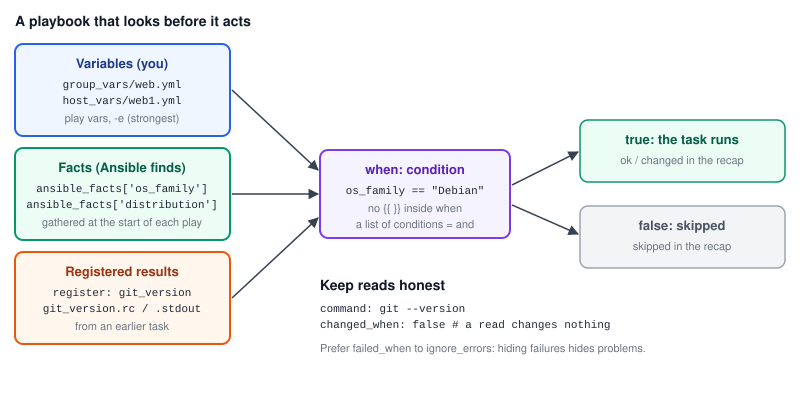

# Chapter 5 — Ansible Variables, Facts, Conditions, and `register`

> **Course:** Infrastructure as Code & Ansible · **Chapter:** 5 of 8
> Read on the website: [learn.bazardev.com/iac/05-ansible-variables-facts-and-conditions](https://learn.bazardev.com/iac/05-ansible-variables-facts-and-conditions)
>
> 🇧🇩 **Prefer Bangla?** [Read this chapter in Bangla →](https://learn.bazardev.com/iac/05-ansible-variables-facts-and-conditions?lang=bn)

So far your playbooks did the same thing on every machine. Real servers differ: one runs Ubuntu, another Debian; one already has a tool, another does not; a command may succeed on one and fail on another. This chapter teaches a playbook to **look before it acts**. It combines four ideas: **variables** (values you choose), **facts** (values Ansible discovers about the machine), **conditions** (`when`), and **`register`** (capturing the result of one task for the next).

> **Honesty note: what was and was not run.** Ansible is **not installed on the server used to write this course**, and nothing was installed for it. So the playbooks below are written from the official Ansible documentation and are **not executed here**. What *was* checked: how facts are gathered and read (`ansible_facts`, the `setup` module, `gather_facts`), the `when` clause and its forms, `register`, the `debug` and `set_fact` modules, `ignore_errors`, `failed_when` and `changed_when`, and `group_vars` and `host_vars` were read from the official docs, every YAML block parses as valid YAML (by a tool), and every external link was opened. The **exact output of a real run is not shown**, because nothing was run; you will see it on your own practice machine. Start there, with `--check`, before you trust a playbook on anything real.



## 1. Where information comes from

A task can use three kinds of information:

| Kind | Who provides it | Example |
|---|---|---|
| **Variables** | **You**: in the play, a file, the inventory, or the command line | `app_dir: /var/www/myapp` |
| **Facts** | **Ansible discovers them** by looking at the machine | the operating system, the hostname |
| **Registered results** | An **earlier task** in the same run | the output of a command |

A `when` condition can test any of the three, and decide whether a task runs.

## 2. Variables, a short recap and two new places

You already know variables from Chapters 3 and 4: `vars:` in a play, `vars_files:`, role `defaults/`, and `-e` on the command line (highest precedence). Two more places matter once you have more than one server:

- **`group_vars`**: values for a **group** of hosts. The docs: "You generally place group variables alongside your inventory file." They are named after the group, for example `group_vars/web` for the `web` group, and `group_vars/all` holds site-wide defaults. (The docs' examples name the files without an extension. A `.yml` extension is also accepted; see the docs.)
- **`host_vars`**: values for **one** host, in a file named after the host, for example `host_vars/web1`. The docs' example sets `ntp_server: override.example.com` for one host.

A layout:

```text
ansible/
├── inventory.ini
├── group_vars/
│   └── web.yml          # values for every host in the "web" group
├── host_vars/
│   └── web1.yml         # values for web1 only (these override group values)
└── site.yml
```

`group_vars/web.yml`:

```yaml
app_dir: /var/www/myapp
php_memory_limit: 256M
```

`host_vars/web1.yml`:

```yaml
php_memory_limit: 512M
```

Now `web1` uses `512M` and every other `web` host uses `256M`, in the **same playbook**. The docs list many precedence levels, and the principle is the one from Chapter 3: the more specific and the more "on the spot" a value is, the stronger it is, with `-e` on top. Per the docs these two directories are loaded by the default vars plugin that ships with Ansible, so you do not mention them in the playbook.

## 3. Facts: what Ansible learns about each machine

At the start of each play, Ansible runs a hidden first task, **Gathering Facts** (you saw it in Chapter 3's output). The docs: "By default, Ansible gathers facts at the beginning of each play." Facts are "data related to your remote systems, including operating systems, IP addresses", and you read them from the **`ansible_facts`** dictionary:

```yaml
- name: Show which system this is
  ansible.builtin.debug:
    msg: "{{ ansible_facts['nodename'] }} runs {{ ansible_facts['distribution'] }}"
```

Facts you will use constantly (all appear in the docs' examples): `ansible_facts['os_family']` (for example `Debian`), `ansible_facts['distribution']` (for example `Ubuntu`), `ansible_facts['distribution_major_version']` and `ansible_facts['nodename']`.

To **see every fact** for a machine, use the `setup` module from Chapter 2:

```bash
ansible web -m ansible.builtin.setup
```

or add a `debug` task with `var: ansible_facts` in a playbook. Read the output once, so you know what is available.

Two details from the docs. First, by default some facts are **also** available as top-level variables with an `ansible_` prefix, and "the *ansible_* prefix shown in the setup module output is not used when addressing these variables" (so write `ansible_facts['os_family']`, the form this course uses, which does not depend on that setting; the injection can be switched off with `INJECT_FACTS_AS_VARS`). Second, gathering facts takes time. If a play does not use any, turn it off:

```yaml
- hosts: web
  gather_facts: false
```

The docs note this can help scalability when you manage many machines.

## 4. Conditions: `when`

A task with a `when` clause runs **only if the condition is true**. The docs describe it as "a raw Jinja2 expression without double curly braces": inside `when` you write the variable name directly, **without** `{{ }}`:

```yaml
- name: Update the package index on Debian-family systems
  ansible.builtin.apt:
    update_cache: true
  when: ansible_facts['os_family'] == "Debian"
```

Combine conditions with `and` and `or`, using parentheses to group:

```yaml
when: (ansible_facts['distribution'] == "Ubuntu" and ansible_facts['distribution_major_version'] == "24") or
      (ansible_facts['distribution'] == "Debian" and ansible_facts['distribution_major_version'] == "12")
```

When **all** conditions must be true, a **list** reads better, and it means `and`:

```yaml
when:
  - ansible_facts['distribution'] == "Ubuntu"
  - ansible_facts['distribution_major_version'] == "24"
```

### `when` with a loop

"If you combine a `when` statement with a loop, Ansible processes the condition separately for each item." The docs' example runs the command only for items above 5:

```yaml
- name: Run with items greater than 5
  ansible.builtin.command: echo {{ item }}
  loop: [ 0, 2, 4, 6, 8, 10 ]
  when: item > 5
```

### Is a variable set? `is defined`

From the docs: "If a required variable has not been set, you can skip or fail using Jinja2's *defined* test."

```yaml
- name: Run only if "foo" is defined
  ansible.builtin.debug:
    msg: "foo is {{ foo }}"
  when: foo is defined

- name: Stop with a clear message if "bar" is missing
  ansible.builtin.fail:
    msg: "Bailing out. This play requires 'bar'"
  when: bar is undefined
```

The `fail` module stops the play for that host with your message. It turns a vague "variable is undefined" error later into a clear instruction now (the same idea as `validation` in Terraform).

### A trap

The docs warn that comparing a **string** with an **integer** is a common cause of unexpected results: `"6" == 6` is not what you want. Facts such as `distribution_major_version` are **strings**, so compare them with quotes, as in the examples above.

## 5. `register`: capture a task's result

`register` saves what a task returned into a variable you can use later. The docs' form:

```yaml
- name: Read the Git version
  ansible.builtin.command: git --version
  register: git_version
  changed_when: false
```

`git_version` now holds a dictionary of return values. For `command` it includes the **return code** `rc` and the output `stdout`. Each module's documentation has a **RETURN** section listing its values. To see what you got, print it with `debug`:

```yaml
- name: Show what was registered
  ansible.builtin.debug:
    var: git_version
```

Two rules from the `debug` docs: use **`var:`** with the bare name, **no braces** (it "already runs in Jinja2 context and has an implicit `{{ }}` wrapping"), and use **`msg:`** for text, where braces are needed. `verbosity: 2` makes a debug task show only when you run with `-vv` or more. Also, running the playbook with **`-v`** shows the values of tasks as they run.

Then use the result in a `when`:

```yaml
- name: Only continue if Git is installed
  ansible.builtin.debug:
    msg: "Found {{ git_version.stdout }}"
  when: git_version.rc == 0
```

You can also test the **state** of a registered task. From the docs: `when: result is failed` and `when: result is succeeded`. For hosts where a task was **skipped**, test `is skipped` rather than checking for "undefined".

## 6. Making `command` honest: `changed_when` and `failed_when`

Chapter 3 warned that `command` and `shell` always report `changed`. A task that only **reads** something should say so. From the docs, `changed_when` decides "whether a change should be reported in Ansible statistics and whether a handler should be triggered":

```yaml
- name: This will never report 'changed' status
  ansible.builtin.shell: wall 'beep'
  changed_when: False
```

That is why the `git --version` task above has `changed_when: false`: reading a version changes nothing, and the second run should stay at `changed=0`.

Sometimes a command's own exit code is not the right test of success. `failed_when` lets you define failure yourself:

```yaml
- name: Fail task when either condition is met
  ansible.builtin.command: /usr/bin/example-command
  register: command_result
  failed_when: command_result.rc != 0 or 'ERROR' in command_result.stdout
```

Notes from the docs: several `failed_when` conditions in a list are joined with an implicit `and`, so write an `or` inside **one** string, as above. And `changed_when` accepts the same kind of expression, for example `changed_when: "bass_result.rc != 2"`.

### `ignore_errors`: use with care

```yaml
- name: Do not count this as a failure
  ansible.builtin.command: /bin/false
  ignore_errors: true
```

The docs say it "only works when the task can run and returns a value of 'failed'". It does **not** cover an undefined variable, a connection failure or a syntax error. It hides real problems, so prefer a precise `failed_when` and use `ignore_errors` only when a failure is genuinely acceptable.

## 7. `set_fact`: make a new variable while running

`set_fact` creates a variable on the **current host** during the run, for example from a calculation:

```yaml
- name: Decide the web root
  ansible.builtin.set_fact:
    web_root: "{{ app_dir }}/public"
```

The docs: the variables "will be available to subsequent plays during an ansible-playbook run via the host they were set on". Two cautions: facts set this way follow the **standard precedence rules**, so other kinds of variables with a higher priority can override them, and `cacheable: true` only saves them across runs if **fact caching is already enabled**. Prefer a plain variable in `vars:` when you can; use `set_fact` when the value depends on something found at run time.

## 8. A playbook that looks before it acts

All the pieces together. It stops on an unsupported system, installs packages only on the Debian family, reads a version safely, and prints a clear report:

```yaml
- name: Adapt to the machine
  hosts: web
  become: true

  tasks:
    - name: Stop on a system this playbook does not support
      ansible.builtin.fail:
        msg: "Debian-family systems only, but this is {{ ansible_facts['distribution'] }}"
      when: ansible_facts['os_family'] != "Debian"

    - name: Base packages are installed
      ansible.builtin.apt:
        name:
          - git
          - unzip
        state: present
        update_cache: true
        cache_valid_time: 3600
      when: ansible_facts['os_family'] == "Debian"

    - name: Read the Git version
      ansible.builtin.command: git --version
      register: git_version
      changed_when: false

    - name: Decide the web root
      ansible.builtin.set_fact:
        web_root: "{{ app_dir }}/public"

    - name: Report
      ansible.builtin.debug:
        msg:
          - "{{ ansible_facts['nodename'] }} runs {{ ansible_facts['distribution'] }}"
          - "{{ git_version.stdout }}"
          - "web root will be {{ web_root }}"
```

`app_dir` comes from `group_vars/web.yml` (section 2). Run it the safe way from Chapter 3: `--syntax-check`, then `--check --diff`, then apply, then again for `changed=0`. One note on check mode from the docs for `command`: a `command` task without `creates` or `removes` is **skipped** in check mode, so a task that registers its result will not have a real result there. That is another reason to treat `--check` as a preview, not a guarantee.

## 9. Habits

1. **Look before you act:** use facts and `when` instead of assuming every machine is the same.
2. **`when` has no braces;** `debug` uses `var:` without braces and `msg:` with them.
3. **Compare strings with strings.** Facts like `distribution_major_version` are strings.
4. **Make reads honest:** `changed_when: false` on tasks that only read.
5. **Prefer `failed_when` over `ignore_errors`.** Hiding failures hides problems.
6. **Put per-group and per-host values in `group_vars` and `host_vars`,** not in `if` chains in the playbook.
7. **Fail early with a clear message** (`fail` with `when: ... is undefined`).
8. **Print with `debug` while learning, then remove noisy tasks.**

## 10. Self-check

<details>
<summary><strong>Q1. What are the three kinds of information a task can use?</strong></summary>

Variables you set, facts Ansible discovers about the machine, and registered results from earlier tasks.
</details>

<details>
<summary><strong>Q2. `php_memory_limit` is 256M in `group_vars/web.yml` and 512M in `host_vars/web1.yml`. What does `web1` get?</strong></summary>

512M. The host-specific value is more specific than the group value, so it wins.
</details>

<details>
<summary><strong>Q3. How do you read the operating-system family of a machine, and how do you see all facts?</strong></summary>

`ansible_facts['os_family']`. To see all facts use `ansible <host> -m ansible.builtin.setup` or a `debug` task with `var: ansible_facts`.
</details>

<details>
<summary><strong>Q4. Why does `when: ansible_facts['os_family'] == "Debian"` have no `{{ }}`?</strong></summary>

A `when` clause is a raw Jinja2 expression, so variable names are written directly without double curly braces.
</details>

<details>
<summary><strong>Q5. What does `register: git_version` do, and how do you see what it captured?</strong></summary>

It saves the task's return values (for `command`, including `rc` and `stdout`) in the variable `git_version`. Print it with `debug` and `var: git_version`, or run the playbook with `-v`.
</details>

<details>
<summary><strong>Q6. Why add `changed_when: false` to a task that runs `git --version`?</strong></summary>

`command` always reports changed otherwise. Reading a version changes nothing, so marking it not changed keeps the second run at `changed=0`.
</details>

<details>
<summary><strong>Q7. What is wrong with using `ignore_errors: true` everywhere?</strong></summary>

It hides real failures, and it does not even cover undefined variables, connection failures or syntax errors. A precise `failed_when` is better.
</details>

<details>
<summary><strong>Q8. How can you stop a play early with a clear message when a required variable is missing?</strong></summary>

Use the `fail` module with a `msg` and `when: variable_name is undefined`.
</details>

## 11. Free resources

- Ansible docs: [Discovering variables: facts and magic variables](https://docs.ansible.com/ansible/latest/playbook_guide/playbooks_vars_facts.html)
- Ansible docs: [Conditionals](https://docs.ansible.com/ansible/latest/playbook_guide/playbooks_conditionals.html) and [Using variables](https://docs.ansible.com/ansible/latest/playbook_guide/playbooks_variables.html)
- Ansible docs: [Error handling in playbooks](https://docs.ansible.com/ansible/latest/playbook_guide/playbooks_error_handling.html)
- Module pages: [debug](https://docs.ansible.com/ansible/latest/collections/ansible/builtin/debug_module.html) and [set_fact](https://docs.ansible.com/ansible/latest/collections/ansible/builtin/set_fact_module.html)

---

**Next:** [Chapter 6 — Ansible Roles for a Laravel Stack: PHP, Caddy, MySQL](06-ansible-laravel-stack-roles.md)
