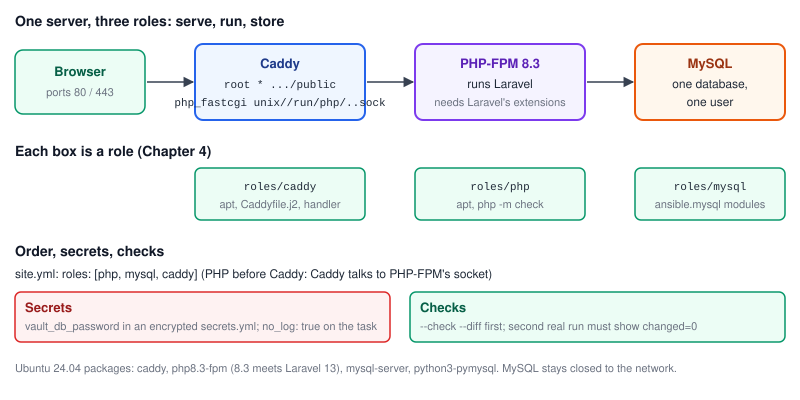

# Chapter 6 — Ansible Roles for a Laravel Stack: PHP, Caddy, MySQL

> **Course:** Infrastructure as Code & Ansible · **Chapter:** 6 of 8
> Read on the website: [learn.bazardev.com/iac/06-ansible-laravel-stack-roles](https://learn.bazardev.com/iac/06-ansible-laravel-stack-roles)
>
> 🇧🇩 **Prefer Bangla?** [Read this chapter in Bangla →](https://learn.bazardev.com/iac/06-ansible-laravel-stack-roles?lang=bn)

Now you use everything you have learned to build something real: the server software a **Laravel** application needs, written as three reusable roles. **PHP** runs the code, **Caddy** serves it to the world, and **MySQL** stores the data. By the end you have a playbook that turns a bare Ubuntu server into a Laravel-ready one, the same way every time, with the database password kept in Vault.

> **Honesty note: what was and was not run.** Ansible is **not installed on the server used to write this course**, no remote server was configured, and nothing was installed for it. So the roles below are written from official documentation and are **not executed here**. What *was* checked: Laravel 13's PHP version and extension requirements and its directory-permission advice, that Ubuntu 24.04 ("noble") packages `caddy`, `php8.3-fpm`, `mysql-server` and `python3-pymysql`, what the `php8.3-xml`, `-mbstring`, `-curl` and `-mysql` packages provide (from their package descriptions), the `php_fastcgi` Caddy directive, the Caddy official apt repository commands, the `ansible.mysql.mysql_db` and `mysql_user` modules (their parameters and the PyMySQL requirement), installing a collection with `ansible-galaxy`, and every YAML block parses as valid YAML (by a tool); every external link was opened. **Package names, versions and module names change**: the versions quoted were what the Ubuntu package search showed when this chapter was written. Run everything first on a **practice server** you can throw away, with `--check` first, and never with real secrets until you trust it.



## 1. What we are building, and why these choices

A request travels like this: the browser reaches **Caddy** on ports 80 and 443; Caddy passes PHP requests to **PHP-FPM** over a local socket; PHP code (Laravel) reads and writes **MySQL**. Each piece becomes one role (Chapter 4), so each is reusable and testable on its own.

**Target system: Ubuntu 24.04 ("noble").** Choosing one system keeps the chapter honest. On that release, Ubuntu's own repositories carry what we need, as the Ubuntu package search showed: `caddy` 2.6.2 (universe), `php8.3-fpm` 8.3.6, `mysql-server` 8.0.x and `python3-pymysql`. Using distribution packages means the plain `apt` module (Chapter 3) is enough, and the system's security updates apply. The trade-off to know: **the distribution's Caddy is older** than the one Caddy's own apt repository ships. The official instructions for that repository are in the Caddy docs (see the resources) if you want the newest release; they add a signing key and a package source, so they need `sudo` and care.

**Why PHP 8.3?** The Laravel 13 deployment documentation says: "Laravel 13 requires PHP 8.3 or higher", and lists the PHP extensions it needs: Ctype, cURL, DOM, Fileinfo, Filter, Hash, Mbstring, OpenSSL, PCRE, PDO, Session, Tokenizer and XML. Ubuntu 24.04's PHP 8.3 meets the version requirement.

The project layout, building on Chapters 2 to 5:

```text
ansible/
├── ansible.cfg
├── inventory.ini
├── requirements.yml          # the ansible.mysql collection
├── site.yml
├── secrets.yml               # ENCRYPTED with ansible-vault (Chapter 4)
├── group_vars/
│   └── web.yml
└── roles/
    ├── php/
    │   ├── defaults/main.yml
    │   └── tasks/main.yml
    ├── caddy/
    │   ├── defaults/main.yml
    │   ├── tasks/main.yml
    │   ├── handlers/main.yml
    │   └── templates/Caddyfile.j2
    └── mysql/
        ├── defaults/main.yml
        └── tasks/main.yml
```

## 2. Role `php`

`roles/php/defaults/main.yml` holds the settings, with the version in one place (Chapter 4: defaults are the easiest to override):

```yaml
php_version: "8.3"

php_packages:
  - "php{{ php_version }}-fpm"
  - "php{{ php_version }}-cli"
  - "php{{ php_version }}-curl"
  - "php{{ php_version }}-mbstring"
  - "php{{ php_version }}-mysql"
  - "php{{ php_version }}-xml"

php_required_modules:
  - ctype
  - curl
  - dom
  - fileinfo
  - filter
  - hash
  - mbstring
  - openssl
  - pcre
  - pdo
  - session
  - tokenizer
  - xml
```

`php_required_modules` is **Laravel's own list**. Of the packages: per their Ubuntu descriptions, `php8.3-xml` provides "DOM, SimpleXML, XML, and XSL", `php8.3-mbstring` the "MBSTRING module", `php8.3-curl` the "CURL module", and `php8.3-mysql` the "MySQL module for PHP", which Laravel uses to talk to MySQL. Other required modules (Ctype, Fileinfo, Tokenizer, Session and so on) normally come with PHP's base packages, but **the package pages did not list them**, so the role **checks** instead of assuming (below).

`roles/php/tasks/main.yml`:

```yaml
- name: PHP and the extensions Laravel needs are installed
  ansible.builtin.apt:
    name: "{{ php_packages }}"
    state: present
    update_cache: true
    cache_valid_time: 3600

- name: PHP-FPM is running
  ansible.builtin.service:
    name: "php{{ php_version }}-fpm"
    state: started

- name: List the PHP modules that are loaded
  ansible.builtin.command: php -m
  register: php_modules
  changed_when: false

- name: Fail if a PHP module Laravel needs is missing
  ansible.builtin.fail:
    msg: "PHP module missing: {{ item }}"
  loop: "{{ php_required_modules }}"
  when:
    - php_modules.stdout_lines is defined
    - item not in (php_modules.stdout_lines | map('lower') | list)
```

Read the last two tasks with Chapter 5 in mind. The first condition, `is defined`, guards against check mode: a `command` task is **skipped** there, so there is no output to compare, and the check is skipped too instead of failing. `php -m` only **reads**, so it has `changed_when: false` and its result is **registered**. Then a `fail` task loops over Laravel's list and stops with a clear message if any module is not loaded (`when` runs once per item, as the docs state for loops). `map('lower')` makes the comparison ignore capitals, because `php -m` prints some names capitalised (for example `PDO`). The filter is standard Jinja2; confirm it on your practice server. This turns "something fails weirdly in production" into "the playbook told me exactly what is missing".

On the server, `php -v` shows the version (the Laravel docs use it too). It must be 8.3 or higher.

## 3. Role `caddy`

`roles/caddy/defaults/main.yml`:

```yaml
site_domain: ":80"
app_dir: /var/www/myapp
php_version: "8.3"
```

(`:80` serves plain HTTP on port 80, which is handy for a practice server with no domain. For a real domain, set `site_domain` to it, with DNS pointing at the server, and Caddy obtains HTTPS certificates for it automatically; see Caddy's docs on site addresses.)

`roles/caddy/templates/Caddyfile.j2`: the Caddy directive for PHP is `php_fastcgi`. The docs call it "a convenient shortcut, replacing a longer configuration", and say it "should almost always be paired with the `root` directive" and `file_server`. The docs' example socket form is `php_fastcgi unix//run/php/php8.2-fpm.sock`, and Laravel's own Nginx example uses a `php8.3-fpm.sock` socket, so for 8.3 we write:

```text
{{ site_domain }} {
    root * {{ app_dir }}/public
    encode gzip
    php_fastcgi unix//run/php/php{{ php_version }}-fpm.sock
    file_server
}
```

Note `root * {{ app_dir }}/public`: the web root is the application's **`public`** directory. The Laravel docs are emphatic: your server must direct requests to `public/index.php`, and "you should never attempt to move the `index.php` file to your project's root, as serving the application from the project root will expose many sensitive configuration files to the public Internet."

`roles/caddy/tasks/main.yml`:

```yaml
- name: Caddy is installed
  ansible.builtin.apt:
    name: caddy
    state: present
    update_cache: true
    cache_valid_time: 3600

- name: Caddyfile is in place
  ansible.builtin.template:
    src: Caddyfile.j2
    dest: /etc/caddy/Caddyfile
    owner: root
    group: root
    mode: '0644'
    backup: true
  notify: Restart caddy

- name: Caddy is running
  ansible.builtin.service:
    name: caddy
    state: started
```

`roles/caddy/handlers/main.yml`:

```yaml
- name: Restart caddy
  ansible.builtin.service:
    name: caddy
    state: restarted
```

Per the Caddy docs, installing the package "automatically starts and runs Caddy as a systemd service named caddy". The docs page does not name the Caddyfile path, so **confirm** the file the service reads on your server (for example with `systemctl cat caddy`) before relying on `/etc/caddy/Caddyfile`. Check the file's syntax with Caddy's own validation command (see Caddy's documentation) before you restart a live site. As in Chapter 4, the `template` module's `validate` option is the place to wire such a check in.

## 4. Role `mysql`

MySQL needs two extra things. The Ansible modules that create databases and users are in the **`ansible.mysql`** collection (not built in), and they need the **PyMySQL** Python package on the **managed** server: the docs say "Requires the PyMySQL package installed on the remote host."

A note on names, from the docs: these modules used to live in `community.mysql`, and that collection's old module names are now **deprecated redirects** that point to `ansible.mysql`. Use the new names. Collection names can change again, so check the Ansible documentation.

Install the collection on your **control node** with a requirements file (the documented format), then run one command:

`requirements.yml`:

```yaml
collections:
  - ansible.mysql
```

```bash
ansible-galaxy collection install -r requirements.yml
```

By default it is installed under `~/.ansible/collections`, per the docs.

`roles/mysql/defaults/main.yml`:

```yaml
db_name: laravel
db_user: laravel
```

`roles/mysql/tasks/main.yml`:

```yaml
- name: MySQL server and the Python driver are installed
  ansible.builtin.apt:
    name:
      - mysql-server
      - python3-pymysql
    state: present
    update_cache: true
    cache_valid_time: 3600

- name: MySQL is running
  ansible.builtin.service:
    name: mysql
    state: started

- name: The application database exists
  ansible.mysql.mysql_db:
    name: "{{ db_name }}"
    state: present
    encoding: utf8mb4
    login_unix_socket: /run/mysqld/mysqld.sock

- name: The application database user exists
  ansible.mysql.mysql_user:
    name: "{{ db_user }}"
    password: "{{ vault_db_password }}"
    priv: "{{ db_name }}.*:ALL"
    state: present
    login_unix_socket: /run/mysqld/mysqld.sock
  no_log: true
```

What is happening, from the docs. `mysql_db` takes the database `name`, a `state` (`present`), an `encoding`, and `login_unix_socket`: "The path to a Unix domain socket for local connections", which also avoids the `Please explicitly state intended protocol` error. `mysql_user` takes a `name`, a `password`, a `host` (default `localhost`), and `priv` in the format `db.table:priv1,priv2`, so `laravel.*:ALL` means all privileges on every table of the `laravel` database and nothing else. The user gets access to **one database only**, not the whole server: least privilege again. `update_password` defaults to `always`, which keeps the password in line with your Vault value every run.

Two points about secrets (Chapter 4). The password comes from `vault_db_password`, an **encrypted** variable, and the task has `no_log: true` so the password is not printed. Remember that `no_log` does not hide `debug` output, and that the `mysql_user` documentation's own examples use a plain-text password, which you must **never** copy. How the modules log in as MySQL's administrator depends on your installation (on many Ubuntu installs the MySQL root account accepts the operating-system root over the local socket, but **check yours**). Nothing here opens MySQL to the network; keep it that way, and keep port 3306 closed in your firewall (Terraform course, Chapter 5).

## 5. Putting the roles together

`group_vars/web.yml` (Chapter 5):

```yaml
app_dir: /var/www/myapp
site_domain: ":80"
php_version: "8.3"
db_name: laravel
db_user: laravel
```

`secrets.yml` is encrypted with `ansible-vault` (Chapter 4) and holds one line, a **fake** value here:

```yaml
vault_db_password: not-a-real-password
```

`site.yml`:

```yaml
- name: Build the Laravel stack
  hosts: web
  become: true
  vars_files:
    - secrets.yml
  roles:
    - php
    - mysql
    - caddy
```

Roles run in the order listed (Chapter 4). `php` comes before `caddy` because Caddy talks to PHP-FPM's socket. Notice how short the playbook is: all the detail lives in the roles, and the **differences between servers** live in `group_vars` and `host_vars`.

Run it the safe way, from the `ansible` folder, on a practice server:

```bash
ansible-galaxy collection install -r requirements.yml
ansible web -m ping
ansible-playbook site.yml --syntax-check
ansible-playbook site.yml --ask-vault-pass --check --diff
ansible-playbook site.yml --ask-vault-pass
ansible-playbook site.yml --ask-vault-pass        # second run: expect changed=0
```

Two cautions about `--check`: the `command` task that runs `php -m` is skipped in check mode (so the module check is skipped too, thanks to the `is defined` guard), and many tasks depend on packages that a dry run did not install. That is normal. The **second real run showing `changed=0`** is the proof of idempotency.

## 6. What comes next for the Laravel app

The stack is ready, but the **application** is not deployed yet. Chapter 8 does that. Facts to carry forward from the Laravel docs: Laravel must **write** to `bootstrap/cache` and `storage`, so the web server's process owner needs permission there (on Ubuntu, PHP-FPM's pool user is normally `www-data`; confirm in your pool configuration). In production, `APP_DEBUG` must be `false`. And a deployment should run the optimisation commands such as `php artisan optimize` (which caches configuration, events, routes and views) and, after deploying new code, restart long-running workers.

## 7. Habits

1. **One role per piece of the stack,** with its settings in `defaults/`.
2. **Check, do not assume:** the `php -m` loop proves the extensions Laravel needs are really there.
3. **Least privilege in the database:** one user, one database, `db.*:ALL`.
4. **Secrets in Vault, `no_log` on the tasks that handle them,** and never copy plain-text passwords from examples.
5. **Do not expose MySQL** to the network; firewall port 3306.
6. **The web root is `public`,** never the project root.
7. **Run on a practice server first,** `--check` first, and expect `changed=0` on the second run.

## 8. Self-check

<details>
<summary><strong>Q1. Why is the web root `.../public` and not the project root?</strong></summary>

Laravel's docs say all requests must go to `public/index.php`, and serving from the project root would expose sensitive configuration files to the public internet.
</details>

<details>
<summary><strong>Q2. What does `php_fastcgi unix//run/php/php8.3-fpm.sock` do in Caddy?</strong></summary>

It sends PHP requests to PHP-FPM through its Unix socket. It is a shortcut for a longer configuration, and is normally paired with `root` and `file_server`.
</details>

<details>
<summary><strong>Q3. Why does the `php` role run `php -m` and fail on missing modules?</strong></summary>

The package descriptions did not list every module Laravel needs, so the role checks Laravel's list against what is loaded and stops with a clear message, instead of failing strangely later.
</details>

<details>
<summary><strong>Q4. Why does the `php -m` task have `changed_when: false`?</strong></summary>

It only reads. Without it, `command` always reports changed and the second run would not reach `changed=0`.
</details>

<details>
<summary><strong>Q5. What do the MySQL modules need on the managed server, and where do the modules come from?</strong></summary>

The PyMySQL Python package on the managed host, and they come from the `ansible.mysql` collection (installed with `ansible-galaxy collection install`), which replaced the deprecated `community.mysql` names.
</details>

<details>
<summary><strong>Q6. What does `priv: "laravel.*:ALL"` grant?</strong></summary>

All privileges on every table of the `laravel` database only, which is least privilege for the application's user.
</details>

<details>
<summary><strong>Q7. Where does the database password come from, and how is it kept out of the output?</strong></summary>

From the encrypted Vault variable `vault_db_password`, and the task has `no_log: true`. `no_log` does not hide `debug` output, so never print it.
</details>

<details>
<summary><strong>Q8. Why does the `caddy` role run after `php` in `site.yml`?</strong></summary>

Roles run in the order listed, and Caddy forwards PHP requests to PHP-FPM's socket, so PHP should be installed and running first.
</details>

## 9. Free resources

- Laravel docs: [Deployment](https://laravel.com/docs/deployment)
- Caddy docs: [Install](https://caddyserver.com/docs/install) and [`php_fastcgi`](https://caddyserver.com/docs/caddyfile/directives/php_fastcgi)
- Ubuntu packages: [`caddy`](https://packages.ubuntu.com/search?keywords=caddy&searchon=names&suite=noble&section=all), [`php8.3-fpm`](https://packages.ubuntu.com/search?keywords=php8.3-fpm&searchon=names&suite=noble&section=all), [`mysql-server`](https://packages.ubuntu.com/search?keywords=mysql-server&searchon=names&suite=noble&section=all)
- Ansible docs: [`ansible.mysql.mysql_db`](https://docs.ansible.com/ansible/latest/collections/ansible/mysql/mysql_db_module.html), [`ansible.mysql.mysql_user`](https://docs.ansible.com/ansible/latest/collections/ansible/mysql/mysql_user_module.html), [Installing collections](https://docs.ansible.com/ansible/latest/collections_guide/collections_installing.html)

---

**Next:** [Chapter 7 — Running Ansible Safely: Tags, Limits, Lint, and CI](07-ansible-safety-testing-and-ci.md)
