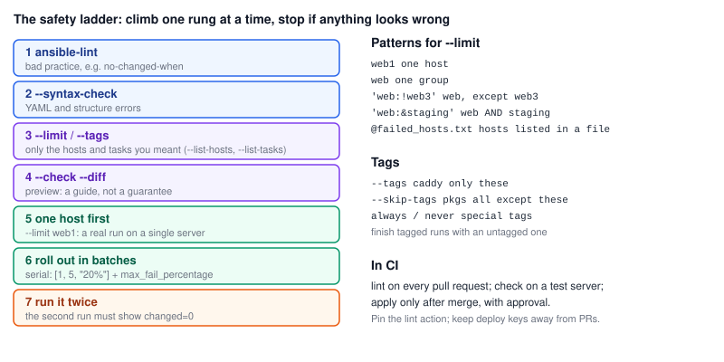

# Chapter 7 — Running Ansible Safely: Tags, Limits, Lint, and CI

> **Course:** Infrastructure as Code & Ansible · **Chapter:** 7 of 8
> Read on the website: [learn.bazardev.com/iac/07-ansible-safety-testing-and-ci](https://learn.bazardev.com/iac/07-ansible-safety-testing-and-ci)
>
> 🇧🇩 **Prefer Bangla?** [Read this chapter in Bangla →](https://learn.bazardev.com/iac/07-ansible-safety-testing-and-ci?lang=bn)

You now have playbooks and roles that can build a whole server. That is power, and the first thing to learn about power is how not to hurt yourself with it. One Ansible command can change **every** server in your inventory in seconds. This chapter is about the **safety layers**: previewing a change, **narrowing** it to a few hosts or tasks, rolling it out **gently**, catching mistakes automatically with a **linter**, and putting all of it in **CI** so nobody depends on remembering.

> **Honesty note: what was and was not run.** Ansible and `ansible-lint` are **not installed on the server used to write this course**, and nothing was installed for it. So the commands and files below are written from the official Ansible and Ansible Lint documentation and are **not executed here**. What *was* checked: host patterns and `--limit`, `--tags` and `--skip-tags` with `--list-tags` and `--list-tasks`, the special tags `always` and `never`, tag inheritance, `serial`, `max_fail_percentage` and `any_errors_fatal`, blocks with `rescue` and `always`, how to install and run `ansible-lint` and how it reports, its configuration, `noqa` comments and profiles, and its GitHub Action were read from the official docs, every YAML block parses as valid YAML (by a tool), and every external link was opened. The **exact messages from a real run are not shown**, because nothing was run. Practise on a **throwaway server**, and use the `--check` and `--limit` habits below before any real change.



## 1. The ladder

Think of a change as climbing a ladder, one rung at a time. At each rung you can stop if something looks wrong, and the cost of a mistake is still small:

| Rung | Tool | What it catches |
|---|---|---|
| 1. Lint | `ansible-lint` | Bad practice, such as a `command` task that always reports changed |
| 2. Syntax | `--syntax-check` | YAML and structure errors |
| 3. Narrow | `--limit`, `--tags` | You only touch the hosts and tasks you meant |
| 4. Preview | `--check --diff` | What would change |
| 5. One host first | `--limit one-host` | A real run on one server, before the rest |
| 6. Roll out | `serial`, `max_fail_percentage` | A small batch at a time, stopping if too many fail |
| 7. Run twice | the second run | `changed=0` proves idempotency |

The first three you know from earlier chapters. This chapter adds the rest.

## 2. `--limit`: choose which hosts

A **host pattern** says which machines a command targets. From the docs:

| Pattern | Meaning |
|---|---|
| `all` or `*` | All hosts |
| `host1` | One host |
| `host1:host2` or `host1,host2` | Several hosts |
| `webservers` | One group |
| `webservers:dbservers` | Hosts in either group |
| `webservers:!atlanta` | Hosts in `webservers`, **except** those in `atlanta` |
| `webservers:&staging` | Hosts in `webservers` that are **also** in `staging` |

The docs say the comma is preferred for ranges and IPv6 addresses. `--limit` narrows a playbook run **further** than its `hosts:` line. The docs' examples:

```bash
ansible-playbook site.yml --limit datacenter2
ansible-playbook site.yml --limit @retry_hosts.txt
```

The second form, with `@`, reads the host list from a file, handy to re-run only on hosts that failed. For an exclusion, the docs insist on **single quotes**, "to prevent bash interpolation":

```bash
ansible all -m ansible.builtin.ping --limit 'all:!host1'
```

Before a risky run, list which hosts you would hit. `--list-hosts` is one of the verification options the docs list for playbooks:

```bash
ansible-playbook site.yml --limit web1 --list-hosts
```

**The most useful habit in this chapter:** run on **one host first**. `--limit web1` gives you a real run on a single server. If it works, widen the limit.

## 3. Tags: choose which tasks

A **tag** is a label on a task. You can run, or skip, tasks by label. From the docs, tags go on a task, a block, a play or a role:

```yaml
- name: Install packages
  ansible.builtin.apt:
    name: git
    state: present
  tags:
    - packages
    - web
```

On a role, in `site.yml`:

```yaml
roles:
  - role: caddy
    tags: [caddy, web]
  - role: php
    tags: [php, web]
```

Then choose with `--tags` (run **only** these) or `--skip-tags` (run **everything except** these):

```bash
ansible-playbook site.yml --tags "caddy"
ansible-playbook site.yml --skip-tags "packages"
ansible-playbook site.yml --list-tags
ansible-playbook site.yml --tags "caddy" --list-tasks
```

`--list-tags` shows the tags that exist, and `--tags ... --list-tasks` previews which tasks would run, **without running anything**. If you pass both flags, the docs say `--skip-tags` takes precedence.

Two special tags: a task tagged **`always`** runs every time (unless you skip it explicitly), and a task tagged **`never`** is skipped unless you specifically ask for it with `--tags`. The `never` tag suits dangerous tasks, such as a "wipe the test database" task you do not want running by accident.

**A caution from the docs:** tags on a block, play, role or import apply to **every task inside**, and a tag on a block can also affect its `rescue` and `always` sections (if the tag selection does not cover them, they will not run). Inheritance does **not** apply to dynamic includes (`include_role`, `include_tasks`): a tag there applies only to the include itself. Tags are a convenience; **a full run is still the truth**, so always finish with an untagged run to prove the whole playbook is consistent.

## 4. Rolling out gently: `serial`

By default, Ansible runs **each task on all hosts** before it moves to the next task (the docs call this the `linear` strategy). If a bad change reaches all hosts at once, all fail together. The **`serial`** keyword changes the **batch size**: "how many hosts Ansible manages at a time". From the docs:

```yaml
- name: Update the web servers
  hosts: web
  serial: 3
```

With six hosts, the whole play runs on three, then the next three. It can also be a percentage (`serial: "30%"`) or a **list**, which gives you the classic **canary** pattern: one host first, then a few, then the rest:

```yaml
- name: Update the web servers, canary first
  hosts: web
  serial:
    - 1
    - 5
    - "20%"
```

"Setting the batch size with `serial` changes the scope of the Ansible failures to the batch size, not the entire host list": a failure now stops the rollout instead of spreading to everyone.

Two keywords control **when to stop**:

- **`max_fail_percentage`** aborts the run once more than a given share of hosts have failed. The docs: "The percentage set must be exceeded, not equaled." It applies **per batch** when used with `serial`. The docs' example is `max_fail_percentage: 30` with `serial: 10`: with ten servers per batch, the play aborts if more than three fail in a batch.
- **`any_errors_fatal: true`** stops the play on **all** hosts after one failure: "Ansible finishes the fatal task on all hosts in the current batch and then stops executing the play on all hosts." Use it when a partial success is worse than stopping, for example taking a load balancer out before an upgrade.

## 5. Blocks: a failure path

A **block** groups tasks, and adds two sections for failures. From the docs: tasks in `rescue` run "after a task returns a 'failed' state", and tasks in `always` "run no matter what the task status of the previous block is". For a risky config change with a way back:

```yaml
- name: Change the Caddy configuration, with a way back
  block:
    - name: New Caddyfile is in place
      ansible.builtin.template:
        src: Caddyfile.j2
        dest: /etc/caddy/Caddyfile
        mode: '0644'
        backup: true

    - name: Caddy restarts with the new file
      ansible.builtin.service:
        name: caddy
        state: restarted
  rescue:
    - name: Stop with a clear instruction
      ansible.builtin.fail:
        msg: "Caddy did not restart. Restore the backup copy of the Caddyfile and check the new file."
  always:
    - name: Report that the attempt finished
      ansible.builtin.debug:
        msg: "Caddy change attempted on {{ inventory_hostname }}"
```

`backup: true` (Chapter 3) keeps the old file. Note the docs on **rescued failures**: if a `rescue` section completes, Ansible "reverts the failed status of the original task for the run" and the play continues, and the rescued failure "does not trigger `max_fail_percentage` or `any_errors_fatal`", though Ansible "still reports a failure in the playbook statistics". Here the rescue ends with `fail` on purpose, so the host really fails and the rollout stops.

## 6. `ansible-lint`: a reviewer that never gets tired

**Ansible Lint** is, in its own words, "a command-line tool for linting playbooks, roles and collections", whose goal is "to promote proven practices, patterns and behaviors while avoiding common pitfalls". It is **opinionated**, and its rules can be turned off individually. It does not support Windows.

Install (from the docs, on a **practice machine**, in a virtual environment if you like):

```bash
pip3 install ansible-lint
```

(The docs also recommend `pip3 install ansible-dev-tools`, which brings `ansible-core` too, and mention pipx to keep it isolated from your other Python packages.) Run it **from the root of your project**, as the docs insist:

```bash
ansible-lint
ansible-lint site.yml roles/php
```

It reports each finding with the file, the line, a **rule name** and a message. The docs' own example finding is this:

```text
examples/playbooks/example.yml:9: no-changed-when: Commands should not change things if nothing needs doing.
```

That is **exactly** the lesson of Chapters 3 and 5: a `command` task needs `changed_when`. The linter finds it for you.

Useful options from the docs:

| Option | Meaning |
|---|---|
| `ansible-lint -T` | List the tags and the rules they cover |
| `ansible-lint -t idempotency playbook.yml` | Run only rules with that tag |
| `ansible-lint -x formatting,metadata playbook.yml` | **Skip** rules by tag or ID |
| `ansible-lint --profile=basic` | Choose a strictness **profile** (`min`, `basic`, `moderate`, `safety`, `shared`, `production`; see `--list-profiles`) |
| `ansible-lint --fix` | Let it fix what it can, including YAML formatting. **Review the changes** it makes |
| `-s` / `--strict` | Non-zero exit on warnings as well as errors |

Start with a lower profile on an old project and move up as it gets cleaner: the docs describe `min` as ensuring "that Ansible can load your content", `basic` as enforcing "standard styles and formatting", and `safety` as ensuring "automation consistency, reliability, and security".

To mute a **false positive**, add `# noqa: rule_id` at the end of the line (the docs say it must be at the end of the line for line-based rules), or list the rule in `skip_list` in a configuration file (`.ansible-lint` is searched for by default). **Muting should be a decision with a reason,** not a way to make the output go quiet. Write the reason in a comment next to it.

## 7. CI: let the machine check every pull request

Everything above can run **automatically** when someone opens a pull request (Chapter 7 of the Terraform course shows the same idea for Terraform). The `ansible-lint` project provides a **GitHub Action**; the docs' workflow file is `.github/workflows/ansible-lint.yml`, with a job that runs on `ubuntu-24.04` and uses `ansible/ansible-lint@main`:

```yaml
name: ansible-lint

on:
  pull_request:

jobs:
  lint:
    runs-on: ubuntu-24.04
    steps:
      - uses: actions/checkout@v4
      - uses: ansible/ansible-lint@main
```

The docs show some optional inputs (`args`, `setup_python`, `python_version`, `working_directory`, `requirements_file`) and say most users do not need them. **Note the `@main`:** that follows the project's moving development branch, so a new release can change your results overnight. For a stable pipeline, **pin** the action to a release tag or commit that you have checked (see the project's releases), and update it deliberately, the same discipline as pinning Terraform's providers.

What CI should do for Ansible, in order of cost:

1. **Lint** on every pull request (above). Free, fast, no servers needed.
2. **Syntax check** (`ansible-playbook site.yml --syntax-check`), after installing Ansible and the collections your roles use (`ansible-galaxy collection install -r requirements.yml`, Chapter 6). If your playbook loads an encrypted Vault file, make sure CI can read it, with the vault password coming from a **CI secret**, never from a file in the repository.
3. **A `--check --diff` against a test server**, if you have one. That needs an SSH key in CI, so use a **separate key with access to the test server only**, stored as a CI secret.
4. **Applying to real servers**, only **after merge**, behind a **human approval**, never from a pull request (the same rule as for Terraform).

## 8. A safe run, start to finish

For a change to a role, on a team:

```bash
ansible-lint                                                   # rung 1
ansible-playbook site.yml --syntax-check                       # rung 2
ansible-playbook site.yml --limit web1 --list-hosts            # rung 3: am I touching only web1?
ansible-playbook site.yml --limit web1 --check --diff          # rung 4: preview on one host
ansible-playbook site.yml --limit web1                         # rung 5: real run on one host
ansible-playbook site.yml                                      # rung 6: the rest, with serial in the play
ansible-playbook site.yml                                      # rung 7: second run, expect changed=0
```

Add `--ask-vault-pass` (or a vault password file kept out of Git) where your play needs Vault. Remember from Chapter 3 that **`--check` is a preview, not a guarantee**: some modules cannot predict their result.

## 9. Habits

1. **Lint first, then syntax-check,** every time, ideally in CI.
2. **One host first:** `--limit` to a single server before the rest.
3. **Roll out in batches** with `serial`, and set `max_fail_percentage` so a bad change stops itself.
4. **Use `never` for dangerous tasks** and `always` for ones that must not be skipped.
5. **Finish tagged runs with an untagged one.**
6. **Give risky changes a failure path** with `block` / `rescue` and `backup: true`.
7. **Mute lint rules on purpose,** with a comment saying why.
8. **Pin what CI runs,** and keep deploy credentials away from pull requests.

## 10. Self-check

<details>
<summary><strong>Q1. What does `ansible-playbook site.yml --limit 'web:!web3'` do?</strong></summary>

It runs the playbook on the hosts in the `web` group except `web3`. The negation needs single quotes so the shell does not interpret `!`.
</details>

<details>
<summary><strong>Q2. How do you see which tasks would run for `--tags caddy`, without running them?</strong></summary>

Add `--list-tasks`: `ansible-playbook site.yml --tags "caddy" --list-tasks`.
</details>

<details>
<summary><strong>Q3. What do the special tags `always` and `never` do?</strong></summary>

`always` tasks run every time unless explicitly skipped. `never` tasks are skipped unless you specifically request them with `--tags`.
</details>

<details>
<summary><strong>Q4. What does `serial: [1, 5, "20%"]` give you?</strong></summary>

A canary rollout: the play runs on one host first, then five, then 20 percent batches, so a failure stops at the batch where it happens.
</details>

<details>
<summary><strong>Q5. With `serial: 10` and `max_fail_percentage: 30`, when does the play abort?</strong></summary>

When more than three hosts in a batch fail. The percentage must be exceeded, not just equalled.
</details>

<details>
<summary><strong>Q6. What happens to a failure that a `rescue` section recovers from?</strong></summary>

The failed status of the original task is reverted and the play continues, and it does not trigger `max_fail_percentage` or `any_errors_fatal`, but Ansible still reports the failure in the playbook statistics.
</details>

<details>
<summary><strong>Q7. What does the `no-changed-when` lint finding mean, and how do you fix it?</strong></summary>

A `command` or `shell` task will always report changed. Add `changed_when` (for example `changed_when: false` for a read-only task), as taught in Chapters 3 and 5.
</details>

<details>
<summary><strong>Q8. Why pin the `ansible-lint` GitHub Action instead of using `@main`?</strong></summary>

`@main` follows a moving branch, so a new release can change your CI results without any change in your code. Pinning to a checked tag or commit keeps the pipeline stable until you choose to update.
</details>

## 11. Free resources

- Ansible docs: [Patterns: targeting hosts and groups](https://docs.ansible.com/ansible/latest/inventory_guide/intro_patterns.html), [Tags](https://docs.ansible.com/ansible/latest/playbook_guide/playbooks_tags.html)
- Ansible docs: [Controlling playbook execution: strategies and more](https://docs.ansible.com/ansible/latest/playbook_guide/playbooks_strategies.html), [Blocks](https://docs.ansible.com/ansible/latest/playbook_guide/playbooks_blocks.html), [Error handling](https://docs.ansible.com/ansible/latest/playbook_guide/playbooks_error_handling.html)
- Ansible Lint: [About](https://docs.ansible.com/projects/lint/), [Installing](https://docs.ansible.com/projects/lint/installing/), [Usage](https://docs.ansible.com/projects/lint/usage/)

---

**Next:** [Chapter 8 — Real Project: A Laravel Server, Built with Ansible](08-real-project-a-laravel-server-with-ansible.md)
