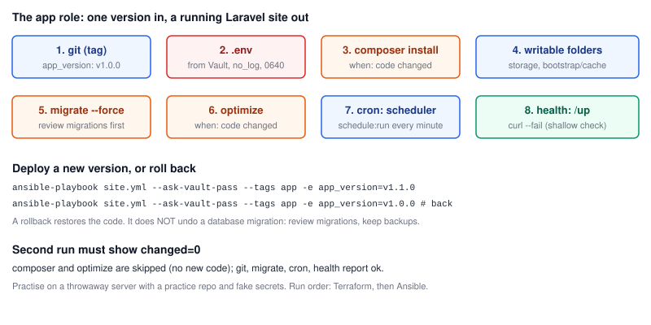

# Chapter 8 — Real Project: A Laravel Server, Built with Ansible

> **Course:** Infrastructure as Code & Ansible · **Chapter:** 8 of 8
> Read on the website: [learn.bazardev.com/iac/08-real-project-a-laravel-server-with-ansible](https://learn.bazardev.com/iac/08-real-project-a-laravel-server-with-ansible)
>
> 🇧🇩 **Prefer Bangla?** [Read this chapter in Bangla →](https://learn.bazardev.com/iac/08-real-project-a-laravel-server-with-ansible?lang=bn)

This is the finish line. In Chapter 6 you built the **stack** (PHP, Caddy, MySQL). In this chapter you add the last role, **`app`**, which deploys a Laravel application onto it: the code, its dependencies, its `.env`, the database migration, the caches, and the scheduler. Then you run the whole thing the safe way from Chapter 7. By the end, a bare Ubuntu server and one command give you a running Laravel site, the same way every time.

> **Honesty note: what was and was not run.** Ansible, Composer and PHP are **not installed on the server used to write this course**, no server was configured, and no Laravel application was deployed. So the playbooks below are written from official documentation and are **not executed here**. What *was* checked: the Ansible `git`, `user`, `cron`, `file`, `template`, `command` and `apt` modules and the unprivileged-`become` advice, Laravel's `.env` and configuration-cache rules, `php artisan migrate --force`, `php artisan optimize`, the health route `/up`, the scheduler's single cron entry, Composer's `--no-dev` and `--optimize-autoloader` options, that Ubuntu 24.04 packages `composer`, and every YAML block parses as valid YAML (by a tool); every external link was opened. The **output of a real deployment is not shown.** Deploy first to a **throwaway server**, with a **practice repository**, and with **fake secrets**, and read what each command prints. Do not use real credentials until you trust the whole pipeline.



## 1. What "deploying" means

Putting a Laravel app on a server is a short list of steps, and every step maps to something you already know:

| Step | Ansible tool (earlier chapter) |
|---|---|
| A user to own the code | `user` module |
| Fetch the code at a **version** | `git` module (`version` is a tag, branch or commit) |
| Write the `.env` with secrets | `template` + Vault + `no_log` (Chapter 4) |
| Install dependencies | `command` running Composer, guarded by a condition (Chapters 3, 5) |
| Make `storage` and `bootstrap/cache` writable | `file` module |
| Update the database schema | `command` running `php artisan migrate --force` |
| Cache config, routes and views | `command` running `php artisan optimize` |
| Run scheduled tasks | `cron` module |
| Prove it is alive | `command` calling the `/up` health route |

The new idea is not any single step. It is **ordering and guarding them** so the second run changes nothing, and so a **new version** can be deployed by changing one variable.

## 2. The layout

```text
ansible/
├── ansible.cfg
├── inventory.ini            # from the Terraform course (or your own server)
├── requirements.yml
├── site.yml
├── secrets.yml              # ENCRYPTED: vault_db_password, vault_app_key
├── group_vars/
│   └── web.yml
└── roles/
    ├── php/        (Chapter 6)
    ├── mysql/      (Chapter 6)
    ├── caddy/      (Chapter 6)
    └── app/
        ├── defaults/main.yml
        ├── tasks/main.yml
        └── templates/env.j2
```

If you followed the Terraform course, its last chapter produced the `inventory.ini` for you: Terraform made the server, and this playbook is the "Ansible" half that replaces the demo `nginx` page with the real stack.

## 3. Role `app`: the settings

`roles/app/defaults/main.yml`:

```yaml
app_user: deploy
app_dir: /var/www/myapp
app_repo: https://example.com/your-org/your-laravel-app.git
app_version: v1.0.0
app_env: production
app_url: http://localhost
db_name: laravel
db_user: laravel
```

`app_repo` is a **placeholder**: point it at a practice repository of your own. `app_version` is a Git **tag**. The docs say the `git` module's `version` accepts "a branch name, a tag name" (and the default is `HEAD`). **Deploy tags, not branches:** a tag names one exact state of the code, so "what is running" has an unambiguous answer, and a rollback is "deploy the older tag".

## 4. Role `app`: the tasks

`roles/app/tasks/main.yml`, read as a recipe:

```yaml
- name: Tools the deployment needs are installed
  ansible.builtin.apt:
    name:
      - git
      - unzip
      - composer
      - acl
      - curl
    state: present
    update_cache: true
    cache_valid_time: 3600

- name: The deploy user exists
  ansible.builtin.user:
    name: "{{ app_user }}"
    shell: /bin/bash
    state: present

- name: The application directory exists
  ansible.builtin.file:
    path: "{{ app_dir }}"
    state: directory
    owner: "{{ app_user }}"
    group: www-data
    mode: '0755'

- name: The code is checked out at the wanted version
  ansible.builtin.git:
    repo: "{{ app_repo }}"
    dest: "{{ app_dir }}"
    version: "{{ app_version }}"
  become_user: "{{ app_user }}"
  register: app_code

- name: The environment file is in place
  ansible.builtin.template:
    src: env.j2
    dest: "{{ app_dir }}/.env"
    owner: "{{ app_user }}"
    group: www-data
    mode: '0640'
  no_log: true

- name: Composer dependencies are installed
  ansible.builtin.command: composer install --no-dev --optimize-autoloader --no-interaction
  args:
    chdir: "{{ app_dir }}"
  become_user: "{{ app_user }}"
  when: app_code.changed
  changed_when: true

- name: Laravel can write where it must
  ansible.builtin.file:
    path: "{{ app_dir }}/{{ item }}"
    state: directory
    owner: www-data
    group: www-data
    mode: '0775'
    recurse: true
  loop:
    - storage
    - bootstrap/cache

- name: The database schema is up to date
  ansible.builtin.command: php artisan migrate --force
  args:
    chdir: "{{ app_dir }}"
  become_user: "{{ app_user }}"
  register: app_migrate
  changed_when: "'Nothing to migrate' not in app_migrate.stdout"

- name: Configuration, routes and views are cached
  ansible.builtin.command: php artisan optimize
  args:
    chdir: "{{ app_dir }}"
  become_user: "{{ app_user }}"
  when: app_code.changed
  changed_when: true

- name: The Laravel scheduler runs every minute
  ansible.builtin.cron:
    name: "Laravel scheduler"
    user: www-data
    job: "cd {{ app_dir }} && php artisan schedule:run >> /dev/null 2>&1"

- name: The application answers its health route
  ansible.builtin.command: curl --fail --silent --show-error http://127.0.0.1/up
  register: app_health
  changed_when: false
```

### Why each task looks the way it does

**Packages.** `composer` exists in Ubuntu 24.04's own repositories (version 2.7 at the time of writing). `acl` is there because, per the Ansible docs, when Ansible must run a module as an **unprivileged** `become_user` it needs to share its temporary file, and the docs say this "can be resolved by installing the package that provides the `setfacl` command", which "is frequently the `acl` package". The docs also warn that running as an unprivileged user can be less safe than running as root, which is one reason this role keeps the unprivileged tasks few and well-defined.

**The user and permissions.** The `deploy` user owns the code, and the group is `www-data`, the user PHP-FPM normally runs as on Ubuntu (confirm in your pool configuration). Laravel's documentation says only two places need to be **writable** by the web server's user: `storage` and `bootstrap/cache`. So the code stays owned by `deploy` (a bug in the app cannot rewrite its own code), and only those two directories are handed to `www-data`. `mode: '0775'` with `recurse` also sets the execute bit on plain files there; harmless in those folders, but you can tighten it later.

**The code.** The `git` module has `repo`, `dest` and `version`, and returns `before` and `after` revisions. We `register` the result as `app_code`, because `app_code.changed` is true **only when new code arrived**. The docs warn about one parameter: `accept_hostkey` "disables a protection against MITM attacks", so do not set it to make an error go away. For a **private** repository, use a **read-only deploy key** (the module has a `key_file` option) and add the host key deliberately.

**Composer.** The docs: `install` reads `composer.lock` and uses "the exact versions from there", `--no-dev` skips dev-only packages, and `--optimize-autoloader` builds a faster autoloader. We use `--no-interaction` so Composer never waits for input. The task is guarded with `when: app_code.changed`, so on the second run, with no new code, it is **skipped**. The `changed_when: true` is honest: when it does run, it changes things, and it stops the `no-changed-when` lint finding from Chapter 7.

**The `.env`** (written **before** Composer runs: a safe habit, because Composer's scripts can boot parts of the framework; check your app's `composer.json` scripts). Laravel's docs are firm: the `.env` file "should not be committed to your application's source control", because it holds credentials. So the **template** builds it on the server from Vault values (`no_log: true`, Chapter 4), with `0640` and group `www-data` so the web server can read it and the world cannot. For the exact variable names, use **your own application's `.env.example`** as the guide: the Laravel docs say a fresh installation contains one that "defines many common environment variables".

**Writable folders.** Straight from Laravel's deployment documentation: "Laravel will need to write to the `bootstrap/cache` and `storage` directories."

**Migrations.** The docs: some migration operations are destructive, so Laravel asks for confirmation in production, and `php artisan migrate --force` runs them **without a prompt**. In automation you need `--force`, so make sure a human reviewed the migration (Chapter 7's pull request and `--check` habits). The `changed_when` reads the output to report `changed` only when something actually ran. **That output wording ("Nothing to migrate") is an assumption**: run it once on your practice server and confirm the exact words for your Laravel version.

**Optimize.** Laravel's `php artisan optimize` caches configuration, events, routes and views and "should typically be invoked as part of your application's deployment process". A caution from the docs: once configuration is cached, "the `.env` file will not be loaded", so `env()` must be called only inside configuration files. It is also guarded with `when: app_code.changed`.

**The scheduler.** Laravel needs **one** cron entry that runs `schedule:run` every minute. The `cron` module needs a unique **`name`**, which "is the idempotency key": the module writes a `#Ansible: <name>` comment and finds the entry again by it, so the task is safe to repeat. Its `minute`, `hour` and other fields default to `*`, which gives the every-minute schedule.

**Health.** Laravel's built-in health route `/up` "will return a 200 HTTP response if the application has booted without exceptions". `curl --fail` exits with an error on an HTTP failure, so the play fails if the app is not answering. It is a **shallow** check (it does not test the database); the Monitoring course shows a deeper one. If you use queue workers, Laravel's documentation describes running them under a process monitor and restarting them after a deploy; that is a separate role you can add.

## 5. The environment template and the secrets

`roles/app/templates/env.j2`: names marked here are the common ones; **confirm them against your own `.env.example`**:

```text
APP_NAME=Laravel
APP_ENV={{ app_env }}
APP_KEY={{ vault_app_key }}
APP_DEBUG=false
APP_URL={{ app_url }}

DB_CONNECTION=mysql
DB_HOST=127.0.0.1
DB_PORT=3306
DB_DATABASE={{ db_name }}
DB_USERNAME={{ db_user }}
DB_PASSWORD={{ vault_db_password }}
```

`APP_DEBUG=false` is not optional. The Laravel docs: "In your production environment, this value should always be `false`", otherwise you risk exposing sensitive configuration values to users.

`secrets.yml` is encrypted with `ansible-vault` (Chapter 4). Its contents, with **fake** values:

```yaml
vault_db_password: not-a-real-password
vault_app_key: "base64:NOT-A-REAL-APP-KEY"
```

Generate a real application key with Laravel's own key command (see the Laravel documentation on encryption), put it in Vault, and **never** commit it. The same `vault_db_password` feeds both the MySQL user (Chapter 6) and this `.env`, so they cannot disagree.

## 6. Putting it together

`group_vars/web.yml`:

```yaml
app_dir: /var/www/myapp
site_domain: ":80"
php_version: "8.3"
db_name: laravel
db_user: laravel
app_repo: https://example.com/your-org/your-laravel-app.git
app_version: v1.0.0
app_url: http://localhost
```

`site.yml`, with tags (Chapter 7) so you can deploy **only the app** without touching the stack:

```yaml
- name: A Laravel server, built with Ansible
  hosts: web
  become: true
  vars_files:
    - secrets.yml
  roles:
    - role: php
      tags: [php, stack]
    - role: mysql
      tags: [mysql, stack]
    - role: app
      tags: [app]
    - role: caddy
      tags: [caddy, stack]
```

Order matters (Chapter 4): PHP and MySQL first, then the app (which needs the database and PHP), then Caddy to serve it. The first time, run everything. Later, **deploying a new version is one variable and one tag**:

```bash
ansible-playbook site.yml --ask-vault-pass --tags app -e app_version=v1.1.0
```

`-e` has the highest precedence (Chapter 3), so it overrides `group_vars` for that run, and `--tags app` runs only the `app` role.

## 7. The safe run, from Chapter 7

On a **practice server**, in this order:

```bash
ansible-galaxy collection install -r requirements.yml
ansible-lint
ansible-playbook site.yml --syntax-check
ansible web -m ping
ansible-playbook site.yml --ask-vault-pass --check --diff           # preview; the deploy tasks may be skipped
ansible-playbook site.yml --ask-vault-pass --limit web1             # a real run on one host
ansible-playbook site.yml --ask-vault-pass                          # the rest
ansible-playbook site.yml --ask-vault-pass                          # second run: expect changed=0
```

What the **second run** should show, and why: Composer and `optimize` are **skipped** (no new code), the git task reports **ok**, the migration reports **ok** (nothing to migrate), the cron task is **ok**, and the health check is **ok**. If something still says `changed`, find out why: that is a task that is not idempotent.

Remember that `--check` is a **preview, not a guarantee**: `command` tasks are skipped in check mode, so a dry run will not show the deploy commands running.

## 8. Rolling back

Because you deploy **tags**, going back is the same command with an older tag:

```bash
ansible-playbook site.yml --ask-vault-pass --tags app -e app_version=v1.0.0
```

That restores the **code**. It does **not** automatically undo a **database migration**. Laravel can roll migrations back (its migrations documentation has a "Rolling Back Migrations" section), but a migration that dropped data cannot bring the data back. That is why destructive migrations deserve **review before deploy**, and why you keep **database backups**. A rollback plan that ignores the database is half a plan.

## 9. Where this fits with the other courses

- **Terraform course, Chapter 8:** Terraform creates the server, firewall and key and writes `inventory.ini`; this playbook is the second step. Run **Terraform first, then Ansible**.
- **Monitoring course, Chapter 8:** add monitoring to the same server (health, metrics, logs, alerts) using the approach there.
- **CI/CD course:** a pipeline can run the lint and check from Chapter 7 on every pull request, and run the deploy tag after approval.

## 10. What you have built, and the habits

You now have: a bare server turned into a Laravel server by code; secrets in Vault; a deploy that is **one variable and one tag**; a rollback that is the same command; and safety layers (lint, check, one-host-first, second-run `changed=0`). The habits:

1. **Deploy tags, not branches,** so every deploy is exactly reproducible.
2. **Guard slow or non-idempotent steps** with a condition on whether the code changed.
3. **Keep the code owned by the deploy user,** and hand only `storage` and `bootstrap/cache` to the web server.
4. **Build `.env` on the server from Vault,** never commit it, always `APP_DEBUG=false` in production.
5. **Review migrations before deploying them,** and keep database backups.
6. **Prove it is alive** with the health route, and know it is shallow.
7. **Practise on a throwaway server first,** with a practice repository and fake secrets.
8. **One host first, then the rest, and the second run must say `changed=0`.**

## 11. Self-check

<details>
<summary><strong>Q1. Why deploy a Git tag instead of a branch?</strong></summary>

A tag names one exact state of the code, so what is running is unambiguous and a rollback is simply deploying an older tag. A branch moves.
</details>

<details>
<summary><strong>Q2. Why is the Composer task guarded with `when: app_code.changed`?</strong></summary>

It only needs to run when new code arrived. On a second run with no change it is skipped, which keeps the run at `changed=0` and saves time.
</details>

<details>
<summary><strong>Q3. Which two Laravel directories must the web server's user be able to write to?</strong></summary>

`storage` and `bootstrap/cache`. The rest of the code can stay owned by the deploy user.
</details>

<details>
<summary><strong>Q4. Why is the `.env` built on the server from a template and Vault, not committed?</strong></summary>

Laravel's docs say `.env` should not be committed because it holds credentials. The template fills it from encrypted Vault values at deploy time, and `no_log` keeps the values out of the output.
</details>

<details>
<summary><strong>Q5. What does `php artisan migrate --force` do, and why does the playbook need it?</strong></summary>

It runs migrations without the confirmation prompt Laravel shows in production. Automation cannot answer a prompt, but it also means a destructive migration will run, so migrations must be reviewed first.
</details>

<details>
<summary><strong>Q6. Why does the `cron` task need a `name`?</strong></summary>

The name is the idempotency key. The module writes a comment with it and uses it to find the entry again, so repeating the task does not add duplicates.
</details>

<details>
<summary><strong>Q7. How do you deploy a new version without touching PHP, MySQL or Caddy?</strong></summary>

`ansible-playbook site.yml --ask-vault-pass --tags app -e app_version=<new-tag>`. The tag limits the run to the `app` role and `-e` overrides the version.
</details>

<details>
<summary><strong>Q8. What does a code rollback not undo, and what protects you?</strong></summary>

It does not undo database migrations, especially ones that dropped data. Review migrations before deploying and keep database backups.
</details>

## 12. Free resources

- Laravel docs: [Deployment](https://laravel.com/docs/deployment), [Configuration](https://laravel.com/docs/configuration), [Migrations](https://laravel.com/docs/migrations), [Task scheduling](https://laravel.com/docs/scheduling), [Queues](https://laravel.com/docs/queues)
- Composer docs: [Command-line interface (`install`)](https://getcomposer.org/doc/03-cli.md)
- Ansible docs: [`git`](https://docs.ansible.com/ansible/latest/collections/ansible/builtin/git_module.html), [`user`](https://docs.ansible.com/ansible/latest/collections/ansible/builtin/user_module.html), [`cron`](https://docs.ansible.com/ansible/latest/collections/ansible/builtin/cron_module.html), [Privilege escalation (`become`)](https://docs.ansible.com/ansible/latest/playbook_guide/playbooks_privilege_escalation.html)

## Where to go next

You have finished the **Infrastructure as Code & Ansible** course. Take the **final exam** on the website once you have passed all eight chapter quizzes. To go further: take the **Terraform** course and join the two with its last chapter, and the **Monitoring** course to watch what you have built.

---

**Next:** the Infrastructure as Code & Ansible final exam, on the website, once you have passed all eight chapter quizzes.
