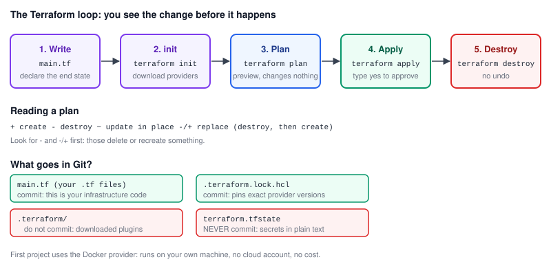

# Chapter 1 — What Is Terraform? Install and Your First Run (No Cloud Needed)

> **Course:** Terraform · **Chapter:** 1 of 8
> Read on the website: [learn.bazardev.com/terraform/01-what-is-terraform-and-your-first-run](https://learn.bazardev.com/terraform/01-what-is-terraform-and-your-first-run)
>
> 🇧🇩 **Prefer Bangla?** [Read this chapter in Bangla →](https://learn.bazardev.com/terraform/01-what-is-terraform-and-your-first-run?lang=bn)

In the Infrastructure as Code course you met the idea: describe infrastructure as code, and a tool makes the real world match. This course is about one of those tools, **Terraform**, which **creates** infrastructure: servers, networks, DNS records, databases. By the end of this chapter you will know how Terraform thinks, and you will have run its full loop (`init`, `plan`, `apply`, `destroy`) on your own machine, with **no cloud account and no cost**, by using Docker.

> **Honesty note: what was and was not run.** Terraform and OpenTofu are **not installed on the server used to write this course**, and nothing was installed for it. So the commands and code below are written from the official Terraform and OpenTofu documentation and are **not executed here**. What *was* checked: the install commands, the `init` / `fmt` / `validate` / `apply` / `show` / `state list` / `destroy` commands, the example configuration (taken from HashiCorp's own Docker tutorial), the meaning of the plan symbols, the version-constraint rules, the lock-file and state-file advice were read from the official docs, and every external link was opened. The **HCL code was not parsed by Terraform** (it is not installed), so it is as correct as the tutorial it comes from. The **output blocks show the shape described in the docs**, not a real run, and provider versions change over time. Whether it works on **your** machine is for you to prove, on a practice machine, with the safe steps below.



## 1. What Terraform is

From the official docs: Terraform is "an infrastructure as code tool that lets you build, change, and version cloud and on-prem resources". Four ideas explain almost everything about it:

| Idea | Meaning |
|---|---|
| **Configuration** | Text files (ending in `.tf`) in which you **declare** what you want. The docs call them declarative: they "describe the end state of your infrastructure". |
| **Provider** | A plugin that lets Terraform talk to one platform. "Providers enable Terraform to work with virtually any platform or service with an accessible API." There are providers for cloud companies, DNS services, and even Docker. |
| **Resource** | One piece of infrastructure you declare: a server, a network, a container. |
| **State** | Terraform "keeps track of your real infrastructure in a state file, which acts as a source of truth for your environment", and uses it to work out what must change. |

Terraform creates an **execution plan** ("what it will create, update, or destroy") and, **on your approval**, performs it "in the correct order, respecting any resource dependencies". The plan step is what makes Terraform safe to use: you see the change **before** it happens.

## 2. HCL, the language, in one minute

Terraform files are written in HCL. It has only two ideas, both from the docs:

- An **argument** assigns a value to a name: `image_id = "abc123"`.
- A **block** groups content. It has a **type**, zero or more **labels**, and a **body** in braces.

```hcl
resource "aws_instance" "example" {
  ami = "abc123"

  network_interface {
    # ...
  }
}
```

Here `resource` is the block type, `"aws_instance"` and `"example"` are its two labels (the kind of thing, and **your name** for it), and `ami = "abc123"` is an argument. A block can contain **nested blocks**, such as `network_interface`. Names may use letters, digits, underscores and hyphens, and cannot start with a digit. Comments start with `#` (the docs recommend `#`; `//` and `/* */` also work).

## 3. Installing Terraform

Do this on a **practice machine**, not production. The commands below are from HashiCorp's own instructions for Ubuntu and Debian. They need `sudo`, because they add a **new package source** and a signing key to your system, so read each line before you run it. As always: if you do not understand a `sudo` line, do not run it.

```bash
sudo apt-get update && sudo apt-get install -y gnupg software-properties-common

wget -O- https://apt.releases.hashicorp.com/gpg | gpg --dearmor | sudo tee /usr/share/keyrings/hashicorp-archive-keyring.gpg > /dev/null

gpg --no-default-keyring --keyring /usr/share/keyrings/hashicorp-archive-keyring.gpg --fingerprint

echo "deb [arch=$(dpkg --print-architecture) signed-by=/usr/share/keyrings/hashicorp-archive-keyring.gpg] https://apt.releases.hashicorp.com $(grep -oP '(?<=UBUNTU_CODENAME=).*' /etc/os-release || lsb_release -cs) main" | sudo tee /etc/apt/sources.list.d/hashicorp.list

sudo apt update
sudo apt-get install terraform
```

What each part does: the first line installs two small tools; the second downloads HashiCorp's **signing key**; the third prints the key's **fingerprint** so you can compare it with the one on HashiCorp's website (the same habit as checking an SSH fingerprint); the fourth adds HashiCorp's package repository; the last two install Terraform.

Check it worked. The docs show `terraform -help` (which lists the commands), and the `terraform version` command prints the version, the platform and the installed providers:

```bash
terraform -help
terraform version
```

### What about OpenTofu?

**OpenTofu** is the open-source fork from Chapter 1 of the IaC course. Its command is `tofu`, and its core workflow is the same one you are about to learn: `tofu init`, `tofu plan`, `tofu apply`. On Ubuntu, its docs give an installer script (the docs tell you to inspect the downloaded script before running it) or a step-by-step apt repository setup, and the package is named `tofu`. See the OpenTofu install page in the resources. This course writes `terraform`; wherever you see it, an OpenTofu user types `tofu`. Check each project's own docs for any difference before you rely on one.

## 4. Your first project: a web server in a Docker container

To practise without a cloud account, we use the **Docker provider**. HashiCorp's own getting-started tutorial does this: Terraform will pull the `nginx` image and run it as a container. Nothing leaves your machine, and nothing costs money. You need **Docker installed and working** (the Docker course).

Make an empty folder and a file named `main.tf`:

```hcl
terraform {
  required_providers {
    docker = {
      source  = "kreuzwerker/docker"
      version = "~> 4.2.0"
    }
  }
}

provider "docker" {}

resource "docker_image" "nginx" {
  name         = "nginx:latest"
  keep_locally = false
}

resource "docker_container" "nginx" {
  image = docker_image.nginx.image_id
  name  = "tutorial"

  ports {
    internal = 80
    external = 8000
  }
}
```

(This is the tutorial's Mac and Linux version. The version number is the one in the tutorial; a newer one may exist when you read this.) Read it block by block:

| Block | What it says |
|---|---|
| `terraform { required_providers { ... } }` | "I need the `docker` provider, from `kreuzwerker/docker` in the Terraform Registry, in version range `~> 4.2.0`." |
| `provider "docker" {}` | Configure that provider (here, with defaults) |
| `resource "docker_image" "nginx"` | Make sure the image `nginx:latest` is pulled. `keep_locally = false` means remove the image from the machine when the resource is destroyed |
| `resource "docker_container" "nginx"` | Run a container from that image, named `tutorial`, with host port **8000** mapped to container port **80** |

Notice `image = docker_image.nginx.image_id`. A resource can **refer to another resource's value**. This is how Terraform learns that the container **depends on** the image, so it pulls the image first. You never write the order by hand.

### The commands, in order

**`terraform init`**: prepares the folder. Per the tutorial, it downloads the `docker` provider into a hidden `.terraform` directory and writes a file named `.terraform.lock.hcl`, which records the **exact provider versions** used.

```bash
terraform init
```

**`terraform fmt`**: rewrites the files into the standard style and lists any file it changed. **`terraform validate`**: checks the configuration is valid and consistent, printing `Success! The configuration is valid.` Neither touches real infrastructure.

```bash
terraform fmt
terraform validate
```

**`terraform apply`**: builds the plan, shows it, and **waits for you**. In the tutorial the plan marks things to create with `+`, shows values that are not known yet as `(known after apply)`, and ends with `Plan: 2 to add, 0 to change, 0 to destroy.` Only when you type `yes` does it act, finishing with `Apply complete! Resources: 2 added, 0 changed, 0 destroyed.`

```bash
terraform apply
```

Port 8000 on your machine is now mapped to port 80 in the container, so opening `http://localhost:8000` should show the nginx welcome page. Then look at what Terraform knows:

```bash
terraform show          # the recorded state, including the container's IP address and ports
terraform state list    # the resources Terraform tracks
```

`terraform state list` shows `docker_container.nginx` and `docker_image.nginx`, the two resources you declared. Try changing something small, such as the external port, then run `terraform plan` (next section) to see Terraform describe the change **before** it does anything.

**`terraform destroy`**: removes what this project created. The docs: "The `terraform destroy` command terminates resources managed by your Terraform project." It shows a plan with `-` markers, ends with `Plan: 0 to add, 0 to change, 2 to destroy.`, and asks `Do you really want to destroy all resources?`. The tutorial warns: **"There is no undo. Only 'yes' will be accepted to confirm."** It does **not** destroy resources running elsewhere that this project does not manage.

```bash
terraform destroy
```

## 5. Reading a plan

`terraform plan` is the command to know best. Per the docs it: (1) reads the current state of existing objects, (2) compares your configuration with the prior state, and (3) proposes the changes that would make the real objects match. It **does not carry out** those changes. The symbols:

| Symbol | Meaning |
|---|---|
| `+` | Create: the resource does not exist yet |
| `-` | Destroy: the resource will be destroyed |
| `~` | Update **in place**: changed without being destroyed and recreated |
| `-/+` | **Replace**: destroyed, then created again |

Learn to look for `-` and `-/+` first. They are the ones that delete or recreate something, and for a database or a server that is the line that matters. With `-out=FILE` you can save a plan and later give that file to `terraform apply`. The docs say this is mainly for automation, and that plan files can contain **sensitive data in cleartext**, so treat them as sensitive.

## 6. Which files go in Git

After your first run, the folder holds:

| File or folder | Git? | Why |
|---|---|---|
| `main.tf` (your `.tf` files) | **Yes** | This is your infrastructure code |
| `.terraform.lock.hcl` | **Yes** | The docs: "You should include this file in your version control repository", so provider version changes go through review. `terraform init` creates or updates it, and `terraform init -upgrade` moves to newer versions |
| `.terraform/` | No | Downloaded provider plugins; `terraform init` recreates it |
| `terraform.tfstate` | **Never** | The state file |

About the state file, the docs are blunt: "Terraform stores your state in a plaintext file, which includes any secret values you defined in your configuration", and marking a value `sensitive` does **not** keep it out of state. "Treat your state file as sensitive data by excluding it from Git workflows." Start with a `.gitignore` before your first commit:

```text
.terraform/
*.tfstate
*.tfstate.*
```

Chapter 3 explains what state is and how Terraform uses it, and Chapter 7 shows safer places to keep it, such as remote storage.

## 7. Version constraints in one minute

The `version = "~> 4.2.0"` line is a **constraint**. From the docs: `=` allows one exact version, `!=` excludes one, `>`, `>=`, `<`, `<=` compare, and `~>` "allows only the right-most version component to increment". Their examples: `~> 1.0.4` allows `1.0.5` and `1.0.10` but not `1.1.0`, and `~> 1.1` allows `1.2` and `1.10` but not `2.0`. So `~> 4.2.0` means "any 4.2.x, but not 4.3". The docs recommend that root modules (your projects) use a `~>` constraint to set both a lower and an upper bound on each provider, so an automatic upgrade cannot surprise you.

## 8. The core workflow

Everything you did is one loop, the same one the official docs describe as **Write, Plan, Apply**:

1. **Write**: author the `.tf` files, keep them in Git, run `terraform init` once to set up the folder.
2. **Plan**: preview the change. Review it like a pull request.
3. **Apply**: approve, and Terraform makes it so. The next change starts again from Write.

Teams add branches and pull requests on top: a plan is reviewed before merge, exactly like the Git and CI/CD courses taught for application code.

## 9. Safe habits from day one

1. **Read every plan**, especially `-` and `-/+`, before typing `yes`.
2. **Practise with local, throwaway things** (Docker, as here) until the loop is automatic.
3. **Never commit state or plan files.** They can hold secrets in plain text.
4. **Commit `.terraform.lock.hcl`**, and pin providers with `~>`.
5. **`destroy` has no undo.** Know which folder you are in, and read what it lists.
6. **Let Terraform own what it creates.** If you change a resource by hand, the next plan will want to undo your change (this is the drift problem from the IaC course).

## 10. Self-check

<details>
<summary><strong>Q1. What does Terraform mainly do, and how is it different from Ansible?</strong></summary>

Terraform provisions infrastructure (servers, networks, DNS, containers) by declaring the end state, and it keeps a state file. Ansible mainly configures what runs on machines and keeps no state file.
</details>

<details>
<summary><strong>Q2. Name the four ideas: configuration, provider, resource, state.</strong></summary>

Configuration is the declarative `.tf` files. A provider is a plugin that talks to one platform. A resource is one piece of infrastructure you declare. State is the file where Terraform records what it manages.
</details>

<details>
<summary><strong>Q3. In `resource "docker_container" "nginx" { ... }`, what are `resource`, `"docker_container"` and `"nginx"`?</strong></summary>

`resource` is the block type. `"docker_container"` is the kind of resource (from the provider) and `"nginx"` is your own name for it.
</details>

<details>
<summary><strong>Q4. What does `terraform init` do?</strong></summary>

It prepares the folder: it downloads the required providers into the hidden `.terraform` directory and creates or updates `.terraform.lock.hcl`, which records the exact provider versions.
</details>

<details>
<summary><strong>Q5. Why does `image = docker_image.nginx.image_id` matter?</strong></summary>

It refers to another resource's value, so Terraform learns the container depends on the image and creates them in the right order without you writing the order.
</details>

<details>
<summary><strong>Q6. What do `+`, `-`, `~` and `-/+` mean in a plan?</strong></summary>

Create, destroy, update in place, and replace (destroy then create again).
</details>

<details>
<summary><strong>Q7. Which files do you commit, and which never?</strong></summary>

Commit the `.tf` files and `.terraform.lock.hcl`. Do not commit `.terraform/`, and never commit the state file, because it can hold secrets in plain text.
</details>

<details>
<summary><strong>Q8. What does `~> 4.2.0` allow?</strong></summary>

Only the last component may increase: any `4.2.x`, but not `4.3`.
</details>

## 11. Free resources

- Terraform docs: [What is Terraform?](https://developer.hashicorp.com/terraform/intro) and [The core Terraform workflow](https://developer.hashicorp.com/terraform/intro/core-workflow)
- Tutorial: [Install Terraform](https://developer.hashicorp.com/terraform/tutorials/docker-get-started/install-cli) and [Build infrastructure (Docker)](https://developer.hashicorp.com/terraform/tutorials/docker-get-started/docker-build), then [Destroy infrastructure](https://developer.hashicorp.com/terraform/tutorials/docker-get-started/docker-destroy)
- Terraform docs: [`terraform plan`](https://developer.hashicorp.com/terraform/cli/commands/plan), [`terraform version`](https://developer.hashicorp.com/terraform/cli/commands/version), [Configuration syntax](https://developer.hashicorp.com/terraform/language/syntax/configuration), [Version constraints](https://developer.hashicorp.com/terraform/language/expressions/version-constraints), [Dependency lock file](https://developer.hashicorp.com/terraform/language/files/dependency-lock), [Sensitive data in state](https://developer.hashicorp.com/terraform/language/state/sensitive-data)
- OpenTofu: [Install on Debian/Ubuntu](https://opentofu.org/docs/intro/install/deb/) and [Core workflow](https://opentofu.org/docs/intro/core-workflow/)

---

**Next:** [Chapter 2 — HCL: Variables, Outputs, and Expressions](02-hcl-variables-outputs-and-expressions.md)
