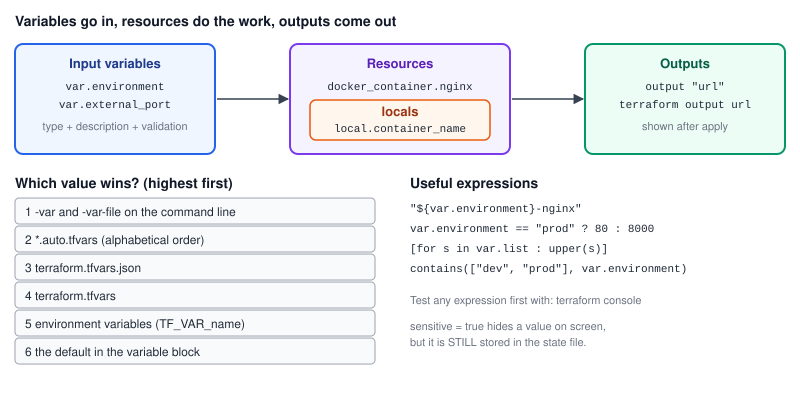

# Chapter 2 — HCL: Variables, Outputs, and Expressions

> **Course:** Terraform · **Chapter:** 2 of 8
> Read on the website: [learn.bazardev.com/terraform/02-hcl-variables-outputs-and-expressions](https://learn.bazardev.com/terraform/02-hcl-variables-outputs-and-expressions)
>
> 🇧🇩 **Prefer Bangla?** [Read this chapter in Bangla →](https://learn.bazardev.com/terraform/02-hcl-variables-outputs-and-expressions?lang=bn)

In Chapter 1 every value was written straight into `main.tf`: the container name, the port, the image. That works for one project, but real infrastructure needs the **same code with different values**: `dev` and `prod`, port 8000 here and 8080 there. This chapter teaches the parts of HCL that make code reusable and readable: **variables** (inputs), **outputs**, **locals**, and **expressions**.

> **Honesty note: what was and was not run.** Terraform and OpenTofu are **not installed on the server used to write this course**, and nothing was installed for it. So the code and commands below are written from the official Terraform documentation and are **not executed here**. What *was* checked: the `variable` block (including `validation` and `sensitive`), the ways to set values and their precedence order, `locals`, `output`, the `terraform output` and `terraform console` commands, the types, string interpolation and heredocs, the conditional expression, `for` expressions, and the `join`, `upper` and `length` functions were read from the official docs, and every external link was opened. The **HCL was not parsed by Terraform**, so a small mistake is possible. The **output blocks show the shape described in the docs**, not a real run. The chapter's own example builds on the Docker project from Chapter 1; try it on a practice machine, and read each plan before you type `yes`.



## 1. Input variables

An **input variable** is a named, typed value that the person running Terraform can set from outside the code. You declare it with a `variable` block, and use it as `var.<name>`. The docs' example:

```hcl
variable "environment" {
  type        = string
  description = "Deployment environment name"
  default     = "dev"

  validation {
    condition     = contains(["dev", "staging", "prod"], var.environment)
    error_message = "Environment must be dev, staging, or prod."
  }
}
```

| Argument | Meaning |
|---|---|
| `type` | What kind of value is allowed (section 2) |
| `description` | A sentence for humans. Always write one |
| `default` | The value used if nobody sets one. **Without a default, Terraform asks for the value** before it makes a plan |
| `validation` | A rule. If the `condition` is false, Terraform stops and shows the `error_message`. The docs: it helps ensure "the value a consumer specifies as the input value meets module requirements" |
| `sensitive` | Hide the value in CLI output (section 3) |

Use a variable anywhere a value is expected:

```hcl
resource "docker_container" "web" {
  name = "${var.environment}-web"
}
```

## 2. Types

HCL values have types. From the docs:

| Type | Meaning | Example |
|---|---|---|
| `string` | Text | `"hello"` |
| `number` | Whole numbers and fractions | `15`, `6.283185` |
| `bool` | `true` or `false` | `true` |
| `list` | An ordered sequence, indexed from zero | `["us-west-1a", "us-west-1c"]` |
| `set` | Unique values with no order. Index access is not supported; convert with `tolist()` first | `set(string)` |
| `map` / `object` | Named values; keys are strings | `{ name = "Mabel", age = 52 }` |
| `null` | "Absence or omission". Setting an argument to `null` is the same as leaving it out | `null` |

Terraform converts automatically where it can: `15` and `"15"`, `true` and `"true"` convert both ways. If conversion is impossible, you get a type-mismatch error. Declare `type` on every variable: it catches mistakes early and documents what is expected.

## 3. Setting values, and which one wins

The docs list these ways to give a variable a value:

| Way | Example |
|---|---|
| Command line | `terraform apply -var="instance_type=t3.medium" -var="environment=prod"` |
| A variable-definition file | `terraform apply -var-file="production.auto.tfvars"` |
| `terraform.tfvars` or `terraform.tfvars.json` | Loaded **automatically** |
| `*.auto.tfvars` or `*.auto.tfvars.json` | Loaded **automatically** |
| Environment variable | `export TF_VAR_environment=staging` |
| The variable's `default` | Used when nothing else sets it |

A file such as `terraform.tfvars` simply lists values:

```hcl
environment   = "staging"
external_port = 8080
```

When the same variable gets values from several places, the docs give this order, **highest first**:

1. `-var` and `-var-file` on the command line
2. `*.auto.tfvars` files, in lexical (alphabetical) order
3. `terraform.tfvars.json`
4. `terraform.tfvars`
5. Environment variables (`TF_VAR_...`)
6. The `default` in the `variable` block

In short: the command line beats files, files beat environment variables, and the default is the last resort.

### Sensitive variables, and an honest limit

```hcl
variable "database_password" {
  type        = string
  description = "Password for the RDS database instance"
  sensitive   = true
}
```

`sensitive = true` keeps Terraform from **displaying** the value in CLI output. But the docs are clear: **"Terraform still stores the values of sensitive variables in your state."** It hides the value on screen; it does not keep it out of the state file (Chapter 1: state is plaintext and never goes in Git). The `ephemeral` argument can omit a value from state and plan files, but it restricts where the value can be used; read the docs before relying on it.

Practical rules, in the spirit of the docs and of Chapter 1: pass secrets by environment variable or a file that is **not** in Git, never as a `default` in code you commit, and list `*.tfvars` files that hold secrets in `.gitignore`. A good habit is to commit a `terraform.tfvars.example` with fake values, so teammates know what to set.

## 4. Locals: give an expression a name

A `locals` block gives a name to an expression, so you write it once. You read it with the **singular** `local.<name>`:

```hcl
locals {
  container_name = "${var.environment}-nginx"
}
```

Per the docs, locals can use variables, resource attributes, function results and other locals, and are visible only in the module that defines them. Use them to reuse a value, to name a complex expression, or to change something in one place. The docs also warn they "can make configuration harder to read because they obscure where values originate", so do not use a local for a value used only once.

## 5. Outputs: values that come back out

An **output** prints a value after `apply`, and makes it available to other tools (and, later, to other modules). The docs' example:

```hcl
output "instance_id" {
  description = "ID of the EC2 instance"
  value       = aws_instance.web.id
}
```

`value` can be "any valid expression". Terraform displays the root module's outputs after `terraform apply`. You can read them again any time, by name:

```bash
terraform output
terraform output instance_id
```

Mark an output `sensitive = true` to show `<sensitive>` instead of the value. But, again from the docs: sensitive outputs are **still stored in state**, and the `-json` and `-raw` flags of `terraform output` show sensitive values in **plain text**. Do not print them into CI logs.

## 6. Expressions

An **expression** is anything that produces a value. You have already used the simplest ones: a literal (`"nginx:latest"`), a reference (`var.environment`, `docker_image.nginx.image_id`).

### Strings and interpolation

Inside a quoted string, `${ ... }` evaluates an expression and puts the result in the text:

```hcl
"Hello, ${var.name}!"
```

To write a literal `${`, use `$${`. For multi-line text, a **heredoc** starts with `<<` and an identifier at the end of a line; `<<-` removes the common leading indentation:

```hcl
user_data = <<-EOT
  hello
    world
EOT
```

The docs also describe a **template directive** that chooses between two texts, `%{ if ... }...%{ else }...%{ endif }`, and note that the `else` part is optional.

### Conditional expressions

```hcl
condition ? true_val : false_val
```

Both results must be of the **same type**. The docs warn that `var.example ? 12 : "hello"` quietly turns the number into a string, and recommend being explicit, as in `var.example ? tostring(12) : "hello"`.

A common use: a different value per environment.

```hcl
locals {
  external_port = var.environment == "prod" ? 80 : 8000
}
```

### `for` expressions: transform a collection

A `for` expression builds a new list or map from an existing one. From the docs:

```hcl
[for s in var.list : upper(s)]
{for s in var.list : s => upper(s)}
[for s in var.list : upper(s) if s != ""]
```

Square brackets give a **list**, braces with `=>` give a **map**, and an optional `if` keeps only matching items.

### Functions

Terraform has built-in functions, called like `name(arguments)`. A few from the docs:

| Function | What it does | Example |
|---|---|---|
| `upper` | Converts letters to uppercase | `upper("hello")` is `HELLO` |
| `join` | Joins a list of strings with a separator | `join("-", ["foo", "bar", "baz"])` is `"foo-bar-baz"` |
| `length` | Counts items in a list or map, or characters in a string | `length(["a", "b"])` is `2` |
| `contains` | Is a value in a list? (used in the validation example above) | `contains(["dev", "prod"], "dev")` is `true` |

There are many more. Look in the function reference before you write something long by hand.

## 7. Try expressions safely: `terraform console`

`terraform console` opens an interactive prompt where you can test expressions and functions, without changing any infrastructure. The docs' example session:

```
$ terraform console
> cidrnetmask("172.16.0.0/12")
"255.240.0.0"
> exit
```

Close it with `exit`, Control-C or Control-D. The console reads the state of the current workspace first, so it can also show values from resources you have already applied. If a value does not exist yet, it shows `(known after apply)`. When an expression does not behave as you expect, test it here before you put it in your code.

## 8. Putting it together: the Docker project, parameterised

Split the Chapter 1 project into three files. The file names are a **convention** that humans expect; Terraform reads the `.tf` files in the folder together.

`variables.tf`:

```hcl
variable "environment" {
  type        = string
  description = "Deployment environment name"
  default     = "dev"

  validation {
    condition     = contains(["dev", "staging", "prod"], var.environment)
    error_message = "Environment must be dev, staging, or prod."
  }
}

variable "external_port" {
  type        = number
  description = "Port on this machine that reaches the web server"
  default     = 8000

  validation {
    condition     = var.external_port >= 1024 && var.external_port <= 65535
    error_message = "Use a port between 1024 and 65535."
  }
}
```

`main.tf`:

```hcl
terraform {
  required_providers {
    docker = {
      source  = "kreuzwerker/docker"
      version = "~> 4.2.0"
    }
  }
}

provider "docker" {}

locals {
  container_name = "${var.environment}-nginx"
}

resource "docker_image" "nginx" {
  name         = "nginx:latest"
  keep_locally = false
}

resource "docker_container" "nginx" {
  image = docker_image.nginx.image_id
  name  = local.container_name

  ports {
    internal = 80
    external = var.external_port
  }
}
```

`outputs.tf`:

```hcl
output "container_name" {
  description = "Name of the running container"
  value       = docker_container.nginx.name
}

output "url" {
  description = "Where to open the web server"
  value       = "http://localhost:${var.external_port}"
}
```

Now the same code gives different results from different inputs:

```bash
terraform init
terraform validate
terraform plan                                          # dev, port 8000 (the defaults)
terraform plan -var="environment=staging" -var="external_port=8080"
terraform plan -var="environment=qa"                    # rejected by validation, shows the error_message
terraform apply -var="environment=staging" -var="external_port=8080"
terraform output url
terraform destroy -var="environment=staging" -var="external_port=8080"
```

The `qa` line is the point of `validation`: a wrong value is stopped **before** any plan is made, with a message you wrote. Note that it is simplest to pass the **same values** to `destroy` that you used for `apply`, or to put them in `terraform.tfvars` once, so every command sees the same inputs. That is the usual reason people keep a `terraform.tfvars` file. As in Chapter 1, read each plan and look for `-` and `-/+` before typing `yes`, because changing a container's name or port may mean replacing it.

## 9. Good habits

1. **Every variable gets a `type` and a `description`.** It is your documentation.
2. **Validate early.** A `validation` block turns a confusing failure later into a clear message now.
3. **No secrets as defaults,** and none in files in Git. Remember `sensitive` hides, it does not remove from state.
4. **Do not print sensitive outputs** into logs (`-json` and `-raw` show them in plain text).
5. **Use locals sparingly,** for values reused or hard to read, not everywhere.
6. **Test expressions in `terraform console`** before you trust them.
7. **Same inputs, same result.** If a `plan` surprises you, the first question is "which source set this variable?" (section 3).

## 10. Self-check

<details>
<summary><strong>Q1. What happens if a variable has no `default` and you do not set it?</strong></summary>

Terraform prompts you to supply a value before it makes a plan.
</details>

<details>
<summary><strong>Q2. A variable is set in `terraform.tfvars` to `8080`, by `TF_VAR_external_port=9090`, and by `-var="external_port=7070"`. Which value is used?</strong></summary>

`7070`. The command line (`-var`) has the highest precedence, then `*.auto.tfvars`, then `terraform.tfvars`, then environment variables, then the default.
</details>

<details>
<summary><strong>Q3. What does `validation` do, and when does it run?</strong></summary>

It checks a rule on the value. If the `condition` is false, Terraform stops before making a plan and shows your `error_message`.
</details>

<details>
<summary><strong>Q4. Does `sensitive = true` keep a secret out of the state file?</strong></summary>

No. It only hides the value in CLI output. Terraform still stores sensitive values in state, so state must never go in Git.
</details>

<details>
<summary><strong>Q5. What is the difference between a variable and a local?</strong></summary>

A variable is an input that the person running Terraform can set from outside. A local is a name for an expression, calculated inside the module, and cannot be set from outside.
</details>

<details>
<summary><strong>Q6. Write the expression that returns 80 in `prod` and 8000 otherwise.</strong></summary>

`var.environment == "prod" ? 80 : 8000`
</details>

<details>
<summary><strong>Q7. What do `[for s in var.list : upper(s)]` and `{for s in var.list : s => upper(s)}` return?</strong></summary>

The first returns a list of the uppercase strings. The second returns a map from each original string to its uppercase version.
</details>

<details>
<summary><strong>Q8. What is `terraform console` for?</strong></summary>

Testing expressions and functions interactively, without changing infrastructure. It also reads the current workspace's state, so it can show values of resources already applied.
</details>

## 11. Free resources

- Terraform docs: [Input variables](https://developer.hashicorp.com/terraform/language/values/variables), [Output values](https://developer.hashicorp.com/terraform/language/values/outputs), [Local values](https://developer.hashicorp.com/terraform/language/values/locals)
- Terraform docs: [Types and values](https://developer.hashicorp.com/terraform/language/expressions/types), [Strings and templates](https://developer.hashicorp.com/terraform/language/expressions/strings), [Conditional expressions](https://developer.hashicorp.com/terraform/language/expressions/conditionals), [`for` expressions](https://developer.hashicorp.com/terraform/language/expressions/for)
- Terraform docs: [`join`](https://developer.hashicorp.com/terraform/language/functions/join), [`upper`](https://developer.hashicorp.com/terraform/language/functions/upper), [`length`](https://developer.hashicorp.com/terraform/language/functions/length), and [`terraform console`](https://developer.hashicorp.com/terraform/cli/commands/console)

---

**Next:** [Chapter 3 — State, and How Terraform Decides What to Change](03-state-and-how-terraform-thinks.md)
