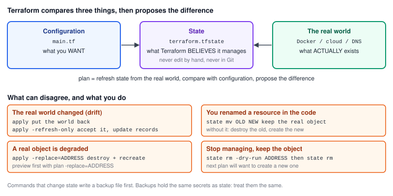

# Chapter 3 — State, and How Terraform Decides What to Change

> **Course:** Terraform · **Chapter:** 3 of 8
> Read on the website: [learn.bazardev.com/terraform/03-state-and-how-terraform-thinks](https://learn.bazardev.com/terraform/03-state-and-how-terraform-thinks)
>
> 🇧🇩 **Prefer Bangla?** [Read this chapter in Bangla →](https://learn.bazardev.com/terraform/03-state-and-how-terraform-thinks?lang=bn)

Every Terraform surprise, good or bad, comes back to one thing: **state**. Why does `plan` say "destroy and create" when you only renamed something? Why does Terraform notice that someone deleted a server by hand? What does it mean to "forget" a resource? Once you understand how Terraform compares **three things**, these questions answer themselves. This chapter teaches that, and shows it on your own machine with the Docker project from Chapter 2.

> **Honesty note: what was and was not run.** Terraform and OpenTofu are **not installed on the server used to write this course**, and nothing was installed for it. So the commands below are written from the official Terraform documentation and are **not executed here**. What *was* checked: the purpose and default location of state, the `terraform state` subcommands (`list`, `show`, `mv`, `rm`), the `-dry-run`, `-refresh-only`, `-refresh=false` and `-replace` options, the rule that state-changing commands write backups, and the description of import were read from the official docs, and every external link was opened. The **exact wording of Terraform's messages is not quoted**, because it was not run: the chapter says what the docs say happens, and you will see the real text on your machine. Some experiments below **delete a container** or **change state**. They are meant only for the throwaway Docker project of Chapters 1 and 2, on a practice machine, never for anything real.



## 1. The three things Terraform compares

| Thing | What it is | Where it lives |
|---|---|---|
| **Configuration** | What you **want** | Your `.tf` files |
| **State** | What Terraform **believes it manages**, and which real object belongs to which resource block | A file, by default `terraform.tfstate` |
| **The real world** | What **actually exists** | Docker, a cloud provider, DNS... |

From the docs: "Terraform uses your workspace's state to map real world resources to your configuration." Without state, Terraform could not tell *which* container belongs to `docker_container.nginx`. State also stores metadata and speeds up large projects.

A `plan` is Terraform's answer to "how do I make the world match the configuration?" Per the docs, before any operation Terraform **refreshes** its state against the real infrastructure, then compares your configuration with the state, and proposes actions. That is the whole algorithm:

1. **Look at the real world** and update what it knows.
2. **Compare** configuration with state.
3. **Propose** the difference: create, change, replace, destroy.

Keep this picture. Everything below is a variation on it.

## 2. What state is, physically

By default, "Terraform stores each workspace's state in a local file named `terraform.tfstate`". It is a **JSON text file**, and the previous version is kept as a backup file next to it. Three rules from the docs and from Chapter 1:

1. **Do not edit it by hand.** The docs: "Do not directly edit this file." For basic changes, use the `terraform state` commands.
2. **It can contain secrets in plain text.** Marking a variable `sensitive` does not remove it from state (Chapter 2). Never commit it, never paste it into a chat or a ticket.
3. **It is precious.** If it is lost, Terraform no longer knows which real objects it owns. The next plan would want to create everything again, and could clash with what already exists.

You can read it, carefully, without changing it (use a pager, and do not share the output):

```bash
less terraform.tfstate
```

## 3. Looking inside state the safe way

Instead of reading the JSON, use the commands made for it. These only **read**:

```bash
terraform state list                       # every resource Terraform knows about
terraform state show docker_container.nginx   # details of one resource
terraform show                             # the whole state in readable form
```

Per the docs, `terraform state list` shows "the resource addresses for every resource Terraform knows about", and can be filtered by part of an address. `terraform state show` "displays detailed state data about one resource". The thing like `docker_container.nginx` is called a **resource address**: the block type, a dot, and the name you gave it.

## 4. Experiment 1: someone changes the real world

This is the most useful experiment in the course. Start from the finished project of Chapter 2, applied, with the container running. (The names below use the defaults, `dev-nginx`. If you applied with other values, use your container's name.)

1. Check that Terraform is happy:

```bash
terraform plan
```

It should report that the real infrastructure matches the configuration, with nothing to change.

2. Now act **outside Terraform**, as a careless teammate might. Remove the container by hand with Docker:

```bash
docker rm -f dev-nginx
```

3. Run the plan again:

```bash
terraform plan
```

Terraform refreshes its state first, so it **notices the container is gone**. The configuration still says it should exist, so the plan proposes to **create** it again (`+`). Nobody told Terraform; it looked at the real world. This is **drift**: the world changed behind Terraform's back.

4. You now have a choice, and the plan options exist for exactly this:

| What you want | Command |
|---|---|
| **Put the world back** to match the code (create the container again) | `terraform apply` |
| **Accept the change** and just update Terraform's records, touching nothing | `terraform apply -refresh-only` |

The docs describe `-refresh-only` as a plan "whose goal is only to update the Terraform state and any root module output values" to match "changes made to remote objects outside of Terraform", for example after an incident. Use `terraform plan -refresh-only` to **preview** that record update first. Note that if you only update the records but your configuration still declares the container, the *next* normal plan will propose creating it. Reconciling records and fixing the code are two separate decisions.

Run `terraform apply` to restore the container. Drift is why the IaC course said: **change the code, not the server**.

### A related option, `-refresh=false`

`terraform plan -refresh=false` skips the "look at the real world" step. The docs warn that it "causes Terraform to ignore external changes, which could result in an incomplete or incorrect plan". It is faster for huge projects, but it can hide drift. Do not use it as a habit.

## 5. Experiment 2: force a rebuild with `-replace`

Sometimes a real object exists but is in a bad state (a container misbehaving). You want Terraform to **destroy and recreate** it, though the code did not change. The docs' answer is the `-replace` option:

```bash
terraform plan  -replace=docker_container.nginx    # preview
terraform apply -replace=docker_container.nginx    # do it
```

Per the docs, it "instructs Terraform to plan to replace the resource instance with the given address", is "helpful when one or more remote objects have become degraded", can be repeated to replace several objects, and cannot be combined with `-destroy`. In the plan, look for `-/+` (Chapter 1).

## 6. Experiment 3: renaming a resource, and `terraform state mv`

Open `main.tf` and rename the block `docker_container "nginx"` to `docker_container "web"`. (Also update the output that refers to `docker_container.nginx.name`.) Run `terraform plan`.

Terraform **does not know you renamed it**. It sees: "`docker_container.nginx` is in state but not in the configuration, so destroy it; `docker_container.web` is in the configuration but not in state, so create it." A rename becomes a destroy and a create. For a container that is harmless. For a **database**, it is a disaster.

The docs' fix is to tell Terraform that the existing object has a **new address**:

```bash
terraform state mv docker_container.nginx docker_container.web
```

Per the docs, `terraform state mv` "changes bindings in Terraform state so that existing remote objects bind to new resource instances." The two addresses must refer to the same kind of resource. Run `terraform plan` again: it should now show nothing to change. The docs add one caution: no teammate should make changes between your configuration edit and the `state mv`, or a plan could destroy and recreate the object.

## 7. `terraform state rm`: make Terraform forget

```bash
terraform state rm -dry-run docker_container.web   # preview what would be forgotten
terraform state rm docker_container.web            # forget it
```

Per the docs, it "removes the binding to an existing remote object **without first destroying it**". The container keeps running, but Terraform no longer manages it. Understand the consequence: the next `terraform plan` "will include an action to create a new object for each of the 'forgotten' instances", and creating may fail if names clash with the old objects still there. The docs recommend `removed` blocks as the way to do this inside your normal plan-and-review workflow. Treat `state rm` as a **surgical tool**: always `-dry-run` first. Avoid `-lock=false`, which the docs call dangerous if others may run commands on the same workspace.

(After this experiment the container is still running, but Terraform no longer owns it. Do **not** just run `terraform apply`: it would try to create a second container with the same name and clash. To clean up your practice project, remove the leftover container by hand (`docker rm -f dev-nginx`), then run `terraform apply` to create a fresh, managed one, or bring the existing one back with import (section 9).)

## 8. Backups, and why they matter

Any command that **modifies** state writes a backup file first. The docs: "backups for state modification can not be disabled", "Terraform forces every state modification command to write a backup file", and you must remove them manually if you do not want to keep them. Read-only commands such as `list` write none. So `state mv` and `state rm` are not as scary as hand-editing, because they leave a way back. A backup file holds the same secrets as the state, so it needs the same care and the same `.gitignore` entries (`*.tfstate.*` from Chapter 1 covers it).

## 9. Existing infrastructure: import

What if a server already exists, built by hand, and you want Terraform to manage it? Writing a `resource` block alone would make Terraform try to **create a second one**. **Import** attaches an existing object to a resource address in state. Per the docs, you can "import them to your Terraform workspace so that you can begin managing the resources as code", and you must write a destination `resource` block that matches the address. The docs also describe an `import` block (it names the resource ID to import) and a plan option that can **generate** the matching `resource` blocks for you. The exact syntax depends on your Terraform version and the provider, so read the Terraform import page, and try it first on something harmless. Importing is how you bring a hand-made server under the "change the code, not the server" rule.

## 10. State and teamwork: a preview

A local state file is fine for you alone. For a **team** it is dangerous: two people could apply at once, or one could use an old copy. The docs recommend a **remote backend** (or HCP Terraform) instead, and warn against version-control systems that lack **state locking**, which stops two runs from changing the same state at once. Chapter 7 covers remote state, locking and workspaces. For now, remember the rule: **one state, one safe home, never in Git.**

## 11. Habits that keep you safe

1. **Think in three:** configuration, state, real world. When a plan surprises you, ask which two disagree.
2. **Read the plan** for `-` and `-/+`, every time.
3. **Never hand-edit state.** Use `terraform state ...` commands, and `-dry-run` first.
4. **Rename with `state mv`,** or the rename becomes a destroy and create.
5. **Treat drift as a signal.** Decide: restore the world (`apply`), or accept it (`apply -refresh-only` and fix the code).
6. **Do not make a habit of `-refresh=false` or `-lock=false`.**
7. **Protect state and its backups** like a password file.

## 12. Self-check

<details>
<summary><strong>Q1. What are the three things Terraform compares when it plans?</strong></summary>

Your configuration (what you want), the state (what Terraform believes it manages), and the real world (what actually exists).
</details>

<details>
<summary><strong>Q2. A teammate deletes a container by hand. What does the next `terraform plan` show, and why?</strong></summary>

A plan to create it again (`+`). Terraform refreshes its state against the real infrastructure first, sees the object is gone, and the configuration still says it should exist.
</details>

<details>
<summary><strong>Q3. What does `terraform apply -refresh-only` do?</strong></summary>

It updates Terraform's state (and outputs) to match changes made outside Terraform, without changing the real infrastructure.
</details>

<details>
<summary><strong>Q4. You rename `docker_container "nginx"` to `"web"` in the code. What does the plan show, and what fixes it?</strong></summary>

A destroy of the old address and a create of the new one, because Terraform does not know it is the same object. `terraform state mv docker_container.nginx docker_container.web` fixes it by moving the binding.
</details>

<details>
<summary><strong>Q5. What does `terraform state rm` do, and what happens at the next plan?</strong></summary>

It removes the binding to a real object without destroying it, so Terraform forgets it. The next plan will propose creating a new object for each forgotten one, which may clash with the existing object.
</details>

<details>
<summary><strong>Q6. How do you force Terraform to recreate one resource without changing the code?</strong></summary>

`terraform apply -replace=ADDRESS`, for example `-replace=docker_container.nginx`. Preview it first with `terraform plan -replace=...`.
</details>

<details>
<summary><strong>Q7. Why must you never edit `terraform.tfstate` by hand, and what do you use instead?</strong></summary>

It is Terraform's source of truth in JSON, and a mistake can make Terraform lose track of real objects. Use the `terraform state` commands, which also write backups.
</details>

<details>
<summary><strong>Q8. Why is a local state file a problem for a team?</strong></summary>

Two people could apply at once or use an old copy. A remote backend with state locking is recommended, and state must never be kept in Git.
</details>

## 13. Free resources

- Terraform docs: [State](https://developer.hashicorp.com/terraform/language/state) and [Sensitive data in state](https://developer.hashicorp.com/terraform/language/state/sensitive-data)
- Terraform docs: [`terraform state`](https://developer.hashicorp.com/terraform/cli/commands/state), [Inspect state](https://developer.hashicorp.com/terraform/cli/state/inspect), [`state mv`](https://developer.hashicorp.com/terraform/cli/commands/state/mv), [`state rm`](https://developer.hashicorp.com/terraform/cli/commands/state/rm)
- Terraform docs: [`terraform plan`](https://developer.hashicorp.com/terraform/cli/commands/plan) (for `-refresh-only`, `-replace`, `-refresh=false`) and [Import](https://developer.hashicorp.com/terraform/language/import)

---

**Next:** [Chapter 4 — Modules: Reusable Infrastructure](04-modules.md)
