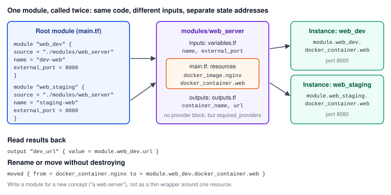

# Chapter 4 — Modules: Reusable Infrastructure

> **Course:** Terraform · **Chapter:** 4 of 8
> Read on the website: [learn.bazardev.com/terraform/04-modules](https://learn.bazardev.com/terraform/04-modules)
>
> 🇧🇩 **Prefer Bangla?** [Read this chapter in Bangla →](https://learn.bazardev.com/terraform/04-modules?lang=bn)

You now have a Docker web server in code. What if you need **two**: one for `dev` on port 8000 and one for `staging` on port 8080? Copying the blocks works once, then every fix has to be made twice, and the copies slowly drift apart. This is the same problem Ansible roles solved. In Terraform the answer is a **module**: a folder of Terraform code that you write once and **call** as many times as you like, with different inputs.

> **Honesty note: what was and was not run.** Terraform and OpenTofu are **not installed on the server used to write this course**, and nothing was installed for it. So the code and commands below are written from the official Terraform documentation and are **not executed here**. What *was* checked: what a module is (root and child modules), the `module` block (`source`, `version`, inputs, `module.<label>.<output>`), the meta-arguments, the source types, the standard module structure, the advice on when to write a module, the rules for providers in modules, and the `moved` block were read from the official docs, and every external link was opened. The **HCL was not parsed by Terraform**, so a small mistake is possible. The example builds on the Docker project from Chapters 1 to 3 and costs nothing. Try it on a practice machine, and read every plan before you type `yes`.



## 1. What a module is

From the official docs: a module is "a collection of resources that Terraform manages together." Two words matter:

| Word | Meaning |
|---|---|
| **Root module** | The configuration files in the folder where you run Terraform. **Every** Terraform project already has one: everything you wrote in Chapters 1 to 3 was a root module |
| **Child module** | A module that another module **calls** with a `module` block. A root module can call child modules more than once, and a child can call its own children |

So you have been writing modules all along. This chapter is about **calling** one from another. The docs' reason to do it: "when you repeatedly provision similar groups of resources", reusable modules help teams "standardize provisioning and deploy the resources they need faster and more predictably."

## 2. A module has an interface

A good module looks like a function. It has **inputs** (variables), **outputs**, and a body of resources. The docs: modules use "the same configuration concepts as root modules, with a clear interface". The recommended minimum layout (the "standard module structure") is four files:

```text
modules/web_server/
├── README.md       # what this module is for
├── main.tf         # the resources
├── variables.tf    # the inputs
└── outputs.tf      # the outputs
```

The docs recommend giving **every variable and output a description**, and keeping nested modules under a `modules/` directory, called by relative path (such as `./modules/web_server`). Files named `main.tf`, `variables.tf` and `outputs.tf` are a convention, so people know where to look.

## 3. Writing a module: `web_server`

Make this project layout:

```text
terraform-modules-demo/
├── main.tf              # the root module
├── outputs.tf
└── modules/
    └── web_server/
        ├── main.tf
        ├── variables.tf
        └── outputs.tf
```

`modules/web_server/variables.tf`: the inputs. A module's variables are exactly how callers configure it.

```hcl
variable "name" {
  type        = string
  description = "Name of the container"
}

variable "external_port" {
  type        = number
  description = "Port on this machine that reaches the web server"

  validation {
    condition     = var.external_port >= 1024 && var.external_port <= 65535
    error_message = "Use a port between 1024 and 65535."
  }
}
```

`modules/web_server/main.tf`: the resources.

```hcl
terraform {
  required_providers {
    docker = {
      source  = "kreuzwerker/docker"
      version = ">= 4.2.0"
    }
  }
}

resource "docker_image" "nginx" {
  name         = "nginx:latest"
  keep_locally = true
}

resource "docker_container" "web" {
  image = docker_image.nginx.image_id
  name  = var.name

  ports {
    internal = 80
    external = var.external_port
  }
}
```

`modules/web_server/outputs.tf`: what the module hands back.

```hcl
output "container_name" {
  description = "Name of the running container"
  value       = docker_container.web.name
}

output "url" {
  description = "Where to open the web server"
  value       = "http://localhost:${var.external_port}"
}
```

Three details worth understanding:

1. **No `provider "docker"` block inside the module.** The docs are firm: "A module intended to be called by one or more other modules must not contain any `provider` blocks." A child module **inherits** the provider configuration from its parent. Only the *configuration* is inherited, though, so the module still declares its **own requirement**: "each module must declare its own provider requirements". That is the `required_providers` block above.
2. **`version = ">= 4.2.0"` in the module, `~> 4.2.0` in the root.** Per the docs, reusable modules should constrain only their **minimum** allowed versions, and the root module (the project) should use a `~>` constraint to set both bounds. The module says "I need at least this"; the project decides exactly what it runs.
3. **`keep_locally = true`.** Two copies of this module both make an image resource for `nginx:latest`. If one of them were allowed to delete the image when it is destroyed, it could remove the image the other still uses. Keeping the image locally avoids that clash. (Real modules often take the image as an input instead.)

## 4. Calling a module

`main.tf` in the root. Here is the `module` block form from the docs: a `source`, optional `version`, and then the **inputs** the module defines, as arguments.

```hcl
terraform {
  required_providers {
    docker = {
      source  = "kreuzwerker/docker"
      version = "~> 4.2.0"
    }
  }
}

provider "docker" {}

module "web_dev" {
  source        = "./modules/web_server"
  name          = "dev-web"
  external_port = 8000
}

module "web_staging" {
  source        = "./modules/web_server"
  name          = "staging-web"
  external_port = 8080
}
```

One module, two **instances**: each gets its own inputs, and each manages its own resources. The root's `outputs.tf` reads module outputs with `module.<label>.<output>`:

```hcl
output "dev_url" {
  value = module.web_dev.url
}

output "staging_url" {
  value = module.web_staging.url
}
```

Run the loop you know. After you add or change a module's `source` (or, for registry modules, its `version`), run `terraform init` so Terraform can load the module code. The docs state this for changes to `source` and `version`; in practice, run `init` whenever you add a module call.

```bash
terraform init
terraform validate
terraform plan
terraform apply
terraform output
terraform destroy
```

The plan lists resources with module-qualified addresses. A resource inside a module is addressed as `module.<label>.<resource address>`:

```text
module.web_dev.docker_container.web
module.web_dev.docker_image.nginx
module.web_staging.docker_container.web
module.web_staging.docker_image.nginx
```

Check with `terraform state list` (Chapter 3). The module label is what keeps the two instances apart in state.

## 5. Where modules can come from

The `source` argument says where the module lives. From the docs, modules can come from "the public or a private Terraform registry, Git repositories, object storage services, and the local file system".

```hcl
# a folder on disk (what we used)
module "servers" {
  source = "./app-cluster"
}

# the public Terraform Registry, with a version constraint
module "vpc" {
  source  = "terraform-aws-modules/vpc/aws"
  version = "6.0.1"
}

# a Git repository, pinned to a tag, branch, or commit with ?ref=
module "vpc" {
  source = "git::https://example.com/vpc.git?ref=v1.2.0"
}
```

For registry modules, add a `version` constraint. For Git, add `?ref=` with "a branch, SHA-1 hash, or tag". The `version` argument works **only** for registry modules.

**A safety habit, from practice rather than the docs:** a module you did not write is **code that runs with your credentials**, deciding what gets created in your account. Read it before you use it, and pin it to an exact version or a Git tag or commit, never to a moving target such as a branch.

## 6. When to write a module, and when not to

The docs give clear advice, and it is easy to get wrong:

- **Do:** "A good module should raise the level of abstraction by describing a new concept in your architecture." The docs' example is a whole Consul cluster built from several resources. Ours, "a web server" (an image, a container, a port), is a small version of the same idea.
- **Do not:** "We do not recommend writing modules that are just thin wrappers around single other resource types." If the module's name only repeats its one resource type, use the resource directly.
- **Be restrained:** "over-using modules can make your overall Terraform configuration harder to understand and maintain."
- **Keep the tree flat:** prefer **composition** (the root calls several small modules side by side) over deep nesting, because that "makes the individual modules easier to re-use in different combinations."

A useful test: can you describe the module in one sentence **without** naming the resource type? "A web server we can run on any port" passes. "A wrapper for `docker_container`" does not.

## 7. Moving existing resources into a module: the `moved` block

Suppose you already applied the Chapter 2 project, with `docker_container.nginx` in the root. You now want it inside a module. Terraform has no way to know that the old address and the new one are the same object, so, as in Chapter 3, it would plan to **destroy** the old and **create** the new. The `moved` block fixes this declaratively. From the docs, it updates "a resource address without destroying it":

```hcl
moved {
  from = docker_container.nginx
  to   = module.web_dev.docker_container.web
}
```

Per the docs, a `moved` block works for renaming a resource, moving a resource into a child module (as above), renaming a module call (`from = module.a`, `to = module.b`), and giving an existing resource an instance key when you add `count` or `for_each`. It needs Terraform v1.1 or later for module addresses; older versions use `terraform state mv`. A module may only make `moved` statements about its **own** objects and its children's. Compared with Chapter 3's `terraform state mv`, a `moved` block is **written in the code**, so it is reviewed in a pull request and works for everyone who runs the code, not just you.

Rule of thumb: **move first, change second.** Make the plan show *no destroy* for the move alone. If you also change an argument (the container's name, say), Terraform will still plan to replace it. Read the plan for `-/+`.

## 8. Meta-arguments, and what is coming

A `module` block also accepts `count`, `for_each` (mutually exclusive with each other), `depends_on` and `providers`. `for_each` lets one `module` block create many instances from a set or a map. Chapter 6 teaches `count`, `for_each` and dependencies properly. For now, calling the module once per block, as above, is enough, and clear.

## 9. Good habits

1. **Interface first:** variables with types and descriptions, outputs with descriptions.
2. **No `provider` blocks in reusable modules,** but do declare `required_providers`.
3. **Module: minimum version; root: `~>`.**
4. **Raise the abstraction.** If the module is a thin wrapper around one resource, delete it.
5. **Keep the tree flat,** and compose small modules in the root.
6. **Pin what you did not write,** and read it first.
7. **Move before you change** (`moved` block, or `state mv`), and check the plan shows no destroy.

## 10. Self-check

<details>
<summary><strong>Q1. What is the root module?</strong></summary>

The Terraform configuration files in the folder where you run Terraform. Every project has one, and it can call child modules.
</details>

<details>
<summary><strong>Q2. How does a caller configure a module, and how does it read a result back?</strong></summary>

It sets the module's input variables as arguments in the `module` block, and reads outputs with `module.<label>.<output>`.
</details>

<details>
<summary><strong>Q3. Why must a reusable module not contain a `provider` block, and what must it still declare?</strong></summary>

A child module inherits the provider configuration from its parent, and the docs say a module meant to be called must not contain provider blocks. It must still declare its own provider requirements with `required_providers`.
</details>

<details>
<summary><strong>Q4. What version constraint style belongs in a reusable module, and what in the root?</strong></summary>

The module should constrain only a minimum (for example `>= 4.2.0`). The root module should use a `~>` constraint to set both a lower and an upper bound.
</details>

<details>
<summary><strong>Q5. What is the address of the container resource `web` inside the module called `web_dev`?</strong></summary>

`module.web_dev.docker_container.web`
</details>

<details>
<summary><strong>Q6. Which source types are allowed, and for which does `version` work?</strong></summary>

A local path, a Terraform registry (public or private), Git repositories and object storage. The `version` argument works only for registry modules; for Git use `?ref=` with a branch, tag or commit.
</details>

<details>
<summary><strong>Q7. Name two signs that a module is not worth writing.</strong></summary>

It is just a thin wrapper around a single resource type, or its name only repeats that resource type. Over-using modules also makes configuration harder to understand.
</details>

<details>
<summary><strong>Q8. What does a `moved` block do, and why is it better than editing state by hand?</strong></summary>

It updates a resource's address in the plan without destroying it, for example when renaming it or moving it into a module. It is written in the code, so it is reviewed and applies for everyone, and no one edits the state file.
</details>

## 11. Free resources

- Terraform docs: [Modules overview](https://developer.hashicorp.com/terraform/language/modules) and [The `module` block](https://developer.hashicorp.com/terraform/language/block/module)
- Terraform docs: [Module sources](https://developer.hashicorp.com/terraform/language/modules/sources), [Standard module structure](https://developer.hashicorp.com/terraform/language/modules/develop/structure), [Develop modules](https://developer.hashicorp.com/terraform/language/modules/develop)
- Terraform docs: [Providers within modules](https://developer.hashicorp.com/terraform/language/modules/develop/providers) and [Refactoring (`moved` blocks)](https://developer.hashicorp.com/terraform/language/modules/develop/refactoring)

---

**Next:** [Chapter 5 — A Real Cloud Provider (Plan Only)](05-a-real-cloud-provider-plan-only.md)
