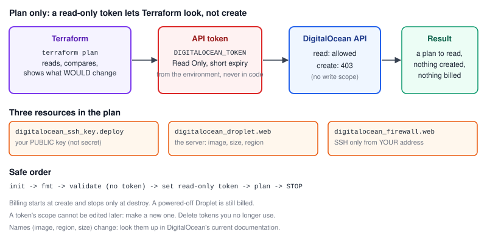

# Chapter 5 — A Real Cloud Provider (Plan Only)

> **Course:** Terraform · **Chapter:** 5 of 8
> Read on the website: [learn.bazardev.com/terraform/05-a-real-cloud-provider-plan-only](https://learn.bazardev.com/terraform/05-a-real-cloud-provider-plan-only)
>
> 🇧🇩 **Prefer Bangla?** [Read this chapter in Bangla →](https://learn.bazardev.com/terraform/05-a-real-cloud-provider-plan-only?lang=bn)

So far Terraform has managed containers on your own machine. The real use of Terraform is a **cloud provider**: servers, firewalls and SSH keys that exist on someone else's computers and cost real money. This chapter teaches you to write that code, using **DigitalOcean** as the example, and to **review it with `terraform plan` without creating anything**. The new idea is not the resources. It is **credentials**: the Docker provider needed none, but a cloud provider needs a key that can spend your money, and protecting that key is the most important skill in this chapter.

> **Honesty note: what was and was not run.** Terraform and OpenTofu are **not installed on the server used to write this course**, no DigitalOcean account was used, and nothing was created or billed. So the code and commands below are written from the official Terraform and DigitalOcean provider documentation and are **not executed here**. What *was* checked: the provider declaration and the `DIGITALOCEAN_TOKEN` variable, the arguments of the `digitalocean_droplet`, `digitalocean_ssh_key` and `digitalocean_firewall` resources, how DigitalOcean API tokens and their scopes work, what `terraform validate` does, and how Droplets are billed were read from the official documentation, and every external link was opened. The **HCL was not parsed by Terraform**, so a small mistake is possible, and **provider versions, image names, regions and sizes change over time**, so check each name in DigitalOcean's current documentation. This chapter stops at `plan`. It does **not** ask you to run `apply`.



## 1. Why "plan only" first

`terraform apply` against a cloud creates things that **bill by the second**. From DigitalOcean's pricing documentation: Droplets are billed hourly rates **per second** (minimum 60 seconds or $0.01), "Billing begins when you create the Droplet and ends when you destroy it", and **powered-off Droplets still incur charges**. A forgotten server is a bill that keeps growing.

`terraform plan` creates nothing (Chapter 1). It only reads the real world and shows what **would** happen. That makes it a safe way to learn and a good way to **review** infrastructure code before anyone pays for it. In this chapter you learn to read cloud plans, and you stop there. If you ever decide to apply, do it on purpose, with a small size, and destroy the resources when you are done.

## 2. A cloud provider needs credentials

The Docker provider talked to a program on your own machine. A cloud provider talks to a company's **API**, and the API must know who you are and what you may do. That is an **API token**: a long secret string that is, in effect, a password to your account. Anyone who has it can do what it allows. So the rules from the Vault chapter and Chapter 1 apply with more force:

1. **Never put the token in code**, in a variable default, or in any file that goes to Git.
2. **Give it the least power that works** (read-only if you can).
3. **Make it expire**, and delete it when you are done.

### Making a token

In DigitalOcean's documentation: in the Control Panel go to **Account > API**, open the **Tokens** tab, and click **Generate New Token**. You enter a name, choose an **expiration**, and choose a **scope**:

| Scope | What it allows |
|---|---|
| **Read Only** | The `api:read` alias: read access to all resources your team role can see |
| **Full Access** | The `api:write` alias: full access to all resources your team role can use |
| **Custom Scopes** | Pick individual permissions: create, read, update, delete per resource type |

Three facts from the docs matter. The secret "is only shown once", so copy it straight into a safe place. **You cannot edit the scope of a token after creation.** And a call to an endpoint **without the required scope returns `403 Forbidden`**.

**For this chapter, create a Read Only token with a short expiry.** A read-only token is enough to *plan*, because a plan only reads. It also gives you a safety net: if you ever type `yes` to an `apply` by mistake, the API should refuse the create requests with a 403 instead of making a bill. (That is what the scope rules in the docs imply; confirm it on your account before relying on it.) Delete the token when you finish the chapter.

### Giving Terraform the token without leaving it behind

The provider docs list the ways to supply it. The `token` argument is required, but it can also come from environment variables: **`DIGITALOCEAN_TOKEN` is checked first, then `DIGITALOCEAN_ACCESS_TOKEN`**, and with the variable set you can leave the `token` argument out of your code. The docs' own example reads the token from a Terraform variable set in a `*.tfvars` file or with `-var`. The safer habit, from practice and the spirit of Chapter 2, is the **environment variable**, because then the token is not in any file that could be committed. Even better, type it so it is not saved in your shell history:

```bash
read -rs DIGITALOCEAN_TOKEN     # paste the token, nothing is shown on screen
export DIGITALOCEAN_TOKEN
```

When you are done: `unset DIGITALOCEAN_TOKEN`, and revoke the token in the control panel. Typing `export DIGITALOCEAN_TOKEN=abc...` directly would leave the secret in your shell history, the same warning the Vault docs gave for `ansible-vault`.

## 3. Declaring the provider

From the provider docs:

```hcl
terraform {
  required_providers {
    digitalocean = {
      source  = "digitalocean/digitalocean"
      version = "~> 2.0"
    }
  }
}

provider "digitalocean" {}
```

The empty `provider "digitalocean" {}` block is enough when `DIGITALOCEAN_TOKEN` is set. The `~> 2.0` constraint is the one in the docs (Chapter 1: only the last component may grow, so any 2.x). As always, `terraform init` downloads the provider, and `.terraform.lock.hcl` records the exact version.

## 4. The resources

Three resources describe a small web server. All names below come from the provider docs.

**An SSH key** so you can log in. It uploads your **public** key (that one is not secret) and exports `id` and `fingerprint`:

```hcl
resource "digitalocean_ssh_key" "deploy" {
  name       = "deploy-key"
  public_key = file("/home/you/.ssh/id_ed25519.pub")
}
```

`file()` reads a file's contents. Use the full path to **your** public key (the one ending in `.pub`), never the private one.

**A Droplet** (DigitalOcean's name for a virtual server). `image`, `name` and `size` are required in the docs; give the `region` explicitly too. `ssh_keys`, `tags`, `user_data`, `monitoring` and `ipv6` are optional. It exports `id` and `ipv4_address`:

```hcl
resource "digitalocean_droplet" "web" {
  image    = var.image
  name     = "web-1"
  region   = var.region
  size     = var.size
  ssh_keys = [digitalocean_ssh_key.deploy.fingerprint]
}
```

Notice the reference `digitalocean_ssh_key.deploy.fingerprint`: Terraform learns the Droplet depends on the key (Chapter 1) and creates the key first. Notes from the docs on what changes **force replacement**: changing `user_data` "forces a new resource to be created", and modifying `ssh_keys` "will prompt you to destroy and recreate the Droplet". Also, increasing a Droplet's disk size is documented as a **permanent** change. These are exactly the `-/+` lines you must read in a plan (Chapter 1).

**A firewall**, so only the ports you need are open. The docs show `inbound_rule` and `outbound_rule` blocks with a `protocol`, a `port_range` and addresses, and `droplet_ids` to attach it to Droplets (`port_range` is required for `tcp` and `udp`):

```hcl
resource "digitalocean_firewall" "web" {
  name        = "web-firewall"
  droplet_ids = [digitalocean_droplet.web.id]

  inbound_rule {
    protocol         = "tcp"
    port_range       = "22"
    source_addresses = [var.admin_cidr]
  }

  inbound_rule {
    protocol         = "tcp"
    port_range       = "80"
    source_addresses = ["0.0.0.0/0", "::/0"]
  }

  inbound_rule {
    protocol         = "tcp"
    port_range       = "443"
    source_addresses = ["0.0.0.0/0", "::/0"]
  }

  outbound_rule {
    protocol              = "tcp"
    port_range            = "1-65535"
    destination_addresses = ["0.0.0.0/0", "::/0"]
  }

  outbound_rule {
    protocol              = "udp"
    port_range            = "1-65535"
    destination_addresses = ["0.0.0.0/0", "::/0"]
  }
}
```

SSH (port 22) is allowed only from `var.admin_cidr`, **your** address range, not the whole internet. Web ports 80 and 443 are open to everyone. (Check the provider docs for the exact `port_range` forms and for ICMP rules if you need ping.) A server with no firewall is reachable on every port; a firewall written in code is reviewed like any other change.

## 5. The inputs and outputs

`variables.tf`: with the Chapter 2 habits, a type and a description on every variable. There is **no variable for the token**, because it comes from the environment.

```hcl
variable "region" {
  type        = string
  description = "DigitalOcean region slug for the server"
  default     = "sgp1"
}

variable "size" {
  type        = string
  description = "Droplet size slug"
  default     = "s-1vcpu-1gb"
}

variable "image" {
  type        = string
  description = "Droplet image slug"
  default     = "ubuntu-24-04-x64"
}

variable "admin_cidr" {
  type        = string
  description = "Address range allowed to SSH in, for example 203.0.113.7/32"
}
```

`size = "s-1vcpu-1gb"` is the slug in the provider's own example. The provider docs' example image, `ubuntu-20-04-x64`, is an **old** Ubuntu release; use a current one and **look up the slug in DigitalOcean's documentation** instead of trusting this chapter. The same goes for the region. `203.0.113.7/32` is a documentation-only example address, not a real one: use your own public address. `admin_cidr` has no default on purpose, so Terraform asks for it and you cannot forget to set it.

`outputs.tf`:

```hcl
output "droplet_ip" {
  description = "Public IPv4 address of the web server"
  value       = digitalocean_droplet.web.ipv4_address
}
```

And the `.gitignore` from Chapters 1 and 2, plus anything that could hold secrets:

```text
.terraform/
*.tfstate
*.tfstate.*
*.tfvars
```

## 6. The plan-only workflow

Do these in order. Only the last needs the token.

```bash
terraform init          # downloads the digitalocean provider
terraform fmt
terraform validate      # checks the code; needs no token
read -rs DIGITALOCEAN_TOKEN && export DIGITALOCEAN_TOKEN    # a READ-ONLY token
terraform plan
```

`terraform validate` checks that the configuration is valid and consistent "regardless of any provided variables or existing state", and per the docs it "does not validate remote services, such as remote state or provider APIs". It needs an initialized folder, but it does not call DigitalOcean, which is why it works without the token. `terraform plan` is the step that talks to the API and needs it.

What a good plan looks like (shape, from Chapter 1's rules): three resources marked `+` (the SSH key, the Droplet, the firewall), values not known yet shown as `(known after apply)` (the Droplet's IP, the IDs), and a summary line such as `Plan: 3 to add, 0 to change, 0 to destroy.` Check, in this order:

1. **Only `+` lines** on a first plan. A `-` or `-/+` on something you did not expect means stop and find out why.
2. **The region, size and image** are the ones you meant. A bigger size costs more every second.
3. **The firewall's SSH rule** shows your address, not `0.0.0.0/0`.
4. **No secret** appears in the output.

Then **stop**. You have reviewed the infrastructure without paying for it. Run `unset DIGITALOCEAN_TOKEN` and delete the token in the control panel.

If you later choose to `apply` on purpose: use a **Full Access** or suitable custom-scope token with a short expiry, the smallest size, watch the plan, and run `terraform destroy` when finished. Then **check the DigitalOcean control panel** to confirm nothing is left running, because billing "ends when you destroy it".

## 7. The state file now holds real infrastructure

After a real `apply`, the state would contain details of your Droplet, firewall and key. Chapter 1 and Chapter 3 apply fully: it can hold sensitive data in plain text, never goes in Git, and a team needs a safe shared place for it (Chapter 7). Your API token is **not** in your code or in `.tfvars` in this design, which is one more reason to prefer the environment variable.

## 8. Other clouds

AWS, Azure, Google Cloud and the rest follow the **same shape**: a provider in `required_providers`, credentials supplied from **outside the code**, then resources. Their resource names and their ways of authenticating differ, so read each provider's documentation page before you write any code. The habits in this chapter carry over: least-power credentials, short expiry, plan before apply, and a firewall in code.

## 9. Habits

1. **Plan first, always,** and read it for `-` and `-/+`.
2. **Credentials come from the environment,** never from code, `.tfvars` in Git, or shell history.
3. **Least privilege:** a Read Only token to plan. A token's scope cannot be edited later, so make a new one.
4. **Short expiry,** and delete tokens you no longer use.
5. **Firewall in code,** with SSH limited to your address.
6. **Look up current slugs** (image, region, size) in the provider's documentation.
7. **Know the bill:** it starts at create and stops only at destroy. Powered off is not free.

## 10. Self-check

<details>
<summary><strong>Q1. Why does a cloud provider need something the Docker provider did not?</strong></summary>

It talks to a company's API, which must know who you are and what you may do. That needs an API token, which is effectively a password to your account.
</details>

<details>
<summary><strong>Q2. Where should the DigitalOcean token come from, and where must it never be?</strong></summary>

From the `DIGITALOCEAN_TOKEN` environment variable (typed so it is not saved in shell history). It must never be in code, in a file committed to Git, or in a variable default.
</details>

<details>
<summary><strong>Q3. Which token scope is right for a plan-only practice, and why?</strong></summary>

Read Only (`api:read`). A plan only reads, and a call without the required scope returns 403, so a mistaken apply should be refused instead of creating a bill.
</details>

<details>
<summary><strong>Q4. You created a token with the wrong scope. What do you do?</strong></summary>

Create a new token with the right scope, because the scope of a token cannot be edited after creation, and delete the old one.
</details>

<details>
<summary><strong>Q5. Does `terraform validate` need the API token? Why?</strong></summary>

No. It checks that the configuration is valid and consistent without contacting remote services or provider APIs. It only needs an initialized folder.
</details>

<details>
<summary><strong>Q6. Name two changes to a Droplet that force it to be recreated, according to the provider docs.</strong></summary>

Changing `user_data`, and modifying `ssh_keys`. In a plan these appear as `-/+`.
</details>

<details>
<summary><strong>Q7. When does DigitalOcean billing for a Droplet start and stop, and does powering it off stop it?</strong></summary>

It starts when the Droplet is created and stops only when it is destroyed. Powered-off Droplets are still billed.
</details>

<details>
<summary><strong>Q8. What four things do you check in a first plan before stopping?</strong></summary>

Only `+` lines (no unexpected `-` or `-/+`), the intended region, size and image, the SSH rule limited to your address rather than `0.0.0.0/0`, and no secret in the output.
</details>

## 11. Free resources

- DigitalOcean provider: [documentation on the Terraform Registry](https://registry.terraform.io/providers/digitalocean/digitalocean/latest/docs) and its [source docs on GitHub](https://github.com/digitalocean/terraform-provider-digitalocean/tree/main/docs): [provider](https://github.com/digitalocean/terraform-provider-digitalocean/blob/main/docs/index.md), [droplet](https://github.com/digitalocean/terraform-provider-digitalocean/blob/main/docs/resources/droplet.md), [ssh_key](https://github.com/digitalocean/terraform-provider-digitalocean/blob/main/docs/resources/ssh_key.md), [firewall](https://github.com/digitalocean/terraform-provider-digitalocean/blob/main/docs/resources/firewall.md)
- DigitalOcean docs: [Create a personal access token](https://docs.digitalocean.com/reference/api/create-personal-access-token/) and [Droplet pricing and billing](https://docs.digitalocean.com/products/droplets/details/pricing/)
- Terraform docs: [`terraform validate`](https://developer.hashicorp.com/terraform/cli/commands/validate) and [`terraform plan`](https://developer.hashicorp.com/terraform/cli/commands/plan)

---

**Next:** [Chapter 6 — Dependencies, `count`, `for_each`, and `lifecycle`](06-dependencies-count-for-each-and-lifecycle.md)
