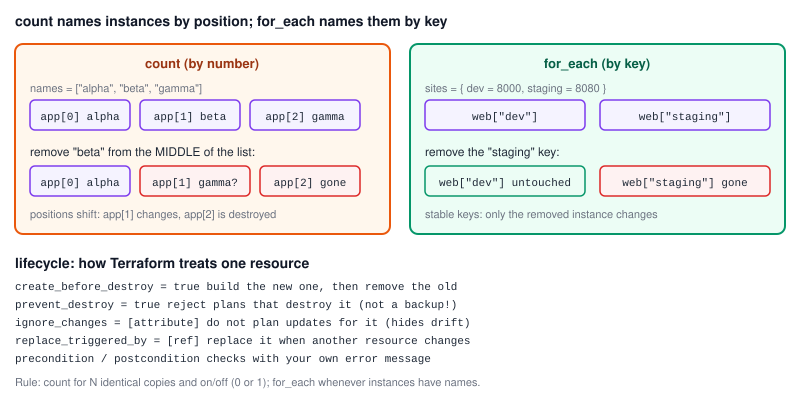

# Chapter 6 — Dependencies, `count`, `for_each`, and `lifecycle`

> **Course:** Terraform · **Chapter:** 6 of 8
> Read on the website: [learn.bazardev.com/terraform/06-dependencies-count-for-each-and-lifecycle](https://learn.bazardev.com/terraform/06-dependencies-count-for-each-and-lifecycle)
>
> 🇧🇩 **Prefer Bangla?** [Read this chapter in Bangla →](https://learn.bazardev.com/terraform/06-dependencies-count-for-each-and-lifecycle?lang=bn)

Three questions now come up in every real project. **In what order** does Terraform build things, and can you influence it? **How do I make several similar things** without copying a block ten times? And **how do I protect something precious**, or tell Terraform to leave one setting alone? The answers are three tools: **dependencies**, the **`count` and `for_each`** meta-arguments, and the **`lifecycle`** block. All three work on any resource, so the examples use the Docker project and need no cloud account.

> **Honesty note: what was and was not run.** Terraform and OpenTofu are **not installed on the server used to write this course**, and nothing was installed for it. So the code below is written from the official Terraform documentation and is **not executed here**. What *was* checked: how implicit and explicit dependencies work and the advice on `depends_on`, the `count` and `for_each` syntax, `count.index`, `each.key` and `each.value`, the restrictions on both (values known at plan time, no sensitive values in `for_each`, no implicit list-to-set conversion), and every `lifecycle` argument with its cautions were read from the official docs, and every external link was opened. The **HCL was not parsed by Terraform**, so a small mistake is possible. One point is **not stated on the `count` documentation page**: what happens to instance addresses when you remove an item from the middle of a list. Section 4 explains it from how index addresses work, and tells you to confirm it with a plan on your own practice machine. Never run these on anything real, and read every plan before you type `yes`.



## 1. Dependencies: what is built before what

Terraform builds a **graph** of your resources. As the core docs say, it performs the proposed operations "in the correct order, respecting any resource dependencies", and runs independent resources in parallel. Most of the time you do not state the order. You just **refer** to another resource, and Terraform sees the dependency:

```hcl
resource "docker_image" "nginx" {
  name = "nginx:latest"
}

resource "docker_container" "web" {
  image = docker_image.nginx.image_id   # this reference creates the dependency
  name  = "web"
}
```

This is an **implicit dependency**: the container uses a value that only exists after the image. The docs' advice: "Instead of `depends_on`, we recommend using expression references to imply dependencies when possible."

### `depends_on`: a hidden dependency

Sometimes B needs A to exist first, but B never uses any value from A, so there is nothing to refer to. The docs call these "hidden resource or module dependencies that Terraform cannot automatically infer". Only then, say it by hand (imagine a `docker_container.db` defined elsewhere in the project):

```hcl
resource "docker_container" "migrate" {
  image = docker_image.nginx.image_id
  name  = "migrate"

  # The migration needs the database to be running, but it uses none of its values.
  depends_on = [docker_container.db]
}
```

The docs say: "You should only use `depends_on` as a last resort", because it can make plans more conservative. Always write a **comment** saying why it is needed, so the next reader does not delete it.

## 2. `count`: N copies, numbered

`count` makes several nearly identical instances. From the docs' example, `count = 4` creates four, and `count.index` gives each its number, starting at `0`:

```hcl
resource "docker_container" "web" {
  count = 3
  image = docker_image.nginx.image_id
  name  = "web-${count.index}"

  ports {
    internal = 80
    external = 8000 + count.index
  }
}
```

Three containers: `web-0` on port 8000, `web-1` on 8001, `web-2` on 8002. You address instances with an index: `docker_container.web[0]`, `docker_container.web[1]`. The block name alone, `docker_container.web`, refers to the whole set. To read a value from every instance, use a `for` expression (Chapter 2):

```hcl
output "container_names" {
  value = [for c in docker_container.web : c.name]
}
```

**Optional resources:** `count` is also the usual way to make something conditional, because `0` means "none". With the conditional expression from Chapter 2:

```hcl
resource "docker_container" "debug" {
  count = var.enable_debug ? 1 : 0
  image = docker_image.nginx.image_id
  name  = "debug"
}
```

**The rule for both `count` and `for_each`:** the value must be **known at plan time**. The docs: `count` "cannot refer to any resource attributes that are only known after a configuration is applied". You cannot count the containers by reading a value that only exists after `apply`.

## 3. `for_each`: one instance per key

`for_each` takes a **map** or a **set of strings**, and makes one instance for each entry. Inside, `each.key` is "the map key or set member corresponding to this instance", and `each.value` is "the map value" (for a set, the same as the key).

```hcl
variable "sites" {
  type        = map(number)
  description = "Site name and the port it listens on"
  default = {
    dev     = 8000
    staging = 8080
  }
}

resource "docker_container" "web" {
  for_each = var.sites
  image    = docker_image.nginx.image_id
  name     = "${each.key}-web"

  ports {
    internal = 80
    external = each.value
  }
}
```

Instances are addressed **by key**: `docker_container.web["dev"]`, `docker_container.web["staging"]`. A set of strings works too; convert a list with `toset()`:

```hcl
for_each = toset(["Todd", "James", "Alice", "Dottie"])
```

Per the docs, the restrictions are:

- The keys of the map, or all values of the set, must be **known values** at plan time.
- `for_each` does **not implicitly convert lists or tuples** to sets: use `toset()`.
- **Sensitive values** cannot be used as `for_each` arguments.
- A block cannot use **both** `count` and `for_each`.

Reading values from every instance: a `for` expression that builds a map, with the key kept:

```hcl
output "container_names" {
  value = { for key, c in docker_container.web : key => c.name }
}
```

Modules can use `for_each` too (Chapter 4): `for_each = var.sites` on a `module` block creates one **module instance** per site, each reached as `module.web["dev"]`.

## 4. `count` or `for_each`? The important difference

The docs' rule: "Use the `count` argument when you want to create nearly identical instances", and "Use `for_each` when some instance arguments must have distinct values" that cannot be derived from an integer.

There is a trap, and it explains why `for_each` is usually the better choice for real infrastructure. **`count` identifies instances by position**: `web[0]`, `web[1]`, `web[2]`. Suppose you build instances from a **list** of names:

```hcl
variable "names" {
  default = ["alpha", "beta", "gamma"]
}

resource "docker_container" "app" {
  count = length(var.names)
  image = docker_image.nginx.image_id
  name  = var.names[count.index]
}
```

Now remove `"beta"` from the **middle** of the list. `gamma` moves from position 2 to position 1. Terraform tracks `app[1]` as "the container called beta" in state, and now the configuration says `app[1]` should be called `gamma`, and `app[2]` no longer exists. The plan will want to **change or replace** `app[1]` and **destroy** `app[2]`, instead of just removing `beta`. This is a consequence of addressing by number. (It is not spelled out on the `count` documentation page, so **prove it yourself**: run the plan on your practice project and read it.)

`for_each` avoids it, because each instance has a **stable key**. Remove the `staging` key from the map above and only `docker_container.web["staging"]` is planned for destruction. `dev` is not touched. Rule of thumb: **use `count` for "N identical things" and for on/off (`0` or `1`); use `for_each` whenever the instances have names.**

If you later switch a resource from a single block to `count` or `for_each`, the old address no longer exists. Use a `moved` block (Chapter 4) such as `from = docker_container.web` and `to = docker_container.web["dev"]`, so the existing object is kept, and check that the plan shows no destroy.

## 5. The `lifecycle` block

A `lifecycle` block changes **how Terraform treats one resource**. It goes inside the resource. The docs give these arguments:

### `create_before_destroy`

When a change forces replacement, the default is to destroy the old object and then create the new one. This makes Terraform **create the new one first**:

```hcl
lifecycle {
  create_before_destroy = true
}
```

Useful when downtime matters. The docs caution that it is opt-in and "you must understand the constraints for each resource type" (two objects may exist at once, so names or ports can clash). Dependencies inherit it.

### `prevent_destroy`

```hcl
lifecycle {
  prevent_destroy = true
}
```

Terraform "rejects plans that would destroy the infrastructure object associated with the resource and returns an error." It is a guard for things that must never disappear by accident, such as a database. Two honest limits, straight from the docs: it **blocks `terraform destroy`** for that object too (you must remove the setting first), and it **does not stop destruction if you delete the resource's configuration**, because "Terraform does not explicitly record a resource's `lifecycle` rule to state" (except `create_before_destroy`). It guards against a plan, not against someone deleting the block. Code review and backups still matter.

### `ignore_changes`

```hcl
resource "docker_container" "web" {
  # ...
  lifecycle {
    ignore_changes = [
      labels
    ]
  }
}
```

(`labels` is only an illustration: name an attribute that your resource type really has.) Terraform still uses the attribute when it **creates** the resource, but **ignores later differences** when planning updates. Use it when something else legitimately changes a value (a tool adds labels or tags). Per the docs, `ignore_changes = all` ignores every attribute, so Terraform can create and destroy the object but never proposes an update. Cautions: it only works for attributes defined by the resource type, and you cannot use it on itself or on other meta-arguments. Use it sparingly, because it hides drift (Chapter 3).

### `replace_triggered_by`

```hcl
lifecycle {
  replace_triggered_by = [
    docker_image.nginx.id
  ]
}
```

Replace this resource whenever the referenced resource or attribute changes. You can only reference **managed resources**. Plain values such as locals or variables are not accepted directly; the docs suggest wrapping them in a `terraform_data` resource.

### `precondition` and `postcondition`

These are **checks with a message**, like `validation` for variables (Chapter 2), but for resources. A `precondition` runs **before** the resource's arguments are evaluated; a `postcondition` runs **after** the object is applied, and failure stops other resources that depend on it:

```hcl
lifecycle {
  postcondition {
    condition     = self.public_dns != ""
    error_message = "EC2 instance must be in a VPC that has public DNS hostnames enabled."
  }
}
```

The example is the docs' own. `self` refers to the resource being checked. Use them to turn a hidden assumption into a clear error.

## 6. Reading the plan with these features

Look back at the symbols from Chapter 1. A `count` or `for_each` change shows **one line per instance**, with the address in brackets, `docker_container.web["staging"]`. A `lifecycle` rule appears as behavior: with `create_before_destroy` the order of a `-/+` replacement flips, and with `prevent_destroy` a plan that would destroy the object fails with an **error** instead of a plan. Treat that error as the guard doing its job: stop, and find out why a destroy was proposed.

## 7. Habits

1. **Prefer references over `depends_on`.** Use `depends_on` only for hidden dependencies, with a comment.
2. **`count` for identical copies and on/off; `for_each` for named instances.** Keys are stable, positions are not.
3. **Never build `for_each` keys from values known only after apply,** and use `toset()` for lists.
4. **Protect what you cannot recreate** with `prevent_destroy`, **and** keep reviews and backups, because the guard disappears with the block.
5. **`ignore_changes` hides drift.** Use it for one named attribute, not `all`, unless you mean it.
6. **Check the plan after every change** to `count`, `for_each` or `lifecycle`: look for the `-` and `-/+` you did not expect.

## 8. Self-check

<details>
<summary><strong>Q1. How does Terraform know to build the image before the container?</strong></summary>

The container refers to `docker_image.nginx.image_id`. That reference creates an implicit dependency, and Terraform builds the graph in the right order.
</details>

<details>
<summary><strong>Q2. When should you use `depends_on`, and what should you add with it?</strong></summary>

Only for a hidden dependency that Terraform cannot infer, because nothing is referenced. The docs call it a last resort, so add a comment explaining why it is needed.
</details>

<details>
<summary><strong>Q3. What do `count.index` and `each.key` give you?</strong></summary>

`count.index` is the instance's number starting at 0. `each.key` is the map key (or set member) of that instance.
</details>

<details>
<summary><strong>Q4. How do you make a resource optional with `count`?</strong></summary>

`count = var.enabled ? 1 : 0`. With `0`, no instance is created.
</details>

<details>
<summary><strong>Q5. Why is `for_each` usually safer than `count` for named things?</strong></summary>

`count` addresses instances by position, so removing an item from the middle of a list shifts the others and the plan may change or replace more than you expect. `for_each` uses stable keys, so removing one key affects only that instance.
</details>

<details>
<summary><strong>Q6. What are two restrictions on `for_each`?</strong></summary>

Its keys or set values must be known at plan time, and lists or tuples are not converted automatically (use `toset()`). Sensitive values cannot be used either, and a block cannot use both `count` and `for_each`.
</details>

<details>
<summary><strong>Q7. What does `prevent_destroy` guard against, and what does it not?</strong></summary>

It makes Terraform reject plans that would destroy the object, including `terraform destroy`. It does not stop destruction if you remove the resource's configuration, because the rule is not recorded in state.
</details>

<details>
<summary><strong>Q8. When is `ignore_changes` appropriate, and what is its downside?</strong></summary>

When another tool legitimately changes an attribute after creation. The downside is that it hides drift, so Terraform will not notice or fix changes to that attribute.
</details>

## 9. Free resources

- Terraform docs: [`depends_on`](https://developer.hashicorp.com/terraform/language/meta-arguments/depends_on)
- Terraform docs: [`count`](https://developer.hashicorp.com/terraform/language/meta-arguments/count) and [`for_each`](https://developer.hashicorp.com/terraform/language/meta-arguments/for_each)
- Terraform docs: [`lifecycle`](https://developer.hashicorp.com/terraform/language/meta-arguments/lifecycle) and [Refactoring with `moved` blocks](https://developer.hashicorp.com/terraform/language/modules/develop/refactoring)

---

**Next:** [Chapter 7 — Remote State, Workspaces, and CI](07-remote-state-workspaces-and-ci.md)
