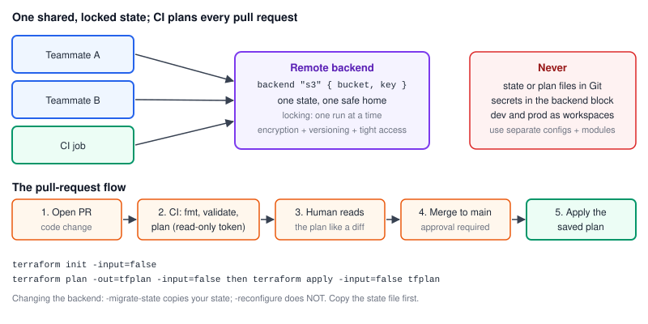

# Chapter 7 — Remote State, Workspaces, and CI

> **Course:** Terraform · **Chapter:** 7 of 8
> Read on the website: [learn.bazardev.com/terraform/07-remote-state-workspaces-and-ci](https://learn.bazardev.com/terraform/07-remote-state-workspaces-and-ci)
>
> 🇧🇩 **Prefer Bangla?** [Read this chapter in Bangla →](https://learn.bazardev.com/terraform/07-remote-state-workspaces-and-ci?lang=bn)

On your own laptop, with one `terraform.tfstate` file, everything is simple. In a **team** it breaks (Chapter 3): two people apply at once, someone uses an old copy, and the state file, which can hold secrets, sits on a laptop. This chapter covers the team side of Terraform: keeping state in a **safe shared place** (a *backend*), keeping **several states** for one configuration (*workspaces*, and why they are not what you might think), and running Terraform from **CI** so every change is planned, reviewed and applied the same way.

> **Honesty note: what was and was not run.** Terraform and OpenTofu are **not installed on the server used to write this course**, no cloud storage was created, and no workflow was run. So the code and commands below are written from the official Terraform and `setup-terraform` documentation and are **not executed here**. What *was* checked: what a backend is and its limits, the S3 backend arguments and its advice on locking, versioning and credentials, the `init` options `-migrate-state` and `-reconfigure`, what workspaces are and the docs' warning about them, the `terraform.tfstate.d` location, HashiCorp's guidance for running Terraform in automation, and the shape of a `setup-terraform` GitHub Actions workflow were read from the official docs, and every external link was opened. The **HCL and the workflow file were not run**. Version numbers in the workflow come from the action's own example and **will be out of date**, so check the current ones. Nothing here asks you to create real cloud resources.



## 1. Backends: where state lives

A **backend** decides where Terraform stores its state. The docs: "The backend defines where Terraform stores its state data files." If you do not configure one, Terraform uses the **`local`** backend, which is the `terraform.tfstate` file you have been using. State is what lets "multiple people access and work on the same infrastructure collection", but only if it lives somewhere they **all** can reach.

You configure a backend inside the `terraform` block. The docs' example (using the `remote` backend):

```hcl
terraform {
  backend "remote" {
    organization = "example_corp"

    workspaces {
      name = "my-app-prod"
    }
  }
}
```

Rules from the docs:

- **One backend per configuration.** "A configuration can only provide one backend block."
- **No variables.** "A backend block cannot refer to named values (like input variables, locals, or data source attributes)." Backend settings are written out, or passed another way at `init`.
- **Re-run `init` after any change.** "After you change a backend's configuration, you must run `terraform init` again."
- **Locking.** Some backends only store state. Others "support locking the state during Terraform operations to prevent conflicts and inconsistencies." Prefer a backend with locking: it stops two runs from changing the same state at once.

## 2. An example: the S3 backend

The docs' S3 example (the bucket name and key are placeholders):

```hcl
terraform {
  backend "s3" {
    bucket = "mybucket"
    key    = "path/to/my/key"
    region = "us-east-1"
  }
}
```

What the S3 backend documentation advises:

| Topic | Advice |
|---|---|
| **Versioning** | Strongly recommended: enable **bucket versioning** "to allow for state recovery in the case of accidental deletions and human error" |
| **Locking** | `use_lockfile` turns on locking with a lock file (default `false`). Locking with DynamoDB is **deprecated** |
| **Encryption** | `encrypt` (optional) enables server-side encryption of the state and lock files |
| **Credentials** | "We recommend using environment variables to supply credentials and other sensitive data" (for example `AWS_ACCESS_KEY_ID` and `AWS_SECRET_ACCESS_KEY`), never in the config |

Two warnings from the same page, worth remembering for **any** backend: values given with `-backend-config` or written in the configuration are included "in both the `.terraform` subdirectory and in plan files", and an encryption key set in a Terraform file "will cause it to be persisted to disk in `terraform.tfstate`". So keep secrets **out** of the backend block, and supply them through the environment. And one fact worth knowing: the storage itself (the bucket) has to **exist before** Terraform can keep state in it, so it is created once, separately, before you point a project at it.

Whichever backend you pick, the rules of Chapters 1 and 3 still apply: the state may hold secrets, so the storage needs **tight access controls**, **encryption**, and **versioning or backups**.

### Moving existing state to a new backend

When you add or change a `backend` block, run `terraform init` again. The docs: Terraform offers to **migrate your existing state** to the new backend, and if you remove the block it offers to migrate back to `local`. The `init` options matter:

| Option | What it does (from the docs) |
|---|---|
| `-migrate-state` | "Attempt to copy existing state to the new backend" |
| `-reconfigure` | "Disregards any existing configuration, **preventing migration** of any existing state" |

"Either `-reconfigure` or `-migrate-state` must be supplied to update the backend configuration." Choosing the wrong one is easy to do and costly: `-reconfigure` starts the new backend **without** your old state, and Terraform then thinks nothing exists. **Before any migration, copy your current state file somewhere safe.** And remember `terraform state` commands (Chapter 3) write backups too.

## 3. Workspaces: several states for one configuration

Some backends support **multiple named states** for a single configuration. The docs: "multiple states to be associated with a single configuration." Each is called a **workspace**. Terraform always starts with one called `default`, "that you cannot delete".

```bash
terraform workspace list
terraform workspace new staging
terraform workspace select staging
terraform workspace delete staging
```

Those four commands (`list`, `new`, `select`, `delete`) are named in the docs. With the **local** backend, the states of non-default workspaces are stored in a directory called **`terraform.tfstate.d`**, and the docs advise treating it like a local-only `terraform.tfstate`: never commit it. With a remote backend, the workspace name is added to the state's path in the backend.

Inside the code you can use the current workspace's name with `${terraform.workspace}`, "anywhere interpolations are allowed". For example, so the same code gives each workspace its own container name:

```hcl
resource "docker_container" "web" {
  image = docker_image.nginx.image_id
  name  = "${terraform.workspace}-web"

  ports {
    internal = 80
    external = 8000
  }
}
```

(Two workspaces would both want port 8000 here. Give each its own port, for example through a map keyed by `terraform.workspace`, or the second apply will clash.)

### The warning you must not skip

Workspaces look like "one workspace per environment". The docs say clearly that they are **not** for that when it matters:

- "Workspaces are not appropriate for system decomposition or deployments requiring **separate credentials and access controls**."
- "They are not private, unless you use purely local state and do not commit your state to version control."
- The docs recommend instead **separate configurations**, each with its own backend, built on **reusable modules** (Chapter 4), for stronger separation.

In plain words: `dev` and `prod` should not be two workspaces of the same configuration in the same bucket with the same credentials. A mistake in `dev`, or a leaked `dev` credential, must not be able to reach `prod`. (Also note that "workspace" has a different meaning in HCP Terraform; the docs call them a separate concept.) Workspaces are fine for **short-lived copies of the same thing**, such as a test copy of a feature branch.

### The pattern that separates environments

Use one **folder per environment**, each with its own backend setting and its own credentials, all calling the same module:

```text
infrastructure/
├── modules/
│   └── web_server/        # written once (Chapter 4)
└── environments/
    ├── dev/
    │   ├── main.tf        # calls ../../modules/web_server, backend key "dev"
    │   └── ...
    └── prod/
        ├── main.tf        # calls ../../modules/web_server, backend key "prod"
        └── ...
```

Each environment has its **own state**, its own plan, and can use its own, more tightly held, token. The shared code lives in the module, so you still write it once.

## 4. Terraform in CI

Running `terraform apply` from a laptop does not scale: it depends on one person's machine, one person's credentials and one person's memory. HashiCorp's guide to running Terraform in automation describes the pattern. Its main points:

**Non-interactive runs.** Use `-input=false` so Terraform never waits for a prompt: "The `-input=false` option indicates that Terraform should not attempt to prompt for input." Give variables with `-var` or `-var-file`.

```bash
terraform init -input=false
terraform plan -out=tfplan -input=false
terraform apply -input=false tfplan
```

**Save the plan and apply that file.** `-out` saves the plan, and applying the same file means **the plan a human reviewed is the plan that runs**. The plan file contains your configuration, state and variables, so protect it (Chapter 1). An error is produced "if Terraform or any plugins are upgraded between creating and applying a plan", so pin versions (the docs' example sets `required_version = ">= 1.2.0"` in the `terraform` block).

**A human approves.** The core workflow includes a step to "have a human operator review that plan, to ensure it is acceptable". Allow only **one outstanding plan** at a time, because applying one plan invalidates others made against the same state. Auto-approval is only for throwaway work: "Use automatic approval **only** with non-critical infrastructure."

**Credentials from the environment.** "For provider authentication credentials, it is recommended to use environment variables instead where possible", and Terraform does not include them in the plan or write them to disk. In CI that means **secrets** of the CI system, not files in the repository.

**Plan on the pull request, apply after merge.** The pattern from the docs: run `terraform plan -input=false` on each commit under review (without `-out`, "because a review plan is never applied"), and when the change is merged, "a new plan can be created and applied from the primary version control branch". This is the Git and CI/CD courses applied to infrastructure.

One caution from the docs for open projects: passing secrets to Terraform in CI "lets anyone who can submit a PR discover them" unless you take care. So the job that runs on pull requests should use a **least-power token** (Chapter 5: Read Only is enough to plan), and the job that applies should run only on your main branch, behind an approval.

### A GitHub Actions workflow that plans on every pull request

`.github/workflows/terraform-plan.yml`, built from the `setup-terraform` action's own example:

```yaml
name: terraform-plan

on:
  pull_request:

jobs:
  plan:
    runs-on: ubuntu-latest
    steps:
      - uses: actions/checkout@v4

      - uses: hashicorp/setup-terraform@v4
        with:
          terraform_version: "1.14.6"

      - name: Format check
        run: terraform fmt -check

      - name: Init
        run: terraform init -input=false

      - name: Validate
        run: terraform validate -no-color

      - name: Plan
        run: terraform plan -no-color -input=false
        env:
          DIGITALOCEAN_TOKEN: ${{ secrets.DIGITALOCEAN_READONLY_TOKEN }}
```

Read it as a recipe: check out the code; install a **pinned** Terraform version; fail the job if the formatting is off (`terraform fmt -check`); initialise without prompts; validate; then plan, with the token coming from a **repository secret** into an **environment variable** (never written in the file). The action's README example pins `terraform_version` and notes that the action installs a wrapper that exposes the output of later `terraform` steps (you can turn it off with `terraform_wrapper: false`). The versions shown (`v4`, `1.14.6`) are the README's examples at the time of writing: **look up the current ones**.

The reviewer reads the plan in the job's log, as they would read a code diff. The second, separate job (not shown) would run only after merge, on the main branch, and apply with a saved plan and a human approval step. See your CI system's documentation for protected environments and approvals.

## 5. A rollout checklist for a team

1. **Backend with locking, encryption and versioning,** created separately and protected with tight access.
2. **One state per environment,** separate folders and credentials, shared modules.
3. **Credentials only in the environment or CI secrets,** least power for plan jobs.
4. **Pinned Terraform and provider versions** (`required_version`, `~>`, and the committed `.terraform.lock.hcl`).
5. **Plan on every pull request,** reviewed like code; **apply only after merge,** from a saved plan, with approval.
6. **Never** commit state, plan files or `.tfvars` with secrets.
7. **Before migrating state,** copy it, and choose `-migrate-state` (not `-reconfigure`) when you want to keep it.

## 6. Self-check

<details>
<summary><strong>Q1. What is a backend, and what is the default one?</strong></summary>

The place where Terraform stores its state. The default is `local`, a `terraform.tfstate` file on disk.
</details>

<details>
<summary><strong>Q2. Why can't you use a variable inside a `backend` block?</strong></summary>

The docs say a backend block cannot refer to named values such as input variables, locals or data source attributes. Backend settings must be written out or supplied another way at init.
</details>

<details>
<summary><strong>Q3. What does state locking protect against?</strong></summary>

Two runs changing the same state at once, which would cause conflicts and inconsistent state.
</details>

<details>
<summary><strong>Q4. You change the backend. What is the difference between `-migrate-state` and `-reconfigure`?</strong></summary>

`-migrate-state` copies your existing state to the new backend. `-reconfigure` ignores the existing configuration and does not migrate state, so the new backend starts empty and Terraform thinks nothing exists.
</details>

<details>
<summary><strong>Q5. Where do credentials for a backend belong?</strong></summary>

In environment variables (or the CI system's secrets), not in the backend block or in `-backend-config`, because those values end up in the `.terraform` directory and in plan files.
</details>

<details>
<summary><strong>Q6. Why are workspaces a poor way to separate `dev` from `prod`?</strong></summary>

Workspaces share one configuration and backend and are not private, so they do not give separate credentials or access control. The docs recommend separate configurations with their own backends, built on reusable modules.
</details>

<details>
<summary><strong>Q7. In CI, why save the plan with `-out` and apply that file?</strong></summary>

So the plan a human reviewed is exactly the plan that is applied. Applying a freshly made plan could differ from what was approved.
</details>

<details>
<summary><strong>Q8. What is the "plan on pull request, apply on merge" pattern?</strong></summary>

Run `terraform plan` on each commit under review so reviewers can read the proposed changes, and after the change is merged, create and apply a plan from the main branch, with human approval for anything important.
</details>

## 7. Free resources

- Terraform docs: [Backends](https://developer.hashicorp.com/terraform/language/backend), [S3 backend](https://developer.hashicorp.com/terraform/language/backend/s3), [`terraform init`](https://developer.hashicorp.com/terraform/cli/commands/init)
- Terraform docs: [Workspaces (state)](https://developer.hashicorp.com/terraform/language/state/workspaces) and [CLI workspaces](https://developer.hashicorp.com/terraform/cli/workspaces)
- HashiCorp tutorial: [Automate Terraform](https://developer.hashicorp.com/terraform/tutorials/automation/automate-terraform)
- GitHub: [`hashicorp/setup-terraform`](https://github.com/hashicorp/setup-terraform)

---

**Next:** [Chapter 8 — Real Project: Terraform and Ansible Together](08-real-project-terraform-and-ansible-together.md)
