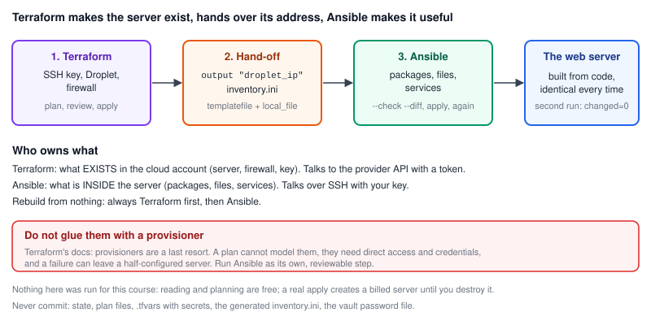

# Chapter 8 — Real Project: Terraform and Ansible Together

> **Course:** Terraform · **Chapter:** 8 of 8
> Read on the website: [learn.bazardev.com/terraform/08-real-project-terraform-and-ansible-together](https://learn.bazardev.com/terraform/08-real-project-terraform-and-ansible-together)
>
> 🇧🇩 **Prefer Bangla?** [Read this chapter in Bangla →](https://learn.bazardev.com/terraform/08-real-project-terraform-and-ansible-together?lang=bn)

This is the chapter where the two tools finally meet. In the Infrastructure as Code course you learned the split: **Terraform makes the server exist, Ansible makes it useful.** Now you build the whole chain on paper, and practise its safe parts: Terraform creates a server, a firewall and an SSH key; the server's address is handed to Ansible; Ansible installs and configures the web server. The skill in this chapter is the **hand-off** between the tools, and the **order and review** that keep a two-tool system safe.

> **Honesty note: what was and was not run.** Terraform, OpenTofu and Ansible are **not installed on the server used to write this course**, no cloud account was used, and **nothing was created or billed**. So the code and commands below are written from the official documentation and are **not executed here**. What *was* checked: the `templatefile` function, the `local_file` resource, `terraform output -raw` and `-json`, HashiCorp's guidance that provisioners are a last resort, and (from the earlier chapters and the IaC course) the DigitalOcean resources, the Ansible inventory, playbook, `apt`, `template` and `service` features, were read from the official docs, and every external link was opened. The **HCL, YAML and shell lines were not run**, so a small mistake is possible, and **image, size and region names change**: look them up. This chapter tells you what to run and in what order, but it does **not** ask you to `apply` anything. Reading and planning cost nothing. A real `apply` creates a billed server (billing "ends when you destroy it"), so do it only on purpose, with a small size, and destroy afterwards.



## 1. Who owns what

| | **Terraform** | **Ansible** |
|---|---|---|
| **Owns** | Things that **exist** in the cloud account: the server, the firewall, the SSH key | What is **inside** the server: packages, files, services |
| **Talks to** | The provider's API, with an API token | The server, over SSH, with your key |
| **Remembers** | A state file | Nothing; it checks the machine each run |
| **Changes when you...** | resize the server, open a port, add a second server | change a config file, add a package, rotate a setting |

A good habit for every change: ask **"is this about the thing existing, or about what is inside it?"** The first is a Terraform change, the second an Ansible change. Rebuilding a server from nothing is "Terraform, then Ansible", always in that order.

## 2. The project layout

```text
web-server-project/
├── terraform/
│   ├── main.tf
│   ├── variables.tf
│   ├── outputs.tf
│   └── inventory.tftpl      # template for the Ansible inventory
├── ansible/
│   ├── ansible.cfg
│   ├── site.yml
│   └── templates/
│       └── index.html.j2
└── .gitignore
```

Two folders, two tools, one repository. Everything here goes in Git **except** state, secrets and the generated inventory:

```text
.terraform/
*.tfstate
*.tfstate.*
*.tfvars
ansible/inventory.ini
.vault_pass
```

## 3. Step 1: Terraform builds the server

`terraform/main.tf` is the cloud code of Chapter 5 (SSH key, Droplet, firewall) plus a new piece at the end, the **hand-off file**:

```hcl
terraform {
  required_providers {
    digitalocean = {
      source  = "digitalocean/digitalocean"
      version = "~> 2.0"
    }
    local = {
      source = "hashicorp/local"
    }
  }
}

provider "digitalocean" {}

resource "digitalocean_ssh_key" "deploy" {
  name       = "deploy-key"
  public_key = file(var.ssh_public_key_path)
}

resource "digitalocean_droplet" "web" {
  image    = var.image
  name     = "web-1"
  region   = var.region
  size     = var.size
  ssh_keys = [digitalocean_ssh_key.deploy.fingerprint]
}

resource "digitalocean_firewall" "web" {
  name        = "web-firewall"
  droplet_ids = [digitalocean_droplet.web.id]

  inbound_rule {
    protocol         = "tcp"
    port_range       = "22"
    source_addresses = [var.admin_cidr]
  }

  inbound_rule {
    protocol         = "tcp"
    port_range       = "80"
    source_addresses = ["0.0.0.0/0", "::/0"]
  }

  inbound_rule {
    protocol         = "tcp"
    port_range       = "443"
    source_addresses = ["0.0.0.0/0", "::/0"]
  }

  outbound_rule {
    protocol              = "tcp"
    port_range            = "1-65535"
    destination_addresses = ["0.0.0.0/0", "::/0"]
  }

  outbound_rule {
    protocol              = "udp"
    port_range            = "1-65535"
    destination_addresses = ["0.0.0.0/0", "::/0"]
  }
}
```

`terraform/variables.tf` has the same variables as Chapter 5 (`region`, `size`, `image`, `admin_cidr`) plus the path to your **public** key. There is still **no variable for the API token**: it comes from `DIGITALOCEAN_TOKEN` in the environment (Chapter 5).

```hcl
variable "ssh_public_key_path" {
  type        = string
  description = "Full path to your SSH PUBLIC key (the file ending in .pub)"
}
```

`terraform/outputs.tf` publishes the one fact Ansible needs, the server's address:

```hcl
output "droplet_ip" {
  description = "Public IPv4 address of the web server"
  value       = digitalocean_droplet.web.ipv4_address
}
```

## 4. Step 2: the hand-off, Terraform to Ansible

Ansible needs an **inventory** (IaC course, Chapter 2) that lists the server. Terraform knows the address, so let it write the file. Two ways, both documented.

### Way A: Terraform writes the inventory file

The `templatefile` function "reads the file at the given path and renders its content as a template", and `${ }` and `%{ for }` work inside it. The `local_file` resource writes content to a file on **your** machine. Together:

`terraform/inventory.tftpl`:

```text
[web]
web1 ansible_host=${web_ip} ansible_user=root
```

Add to `main.tf`:

```hcl
resource "local_file" "inventory" {
  filename = "${path.module}/../ansible/inventory.ini"
  content = templatefile("${path.module}/inventory.tftpl", {
    web_ip = digitalocean_droplet.web.ipv4_address
  })
}
```

When Terraform creates the Droplet, it learns the IP, renders the template, and writes `ansible/inventory.ini`. The file ends up with the group `web` that the playbook will target. Two notes. `ansible_user=root` is an assumption: check in DigitalOcean's documentation which user your chosen image lets you log in as with your SSH key. And the `local_file` docs carry a warning: "Terraform will detect the resource as having been deleted each time a configuration is applied on a new machine" where the file is absent. That shows up as harmless noise in a plan on a fresh CI machine, which is one reason to prefer Way B in automation.

### Way B: read the output and write the file yourself

`terraform output NAME` prints one output. With `-raw`, it prints the value "directly to the output, without any special formatting", which suits shell scripts (it works for string, number and boolean values; `-json` is for complex ones):

```bash
cd terraform
printf '[web]\nweb1 ansible_host=%s ansible_user=root\n' "$(terraform output -raw droplet_ip)" > ../ansible/inventory.ini
cd ..
```

Careful with one thing the docs state: with `-json` or `-raw`, Terraform shows **`sensitive` values in plain text**. The IP is not secret, but do not use this trick for a password or a token, and never print outputs into CI logs.

### Why not run Ansible from inside Terraform?

Terraform has a feature for exactly this, **provisioners** (`local-exec`, `remote-exec`), and it is tempting to call `ansible-playbook` from one. The official docs advise against it: "You should exhaust all alternatives before using provisioners in your configurations." Their reasons: "Terraform cannot predictably model provisioner behaviors" (so the **plan cannot show you** what it will do), most provisioners "require direct network access to your servers and credentials", and a failed provisioner "can leave a resource in a semi-configured state". The docs "strongly recommend using purpose-built solutions" for post-apply work. Ansible **is** that purpose-built tool, so run it as its **own step**: you can review it, re-run it, and test it separately from the infrastructure.

## 5. Step 3: Ansible configures the server

`ansible/ansible.cfg` (IaC course, Chapter 2):

```ini
[defaults]
inventory = inventory.ini
```

`ansible/site.yml` uses only features from the IaC course: the `apt`, `template` and `service` modules, `become`, and a variable (Chapter 3). A small playbook, so the **hand-off** stays the point:

```yaml
- name: Configure the web server
  hosts: web
  become: true
  vars:
    site_message: "Built with Terraform and Ansible"

  tasks:
    - name: Web server packages are installed
      ansible.builtin.apt:
        name:
          - nginx
          - git
        state: present
        update_cache: true
        cache_valid_time: 3600

    - name: Landing page is in place
      ansible.builtin.template:
        src: index.html.j2
        dest: /var/www/html/index.html
        owner: root
        group: root
        mode: '0644'

    - name: Nginx is running
      ansible.builtin.service:
        name: nginx
        state: started
```

`ansible/templates/index.html.j2`:

```text
<!doctype html>
<title>{{ site_message }}</title>
<h1>{{ site_message }}</h1>
<p>Server: {{ inventory_hostname }}</p>
```

(`nginx` is used here because it is in Ubuntu's own package repositories, so the hand-off is easy to follow. A full Laravel stack, with PHP, Caddy and MySQL as roles, is built in the IaC course. The Ansible habits that matter carry over: roles, templates, Vault for secrets.)

## 6. The runbook, in order

Read it as a checklist you could hand a teammate. **Steps marked (plan-only) cost nothing.**

**A. Review the infrastructure (plan-only)**

```bash
cd terraform
terraform init
terraform fmt
terraform validate
read -rs DIGITALOCEAN_TOKEN && export DIGITALOCEAN_TOKEN     # a READ-ONLY token
terraform plan
```

Read the plan as in Chapter 5: only `+` lines on a first run, the intended region, size and image, SSH limited to your address. You should see **four** new resources: the key, the Droplet, the firewall, and the inventory file. **Stop here if you only practise.** `unset DIGITALOCEAN_TOKEN` and delete the token.

**B. Only if you choose to build it, on purpose**

Use a small size and a token with the rights needed to create, set to expire soon. Then:

```bash
terraform apply          # read the plan, then type yes
```

The Droplet is billed from creation until you destroy it. Terraform writes `ansible/inventory.ini` (Way A).

**C. Configure the server with Ansible**

A new server may need a minute before SSH answers. Then, from the `ansible` folder, use the safe order from the IaC course:

```bash
cd ../ansible
ansible web -m ping                                  # can Ansible log in? expect "pong"
ansible-playbook site.yml --syntax-check
ansible-playbook site.yml --check --diff             # preview, change nothing
ansible-playbook site.yml                            # apply
ansible-playbook site.yml                            # second run: expect changed=0
```

If the server was **recreated** at an address you used before, SSH may warn that the host key changed. That is SSH doing its job: check why, remove the old entry on purpose, and never turn host-key checking off. Then open `http://<the-droplet-ip>` and look for your page.

**D. Tear down, if you built it**

```bash
cd ../terraform
terraform destroy        # read what it lists, then type yes
```

Then **look in the DigitalOcean control panel** to confirm nothing is still running, because billing stops only at destroy. Delete the API token.

## 7. Day-two: changing things safely

| You want to... | Change | Then run |
|---|---|---|
| Open another port, or resize the server | `terraform/` code | `terraform plan`, review, `apply`, then re-run Ansible if the address changed |
| Change the page, add a package | `ansible/` code | `--check --diff`, then the playbook twice |
| Rebuild the server from scratch | Nothing, or `-replace` | `terraform apply -replace=digitalocean_droplet.web`, then the full Ansible run |
| Add a secret (database password) | Ansible Vault file | Run with `--ask-vault-pass` or a password file kept out of Git (IaC course, Chapter 4) |

The rebuild row is the payoff of the whole course: because both layers are code, **a server can be thrown away and rebuilt, identical, in minutes**, by running the same two steps. If a replaced server gets a **new IP**, Terraform rewrites the inventory (Way A) or you regenerate it (Way B), and the playbook is unchanged.

## 8. Automating the pair

In CI (Chapter 7), the two tools get **two jobs**:

1. **On every pull request:** `terraform fmt -check`, `init`, `validate` and `plan` with a **read-only** token, and `ansible-playbook --syntax-check` (and `--check` against a test server if you have one). Reviewers read the plan like a diff.
2. **After merge, with approval:** apply a **saved plan** for Terraform, then run the playbook. Keep these as **separate, reviewable steps**, for the reasons the provisioner docs give.

Credentials stay in the CI system's **secrets**, never in the repository.

## 9. What you have built, and the habits

You can now say: *the server, its firewall and its key exist because Terraform says so; what runs on it is there because Ansible says so; both live in Git; every change is planned or checked first; and no secret is in the repository.* The habits, in one list:

1. **One owner per thing:** Terraform for what exists, Ansible for what is inside.
2. **Always in that order** when rebuilding: Terraform, then Ansible.
3. **Hand off with an output,** not with a provisioner.
4. **Two steps, reviewed separately:** `plan` and `--check --diff`.
5. **Never commit** state, plan files, `.tfvars` with secrets, or the vault password file.
6. **Least-power credentials, short expiry,** environment variables only.
7. **Plan first; apply on purpose;** destroy and **verify in the control panel**.

## 10. Self-check

<details>
<summary><strong>Q1. A change is "open port 8080 on the firewall". Terraform or Ansible?</strong></summary>

Terraform. The firewall is cloud infrastructure that exists in the provider account, not something inside the server.
</details>

<details>
<summary><strong>Q2. A change is "install another package on the server". Terraform or Ansible?</strong></summary>

Ansible. It is about what is inside the server, and Ansible's `apt` module is idempotent.
</details>

<details>
<summary><strong>Q3. How does Terraform tell Ansible the server's address?</strong></summary>

Through an output (`droplet_ip`). Either Terraform renders an inventory file with `templatefile` and `local_file`, or you read the output with `terraform output -raw droplet_ip` and write the inventory yourself.
</details>

<details>
<summary><strong>Q4. Why not call `ansible-playbook` from a Terraform provisioner?</strong></summary>

The docs call provisioners a last resort: Terraform cannot model them in the plan, they need direct access and credentials, and a failure can leave a half-configured resource. Running Ansible as its own step keeps both reviewable and re-runnable.
</details>

<details>
<summary><strong>Q5. What does `terraform output -raw NAME` do, and what is its danger?</strong></summary>

It prints a string, number or boolean output without formatting, which suits shell scripts. With `-raw` or `-json`, Terraform shows sensitive values in plain text, so never use it for secrets or print it into logs.
</details>

<details>
<summary><strong>Q6. Which files from this project must not be committed?</strong></summary>

The state files, `.terraform/`, `.tfvars` files with secrets, the generated `inventory.ini` and the vault password file (plus any plan file).
</details>

<details>
<summary><strong>Q7. In what order do you run the tools to rebuild a server, and how do you check the Ansible run is healthy?</strong></summary>

Terraform first (create or replace the server), then Ansible. A healthy Ansible run shows `changed=0` on the second run, after a `--check --diff` preview on the first.
</details>

<details>
<summary><strong>Q8. After a practice `apply`, what must you do, and why?</strong></summary>

Run `terraform destroy` and check the cloud control panel that nothing is left running, because billing continues until the resources are destroyed, even if the server is powered off. Then delete the API token.
</details>

## 11. Free resources

- Terraform docs: [`templatefile`](https://developer.hashicorp.com/terraform/language/functions/templatefile), [`terraform output`](https://developer.hashicorp.com/terraform/cli/commands/output), [Provisioners](https://developer.hashicorp.com/terraform/language/provisioners)
- Provider docs: [`local_file` resource](https://github.com/hashicorp/terraform-provider-local/blob/main/docs/resources/file.md)
- Earlier in this course: Chapter 5 (the DigitalOcean resources and tokens) and Chapter 7 (CI). In the IaC course: inventory and ad-hoc commands, playbooks, roles and Vault.

## Where to go next

You have finished the Terraform course. Take the **final exam** on the website once you have passed all eight chapter quizzes. To go further: build the full Laravel stack with Ansible roles in the **Infrastructure as Code & Ansible** course, then combine it with this chapter's pipeline.

---

**Next:** the Terraform final exam, on the website, once you have passed all eight chapter quizzes.
