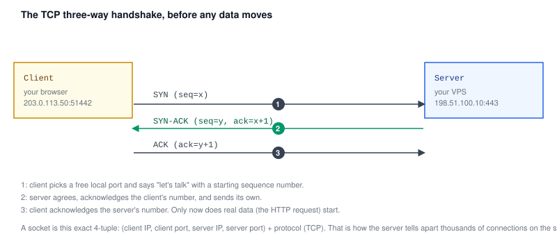

# Chapter 1 — How Networks Actually Work: IP, Ports, TCP/UDP, and the Three-Way Handshake

> **Course:** Networking & Web Servers · **Chapter:** 1 of 8
> Read on the website: [learn.bazardev.com/networking/01-how-networks-actually-work](https://learn.bazardev.com/networking/01-how-networks-actually-work)
>
> 🇧🇩 **Prefer Bangla?** [Read this chapter in Bangla →](https://learn.bazardev.com/networking/01-how-networks-actually-work?lang=bn)

In the Cloud course you opened firewall ports 22, 80 and 443 (Chapter 2), pointed a domain at an IP with DNS (Chapter 3), and put a web server behind HTTPS (Chapter 4). That worked, but a few words were used without being explained: *port*, *socket*, *TCP*. This chapter opens those words up, so the rest of this course — virtual hosts, TLS internals, reverse proxies, load balancing — has solid ground to stand on.

## 1. The layers you actually need

Networking courses often start with the 7-layer OSI model. In practice, working engineers use a simpler 4-layer mental model (the one the internet itself is built on, the **TCP/IP model**):

| Layer | Job | Examples you already know |
|---|---|---|
| **Application** | What your program actually wants to say | HTTP, DNS, SSH |
| **Transport** | Getting a message from one *program* to another | TCP, UDP |
| **Internet** | Getting a packet from one *machine* to another, across networks | IP (IPv4, IPv6) |
| **Link** | Getting a frame across one physical/local network | Ethernet, Wi-Fi |

Each layer only needs to know about the one directly below it. Your Laravel app calls an HTTP client; it has no idea whether the bytes travel over Wi-Fi, fiber or a VPN; TCP and IP handle that underneath. This chapter lives mostly in the **Internet** and **Transport** rows, because that is where "port", "socket" and "handshake" come from.

## 2. IP addresses: how machines are named

An **IP address** identifies one machine (or one network interface) on a network — the Internet layer's job.

- **IPv4** looks like `203.0.113.10`: four numbers 0–255. There are only about 4.3 billion of them, and they ran out years ago, which is why **IPv6** exists: `2001:db8::1f`, with a vastly bigger address space. Most VPS providers give you both.
- **Private ranges** are reserved for internal use and never routed on the public internet: `10.0.0.0/8`, `172.16.0.0/12`, `192.168.0.0/16`. Your home router and office network use these. A VPS usually has a public IP directly, but cloud providers also give instances a private IP for talking to other instances in the same network without crossing the public internet.
- **`127.0.0.1`** (`localhost`) always means "this same machine" — never the network.
- Behind a home router, many devices share one public IP through **NAT (Network Address Translation)**: the router rewrites addresses so replies find their way back to the right device. A VPS normally doesn't need this; it already has its own public IP.

## 3. Ports and sockets: telling programs apart

One machine, one IP address — but dozens of programs might want the network at once (your web server, MySQL, Redis, an SSH session). **Ports** solve that: a 16-bit number (0–65535) that says *which program* on the machine a packet is for.

Some ports are standardised by **IANA** for well-known services, so clients know what to expect:

| Port | Service |
|---|---|
| 22 | SSH |
| 53 | DNS |
| 80 | HTTP |
| 443 | HTTPS |
| 25 / 587 | SMTP (mail) |
| 3306 | MySQL (default) |
| 6379 | Redis (default) |

Ports below 1024 are "well-known" and (on Linux) need root to bind to; above that, anyone can listen. When your browser connects *out* to a server, it doesn't use a well-known port for itself — the OS hands it a random free one from the **ephemeral range** (typically 32768–60999 on Linux), used only for that one connection and then released.

Put an IP and a port together and you get a **socket**: the combination that actually sends or receives data. A server listening on port 443 can be talking to thousands of browsers at once, because each conversation is identified by the full 4-tuple:

```
(client IP, client port, server IP, server port)
```

Your server's socket (`198.51.100.10:443`) stays the same for every visitor; what makes each visitor's connection unique is *their* IP and *their* ephemeral port. That is also, concretely, what a firewall rule does: UFW's `allow 443` (Cloud, Chapter 2) means "accept new connections to this machine's port 443, from any source IP and port".

## 4. TCP vs UDP: two ways to send something

Both sit at the Transport layer, both use ports, and that is where the similarity ends.

| | **TCP** | **UDP** |
|---|---|---|
| Connection | Set up first (handshake), then torn down | None — just send |
| Order | Guaranteed, in order | Not guaranteed |
| Delivery | Guaranteed (retransmits lost packets) | Best-effort, may be lost |
| Speed/overhead | Slower to start, more bookkeeping | Minimal overhead |
| Used by | HTTP, HTTPS, SSH, MySQL | DNS queries, video/voice calls, game state |

TCP is "reliable but with setup cost": worth it when every byte matters and arriving in order matters, which is why almost everything in this course runs over TCP. UDP is "fast but you handle problems yourself": a dropped word in a voice call is barely noticed, but waiting for a perfect retransmit would make the call unusable — so voice/video protocols use UDP and accept occasional loss. DNS queries (Cloud, Chapter 3) mostly use UDP too: a single small request/response, cheap to just retry if nothing comes back. (A newer protocol, **QUIC** — the transport behind **HTTP/3** — runs over UDP but rebuilds TCP's reliability itself, specifically to make the handshake below cheaper. Full HTTP/3 support is still growing across servers, so this course keeps teaching TCP-based HTTP/1.1 and HTTP/2, which is still the overwhelming majority of the web today.)

## 5. The TCP three-way handshake

Before a single byte of your HTTP request travels, TCP agrees on the conversation:



1. **SYN** — the client picks a free local port, and tells the server "I'd like to start, here is my starting sequence number."
2. **SYN-ACK** — the server agrees, acknowledges the client's number, and sends its own starting number back.
3. **ACK** — the client acknowledges the server's number. The socket is now **established**; HTTP request bytes can flow.

Sequence numbers let either side detect a lost or out-of-order packet and ask for it again — this is where TCP's reliability actually comes from. Ending a connection is a similar, politer exchange (`FIN`, then `ACK`, in both directions) rather than just going silent.

This round trip costs real time — at least one full trip to the server and back before any data moves, and TLS (Chapter 4 of this course) adds its own handshake on top. That is exactly why keeping connections open and reusing them (`Connection: keep-alive`, which HTTP/1.1 does by default) matters for a fast site: pay the handshake cost once, not on every request.

## 6. See it yourself

Two small, read-only commands, no special install needed (part of `iproute2`, already on Ubuntu):

```bash
ss -tln
```

```
State    Recv-Q  Send-Q  Local Address:Port   Peer Address:Port
LISTEN   0       511     0.0.0.0:80            0.0.0.0:*
LISTEN   0       511     0.0.0.0:443           0.0.0.0:*
LISTEN   0       128     127.0.0.1:3306        0.0.0.0:*
LISTEN   0       128     127.0.0.1:6379        0.0.0.0:*
```

`-t` = TCP sockets, `-l` = only listening ones, `-n` = show numbers, not resolved names. Read it as: "this machine is answering on 80 and 443 for anyone (`0.0.0.0`), and on 3306/6379 only for itself (`127.0.0.1`)" — MySQL and Redis are deliberately not exposed to the network. That `127.0.0.1` line is a firewall rule you get for free, before UFW even runs.

To see active conversations, not just listening sockets:

```bash
ss -tn state established
```

```
State       Recv-Q  Send-Q   Local Address:Port      Peer Address:Port
ESTAB       0       0        198.51.100.10:443       203.0.113.77:51442
```

That one line is the 4-tuple from Section 3, after the handshake from Section 5 has already happened — a real visitor, mid-request, on your server.

## 7. Key takeaways

- The internet runs on four practical layers: **Link → Internet (IP) → Transport (TCP/UDP) → Application (HTTP, DNS, SSH, …)**. Each only needs the one below it.
- An **IP address** names a machine; a **port** (0–65535) names a program on it; together they form a **socket**.
- **TCP** sets up a connection first and guarantees order and delivery (HTTP, SSH, MySQL); **UDP** just sends, cheaper but unreliable (DNS queries, voice/video).
- The **three-way handshake** (SYN, SYN-ACK, ACK) happens before any TCP data moves — one reason reusing connections is faster than opening new ones.
- `ss -tln` shows what is listening on your server right now, and on which address — the same ports your firewall rules are written for.

## 8. Test yourself (exam prep)

<details>
<summary><strong>Q1. What does a port number actually identify?</strong></summary>

Which program on a machine a piece of network traffic is meant for — not the machine itself (that's the IP address's job).
</details>

<details>
<summary><strong>Q2. What is a socket?</strong></summary>

The combination of an IP address, a port, and a protocol — concretely, the 4-tuple (client IP, client port, server IP, server port) that identifies one specific connection.
</details>

<details>
<summary><strong>Q3. Give one reason HTTP uses TCP rather than UDP.</strong></summary>

An HTTP request/response needs every byte to arrive, in order, without loss — TCP guarantees that; UDP does not.
</details>

<details>
<summary><strong>Q4. Put the three steps of the TCP handshake in order.</strong></summary>

SYN (client proposes) → SYN-ACK (server agrees and proposes back) → ACK (client confirms). Only then does data flow.
</details>

<details>
<summary><strong>Q5. Why does DNS mostly use UDP instead of TCP?</strong></summary>

A DNS query is small and cheap to simply retry if the answer doesn't come back, so the extra reliability and setup cost of TCP usually isn't worth it.
</details>

<details>
<summary><strong>Q6. In <code>ss -tln</code> output, a service listening on <code>127.0.0.1:3306</code> instead of <code>0.0.0.0:3306</code> — what does that mean?</strong></summary>

The service (MySQL) only accepts connections from the same machine, not from the network — it is not reachable remotely even before any firewall rule runs.
</details>

<details>
<summary><strong>Q7. Why does reusing one TCP connection for several HTTP requests make a site feel faster?</strong></summary>

Each new TCP connection needs its own three-way handshake, which costs at least one round trip before any data moves. Reusing a connection pays that cost once instead of on every request.
</details>

<details>
<summary><strong>Q8. Name one port above 1024 you've already used in this course, and what runs on it.</strong></summary>

For example, 3306 (MySQL) or 6379 (Redis) — any accepted answer naming a port from this chapter's table and its service is correct.
</details>

## 9. Free resources

- Cloudflare: [What is the OSI Model?](https://www.cloudflare.com/learning/ddos/glossary/open-systems-interconnection-model-osi/)
- Cloudflare: [What is a packet?](https://www.cloudflare.com/learning/network-layer/what-is-a-packet/) and [What is UDP?](https://www.cloudflare.com/learning/protocols/udp/)
- IANA: [Service Name and Transport Protocol Port Number Registry](https://www.iana.org/assignments/service-names-port-numbers/service-names-port-numbers.xhtml)
- DigitalOcean: [Understanding Sockets](https://www.digitalocean.com/community/tutorials/an-introduction-to-networking-terminology-interfaces-and-protocols) (networking terminology primer)
- `man ss` (`ss --help` for a quick option summary)

---

**Next:** [Chapter 2 — DNS beyond the basics: CAA, SRV, DNSSEC, and debugging past `dig`](02-dns-beyond-the-basics.md)
