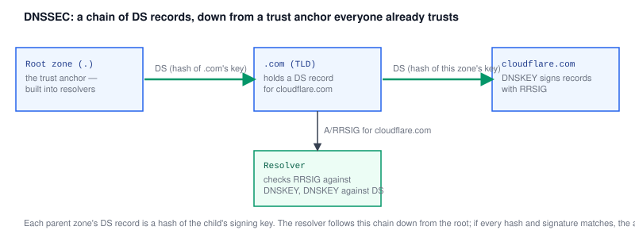

# Chapter 2 — DNS Beyond the Basics: CAA, SRV, DNSSEC, and Debugging Past `dig`

> **Course:** Networking & Web Servers · **Chapter:** 2 of 8
> Read on the website: [learn.bazardev.com/networking/02-dns-beyond-the-basics](https://learn.bazardev.com/networking/02-dns-beyond-the-basics)
>
> 🇧🇩 **Prefer Bangla?** [Read this chapter in Bangla →](https://learn.bazardev.com/networking/02-dns-beyond-the-basics?lang=bn)

Cloud Chapter 3 already covered DNS's job, the lookup chain, A/AAAA/CNAME/MX/TXT/NS records, TTL, and plain `dig`. This chapter assumes all of that and goes to the three things a working developer eventually runs into that chapter didn't cover: a record type that controls *who is allowed to issue your certificates*, a record type that *advertises a service* instead of just an address, and the system that lets a resolver *prove* an answer wasn't forged — plus a debugging command stronger than plain `dig`.

## 1. CAA: who may issue a certificate for your domain

Anyone who can prove control of a domain (Chapter 4 will show exactly how Let's Encrypt checks this) can normally get a certificate for it — from *any* trusted CA. A **CAA (Certification Authority Authorization)** record narrows that: it names the only CAs allowed to issue for your domain, straight from DNS, defined in [RFC 8659](https://www.rfc-editor.org/rfc/rfc8659).

```
myshop.com.  CAA  0 issue "letsencrypt.org"
myshop.com.  CAA  0 issuewild "letsencrypt.org"
```

- **`issue`** — this CA may issue normal certificates for this name.
- **`issuewild`** — this CA may issue *wildcard* certificates (`*.myshop.com`). Without it, `issue` CAs still can't issue wildcards.
- **`iodef`** — an optional contact (a `mailto:` or `https:` URL) a CA can notify about a request it had to refuse.

A real example — GitHub publishes several, because more than one CA issues for them:

```bash
dig +short github.com CAA
```

```
0 issuewild "digicert.com"
0 issue "globalsign.com"
0 issue "sectigo.com"
0 issue "digicert.com"
0 issue "letsencrypt.org"
0 issuewild "sectigo.com"
0 issuewild "letsencrypt.org"
```

A domain with **no CAA record at all** allows any publicly trusted CA — which is the common case, and fine for most sites. CAA is worth adding once you've settled on a CA (Let's Encrypt, in this course) and want to shrink the blast radius if your registrar account or DNS is ever compromised: even with access, an attacker still can't get a working certificate from a CA you haven't allowed. Every publicly trusted CA is required to check CAA before issuing, so this is enforced CA-side, not just advisory.

## 2. SRV: advertising a service, not just a server

A, AAAA and CNAME all answer "where is this name?". **SRV** answers a different question: "which host and port runs *this specific service*?", so a client can find a service without a fixed, well-known port. Format, from [RFC 2782](https://www.rfc-editor.org/rfc/rfc2782):

```
_service._proto.name.  TTL  IN  SRV  priority  weight  port  target.
```

- **`_service._proto`** — the service and transport, for example `_sip._tcp` or `_caldavs._tcp`.
- **priority** — lower is tried first (same idea as MX).
- **weight** — splits traffic between same-priority targets, proportionally.
- **port** — the actual port this instance of the service runs on — the whole reason SRV exists, since the client can't just assume 443.
- **target** — a hostname, resolved separately with its own A/AAAA lookup.

Two real, public examples you can check right now:

```bash
dig +short _caldavs._tcp.icloud.com SRV
```

```
0 0 443 caldav.icloud.com.
```

```bash
dig +short _xmpp-server._tcp.jabber.org SRV
```

```
30 30 5269 scarlet.jabber.org.
```

That's how an Apple Calendar app finds iCloud's CalDAV server, and how one XMPP (chat) server finds another to federate with — no hardcoded hostname or port baked into the client. You will meet SRV again outside plain websites: VoIP (SIP), Minecraft servers, and Microsoft 365/Exchange Autodiscover all use it. A typical Laravel site has no need to publish one, but you now know what one is when you see it in someone else's zone.

## 3. DNSSEC: proving an answer wasn't forged

Plain DNS has no authentication: a resolver has no way to tell a real answer from a forged one injected along the way (DNS cache poisoning). **DNSSEC (DNS Security Extensions)** fixes that by signing records, so a resolver can cryptographically verify them, not just trust whoever replied.

Three record types carry it:

- **DNSKEY** — a zone's public signing key.
- **RRSIG** — a signature over a set of records, made with that key.
- **DS (Delegation Signer)** — a *hash* of a child zone's DNSKEY, published **in the parent zone**. This is the link that turns individual signed zones into a **chain of trust**.



The root zone is the one link nobody can verify from a parent — every DNSSEC-validating resolver simply ships with the root's public key built in (a **trust anchor**). From there, each DS record down the chain is checkable, so trust is inherited all the way to your domain without the resolver trusting any single server blindly.

See it on a real, signed domain:

```bash
dig +dnssec cloudflare.com A
```

```
;; flags: qr rd ra; QUERY: 1, ANSWER: 3, AUTHORITY: 0, ADDITIONAL: 1
cloudflare.com.   299  IN  A      104.16.132.229
cloudflare.com.   299  IN  A      104.16.133.229
cloudflare.com.   299  IN  RRSIG  A 13 2 300 20261119012945 20261116232945 34505 cloudflare.com. X1shl+zekYn9Qbx+A/6RvNOnAVUUWhDdRL1HEJI2tHr1c3oTSGy8LX3kAVCWUFUv4RpzjwLY02Qjr9c/6kvBpQ==
```

```bash
dig +short cloudflare.com DS
```

```
2371 13 2 32996839A6D808AFE3EB4A795A0E6A7A39A76FC52FF228B22B76F6D63826F2B9
```

The `RRSIG` line is the signature over the `A` records; the `DS` line is what `.com` publishes so a resolver can trust `cloudflare.com`'s key in the first place. (A validating resolver sets the **`ad`** — "authenticated data" — flag on a response once every check passes; `dig` without `+cd` shows you what it got, but the actual verification normally happens inside your resolver, closer to you.)

**What DNSSEC does *not* do:** it does not encrypt anything — a query and its answer are still plain text on the wire (that's what [DNS over HTTPS/TLS](https://www.cloudflare.com/learning/dns/dns-over-tls/) is for, a separate concern). It only proves an answer is authentic and unmodified. It also depends on *every* link in the chain being signed and your resolver actually validating — a broken DS record at any level makes the zone **unreachable** for validating resolvers rather than merely insecure, which is why it is normally turned on at the DNS host with a couple of clicks (as Cloudflare's dashboard does) rather than configured by hand.

## 4. Debugging past `dig`: `+trace`

Plain `dig domain.com` asks *your configured resolver* and shows you the final answer. `dig +trace` instead walks the delegation chain itself, hop by hop — useful when you suspect the problem is a broken delegation (wrong NS records) rather than a stale cache:

```bash
dig +trace github.com A
```

```
.                IN NS  a.root-servers.net.   (and 12 more — the root)
;; Received ... from 127.0.0.53#53(127.0.0.53)

com.             IN NS  a.gtld-servers.net.   (and 12 more — the .com TLD)
;; Received ... from k.root-servers.net

github.com.      IN NS  dns1.p08.nsone.net.
github.com.      IN NS  ns-520.awsdns-01.net.  (and more — github.com's own servers)
;; Received ... from e.gtld-servers.net

github.com.   60  IN A  140.82.121.4
;; Received ... from ns-1283.awsdns-32.org
```

(Real output, captured while writing this chapter — the exact IPs and server names will differ, and some change over time; what matters is the shape: root → TLD → the domain's own name servers → the final answer, each line naming which server actually answered that hop.) Read it top to bottom: if it stops making progress at the TLD hop, the registrar's NS records are wrong; if it reaches the domain's own servers but gets no answer, the DNS host's zone itself is the problem — a much faster diagnosis than guessing.

A few more tools worth knowing, each answering a narrower question than `dig`:

| Command | Answers |
|---|---|
| `host myshop.com` | A quick, short-form lookup — handy for a fast sanity check |
| `whois myshop.com` | Who registered the domain, and (sometimes) its name servers — a registration question, not a DNS one |
| `dig myshop.com NS +short` | Exactly which name servers are currently delegated (compare against your DNS host's own list) |

## 5. Key takeaways

- **CAA** names which CAs may issue certificates for your domain, enforced by every public CA — `issue` for normal certs, `issuewild` for wildcards. No record means any CA is allowed.
- **SRV** advertises a service's actual host *and port* (`priority weight port target`), for protocols that can't assume a fixed well-known port — not needed for a typical website, common for chat, VoIP, and calendar/contacts discovery.
- **DNSSEC** signs DNS answers (`DNSKEY`, `RRSIG`) and links zones to their parent (`DS`), building a **chain of trust** down from the root. It authenticates answers; it does not encrypt them.
- `dig +trace` walks the delegation chain itself — root, then TLD, then the domain's own servers — which pinpoints *where* a broken DNS setup actually breaks.

## 6. Test yourself (exam prep)

<details>
<summary><strong>Q1. What does a CAA record control?</strong></summary>

Which certificate authorities are allowed to issue TLS certificates for a domain. No CAA record means any publicly trusted CA may issue.
</details>

<details>
<summary><strong>Q2. A domain's CAA records list only <code>issue "letsencrypt.org"</code>, with no <code>issuewild</code> entry. Can Let's Encrypt issue a wildcard certificate for it?</strong></summary>

No. `issue` only covers normal certificates; a separate `issuewild` entry is required for wildcard certificates, even for an already-allowed CA.
</details>

<details>
<summary><strong>Q3. What problem does SRV solve that A/CNAME records don't?</strong></summary>

A/CNAME only say where a name points; SRV also says which *port* a specific service runs on, and lets priority/weight pick between several instances — useful when a service can't assume a fixed well-known port.
</details>

<details>
<summary><strong>Q4. In an SRV record, what is the "target"?</strong></summary>

A hostname — it still needs its own A or AAAA lookup to turn into an IP address; SRV itself only supplies the host and port.
</details>

<details>
<summary><strong>Q5. What does a DS record actually contain?</strong></summary>

A hash of the child zone's DNSKEY (public signing key), published in the parent zone — the link that lets a resolver trust the child zone's key.
</details>

<details>
<summary><strong>Q6. Does DNSSEC encrypt DNS traffic?</strong></summary>

No. It only authenticates that an answer is genuine and unmodified; the query and answer are still sent in plain text.
</details>

<details>
<summary><strong>Q7. You suspect a domain's NS records at the registrar are wrong. Plain <code>dig</code> or <code>dig +trace</code> — which tells you faster, and why?</strong></summary>

`dig +trace`, because it shows each hop (root, TLD, the domain's own servers) separately, so you can see exactly where delegation stops working instead of only seeing the final failure.
</details>

<details>
<summary><strong>Q8. Why would a site deliberately add a CAA record even though it already has a working certificate?</strong></summary>

To shrink the damage if DNS or the registrar account is ever compromised: even with that access, an attacker still can't get a valid certificate issued by a CA the domain hasn't authorized.
</details>

## 7. Free resources

- RFC Editor: [RFC 8659 — DNS Certification Authority Authorization (CAA)](https://www.rfc-editor.org/rfc/rfc8659)
- RFC Editor: [RFC 2782 — A DNS RR for specifying the location of services (SRV)](https://www.rfc-editor.org/rfc/rfc2782)
- Cloudflare: [How DNSSEC works](https://www.cloudflare.com/dnssec/)
- IBM: [What is dig +trace?](https://www.ibm.com/think/topics/using-dig-trace)
- ICANN: [DNSSEC — what is it and why is it important?](https://www.icann.org/resources/pages/dnssec-what-is-it-why-important-2019-03-05-en)

---

**Next:** Chapter 3 — Virtual hosts and SNI: one server, many sites *(coming soon)*
