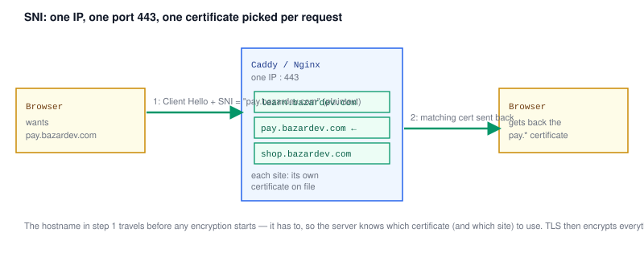

# Chapter 3 — Virtual Hosts and SNI: One Server, Many Sites

> **Course:** Networking & Web Servers · **Chapter:** 3 of 8
> Read on the website: [learn.bazardev.com/networking/03-virtual-hosts-and-sni](https://learn.bazardev.com/networking/03-virtual-hosts-and-sni)
>
> 🇧🇩 **Prefer Bangla?** [Read this chapter in Bangla →](https://learn.bazardev.com/networking/03-virtual-hosts-and-sni?lang=bn)

Cloud Chapter 4 set up **one** domain, on **one** web server, with **one** certificate. In practice, one small VPS usually runs several sites — this course's own server does, which makes a good real example. This chapter is about the two mechanisms that make that possible: **name-based virtual hosts**, for plain HTTP, and **SNI**, for HTTPS.

## 1. Virtual hosts over plain HTTP: the `Host` header

Every HTTP request carries a `Host` header — it has to, because many names can share one IP and one port 80:

```
GET / HTTP/1.1
Host: pay.bazardev.com
```

A web server with several sites configured keeps one block per site and picks the matching one by that header. In Nginx, each block lists the names it answers to:

```nginx
server {
    listen 80;
    server_name learn.bazardev.com;
    root /var/www/learn/public;
}

server {
    listen 80;
    server_name pay.bazardev.com;
    root /var/www/pay/public;
}
```

Caddy works the same way, just with the domain as the block's own heading (as Cloud Chapter 4 already showed for one site):

```
learn.bazardev.com {
    root * /var/www/learn/public
    file_server
}

pay.bazardev.com {
    root * /var/www/pay/public
    file_server
}
```

**What happens if a request's `Host` matches nothing you configured?** Someone will eventually probe your IP directly, or with a random hostname, or with an old DNS record that still points here. Nginx quietly falls back to the **first server block it loaded** unless you say otherwise — which can mean a stranger's malformed request gets served by whichever site happened to be defined first, including real content it shouldn't see. Mark one block explicitly as the catch-all instead:

```nginx
server {
    listen 80 default_server;
    server_name _;
    return 444;   # Nginx-specific: close the connection, send nothing back
}
```

Nginx allows only **one** `default_server` per address and port. Caddy has no such silent fallback: a request whose `Host` matches no site block simply gets no response from Caddy's routing, by design.

## 2. The HTTPS problem: picking a certificate before anything is readable

Add TLS and a new problem appears. HTTPS encrypts the `Host` header along with everything else — but encryption only *starts* once the server has already sent back a certificate, and a server with several sites has **one certificate per domain**, not one for the whole IP. So: how does the server know *which* certificate to send, before it can read anything that would tell it?

## 3. SNI: the hostname that travels before encryption

The answer is **SNI (Server Name Indication)**, a TLS extension defined in [RFC 6066](https://www.rfc-editor.org/rfc/rfc6066): the browser's very first message (the **Client Hello** — the same message that starts the handshake from Chapter 1, now carrying TLS parameters too) includes the hostname it wants, **sent in the clear, before any encryption begins**. The server reads just that one field, picks the matching certificate, and the rest of the handshake proceeds normally.



This is exactly how every multi-tenant server on the internet works, including this course's own server: `learn.bazardev.com`, `pay.bazardev.com` and every other `*.bazardev.com` site live on the **same IP address**, each with its own certificate, told apart purely by SNI.

**See it yourself.** Two real requests, same IP, same port, different `-servername` — each gets its own certificate:

```bash
echo | openssl s_client -connect 167.86.127.108:443 -servername learn.bazardev.com 2>/dev/null \
  | openssl x509 -noout -subject
```

```
subject=CN=learn.bazardev.com
```

```bash
echo | openssl s_client -connect 167.86.127.108:443 -servername pay.bazardev.com 2>/dev/null \
  | openssl x509 -noout -subject
```

```
subject=CN=pay.bazardev.com
```

**Now try it with no SNI at all** (tested directly against this course's own server while writing this chapter):

```bash
echo | openssl s_client -connect 167.86.127.108:443 2>&1 | head -3
```

```
Connecting to 167.86.127.108
...error:...SSL alert number 80
CONNECTED(00000003)
```

The handshake fails outright — `alert number 80` is TLS's generic `internal_error`. Without a hostname to match, Caddy has no certificate to offer, so it cannot complete the handshake at all. (Nginx, configured with an explicit default, could instead choose to present a fallback certificate — but either way, *something* has to be decided from SNI alone, before anything else is readable.)

## 4. Before SNI: one IP per HTTPS site

SNI only reached near-universal client support around the early-to-mid 2010s. Before that (and still today, for the rare legacy client without it), a server had no way to pick a certificate from an encrypted-but-not-yet-decryptable connection — so **HTTPS virtual hosting required one IP address per certificate**. That scarcity of IPv4 addresses is a direct reason SNI mattered enough to get built and adopted everywhere: it turned "one IP per HTTPS site" into "one IP, unlimited HTTPS sites", the same way a port turns "one IP per program" into many.

## 5. A privacy note worth knowing

SNI is sent **unencrypted**, by design — that is the whole mechanism. Which means anyone who can see your network traffic (an ISP, a network operator, anyone on the same Wi-Fi) can see *which hostname* you are requesting over HTTPS, even though they can't read the page itself. Browsers and some providers are rolling out **Encrypted Client Hello (ECH)**, which wraps the real SNI inside an outer, encrypted-from-the-start hello — support is still growing, so don't assume it protects a given connection yet. For this course, the practical point is simpler: SNI is metadata a firewall or proxy can filter on even when it can't see the request itself, which is exactly why some corporate and national firewalls block sites by SNI hostname rather than by IP.

## 6. Key takeaways

- Plain HTTP virtual hosts are matched by the **`Host` header**; always configure an explicit catch-all (`default_server` in Nginx) rather than relying on whichever site loaded first.
- HTTPS can't read the `Host` header before choosing a certificate, because encryption hasn't started yet — **SNI** solves this by sending the hostname in the clear, inside the Client Hello.
- One IP, one port 443, and **as many certificates as you have sites configured** — proven directly with `openssl s_client -servername` against this course's own multi-site server.
- No matching SNI means no certificate to offer — on this server, that fails the handshake outright, rather than falling back to anything.
- SNI is unencrypted metadata; Encrypted Client Hello (ECH) is the emerging fix, not yet something to rely on everywhere.

## 7. Test yourself (exam prep)

<details>
<summary><strong>Q1. How does a web server with several sites on port 80 know which site a request is for?</strong></summary>

From the request's `Host` header, matched against each site's configured name(s).
</details>

<details>
<summary><strong>Q2. Why can't a multi-site HTTPS server just read the <code>Host</code> header to pick a certificate, the way it does over plain HTTP?</strong></summary>

Because the `Host` header is only readable after encryption has started, and encryption can't start until the server has already sent a certificate — there's a chicken-and-egg problem.
</details>

<details>
<summary><strong>Q3. What does SNI actually send, and when?</strong></summary>

The requested hostname, inside the Client Hello, in plaintext, before any encryption begins — early enough for the server to choose the matching certificate.
</details>

<details>
<summary><strong>Q4. Two different domains resolve to the same IP address and both serve valid HTTPS with their own certificate. How is that possible?</strong></summary>

SNI: the server reads the hostname from each connection's Client Hello and presents that site's own certificate, even though both sites share one IP and one port 443.
</details>

<details>
<summary><strong>Q5. In Nginx, what happens to a request whose <code>Host</code> header matches no configured <code>server_name</code>, if you haven't set a <code>default_server</code>?</strong></summary>

Nginx falls back to the first server block it loaded for that address and port — which can unintentionally expose a real site's content to a mismatched request.
</details>

<details>
<summary><strong>Q6. Why did HTTPS virtual hosting require one IP per site before SNI existed?</strong></summary>

Without a way to read the hostname before the handshake, the server had no way to pick which certificate to present — so each certificate needed its own IP address to be unambiguous.
</details>

<details>
<summary><strong>Q7. Is the hostname sent via SNI encrypted?</strong></summary>

No — it is sent in plaintext in the Client Hello, by design, so the server can read it before any encryption starts. This is why an observer on the network path can see which hostname you're requesting even over HTTPS.
</details>

<details>
<summary><strong>Q8. On this course's own server, what happened when <code>openssl s_client</code> connected with no <code>-servername</code> at all?</strong></summary>

The TLS handshake failed with an `internal_error` alert — with no hostname to match against any configured site, Caddy had no certificate to offer and could not complete the handshake.
</details>

## 8. Free resources

- RFC Editor: [RFC 6066 — TLS Extensions: Server Name Indication](https://www.rfc-editor.org/rfc/rfc6066)
- Nginx docs: [Server names](https://nginx.org/en/docs/http/server_names.html)
- Caddy docs: [Automatic HTTPS](https://caddyserver.com/docs/automatic-https)
- Cloudflare: [What is SNI? How TLS server name indication works](https://www.cloudflare.com/learning/ssl/what-is-sni)
- IETF: [RFC 8744 — Issues and Requirements for SNI Encryption in TLS](https://www.rfc-editor.org/rfc/rfc8744) (background on the privacy note above)

---

**Next:** Chapter 4 — TLS deep dive: the handshake, certificate chains, and HSTS *(coming soon)*
