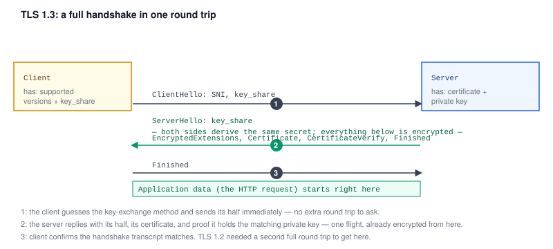

# Chapter 4 — TLS Deep Dive: the Handshake, Certificate Chains, and HSTS

> **Course:** Networking & Web Servers · **Chapter:** 4 of 8
> Read on the website: [learn.bazardev.com/networking/04-tls-deep-dive](https://learn.bazardev.com/networking/04-tls-deep-dive)
>
> 🇧🇩 **Prefer Bangla?** [Read this chapter in Bangla →](https://learn.bazardev.com/networking/04-tls-deep-dive?lang=bn)

Cloud Chapter 4 got you a working `https://` site with certbot or Caddy, and told you TLS gives you encryption, integrity, and identity. Chapter 3 of this course showed *how the server picks the right certificate* (SNI). This chapter opens the box on what happens right after that: the actual handshake that turns a plain TCP connection into an encrypted one, what a certificate **chain** really is, and the one header (HSTS) most sites forget to add.

## 1. The TLS 1.3 handshake, one round trip

Chapter 1 showed the TCP three-way handshake — SYN, SYN-ACK, ACK — which just opens a reliable pipe, with nothing encrypted yet. TLS runs *inside* that pipe, immediately after. Here is a real handshake, captured live against this course's own server, with `openssl`'s protocol-debug flag turned on:

```bash
echo | openssl s_client -connect learn.bazardev.com:443 -servername learn.bazardev.com -tls1_3 -msg -state
```

```
>>> TLS 1.3, Handshake, ClientHello
<<< TLS 1.3, Handshake, ServerHello
<<< TLS 1.3, ChangeCipherSpec                 (compatibility only — see below)
<<< TLS 1.3, Handshake, EncryptedExtensions
<<< TLS 1.3, Handshake, Certificate
<<< TLS 1.3, Handshake, CertificateVerify
<<< TLS 1.3, Handshake, Finished
>>> TLS 1.3, ChangeCipherSpec
>>> TLS 1.3, Handshake, Finished
SSL_connect:SSL negotiation finished successfully
```

(Real output, with the repeated low-level `RecordHeader`/`InnerContent` lines stripped out for readability — only the handshake messages that matter are kept, in the exact order the server sent them.)



Read what each message actually does, defined in [RFC 8446](https://www.rfc-editor.org/rfc/rfc8446):

1. **ClientHello** — the browser sends the TLS versions and cipher suites it supports, the hostname via **SNI** (Chapter 3), and a **`key_share`**: its half of a fresh, one-time Diffie-Hellman key exchange. This is the one new idea that makes everything else in this handshake possible: the client doesn't wait for the server to ask — it guesses the key-exchange method the server will pick and sends its share immediately.
2. **ServerHello** — the server picks a version and cipher suite, and sends back *its* half of the key exchange. **Both sides can now compute the same shared secret independently** (that's how Diffie-Hellman works) — so from this point on, everything is encrypted.
3. **EncryptedExtensions, Certificate, CertificateVerify** — now encrypted. The server sends its certificate chain, then proves it actually holds the private key matching that certificate by signing a hash of everything exchanged so far (`CertificateVerify`) — not just presenting a certificate, but proving ownership of it, in this same flight.
4. **Finished** (server), then **Finished** (client) — each side sends a MAC over the full handshake transcript, so both can detect if anything was tampered with or dropped in transit.

That's it — **one round trip**, and application data (the actual HTTP request) can start right after the client's `Finished`. The `ChangeCipherSpec` messages you see in the capture are not doing real work in TLS 1.3 — they only exist so that old middleboxes on the network path, written for TLS 1.2, see a message shape they recognize and don't drop the connection ([RFC 8446 §5](https://www.rfc-editor.org/rfc/rfc8446), Appendix D).

## 2. Why this is a change: TLS 1.2 took two round trips

TLS 1.2 (still spoken by some older clients) negotiates the key exchange method first, then runs it — `ClientHello` → `ServerHello + Certificate + ServerKeyExchange + ServerHelloDone` → `ClientKeyExchange + Finished` → `Finished`: **two round trips** before application data can move. TLS 1.3 saves one entirely because the client *guesses and sends* its key share up front instead of waiting to be asked.

This server still accepts TLS 1.2 connections, for clients that can't do better:

```bash
echo | openssl s_client -connect learn.bazardev.com:443 -servername learn.bazardev.com -tls1_2
```

```
New, TLSv1.2, Cipher is ECDHE-ECDSA-AES128-GCM-SHA256
Protocol: TLSv1.2
```

Notice the cipher name starts with **ECDHE** — Elliptic-Curve Diffie-Hellman, *Ephemeral*. That "ephemeral" is what gives you **forward secrecy**: a fresh key pair is generated for this connection alone and thrown away afterward, so even if the server's long-term private key leaks next year, today's captured traffic still can't be decrypted — the one-time key needed for it never existed anywhere but in that connection's memory. TLS 1.2 *could* skip this (plain RSA key exchange, no forward secrecy) — TLS 1.3 removed that option entirely and made an ephemeral exchange mandatory for every connection.

## 3. Certificate chains: why a server sends more than one certificate

A certificate says "here is a public key, and a trusted third party signed a statement that it belongs to this hostname." But browsers and operating systems don't trust every CA directly — they ship with a short, curated list of **root CAs**. To bridge that gap, a CA signs with an **intermediate** certificate, and that intermediate is itself signed by a root the client already trusts. The server sends the whole chain (except the root — the client already has that) so the client can walk it upward until it reaches a root it recognizes.

Here is the real chain this server currently presents (`openssl s_client -connect learn.bazardev.com:443 -servername learn.bazardev.com`, showing `s:` = subject, `i:` = issuer of each certificate):

```
0 s:CN=learn.bazardev.com
  i:C=US, O=Let's Encrypt, CN=YE1
1 s:C=US, O=Let's Encrypt, CN=YE1
  i:C=US, O=ISRG, CN=Root YE
2 s:C=US, O=ISRG, CN=Root YE
  i:C=US, O=Internet Security Research Group, CN=ISRG Root X2
3 s:C=US, O=Internet Security Research Group, CN=ISRG Root X2
  i:C=US, O=Internet Security Research Group, CN=ISRG Root X1
```

Read it bottom-up: the leaf certificate (**0**, for this exact hostname) is signed by intermediate **YE1**, which is itself signed by **Root YE**, which is cross-signed by **ISRG Root X2**, which is in turn cross-signed by the older, more widely trusted **ISRG Root X1**. (The exact intermediate and root names a CA uses change over time as it rotates keys — don't memorize these names; memorize the *shape*: leaf → one or more intermediates → a root your trust store already has. Cross-signing like the last link here is a CA's way of staying compatible with older trust stores while rolling out a new root.) You can see your own trust store's roots on Linux at `/etc/ssl/certs/`.

**Certificates can also be revoked** before they expire — if a private key leaks, the CA can mark the certificate invalid early. Checking that uses **OCSP** (Online Certificate Status Protocol — "has certificate X been revoked?") or the older **CRL** (a downloadable list of revoked serial numbers). Checking OCSP live, per connection, is slow and leaks your browsing to the CA, so modern servers often use **OCSP stapling**: the server itself periodically fetches a signed "still good" answer from the CA and attaches it to the handshake, so the client doesn't have to ask.

## 4. HSTS: closing the first-request gap

Even with HTTPS fully working, there's a gap: the *very first* time a browser visits your domain, it often doesn't know to use HTTPS yet — typing a bare `myshop.com`, or an old bookmark, defaults to plain `http://`. A server can redirect that to HTTPS (Chapter 2's Cloud chapter showed Caddy doing exactly this), but the redirect itself is one unencrypted request, and an attacker sitting on that network path (an "SSL-stripping" attack) can intercept it and quietly keep the victim on `http://` instead of letting the redirect through.

**HSTS (HTTP Strict Transport Security)** closes this for *repeat* visits: once a browser has seen this response header over a connection it already trusts, it remembers to go straight to HTTPS for that host, every time, without ever trying plain HTTP first — so there's no redirect left to intercept.

```
Strict-Transport-Security: max-age=31536000; includeSubDomains
```

- **`max-age`** — how many seconds the browser should keep enforcing this, in seconds (31536000 = one year here).
- **`includeSubDomains`** — apply the same rule to every subdomain, not just the exact host.
- **`preload`** — an optional third directive asking to go further (next section).

Now the honest finding — checked live, right now, against this course's own server:

```bash
curl -sI https://learn.bazardev.com/ | grep -i strict
```

```
(no output — the header is not present)
```

This site redirects HTTP to HTTPS (`curl -sI http://learn.bazardev.com/` returns `308 Permanent Redirect` to the `https://` URL — Caddy does that automatically), but it does **not** currently send `Strict-Transport-Security`. That's a common gap: Caddy and Nginx both handle certificates and the redirect for you automatically, but **neither sends HSTS by default** — you have to add the header yourself. In a Caddyfile:

```
myshop.com {
    header Strict-Transport-Security "max-age=31536000; includeSubDomains"
}
```

Or in Nginx:

```nginx
add_header Strict-Transport-Security "max-age=31536000; includeSubDomains" always;
```

### Preloading: closing the gap on the *very first* visit, too

HSTS only protects a browser that has already connected once over HTTPS. The **HSTS preload list**, maintained by Chrome and used by most major browsers, closes even that: it's a hardcoded list of domains, shipped inside the browser itself, that are HTTPS-only from the browser's very first connection, no prior visit needed. Submitting at [hstspreload.org](https://hstspreload.org/) requires a valid certificate, an HTTP→HTTPS redirect, and a live `Strict-Transport-Security` header with `max-age` of at least one year, `includeSubDomains`, and the `preload` directive itself present.

Preloading is **not something to turn on casually**: every subdomain must support HTTPS before you add `includeSubDomains` (one HTTP-only subdomain breaks for every visitor), and removal is slow — new entries (and removals) only reach users once rebuilt into a browser release, which can take months. Add plain HSTS first, confirm every subdomain actually works over HTTPS for a while, and only then consider preloading.

## 5. Key takeaways

- TLS 1.3 completes a full handshake in **one round trip**: the client sends its key share in the `ClientHello` itself instead of waiting to be asked, so the server can reply with `ServerHello` + certificate + `Finished` all in one flight.
- **Ephemeral (EC)DHE key exchange gives forward secrecy** — today's traffic stays unreadable even if the server's long-term key leaks later. TLS 1.3 makes this mandatory; TLS 1.2 made it optional.
- A server sends a **certificate chain** — leaf → intermediate(s) — so the client can walk up to a **root CA** it already trusts; it never needs to send the root itself.
- Certificates can be **revoked** early; **OCSP stapling** lets the server prove "still valid" without the client contacting the CA on every connection.
- **HSTS** (`Strict-Transport-Security` header) stops a browser from ever retrying plain HTTP on a host it's seen it on before — closing the SSL-stripping window on repeat visits. Caddy and Nginx auto-redirect HTTP→HTTPS but do **not** send this header by default; you add it yourself.
- **HSTS preload** closes the gap on the *very first* visit too, but is a slow, hard-to-reverse commitment — get plain HSTS fully working everywhere first.

## 6. Test yourself (exam prep)

<details>
<summary><strong>Q1. What does the client send in its very first message that lets a TLS 1.3 handshake finish in one round trip?</strong></summary>

Its `key_share` — half of a Diffie-Hellman key exchange, sent immediately in the `ClientHello` instead of waiting for the server to request it, so the server can reply with everything (including an encrypted certificate) in a single flight.
</details>

<details>
<summary><strong>Q2. What does "ephemeral" mean in a cipher suite like ECDHE, and why does it matter?</strong></summary>

A fresh key pair is generated for that one connection and discarded afterward. It gives forward secrecy: even if the server's long-term private key is later compromised, traffic from past connections still can't be decrypted, because the one-time key never existed anywhere else.
</details>

<details>
<summary><strong>Q3. Why does a server send intermediate certificates along with its own, but not the root certificate?</strong></summary>

Browsers and operating systems don't trust every CA directly, only a short list of root CAs they already ship with. Intermediates bridge the server's certificate up to one of those trusted roots; the root itself doesn't need to be sent because the client already has it.
</details>

<details>
<summary><strong>Q4. A site has had a working HTTP→HTTPS redirect for years. Does that alone protect every future visit from an SSL-stripping attack?</strong></summary>

No. The redirect itself is one unencrypted request each time a browser hasn't yet learned to go straight to HTTPS, and that single request can be intercepted. HSTS fixes repeat visits by making the browser skip the HTTP step entirely once it has seen the header; even that doesn't cover a user's very first-ever visit, which only HSTS preloading addresses.
</details>

<details>
<summary><strong>Q5. Why shouldn't you add `includeSubDomains` and submit to HSTS preload the same day you first turn on HTTPS?</strong></summary>

`includeSubDomains` immediately forces every subdomain to be HTTPS-only — one subdomain that isn't ready breaks for all visitors. Preloading is also slow to undo, since changes only reach users after a browser release rebuild, which can take months. Confirm every subdomain works over HTTPS first.
</details>

## 7. Free resources

- RFC Editor: [RFC 8446 — The Transport Layer Security (TLS) Protocol Version 1.3](https://www.rfc-editor.org/rfc/rfc8446)
- MDN: [Strict-Transport-Security header](https://developer.mozilla.org/en-US/docs/Web/HTTP/Reference/Headers/Strict-Transport-Security)
- HSTS Preload List: [hstspreload.org](https://hstspreload.org/)
- Caddy: [Automatic HTTPS](https://caddyserver.com/docs/automatic-https)
- DigiCert: [What is OCSP stapling?](https://www.digicert.com/ocsp-stapling)

---

**Next:** [Chapter 5 — Reverse proxy patterns: path routing, websockets, caching, and rate limiting](05-reverse-proxy-patterns.md)

