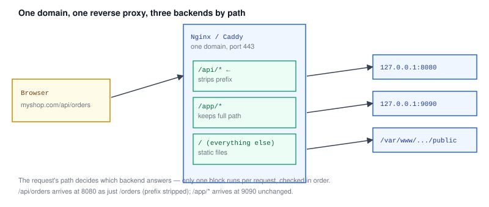

# Chapter 5 — Reverse Proxy Patterns: Path Routing, WebSockets, Caching, and Rate Limiting

> **Course:** Networking & Web Servers · **Chapter:** 5 of 8
> Read on the website: [learn.bazardev.com/networking/05-reverse-proxy-patterns](https://learn.bazardev.com/networking/05-reverse-proxy-patterns)
>
> 🇧🇩 **Prefer Bangla?** [Read this chapter in Bangla →](https://learn.bazardev.com/networking/05-reverse-proxy-patterns?lang=bn)

Cloud Chapter 4 showed the simplest reverse proxy: one domain, one `proxy_pass`, forwarding everything to one backend. Real setups need more: several backends sharing one domain by URL path, long-lived WebSocket connections instead of plain request/response, caching a backend's responses instead of hitting it every time, and protecting a backend from being overwhelmed. This chapter covers all four — with Nginx directives checked against nginx.org, and Caddy examples actually validated with `caddy validate` (Nginx itself isn't installed on the machine writing this course, so its examples are doc-sourced, not executed; Caddy is, so those are).

## 1. Path-based routing: one domain, several backends

A single domain can forward different URL paths to entirely different backends — a PHP app at `/`, a separate microservice at `/api/`, a Node app at `/app/`.

**Nginx** does this with multiple `location` blocks, each with its own `proxy_pass`:

```nginx
server {
    server_name myshop.com;

    location /api/ {
        proxy_pass http://127.0.0.1:8080/;   # trailing slash strips /api/ before forwarding
    }

    location /app/ {
        proxy_pass http://127.0.0.1:9090;    # no trailing slash keeps /app/ in the forwarded path
    }

    location / {
        root /var/www/myshop/public;
    }
}
```

That one-character difference (a trailing slash on `proxy_pass`'s URL) decides whether the matched prefix is stripped before forwarding — a very common Nginx gotcha.

When several `location` blocks could match the same request, Nginx doesn't just use the longest prefix — it follows a fixed order, straight from [the official docs](https://nginx.org/en/docs/http/ngx_http_core_module.html#location): an **exact match (`=`)** wins immediately; otherwise the **longest prefix** is remembered, and if that prefix has **`^~`**, regex locations are skipped entirely; otherwise **regex locations (`~`, `~*`)** are tried in the order they appear in the file, and the first one to match wins; only if nothing above matched does Nginx fall back to the longest prefix it remembered at the start.



**Caddy** uses `handle_path` (strips the matched prefix) or `handle` (keeps the full path), and only one of them runs per request — Caddy tries each in turn and stops at the first match:

```
myshop.com {
    handle_path /api/* {
        reverse_proxy 127.0.0.1:8080
    }

    handle /app/* {
        reverse_proxy 127.0.0.1:9090
    }

    handle {
        root * /var/www/myshop/public
        file_server
    }
}
```

(Checked for real: `caddy validate --config Caddyfile --adapter caddyfile` on this exact snippet returns `Valid configuration`.) `handle_path /api/*` is the Caddy equivalent of Nginx's trailing-slash trick — the `/api` prefix is removed before the request reaches `127.0.0.1:8080`.

## 2. Proxying WebSockets: the connection doesn't end after one response

A normal HTTP reverse proxy forwards a request, gets a response, and is done. A **WebSocket** connection (used for live chat, notifications, collaborative editing) starts as a normal HTTP request but then **upgrades**: the client sends an `Upgrade: websocket` header, the server replies `101 Switching Protocols`, and from that point the same TCP connection carries a long-lived, bidirectional stream — no more request/response pairs.

A reverse proxy sitting in the middle has to be told to tunnel that upgrade through, instead of treating it as a normal, short-lived request. From [nginx.org's own WebSocket proxying guide](https://nginx.org/en/docs/http/websocket.html): `Upgrade` and `Connection` are *hop-by-hop* headers, so Nginx does **not** forward them to the backend by default — you must forward them explicitly:

```nginx
location /chat/ {
    proxy_pass http://backend;
    proxy_set_header Upgrade $http_upgrade;
    proxy_set_header Connection "upgrade";
}
```

That unconditional `"upgrade"` breaks ordinary HTTP requests to the same location (they don't send an `Upgrade` header at all), so production configs usually add a `map` to only send `"upgrade"` when the client actually asked for it:

```nginx
http {
    map $http_upgrade $connection_upgrade {
        default upgrade;
        ''      close;
    }
}
```

```nginx
proxy_set_header Connection $connection_upgrade;
```

One more real detail from the same docs: Nginx closes a proxied connection after **60 seconds** of silence from the backend by default — fine for ordinary requests, but a WebSocket can sit idle far longer than that. Fix it with a longer `proxy_read_timeout`, or have the backend send periodic WebSocket ping frames to keep resetting that clock.

**Caddy needs none of this.** Its `reverse_proxy` directive detects and tunnels WebSocket upgrades automatically — the same `reverse_proxy 127.0.0.1:8080` line you'd use for plain HTTP already handles it.

## 3. Caching a backend's responses

A reverse proxy can hold on to a backend's response and serve the next matching request straight from memory or disk, skipping the backend entirely. **Nginx** does this with `proxy_cache_path` (defines where and how big the cache is — `http` context only) plus `proxy_cache` and `proxy_cache_valid` (per-location):

```nginx
http {
    proxy_cache_path /var/cache/nginx levels=1:2 keys_zone=myshop:10m max_size=1g inactive=60m;

    server {
        location /api/ {
            proxy_pass http://127.0.0.1:8080/;
            proxy_cache myshop;
            proxy_cache_valid 200 302 10m;
            proxy_cache_valid 404 1m;
            add_header X-Cache-Status $upstream_cache_status;   # see what actually happened
        }
    }
}
```

That `X-Cache-Status` header exposes Nginx's own `$upstream_cache_status` variable, documented with exactly these values: `MISS` (not cached, backend was asked), `HIT` (served straight from cache), `EXPIRED` (cache entry was too old, backend asked again), `BYPASS` (a `proxy_cache_bypass` rule skipped the cache on purpose), `STALE`, `UPDATING`, and `REVALIDATED` (edge cases around refreshing an expiring entry). Watching this header while testing is the fastest way to confirm caching is actually doing what you think it's doing — don't assume, check.

A response's own `Cache-Control` or `Expires` headers (set by your app) **override** `proxy_cache_valid` — so caching is ultimately a negotiation between what your backend says and what the proxy is configured to allow. `proxy_cache_bypass` lets you skip the cache on purpose — the common case is a logged-in session, where `proxy_cache_bypass $cookie_session;` means any request carrying that cookie always goes to the backend fresh.

**Caddy's `reverse_proxy` has no built-in response cache** — nothing on its own official directive page mentions one. Caching a proxied response in Caddy means adding a module (the official [`caddyserver/cache-handler`](https://github.com/caddyserver/cache-handler), built on the Souin cache), built in via `xcaddy`, since this isn't part of Caddy core.

## 4. Rate limiting: protecting a backend from too many requests

A reverse proxy can also cap how fast one client is allowed to hit a backend — useful against a misbehaving script, a scraper, or a brute-force login attempt. **Nginx**'s `ngx_http_limit_req_module` ([nginx.org](https://nginx.org/en/docs/http/ngx_http_limit_req_module.html)) works in two parts — a shared-memory zone keyed by something (usually the client IP), and a limit applied where you want it:

```nginx
http {
    limit_req_zone $binary_remote_addr zone=login:10m rate=5r/s;

    server {
        location /login {
            limit_req zone=login burst=10 nodelay;
            limit_req_status 429;
            proxy_pass http://127.0.0.1:8080;
        }
    }
}
```

- **`rate=5r/s`** — the sustained rate allowed per key (here, per client IP).
- **`burst=10`** — how many requests above that rate can queue up before being rejected outright.
- **`nodelay`** — without it, requests inside the burst are *queued and spaced out* to match the rate; with it, they're let through immediately (still capped at 10), so a short, legitimate spike doesn't get needlessly slowed down.
- **`limit_req_status 429`** — send the correct `429 Too Many Requests`, since the directive's own default is a plain `503`.

One real catch worth knowing: `$binary_remote_addr` is whatever IP Nginx sees as the client. If Nginx itself sits behind another proxy or load balancer, that's the load balancer's IP, not the real visitor's — every real visitor would then share one rate-limit bucket. Chapter 6 (load balancing) and the `ngx_http_realip_module` are how you recover the real client IP in that situation.

**Caddy core has no rate limiting either.** The maintained option is [`mholt/caddy-ratelimit`](https://github.com/mholt/caddy-ratelimit) — written by Caddy's own creator, added via `xcaddy build --with github.com/mholt/caddy-ratelimit`, giving a `rate_limit` directive with named zones. Like caching, it's a module you add, not something `reverse_proxy` does by itself.

## 5. Key takeaways

- **Path-based routing** lets one domain forward different URL prefixes to different backends: Nginx with multiple `location` blocks (watch the trailing-slash-on-`proxy_pass` prefix-stripping gotcha), Caddy with `handle_path` (strips the prefix) or `handle` (keeps it).
- Nginx resolves overlapping `location` blocks in a fixed order: exact match → longest `^~` prefix → regex in file order → the remembered longest plain prefix.
- **WebSockets** upgrade an HTTP connection into a long-lived tunnel. Nginx must be told to forward the `Upgrade`/`Connection` headers and usually needs a longer timeout; Caddy's `reverse_proxy` handles WebSockets automatically.
- **Response caching** (`proxy_cache_path`/`proxy_cache`/`proxy_cache_valid` in Nginx) skips the backend for repeat requests; `$upstream_cache_status` tells you whether a request was a `HIT`, `MISS`, or something else — check it, don't assume. Caddy core has no built-in equivalent; it needs a third-party module.
- **Rate limiting** (`limit_req_zone`/`limit_req` in Nginx) caps how fast one key (usually an IP) can hit a backend, with `burst` and `nodelay` controlling how spiky traffic is handled. Caddy core has none built in either; `caddy-ratelimit` is the maintained option.
- Both caching and rate limiting key off the client IP or similar — if your proxy itself sits behind another layer, you need the *real* client IP (Nginx's `realip` module) or the bucket keys on the wrong address.

## 6. Test yourself (exam prep)

<details>
<summary><strong>Q1. In Nginx, what's the effect of a trailing slash on the URL in <code>proxy_pass http://backend/;</code> versus <code>proxy_pass http://backend;</code> (no trailing slash)?</strong></summary>

With the trailing slash, the matched `location` prefix is stripped from the URL before it's forwarded to the backend. Without it, the full original path (including the matched prefix) is forwarded as-is.
</details>

<details>
<summary><strong>Q2. A request could match both an Nginx <code>location ^~ /images/</code> and a <code>location ~* \.jpg$</code>. Which one wins?</strong></summary>

The `^~` prefix location wins — that modifier tells Nginx to skip checking regex locations entirely once it's the longest matching prefix, regardless of whether a regex would also have matched.
</details>

<details>
<summary><strong>Q3. Why does a plain Nginx reverse proxy break WebSocket connections unless you add extra configuration?</strong></summary>

`Upgrade` and `Connection` are hop-by-hop headers, so Nginx doesn't forward them to the backend by default. Without `proxy_set_header Upgrade $http_upgrade;` and a corresponding `Connection` header, the backend never sees the upgrade request and can't switch the connection to a WebSocket tunnel.
</details>

<details>
<summary><strong>Q4. Your Nginx response has <code>X-Cache-Status: EXPIRED</code>. What does that tell you?</strong></summary>

A cached entry for this request existed, but it was past its allowed cache time (`proxy_cache_valid`), so Nginx asked the backend again rather than serving the old copy. It's different from `MISS` (nothing was cached at all) and `HIT` (a still-valid cached copy was served).
</details>

<details>
<summary><strong>Q5. An Nginx <code>limit_req_zone</code> keys on <code>$binary_remote_addr</code>, but Nginx itself sits behind a load balancer. What goes wrong?</strong></summary>

Nginx sees the load balancer's IP as the "client" for every request, so all real visitors share a single rate-limit bucket — one busy or malicious visitor can get everyone else rate-limited too. Recovering the real client IP (for example with the `realip` module) is needed first.
</details>

## 7. Free resources

- Nginx: [Module ngx_http_core_module — the `location` directive](https://nginx.org/en/docs/http/ngx_http_core_module.html#location)
- Nginx: [WebSocket proxying](https://nginx.org/en/docs/http/websocket.html)
- Nginx: [Module ngx_http_proxy_module — caching directives](https://nginx.org/en/docs/http/ngx_http_proxy_module.html)
- Nginx: [Module ngx_http_limit_req_module](https://nginx.org/en/docs/http/ngx_http_limit_req_module.html)
- Caddy: [`handle_path` directive](https://caddyserver.com/docs/caddyfile/directives/handle_path)
- GitHub: [caddyserver/cache-handler](https://github.com/caddyserver/cache-handler)
- GitHub: [mholt/caddy-ratelimit](https://github.com/mholt/caddy-ratelimit)

---

**Next:** Chapter 6 — Load balancing: L4 vs L7, algorithms, and health checks *(coming soon)*
