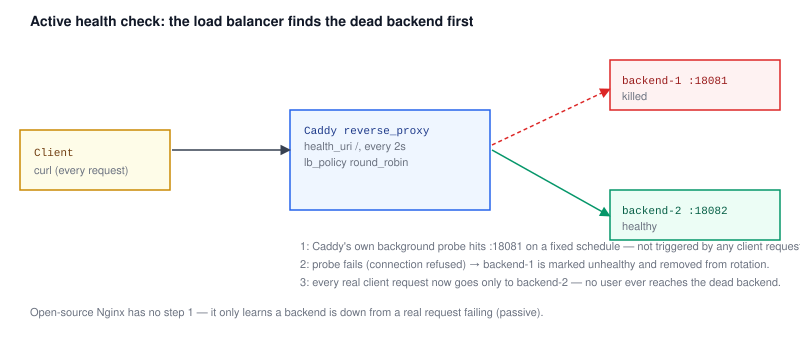

# Chapter 6 — Load Balancing: L4 vs L7, Algorithms, and Health Checks

> **Course:** Networking & Web Servers · **Chapter:** 6 of 8
> Read on the website: [learn.bazardev.com/networking/06-load-balancing](https://learn.bazardev.com/networking/06-load-balancing)
>
> 🇧🇩 **Prefer Bangla?** [Read this chapter in Bangla →](https://learn.bazardev.com/networking/06-load-balancing?lang=bn)

Every reverse proxy example so far in this course has had exactly one backend behind each path. A **load balancer** is a reverse proxy with *several* backends behind the same route, deciding which one gets each request — and, critically, noticing when one of them stops answering. This chapter covers the one distinction that decides how much a load balancer can see (L4 vs L7), the algorithms it can use to pick a backend, and how it tells a healthy backend from a dead one — including a real, live demo built for this chapter.

## 1. L4 vs L7: how much the load balancer actually understands

Everything this course has done so far — routing by `Host` header (Chapter 3), by URL path (Chapter 5) — requires reading the request itself: the HTTP headers, or at least the hostname. That's **Layer 7 (application layer)** load balancing. It's not free: the proxy has to understand HTTP (or at least TLS's `ClientHello`) to make that decision.

**Layer 4 (transport layer)** load balancing doesn't look inside the connection at all — it only sees IP addresses and ports, and forwards the raw TCP or UDP stream byte-for-byte. Nginx's `stream {}` block (a separate module from the `http {}` block used everywhere else in this course) does exactly this, straight from [nginx.org](https://nginx.org/en/docs/stream/ngx_stream_core_module.html):

```nginx
stream {
    upstream backend {
        server 127.0.0.1:12346;
    }

    server {
        listen 12345;
        proxy_pass backend;
    }
}
```

Nginx never parses what's inside this connection — it just shuttles bytes between the client and `backend`. This is faster and more general (it works for any TCP/UDP protocol, not just HTTP) but it can't do anything Chapter 3 or 5 did: no routing by hostname, no routing by path, because those require reading content that, at this layer, Nginx never looks at.

There's one more trick worth knowing, and it connects directly back to Chapter 3's SNI chapter. The `ssl_preread` module reads the **SNI hostname from the TLS `ClientHello`** — the exact same unencrypted field Chapter 3 showed a web server reading to pick a certificate — but *without* decrypting or terminating the connection at all:

```nginx
stream {
    map $ssl_preread_server_name $backend {
        app1.example.com  192.168.0.1:443;
        app2.example.com  192.168.0.2:443;
        default           192.168.0.3:443;
    }

    server {
        listen      443;
        proxy_pass  $backend;
        ssl_preread on;
    }
}
```

This is a genuinely different thing from Chapter 3's demo: there, `learn.bazardev.com`'s web server **terminated** TLS itself, picking a certificate it held and decrypting the traffic. Here, the raw, still-encrypted TLS bytes are forwarded on to whichever backend owns that hostname — the load balancer never sees the certificate or the decrypted traffic at all. This is called **TLS passthrough**, and it's how you route encrypted traffic to the right backend when that backend (not the load balancer) should be the one holding the private key.

## 2. Load-balancing algorithms

Once there's more than one healthy backend, something has to decide which one gets the next request. Nginx's `upstream` block ([nginx.org](https://nginx.org/en/docs/http/load_balancing.html)) supports:

| Method | Directive | How it picks |
|---|---|---|
| **Weighted round-robin** (default) | *(none needed)* | Cycles through servers in turn; a `weight=N` on a server gives it a proportionally larger share. |
| **Least connections** | `least_conn;` | Sends the next request to whichever server currently has the fewest active connections — useful when request times vary a lot. |
| **IP hash** | `ip_hash;` | A hash of the client's IP always picks the same server — simple session persistence, as long as that server stays healthy. |
| **Least time** | `least_time header\|last_byte;` | Picks the server with the best combination of response time and active connections. (Open-sourced in nginx 1.31, released May 2026 — for years this was an Nginx Plus–only feature.) |

```nginx
upstream backend {
    server backend1.example.com weight=5;
    server backend2.example.com;
    server backend3.example.com;
}
```

With no method named, this is round-robin: out of every 7 requests, 5 go to `backend1`, 1 each to the others, because of its `weight=5`.

**Caddy's** `reverse_proxy` takes the same idea under `lb_policy`, with one real surprise: Nginx defaults to round-robin, but **Caddy defaults to `random`** — pick an upstream at random for every request, unless you say otherwise:

```
reverse_proxy 127.0.0.1:8081 127.0.0.1:8082 {
    lb_policy round_robin
}
```

Caddy's option list is broader than Nginx's open-source one — alongside `round_robin`, `least_conn`, and `ip_hash` (called `client_ip_hash` when behind another proxy, paired with `trusted_proxies`), it also offers stickiness by `cookie`, `header`, or `query` value, not just by IP.

## 3. Health checks: a live demo

A load balancer with a dead backend in its list is actively harmful — it keeps sending some fraction of traffic into a black hole. **Health checks** are how it stops doing that, and here Nginx's open-source edition and Caddy genuinely differ.

**Nginx (open source) only does *passive* health checks** — it learns a backend is down from real traffic failing, via `max_fails` and `fail_timeout` on the `server` line:

```nginx
upstream backend {
    server backend1.example.com;
    server backend2.example.com max_fails=3 fail_timeout=30s;
}
```

After 3 failed attempts within a 30-second window, `backend2` is marked unavailable for the next 30 seconds. *Active* health checks — proactively polling a health endpoint on a schedule, independent of real traffic — exist in Nginx, but [only as part of the commercial Nginx Plus subscription](https://nginx.org/en/docs/http/ngx_http_upstream_module.html) (the `health_check` directive and `ngx_http_upstream_hc_module`), not the free, open-source build used throughout this course.

**Caddy's open-source `reverse_proxy` has both, for free.** Here's a real demo built for this chapter — two throwaway backends, and a load balancer with active health checks turned on:

```
reverse_proxy 127.0.0.1:18081 127.0.0.1:18082 {
    lb_policy round_robin
    health_uri /
    health_interval 2s
    health_timeout 1s
}
```

(Checked for real with `caddy validate` first, then actually run.) Six requests against it, with both backends up:

```bash
for i in 1 2 3 4 5 6; do curl -s http://127.0.0.1:18080/; done
```

```
backend-2
backend-1
backend-2
backend-1
backend-2
backend-1
```

Clean round-robin alternation. Then `backend-1` was killed outright (`pkill`) while the load balancer kept running. Caddy's own log, within 2 seconds (the configured `health_interval`), shows its active health checker noticing on its own — not from a failed client request, but from its own background probe:

```
{"logger":"http.handlers.reverse_proxy.health_checker.active","msg":"HTTP request failed","host":"127.0.0.1:18081","error":"...connect: connection refused"}
```

And six more requests, with no client ever hitting the dead backend:

```
backend-2
backend-2
backend-2
backend-2
backend-2
backend-2
```



Nobody's request ever failed — the dead backend was already out of rotation before the next client arrived, because Caddy found out *on its own schedule*, not by sacrificing a real user's request to discover it. That's the practical difference between active and passive health checking, demonstrated rather than just described.

## 4. Session persistence: when it matters, and its limit

If an app stores session data only in the memory of whichever server handled the login, every later request from that user **must** reach that same server, or they'll appear logged out. `ip_hash` (Nginx) or `client_ip_hash`/`cookie` (Caddy) solve this by always routing the same client to the same backend.

But this is a workaround, not a fix: it means load is no longer evenly spread (one popular office's shared IP, or one heavy user, can overload a single backend), and the moment that specific backend goes down, everyone pinned to it loses their session anyway. The real fix — moving session storage out of each server's own memory into something every backend can reach (Redis, a shared database) — is a bigger architectural topic than this course's Advanced path covers today; this chapter only needs you to recognize *why* sticky sessions get reached for, and that they're a patch, not a solution.

## 5. Key takeaways

- **L4** load balancing forwards raw TCP/UDP without reading the content — faster and protocol-agnostic, but can't route by hostname or path. **L7** (everything else in this course) reads the request to make that decision.
- `ssl_preread` can route encrypted TLS traffic by its SNI hostname **without decrypting it** (TLS passthrough) — a genuinely different thing from Chapter 3's demo, where the proxy terminated TLS itself.
- Nginx defaults to **weighted round-robin**; also offers `least_conn`, `ip_hash`, and (as of nginx 1.31, now open-source) `least_time`. Caddy's `lb_policy` defaults to **`random`** instead, and adds cookie/header/query-based stickiness.
- Open-source Nginx only has **passive** health checks (`max_fails`/`fail_timeout`, learned from real failed requests); active, scheduled health checks are Nginx Plus–only. Caddy's open-source `reverse_proxy` has both — demonstrated live in this chapter.
- Sticky sessions (`ip_hash`, cookie-based stickiness) are a workaround for servers that hold session state locally, not a substitute for shared session storage.

## 6. Test yourself (exam prep)

<details>
<summary><strong>Q1. What's the fundamental difference between L4 and L7 load balancing?</strong></summary>

L4 forwards raw TCP/UDP traffic by IP and port alone, without reading its content. L7 reads the request itself (HTTP headers, hostname, path) to decide where it goes — which is why only L7 can route by `Host` header or URL path.
</details>

<details>
<summary><strong>Q2. How is <code>ssl_preread</code>-based SNI routing different from the SNI demo in Chapter 3?</strong></summary>

Chapter 3's demo had the proxy terminate TLS itself, decrypting traffic after picking a matching certificate. `ssl_preread` reads the same SNI hostname from the ClientHello but forwards the connection on still encrypted — the load balancer never holds the certificate or sees decrypted traffic.
</details>

<details>
<summary><strong>Q3. Nginx's default load-balancing method, with no directive specified, is which one?</strong></summary>

Weighted round-robin — requests cycle through the servers in turn, with any `weight=N` giving a server a proportionally larger share.
</details>

<details>
<summary><strong>Q4. What can open-source Nginx's health checking NOT do, that Caddy's open-source reverse_proxy can?</strong></summary>

Active health checks — proactively polling a health endpoint on a fixed schedule, independent of real traffic. Open-source Nginx only has passive checks, learned from real requests failing; active checks are an Nginx Plus (commercial) feature. Caddy's open-source `reverse_proxy` supports active checks (`health_uri`, `health_interval`) directly.
</details>

<details>
<summary><strong>Q5. Why is <code>ip_hash</code>-based session persistence described as a workaround rather than a fix?</strong></summary>

It only pins a client to a backend by IP — load stops being evenly spread, and if that specific backend goes down, every client pinned to it still loses their session. The actual fix is moving session storage somewhere every backend can reach (like Redis), not pinning clients to one server.
</details>

## 7. Free resources

- Nginx: [Load Balancing with NGINX](https://nginx.org/en/docs/http/load_balancing.html)
- Nginx: [Module ngx_http_upstream_module](https://nginx.org/en/docs/http/ngx_http_upstream_module.html)
- Nginx: [Module ngx_stream_core_module](https://nginx.org/en/docs/stream/ngx_stream_core_module.html)
- Nginx: [Module ngx_stream_ssl_preread_module](https://nginx.org/en/docs/stream/ngx_stream_ssl_preread_module.html)
- Caddy: [`reverse_proxy` directive — load balancing and health checks](https://caddyserver.com/docs/caddyfile/directives/reverse_proxy)

---

**Next:** [Chapter 7 — Debugging the network like a pro: ss, tcpdump, traceroute, and openssl](07-debugging-the-network-like-a-pro.md)
