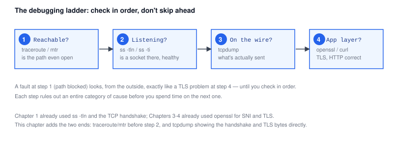

# Chapter 7 — Debugging the Network Like a Pro: ss, tcpdump, traceroute, and openssl

> **Course:** Networking & Web Servers · **Chapter:** 7 of 8
> Read on the website: [learn.bazardev.com/networking/07-debugging-the-network-like-a-pro](https://learn.bazardev.com/networking/07-debugging-the-network-like-a-pro)
>
> 🇧🇩 **Prefer Bangla?** [Read this chapter in Bangla →](https://learn.bazardev.com/networking/07-debugging-the-network-like-a-pro?lang=bn)

Six chapters in, you've used `ss -tln` (Chapter 1) to see what's listening, and `openssl s_client` (Chapters 3-4) to inspect a handshake. This chapter turns individual commands into a **method**: when "the site is down" or "it's slow," which tool answers which question, in which order — going deeper into `ss`, and adding two tools this course hasn't touched yet: `tcpdump` (what's actually on the wire) and path tracing (`traceroute`/`mtr`). Every capture below is real, run live against this course's own server while writing this chapter.

## 1. The debugging ladder: four questions, in order

A connection problem lives at one of four levels, and checking them in order wastes the least time:

1. **Can I even reach the server?** — path tracing (`traceroute`/`mtr`).
2. **Is anything listening there?** — `ss` (Chapter 1 covered the basics; this chapter goes further).
3. **What's actually happening on the wire?** — `tcpdump`.
4. **Is the application protocol (TLS, HTTP) working correctly?** — `openssl`, `curl`, the browser itself.



Skipping straight to step 4 when the real problem is step 1 (a firewall blocking the path entirely) wastes time chasing TLS errors that were never the actual cause.

## 2. Step 1: can I reach it? Path tracing

**Traceroute**'s trick, standardized by [RFC 792](https://www.rfc-editor.org/rfc/rfc792) (ICMP): send a packet with TTL=1. The first router decrements it to 0, discards it, and replies with an ICMP **Time Exceeded** message — which reveals that router's address. Send another with TTL=2, and the *second* router replies instead. Repeating with an increasing TTL reveals the path one hop at a time, and each reply's travel time is that hop's latency.

(The `traceroute` binary itself isn't installed on the machine writing this course — `mtr` is, and it does the same thing plus continuous, live-updating ping statistics per hop, so that's what's demonstrated here, actually run.) A real trace from this server to Cloudflare's public DNS resolver:

```bash
mtr -r -c 3 -n 1.1.1.1
```

```
HOST: nirjhor-workspace           Loss%   Snt   Last   Avg  Best  Wrst StDev
  1.|-- 10.243.2.101               0.0%     3    7.8   5.3   3.1   7.8   2.3
  2.|-- 10.0.66.2                  0.0%     3    4.3   3.3   2.5   4.3   0.9
  3.|-- 62.115.45.148              0.0%     3    5.4  12.5   3.3  28.7  14.1
  4.|-- 62.115.136.146             0.0%     3   25.4  27.0  20.3  35.3   7.6
  5.|-- 62.115.124.117             0.0%     3   21.3  11.8   5.0  21.3   8.5
  6.|-- 62.115.144.199             0.0%     3   11.9   7.3   4.7  11.9   3.9
  7.|-- 162.158.84.237             0.0%     3   38.9  21.2   7.6  38.9  16.1
  8.|-- 1.1.1.1                    0.0%     3    6.5   5.2   4.5   6.5   1.1
```

Read it as a story: hops 1-2 are this server's own hosting provider network (private `10.x` addresses), hops 3-6 are the provider's upstream transit, hop 7 is Cloudflare's own network edge (`162.158.x.x` is a known Cloudflare range), and hop 8 is the destination itself. If a real problem showed 0% loss through hop 5 and 100% loss from hop 6 onward, that tells you *exactly* which network boundary to report the problem to — your own box and hops 1-5 are fine; something between hop 5 and 6 is dropping traffic. `Loss%` per hop is the number to watch; a single slow-but-complete hop (like hop 7's wider spread here) is usually not a real problem — slow and 0% loss just means that router deprioritizes replying to its *own* ICMP traffic, not that it's dropping *your* traffic.

## 3. Step 2: is anything listening? `ss`, beyond `-tln`

Chapter 1 used `ss -tln` to see listening sockets. For an already-open connection that *feels* slow, `ss -i` (or combined, `-ti`) shows the kernel's own live measurements for that TCP connection — no packet capture needed:

```bash
ss -ti dst 167.86.127.108
```

```
State  Recv-Q Send-Q  Local Address:Port    Peer Address:Port
ESTAB  0      0        167.86.127.108:57210  167.86.127.108:https
       cubic wscale:10,10 rto:213 rtt:12.102/11.706 ato:40 mss:40448 cwnd:10
       bytes_sent:1849 bytes_acked:1850 bytes_received:5122 segs_out:9 segs_in:7
       pacing_rate 535Mbps delivery_rate 247Mbps minrtt:1.31
```

The fields worth knowing:

- **`rtt:12.102/11.706`** — the smoothed round-trip time and its variance, in milliseconds, measured by the kernel from real ACKs on this exact connection — a live, per-connection ping, with no extra packets sent.
- **`cwnd`** — the **congestion window**: how many unacknowledged packets TCP currently allows in flight to this peer. A `cwnd` stuck low on an otherwise healthy path is a sign something (packet loss, a slow receiver) is throttling throughput.
- **`retrans`** (not present above — nothing was lost on this loopback-speed connection) would show retransmitted-segment counts if packets were actually being lost and resent.

This answers "is TCP itself healthy for this connection?" before ever suspecting the application layer.

## 4. Step 3: what's actually on the wire? `tcpdump`

`ss` shows the kernel's *summary* of a connection. `tcpdump` shows the actual packets. A real capture, taken while a request went to this server's own HTTPS port:

```bash
sudo tcpdump -i lo -n -c 10 'tcp port 443'
```

```
10:51:00.817554 IP 127.0.0.1.51492 > 127.0.0.1.443: Flags [S], seq 1918073176, win 65495, ...
10:51:00.817593 IP 127.0.0.1.443 > 127.0.0.1.51492: Flags [S.], seq 744179515, ack 1918073177, ...
10:51:00.817611 IP 127.0.0.1.51492 > 127.0.0.1.443: Flags [.], ack 1, win 64, ...
10:51:00.824377 IP 127.0.0.1.51492 > 127.0.0.1.443: Flags [P.], seq 1:1579, ack 1, ..., length 1578
10:51:00.824417 IP 127.0.0.1.443 > 127.0.0.1.51492: Flags [.], ack 1579, win 78, length 0
10:51:00.826143 IP 127.0.0.1.443 > 127.0.0.1.51492: Flags [P.], seq 1:5012, ack 1579, ..., length 5011
10:51:00.826156 IP 127.0.0.1.51492 > 127.0.0.1.443: Flags [.], ack 5012, win 103, length 0
10:51:00.850851 IP 127.0.0.1.51492 > 127.0.0.1.443: Flags [P.], seq 1579:1643, ack 5012, ..., length 64
10:51:00.851511 IP 127.0.0.1.443 > 127.0.0.1.51492: Flags [P.], seq 5012:5079, ack 1643, ..., length 67
10:51:00.851998 IP 127.0.0.1.51492 > 127.0.0.1.443: Flags [P.], seq 1643:1771, ack 5079, ..., length 128
```

This is every concept from earlier chapters, visible as actual bytes:

- Packets 1-3 (`[S]`, `[S.]`, `[.]`) are the **TCP three-way handshake** from Chapter 1 — SYN, SYN-ACK, ACK — now seen directly instead of described.
- Packet 4, 1578 bytes from the client (`[P.]`, `seq 1:1579`): that's the TLS **ClientHello** from Chapter 4 — its size is large because it carries the SNI hostname and the `key_share` for TLS 1.3's one-round-trip handshake.
- Packet 6, 5011 bytes from the server: the `ServerHello` + certificate chain + `Finished` flight — also from Chapter 4 — arriving as one TCP segment, encrypted, right after the client's `key_share` let both sides derive a shared secret.
- The smaller packets after that are the TLS `Finished` exchange and the start of the actual HTTP request/response.

The filter syntax (`'tcp port 443'`) is a **BPF (Berkeley Packet Filter)** expression — `tcpdump`'s own manual documents `host`, `port`, `tcp`, `udp`, and `and`/`or`/`not` as the core building blocks (for example `'host 1.1.1.1 and tcp port 443'` for one specific peer). `-n` skips DNS lookups (faster, and doesn't mask IPs behind the exact hostname you're trying to debug), `-c` stops after a fixed count instead of running forever. Capturing needs `CAP_NET_RAW` — in practice, `sudo`.

## 5. Step 4: is the application protocol actually working? `openssl`

Chapters 3-4 already used `openssl s_client` to inspect SNI and certificate chains. As a standing **debugging** habit (not a one-time inspection), the same tool answers "how many days until this certificate expires?" without opening a browser:

```bash
echo | openssl s_client -connect learn.bazardev.com:443 -servername learn.bazardev.com 2>/dev/null | openssl x509 -noout -subject -dates
```

```
subject=CN=learn.bazardev.com
notBefore=Nov 10 15:13:51 2026 GMT
notAfter=Feb  8 15:13:50 2027 GMT
```

This is exactly the kind of one-liner worth putting in a cron job or a monitoring check (Monitoring Chapter 4 covered Prometheus; a certificate-expiry probe is a natural thing to alert on) rather than discovering an expired certificate from an angry user.

## 6. Putting it together: a troubleshooting table

| Symptom | Check first | What it rules in or out |
|---|---|---|
| "The site won't load at all" | `mtr`/`traceroute` to the server's IP | Is the network path even open, or does it stop dead at some hop? |
| "The site loads for me, not for them" | `ss -tln` (Chapter 1) on the server | Is the service actually listening on the address they'd be reaching? |
| "It's slow, not down" | `ss -ti` on the live connection | Is TCP itself healthy (`rtt`, `cwnd`, `retrans`), or is the problem upstream in the app? |
| "Something's wrong but I don't know what's actually being sent" | `tcpdump` with a narrow filter | See the literal bytes — handshake, TLS, HTTP headers — instead of guessing |
| "HTTPS-specific error, cert warning, handshake failure" | `openssl s_client -servername ...` | Which certificate came back, which TLS version, does SNI matter here (Chapter 3) |
| "DNS seems involved" | `dig +trace` (Chapter 2) | Which exact hop in the DNS delegation chain stopped answering |

## 7. Key takeaways

- Debug in order: **path reachability → is anything listening → what's on the wire → is the application protocol correct.** Skipping ahead wastes time chasing symptoms of an earlier-layer problem.
- **Path tracing** (`traceroute`/`mtr`) reveals the hop-by-hop path using ICMP Time Exceeded replies to packets with an increasing TTL ([RFC 792](https://www.rfc-editor.org/rfc/rfc792)); `mtr` adds continuous ping statistics per hop.
- `ss -ti` exposes the kernel's own live measurements (`rtt`, `cwnd`, `retrans`) for an existing TCP connection, with no packet capture needed.
- `tcpdump` shows the actual bytes on the wire — the real place to *see*, not just describe, the TCP handshake and the TLS messages from earlier chapters. BPF filters (`host`, `port`, `tcp`/`udp`) narrow a capture to exactly what matters.
- `openssl s_client` piped into `openssl x509 -noout -dates` is a genuinely useful standing habit: checking a live certificate's expiry without a browser.

## 8. Test yourself (exam prep)

<details>
<summary><strong>Q1. How does traceroute/mtr discover each router along a path?</strong></summary>

It sends packets with an increasing TTL (starting at 1). Each router that decrements a packet's TTL to 0 discards it and replies with an ICMP Time Exceeded message, revealing that router's address — one hop per TTL value.
</details>

<details>
<summary><strong>Q2. In <code>ss -ti</code> output, what does the <code>cwnd</code> field tell you?</strong></summary>

The congestion window — how many unacknowledged packets TCP currently allows in flight to that peer. A cwnd that's stuck low on an otherwise healthy path suggests something is throttling throughput, such as packet loss.
</details>

<details>
<summary><strong>Q3. In a tcpdump capture of a TLS connection, why is the ClientHello packet often noticeably larger than the three handshake packets before it?</strong></summary>

The three-way handshake packets (SYN, SYN-ACK, ACK) carry no application data. The ClientHello carries the SNI hostname and, in TLS 1.3, the key_share needed for a one-round-trip handshake — real payload, not just handshake flags.
</details>

<details>
<summary><strong>Q4. Why use <code>tcpdump -n</code> rather than letting it resolve hostnames?</strong></summary>

It's faster (no DNS lookups per packet), and it avoids masking the literal IP addresses involved — which matters when the hostname resolution itself might be part of what you're debugging.
</details>

<details>
<summary><strong>Q5. A site is completely unreachable for one user. Why check <code>mtr</code>/<code>traceroute</code> before diving into HTTPS/TLS debugging?</strong></summary>

If the network path itself is broken at some hop before even reaching the server, no amount of TLS or application-layer debugging will explain it — the connection never gets that far. Checking reachability first avoids chasing symptoms of an earlier, simpler problem.
</details>

## 9. Free resources

- RFC Editor: [RFC 792 — Internet Control Message Protocol](https://www.rfc-editor.org/rfc/rfc792)
- `man ss` / `ss --help` (this chapter used `-i`/`-t`; Chapter 1 used `-l`/`-n`)
- `man tcpdump` — filter expression (BPF) syntax
- `man mtr`
- OpenSSL: [`s_client` command](https://docs.openssl.org/master/man1/openssl-s_client/)

---

**Next:** [Chapter 8 — Real project: a load-balanced, multi-domain Laravel setup with TLS](08-real-project-load-balanced-laravel.md)
