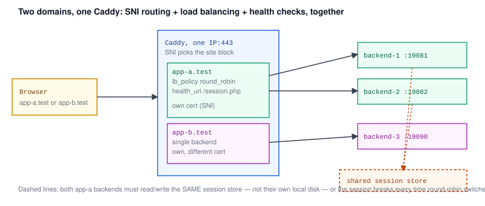

# Chapter 8 — Real Project: A Load-Balanced, Multi-Domain Laravel Setup with TLS

> **Course:** Networking & Web Servers · **Chapter:** 8 of 8
> Read on the website: [learn.bazardev.com/networking/08-real-project-load-balanced-laravel](https://learn.bazardev.com/networking/08-real-project-load-balanced-laravel)
>
> 🇧🇩 **Prefer Bangla?** [Read this chapter in Bangla →](https://learn.bazardev.com/networking/08-real-project-load-balanced-laravel?lang=bn)

Cloud Chapter 8 already took one Laravel app from nothing to a working, single-server production deploy: server, domain, HTTPS, database, queue worker, scheduler, a deploy script, backups. **This chapter assumes that per-server setup is already done**, and builds the one thing that changes once a single server isn't enough: more than one app server, behind one load balancer, serving more than one domain, over TLS — using Chapter 3's SNI, Chapter 5's reverse proxy patterns, and Chapter 6's load balancing and health checks, all at once. And it hits the one bug that this exact combination causes if you're not ready for it, live, on purpose.

## 1. The setup



Everything below was actually built and run for this chapter (not just described): one Caddy instance in front of two *different* domains. `app-a.test` is load-balanced across two backend processes with active health checks (Chapter 6); `app-b.test` is a completely unrelated single backend, proving multiple domains and a load-balanced pool coexist on one proxy without interfering:

```
{
    admin off
    http_port 19080
    https_port 19443
}

app-a.test {
    tls internal
    reverse_proxy 127.0.0.1:19081 127.0.0.1:19082 {
        lb_policy round_robin
        health_uri /session.php
        health_interval 2s
    }
}

app-b.test {
    tls internal
    reverse_proxy 127.0.0.1:19090
}
```

(`caddy validate` confirmed this is syntactically correct before it was ever run.) The `http_port`/`https_port` override only exists because this course's own production Caddy already owns ports 80/443 on the machine writing this chapter — on a real, dedicated server, that global block is simply omitted and Caddy uses the normal 80/443. One real difference from every earlier chapter's demo: `tls internal` tells Caddy to issue certificates from its own **local, locally-trusted CA** instead of Let's Encrypt — the right choice for `.test` domains that don't really exist on the public internet. On a real production domain, you'd simply **not** write this line at all, and Caddy's automatic HTTPS (Chapter 2's Cloud chapter, and this course's Chapters 3-4) issues a real Let's Encrypt certificate exactly as it already does for `learn.bazardev.com`.

Proof that the two domains stay genuinely separate — each gets its *own* certificate, matched by SNI (Chapter 3), confirmed live:

```bash
openssl s_client -connect 127.0.0.1:19443 -servername app-a.test 2>/dev/null | openssl x509 -noout -ext subjectAltName
openssl s_client -connect 127.0.0.1:19443 -servername app-b.test 2>/dev/null | openssl x509 -noout -ext subjectAltName
```

```
X509v3 Subject Alternative Name: critical
    DNS:app-a.test
X509v3 Subject Alternative Name: critical
    DNS:app-b.test
```

Same IP, same port, two different certificates — exactly Chapter 3's lesson, now running inside a setup that also load-balances and health-checks.

## 2. The bug this combination causes — demonstrated, not just described

`app-a.test`'s two backends are two tiny PHP scripts that each start a session and remember one value. A fresh request, with a fresh cookie jar, against the load balancer:

```bash
curl -sk --resolve app-a.test:19443:127.0.0.1 -c cookies.txt https://app-a.test:19443/session.php
```

```
handled by: backend-1
session value: set by backend-1
session id: 87e8672f0290a7a502cace1d5a417d3d
```

The **exact same cookie jar**, sent again three more times — round-robin (Chapter 6) means the load balancer alternates backends on every request:

```bash
curl -sk --resolve app-a.test:19443:127.0.0.1 -b cookies.txt https://app-a.test:19443/session.php
curl -sk --resolve app-a.test:19443:127.0.0.1 -b cookies.txt https://app-a.test:19443/session.php
curl -sk --resolve app-a.test:19443:127.0.0.1 -b cookies.txt https://app-a.test:19443/session.php
```

```
handled by: backend-2
session value: set by backend-2
session id: 87e8672f0290a7a502cace1d5a417d3d
handled by: backend-1
session value: set by backend-1
session id: 87e8672f0290a7a502cace1d5a417d3d
handled by: backend-2
session value: set by backend-2
session id: 87e8672f0290a7a502cace1d5a417d3d
```

Read that carefully: the **session ID in the cookie never changes** — the client is doing everything right. But the **session value flips** depending on which backend happens to answer. Each backend's default, file-based session storage lives only on *its own* local disk; `backend-2` has never seen `backend-1`'s session file, so it silently starts a brand new one under the same ID instead of erroring. In a real Laravel app, this is exactly the bug behind "I filled out a form and it says I'm logged out" or a CSRF token mismatch that only happens *sometimes* — the request landed on whichever backend didn't have that session.

**The fix:** session storage has to live somewhere every backend can reach, not on any one backend's own disk. Pointing both backends at the same shared session store and repeating the exact same requests:

```
handled by: backend-1
session value: set by backend-1
session id: c4bd9b8532c15bef15949b6db40b945d
handled by: backend-2
session value: set by backend-1
session id: c4bd9b8532c15bef15949b6db40b945d
handled by: backend-1
session value: set by backend-1
session id: c4bd9b8532c15bef15949b6db40b945d
handled by: backend-2
session value: set by backend-1
session id: c4bd9b8532c15bef15949b6db40b945d
```

`handled by` still alternates — the load balancer never stopped round-robin-ing — but `session value` now stays `set by backend-1` no matter which backend answers, because both now read and write the same place. **Full honesty about this exact demo:** both backends sharing one local directory only worked here because they're two processes on the *same* machine. On two genuinely separate servers, a shared local directory doesn't exist to point at — the real fix is a session store reachable over the network from every server: `SESSION_DRIVER=redis` or `SESSION_DRIVER=database` in Laravel's `.env`, never `file`, the moment there's more than one app server. This is exactly the sticky-session workaround Chapter 6 flagged (`ip_hash`/`cookie` stickiness papers over this same problem without fixing it) — here, it's the actual, underlying fix instead of the workaround.

## 3. Mapping this demo to a real production setup

| In this chapter's demo | In a real production setup |
|---|---|
| `tls internal`, a local CA | Omit the line; Caddy's automatic HTTPS issues real Let's Encrypt certificates (Chapters 2-4) |
| Two PHP processes on one machine | Two (or more) separate servers, each already set up end-to-end per Cloud Chapter 8 |
| A shared local directory for sessions | `SESSION_DRIVER=redis` or `database` in each server's `.env`, pointed at one shared Redis/database instance |
| One Caddy instance doing both proxying and load balancing | The same — Caddy (or Nginx) can do both; a dedicated load-balancer tier is only needed at a scale this course hasn't reached |
| Manually running `curl` to check behavior | Chapter 7's tools (`ss -ti`, `tcpdump`, `mtr`, `openssl s_client`) for diagnosing it live when something's wrong |
| Health checks on a plain `/session.php` | A real, cheap health endpoint — Monitoring Chapter 8 already built exactly this kind of check for a Laravel app |

Nothing conceptual changes between the demo and the real thing — every piece here is a direct, named callback to an earlier chapter, run for real rather than just described.

## 4. Key takeaways

- A load balancer in front of more than one domain, and more than one backend per domain, is just Chapter 3's SNI routing and Chapter 6's load balancing running at the same time — they don't interfere with each other.
- `tls internal` is a legitimate Caddy feature for local testing against fake domains; a real production domain just omits it and gets a real Let's Encrypt certificate automatically.
- **File-based session storage breaks the moment there's more than one app server**, even with the load balancer working perfectly — demonstrated here with the exact same session ID producing a different value depending on which backend answered.
- The fix is a session store every backend can reach over the network (Redis, a shared database) — not IP-based stickiness, which only hides the problem for one user at a time and still breaks the moment that backend goes down.
- Every piece of a real multi-server, multi-domain Laravel setup maps directly to a chapter already covered in this course — this chapter is where they're run together, not where new concepts begin.

## 5. Test yourself (exam prep)

<details>
<summary><strong>Q1. In this chapter's demo, why does the session ID stay identical across requests while the session value changes?</strong></summary>

The client sends the same cookie (session ID) every time, correctly. But each backend stores sessions only on its own local disk — a backend that has never seen that ID's file creates a fresh one under the same ID rather than erroring, so the *value* differs by backend even though the *ID* never does.
</details>

<details>
<summary><strong>Q2. What's the actual fix for the session bug demonstrated in this chapter, and what's explicitly not a fix?</strong></summary>

The fix is session storage reachable by every backend over the network (Redis or a shared database, e.g. `SESSION_DRIVER=redis`). IP-based sticky sessions (Chapter 6) are explicitly not a fix — they only route one user back to the same backend, and that user's session is still lost the moment that specific backend goes down.
</details>

<details>
<summary><strong>Q3. Why is <code>tls internal</code> appropriate for this chapter's demo but not for a real production domain?</strong></summary>

`tls internal` issues certificates from Caddy's own local CA, which no real browser trusts by default — fine for fake `.test` domains used only for testing. A real production domain should get a publicly trusted certificate automatically via Caddy's normal automatic HTTPS (Let's Encrypt), which simply requires not adding `tls internal` at all.
</details>

<details>
<summary><strong>Q4. Two domains on one Caddy instance, each pointing at a different backend pool. Why don't they interfere with each other?</strong></summary>

Caddy picks which site block applies per request using SNI (the hostname in the TLS ClientHello, Chapter 3) — each domain's traffic is matched to its own site block and its own backend pool independently, regardless of how many other domains share the same IP and port.
</details>

<details>
<summary><strong>Q5. Does a load-balanced setup like this one need a separate, dedicated load-balancer machine, distinct from the reverse proxy?</strong></summary>

Not necessarily. The same Caddy (or Nginx) instance that terminates TLS and routes by domain can also load-balance across backends — one process doing both jobs, as this chapter's demo shows. A dedicated load-balancer tier only becomes worth it at a scale well beyond what this course has covered.
</details>

## 6. Free resources

- Caddy: [the `tls` directive, including `internal`](https://caddyserver.com/docs/caddyfile/directives/tls)
- Laravel: [Session configuration](https://laravel.com/docs/session)
- Laravel: [Redis](https://laravel.com/docs/redis)

---

**Course complete.** Take the course exam on the website to earn your certificate.
