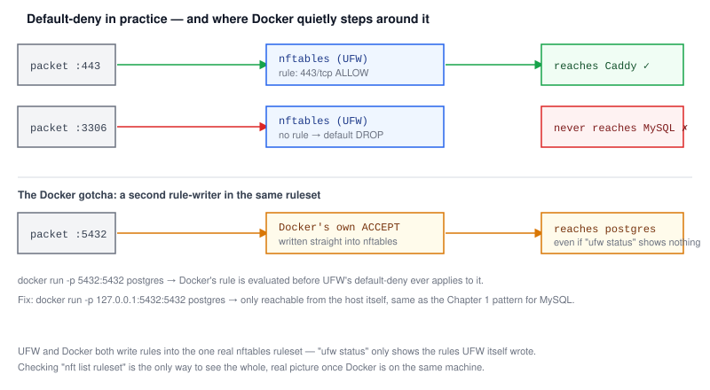

# Chapter 2 — Firewalls: UFW and nftables, Default-Deny Done Right

> **Course:** Linux Server Security & Secrets · **Chapter:** 2 of 8
> Read on the website: [learn.bazardev.com/linux-security/02-firewalls-ufw-and-nftables](https://learn.bazardev.com/linux-security/02-firewalls-ufw-and-nftables)
>
> 🇧🇩 **Prefer Bangla?** [Read this chapter in Bangla →](https://learn.bazardev.com/linux-security/02-firewalls-ufw-and-nftables?lang=bn)

> **Honesty note:** these commands were not run on the writing server either — firewall changes carry the same lock-yourself-out risk as Chapter 1's SSH changes, this time to *every* port instead of just 22. Everything below is sourced from the official UFW manual (`man ufw`), the Ubuntu Server firewall documentation, the `nftables` wiki, and Docker's own documentation on its interaction with host firewalls, all linked at the end. Apply the same "keep a working session open" discipline from Chapter 1 before changing rules on a real machine — a wrong firewall rule can cut off the very SSH session you're using to fix it.

In the Cloud course you ran `ufw allow 22`, `ufw allow 80`, `ufw allow 443` and moved on (Chapter 2). That was the right first step, but "allow three things" is only half of what a firewall does. This chapter covers the other half — **default-deny**, what's actually enforcing it underneath UFW, and a real gotcha that catches people who later add Docker to the same server.

## 1. The model: default-deny, then open exactly what's needed

A firewall's job is to decide, for every packet arriving at the machine, whether to let it through. UFW (**U**ncomplicated **F**ire**w**all) ships with Ubuntu and gives that decision two possible starting points:

- **Default allow** — everything gets through unless a rule blocks it. Easy to misconfigure into exposing something you forgot about.
- **Default deny** — nothing gets through unless a rule allows it. You have to consciously open each thing you want reachable; everything else is closed by default, including services you install later and forget to firewall.



This course uses default-deny, which is also UFW's own recommended starting point:

```bash
sudo ufw default deny incoming
sudo ufw default allow outgoing
```

Outgoing stays allowed by default — your server can still make outbound requests (composer, npm, curl, SSLCommerz callbacks) without extra rules; it's *incoming*, unsolicited connections that default-deny protects against.

## 2. Allowing what you actually need

```bash
sudo ufw allow 22/tcp    # or: sudo ufw allow OpenSSH
sudo ufw allow 80/tcp
sudo ufw allow 443/tcp
sudo ufw enable
```

A few things worth knowing that the Cloud course didn't cover:

- **UFW understands service names** for anything with an `/etc/services` entry or an app profile (`ufw app list` shows installed profiles like `OpenSSH`, `Nginx Full`) — `ufw allow OpenSSH` and `ufw allow 22/tcp` do the same thing; names are just easier to read later.
- **You can scope a rule to a source**, which matters a lot for anything that doesn't need to be world-reachable:
  ```bash
  sudo ufw allow from 203.0.113.50 to any port 3306 proto tcp
  ```
  This allows MySQL's port only from one specific IP (say, your office, or another server in a cluster) — everyone else is still denied, even though the port is "open" in that one rule.
- **Check what you actually have**, numbered so you can delete by number later:
  ```bash
  sudo ufw status numbered
  ```
  ```
       To                         Action      From
       --                         ------      ----
  [ 1] 22/tcp                     ALLOW IN    Anywhere
  [ 2] 80/tcp                     ALLOW IN    Anywhere
  [ 3] 443/tcp                    ALLOW IN    Anywhere
  [ 4] 3306/tcp                   ALLOW IN    203.0.113.50
  ```

## 3. Stateful, not stateless: why you never wrote an "allow the reply" rule

You never had to write a rule saying "allow the HTTP response back to the visitor" — only the inbound request. That's because UFW (like virtually every modern firewall) is **stateful**: it tracks which outbound packets are replies to a connection it already approved, via **conntrack** (connection tracking) in the Linux kernel, and lets replies through automatically without needing a matching rule of their own. Only *new, unsolicited* inbound connections are checked against your allow list — a reply riding on a connection you already approved is not a new connection.

## 4. What's actually enforcing this: nftables

UFW is a **front end** — a simpler syntax that writes rules into the kernel's real packet-filtering engine underneath. On current Ubuntu releases, that engine is **nftables** (the modern successor to the older `iptables`, which Ubuntu kept around for compatibility but no longer uses as UFW's default backend). Every `ufw allow` command you ran became an nftables rule the moment you ran it — UFW never evaluates packets itself.

See what UFW actually wrote, underneath its own simpler view:

```bash
sudo nft list ruleset
```

The output is far more verbose than `ufw status` — tables, chains, and rules with explicit `accept`/`drop` verdicts — because `ufw status` is a deliberately simplified summary of exactly this. Knowing this matters the moment something doesn't behave the way a `ufw` rule alone would suggest (Section 6 is a real example): the real decision is always made in the nftables ruleset, and UFW is only the editor you normally use to write it.

## 5. IPv6, and logging

Two settings in `/etc/default/ufw` worth knowing about rather than discovering by accident:

- **`IPV6=yes`** (the default) makes every rule you add apply to both IPv4 and IPv6 automatically — `ufw allow 443/tcp` opens the port on both. If your server has a public IPv6 address and this were off, IPv6 traffic would sail past rules you thought covered it.
- **`ufw logging on`** (medium is a reasonable level) writes every blocked packet to the kernel log, viewable with:
  ```bash
  sudo journalctl -k | grep UFW
  ```
  ```
  kernel: [UFW BLOCK] IN=eth0 ... SRC=198.51.100.9 DST=... DPT=3389 ...
  ```
  A `DPT` (destination port) of `3389` here is someone scanning for Windows Remote Desktop on a Linux box that never had it — harmless, but it's the same kind of background noise as Chapter 1's SSH scan logs, now visible for every port instead of just 22.

## 6. Rate-limiting at the firewall: a first line of defense

```bash
sudo ufw limit ssh
```

`limit` is stricter than `allow`: UFW denies an IP that attempts more than roughly 6 new connections within 30 seconds to that rule's port. This doesn't replace Chapter 1's `PasswordAuthentication no` or Chapter 3's fail2ban — it's a cheap, built-in first line that slows down a connection-flood style scan before it even reaches the SSH daemon to be rejected there.

## 7. The Docker gotcha: a published container port can bypass UFW entirely

This is the real trap this chapter exists to warn about, and it only shows up once you combine this course with the Docker course. Docker manages its own networking by writing rules **directly into the same nftables/iptables tables UFW uses** — and by default, Docker's rules for a published port are inserted in a way that can let traffic reach that container **regardless of what UFW says**, because Docker's own `ACCEPT` rule for the published port is evaluated before UFW's `DROP` default ever applies to it. Concretely: `docker run -p 5432:5432 postgres` can leave port 5432 reachable from the internet even with `ufw status` showing no rule for it at all — "ufw didn't allow it" does not mean "it's blocked," if Docker already accepted it upstream in the same ruleset.

This is documented behavior, not a bug — Docker explains it directly in its own networking documentation (linked below) because it causes real incidents. Three honest mitigations, in order of how much they change:

1. **Bind published ports to localhost only**, and reach the container through a reverse proxy (Caddy, as this course already uses) that UFW *does* govern: `docker run -p 127.0.0.1:5432:5432 postgres` — now the port is only reachable from the host itself, same as the Chapter 1 pattern for MySQL.
2. **Don't publish the port at all** if nothing outside Docker's own network needs it — containers on the same Docker network reach each other by service name without any `-p` flag.
3. For cases that genuinely need Docker's published ports to respect UFW, a dedicated tool like `ufw-docker` (community project, linked below) rewrites the integration — know that this is a real, documented gap before reaching for a third-party fix, rather than assuming `ufw status` is the end of the story once Docker is on the same machine.

## 8. Key takeaways

- **Default-deny incoming, default-allow outgoing** is the model: open exactly what needs to be reachable, nothing opens itself by accident later.
- A firewall is **stateful** — replies to a connection you already approved pass automatically via conntrack; you only write rules for new inbound connections.
- UFW is a front end; **nftables** (viewable with `nft list ruleset`) is what actually filters every packet. `ufw status` is a simplified summary of that real ruleset.
- `ufw logging on` plus `journalctl -k | grep UFW` shows exactly what's being blocked, the same way Chapter 1's SSH logs showed login attempts.
- `ufw limit ssh` throttles connection floods before they even reach the service — a cheap first line, not a replacement for Chapter 1 or Chapter 3.
- **Docker writes its own rules into the same underlying tables UFW uses**, and a published container port can be reachable from the internet even with no matching UFW rule. Bind to `127.0.0.1` and reverse-proxy, or don't publish the port at all, unless you specifically need and have configured otherwise.

## 9. Test yourself (exam prep)

<details>
<summary><strong>Q1. What is the difference between "default deny incoming" and "default allow incoming"?</strong></summary>

Default deny blocks every incoming connection unless a rule explicitly allows it — anything you install later and forget to open stays closed. Default allow lets everything through unless a rule blocks it, which silently exposes anything you forget to firewall.
</details>

<details>
<summary><strong>Q2. Why don't you need a firewall rule to let an HTTP response back to a visitor?</strong></summary>

The firewall is stateful: it uses connection tracking (conntrack) to recognize that the reply belongs to a connection already approved by an existing allow rule, and lets it through automatically. Only new, unsolicited inbound connections are checked against the allow list.
</details>

<details>
<summary><strong>Q3. What is UFW's relationship to nftables?</strong></summary>

UFW is a simplified front end; every rule it writes becomes a real nftables rule underneath, which is what actually filters packets. `ufw status` is a simplified summary of the real ruleset visible with `nft list ruleset`.
</details>

<details>
<summary><strong>Q4. What does <code>ufw limit ssh</code> do, and what does it not replace?</strong></summary>

It denies an IP that makes too many new connection attempts (roughly 6 in 30 seconds) to that port, throttling connection-flood style scans at the network level. It does not replace disabling password authentication (Chapter 1) or fail2ban (Chapter 3).
</details>

<details>
<summary><strong>Q5. Why can a Docker container's published port be reachable from the internet even when <code>ufw status</code> shows no rule allowing it?</strong></summary>

Docker inserts its own accept rules directly into the same nftables/iptables tables UFW uses, and by default those rules can take effect before UFW's deny default applies — so a port can be open in practice with nothing showing in UFW's own rule list.
</details>

<details>
<summary><strong>Q6. Name one way to stop a Docker container's published port from bypassing UFW.</strong></summary>

Bind the published port to localhost only (e.g. <code>-p 127.0.0.1:5432:5432</code>) and reach it through a reverse proxy UFW governs, or don't publish the port at all if nothing outside Docker's network needs it.
</details>

<details>
<summary><strong>Q7. What does <code>IPV6=yes</code> in <code>/etc/default/ufw</code> mean for a rule like <code>ufw allow 443/tcp</code>?</strong></summary>

The rule applies to both IPv4 and IPv6 automatically. If this were off and the server had a public IPv6 address, IPv6 traffic to port 443 would not be covered by a rule you thought had already opened it.
</details>

<details>
<summary><strong>Q8. In a UFW log line like <code>[UFW BLOCK] ... DPT=3389</code>, what does it mean, and should it worry you on its own?</strong></summary>

It means an inbound connection attempt to port 3389 (Windows Remote Desktop) was blocked — on its own this is routine internet background scanning noise, the same category as the SSH scan attempts from Chapter 1, not evidence of a targeted attack.
</details>

## 10. Free resources

- Ubuntu Server Documentation: [Firewalls (UFW)](https://ubuntu.com/server/docs/firewalls)
- `man ufw` (`man 8 ufw` for the full manual)
- nftables wiki: [What is nftables?](https://wiki.nftables.org/wiki-nftables/index.php/What_is_nftables%3F)
- Docker Documentation: [Packet filtering and firewalls](https://docs.docker.com/engine/network/packet-filtering-firewalls/)
- `ufw-docker` (community project): [GitHub](https://github.com/chaifeng/ufw-docker)

---

**Next:** [Chapter 3 — fail2ban: automatic banning for repeat offenders](03-fail2ban-and-automatic-banning.md)
