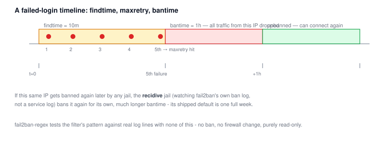

# Chapter 3 — fail2ban: Automatic Banning for Repeat Offenders

> **Course:** Linux Server Security & Secrets · **Chapter:** 3 of 8
> Read on the website: [learn.bazardev.com/linux-security/03-fail2ban-and-automatic-banning](https://learn.bazardev.com/linux-security/03-fail2ban-and-automatic-banning)
>
> 🇧🇩 **Prefer Bangla?** [Read this chapter in Bangla →](https://learn.bazardev.com/linux-security/03-fail2ban-and-automatic-banning?lang=bn)

> **Honesty note:** fail2ban was not installed or run on the writing server for this chapter — the same reasoning as Chapters 1 and 2: a tool whose entire job is to ban IPs that look suspicious can ban the very session writing about it, on a server reached only over SSH. Every default, config path, and command below comes from fail2ban's official documentation and `man` pages (linked at the end), and Section 6 shows a genuinely safe, read-only way to test a filter without risking that.

Chapter 1 removed password login, so there's nothing left to brute-force. Chapter 2 added `ufw limit` for a first, cheap throttle. So is there still a reason to add a whole new tool? Yes — and this chapter is honest about exactly what fail2ban adds that the previous two chapters don't.

## 1. What fail2ban actually does that the firewall alone doesn't

`ufw limit` (Chapter 2) counts raw *connection attempts* per IP, regardless of whether they succeed — it has no idea whether a login actually failed. **fail2ban** works at a different, smarter layer: it **reads a service's log file**, matches lines against a regex pattern that means "this login attempt failed," counts those specifically, and **bans the offending IP in the firewall** once a threshold is crossed within a time window — automatically, with no human watching logs in real time.

That distinction matters in practice:

- It understands *failure*, not just *connection count* — a legitimate user retrying a few times isn't the same as an attacker guessing hundreds of usernames, and fail2ban's log-based matching tells them apart better than a raw connection-rate limit can.
- It isn't tied to one service. The same engine protects SSH, and — once configured — any other service that logs failed attempts: a web app's login form, Postfix, an admin panel. One tool, many jails.
- It responds specifically to the thing the log says failed — "invalid user", "wrong password", "wrong key" — which a connection-count limit can't distinguish from normal traffic patterns.

## 2. The vocabulary: jails, filters, and actions

fail2ban's config is built from three pieces per protected service:

- A **jail** — the on/off switch and settings for one service (which log to watch, how many failures, over what time, for how long to ban).
- A **filter** — the regex that recognizes a failed attempt in that service's log format (fail2ban ships filters for dozens of common services already).
- An **action** — what actually happens to a banned IP (by default on Debian/Ubuntu, a firewall rule that drops its traffic; the specific mechanism depends on your firewall backend).

```
[jail: sshd]  --uses--> filter (sshd.conf: regex for "Failed password", "Invalid user", ...)
              --uses--> action (ban the matched IP in the firewall)
              --uses--> backend (how to read the log: file, or the systemd journal)
```

## 3. Two config files, and a rule you must not break

```bash
sudo apt install fail2ban
```

fail2ban ships `/etc/fail2ban/jail.conf` with sane defaults for every service it knows about — but **this file is overwritten on every package upgrade**, so anything you write in it is lost silently. The convention, stated directly in the shipped file's own comments, is: never edit `jail.conf`; instead create `/etc/fail2ban/jail.local`, which only sets the handful of values you want to change and is never touched by upgrades. Settings in `jail.local` override the matching ones in `jail.conf`.

```bash
sudo nano /etc/fail2ban/jail.local
```

```ini
[DEFAULT]
bantime  = 1h
findtime = 10m
maxretry = 5

[sshd]
enabled = true
```

- **`maxretry = 5`** — this many failures within `findtime`...
- **`findtime = 10m`** — ...this time window...
- **`bantime = 1h`** — ...triggers a ban lasting this long.
- `[sshd]` turns on the pre-shipped SSH jail with those `[DEFAULT]` values; any service-specific section can override any of the three per service, same override logic as `jail.local` over `jail.conf`.



Restart to apply, then check that the jail is actually active:

```bash
sudo systemctl restart fail2ban
sudo fail2ban-client status sshd
```

```
Status for the jail: sshd
|- Filter
|  |- Currently failed: 0
|  |- Total failed:     0
|  `- Journal matches:  _SYSTEMD_UNIT=ssh.service + _COMM=sshd
`- Actions
   |- Currently banned: 0
   |- Total banned:     0
   `- Banned IP list:
```

`Journal matches` here shows fail2ban reading from the systemd journal rather than a flat log file — on current Ubuntu, that's fail2ban's auto-detected default backend for the `sshd` jail, since Chapter 1's `journalctl -u ssh` output is the same data source.

## 4. Testing a filter without risking a self-ban

Manually generating five failed SSH logins against your own server to test this would be a genuinely bad idea — it's your own IP being banned, and if that's the IP you're connected from, Chapter 1's lock-out risk returns, this time self-inflicted. fail2ban ships exactly the right tool for this: `fail2ban-regex` checks a filter against log lines **without banning anyone or touching the firewall at all** — purely a read-only regex test:

```bash
fail2ban-regex /var/log/auth.log /etc/fail2ban/filter.d/sshd.conf
```

```
Results
=======
Failregex: 3 total
Ignoreregex: 0 total
```

This confirms the `sshd` filter actually matches lines in the real log format on your system — the safe way to validate a jail is configured correctly before trusting it with real bans.

## 5. Checking, and recovering from, a real ban

```bash
sudo fail2ban-client status sshd        # see who's currently banned
sudo fail2ban-client set sshd unbanip 203.0.113.44   # manually lift a ban
```

Worth knowing before you need it in a hurry: if you ever get banned by your own server's fail2ban (a shared office IP where a colleague fails a login several times counts against everyone behind that IP), the fix is either from another network, or — on most providers — the VPS's web-based console/VNC access that bypasses SSH and the firewall entirely, specifically for this kind of lockout.

## 6. Going further: the `recidive` jail

fail2ban ships a `recidive` jail that watches its **own ban log** instead of a service log — if an IP gets banned by any other jail repeatedly, `recidive` bans it again for much longer (its own shipped default is a week). This is the practical answer to "what about an attacker who just waits out the ban and tries again" — repeat offenders escalate automatically:

```ini
[recidive]
enabled  = true
bantime  = 1w
findtime = 1d
maxretry = 3
```

## 7. Why this still matters with passwords already disabled

A fair question: if Chapter 1 already removed password login, is fail2ban protecting against anything real? Three honest reasons it still is:

1. **Defense in depth** — if `sshd_config` is ever accidentally reverted (a config management mistake, a provider image reset), fail2ban is still there independently of that setting.
2. **Other jails, other services** — once anything else on the server has a login (a Laravel admin panel behind basic auth, Postfix, an app with its own brute-forceable form), the same engine protects it with its own jail and filter.
3. **Noise reduction stays useful either way** — `Invalid user` scanning (Chapter 1, Section 7) still happens against a key-only server; banning those source IPs after a few attempts keeps logs smaller and keeps automated scanners from lingering on your server's resources.

## 8. Key takeaways

- fail2ban reads logs for **failed attempts specifically**, not raw connection counts — a smarter complement to Chapter 2's `ufw limit`, not a replacement for it.
- Three pieces per protected service: a **jail** (on/off + thresholds), a **filter** (regex for "this failed"), an **action** (what happens to a banned IP).
- **Never edit `jail.conf`** — it's overwritten on upgrade. Put all overrides in `jail.local`.
- `maxretry` failures within `findtime` triggers a ban lasting `bantime`.
- `fail2ban-regex` tests a filter against real log lines **without banning anyone** — the safe way to validate a jail.
- The `recidive` jail bans repeat offenders of *any* jail for much longer, automatically.
- Still worth running even with password login disabled: defense in depth, protection for other services, and log noise reduction.

## 9. Test yourself (exam prep)

<details>
<summary><strong>Q1. What does fail2ban detect that a raw connection-count limit like <code>ufw limit</code> cannot?</strong></summary>

fail2ban reads the service's log and matches specifically on failed attempts (wrong password, invalid user, and similar), distinguishing an attacker's failures from a legitimate user's normal traffic — a connection-count limit only counts attempts, not whether they failed.
</details>

<details>
<summary><strong>Q2. Name the three pieces of fail2ban's config for one protected service.</strong></summary>

A jail (the on/off switch and thresholds for that service), a filter (the regex that recognizes a failed attempt in its log format), and an action (what happens to an IP once banned).
</details>

<details>
<summary><strong>Q3. Why should you never edit <code>/etc/fail2ban/jail.conf</code> directly?</strong></summary>

It ships with the package and is overwritten on every upgrade, silently discarding any changes made to it. Overrides belong in <code>jail.local</code>, which the package never touches.
</details>

<details>
<summary><strong>Q4. With <code>maxretry = 5</code>, <code>findtime = 10m</code>, and <code>bantime = 1h</code>, when does an IP get banned, and for how long?</strong></summary>

It's banned once it accumulates 5 failed attempts within a 10-minute window, and the ban then lasts 1 hour.
</details>

<details>
<summary><strong>Q5. Why is <code>fail2ban-regex</code> a safe way to test a filter, compared to generating real failed logins against your own server?</strong></summary>

It checks a filter's regex against existing log lines in a purely read-only way — it never bans an IP or touches the firewall, so there is no risk of banning your own connection while testing.
</details>

<details>
<summary><strong>Q6. What does the <code>recidive</code> jail do differently from a normal jail like <code>sshd</code>?</strong></summary>

It watches fail2ban's own ban log rather than a service log, and bans an IP again for a much longer time if it has already been banned by another jail repeatedly — an escalating response to repeat offenders.
</details>

<details>
<summary><strong>Q7. If password login is already disabled, why would fail2ban's sshd jail still be worth running?</strong></summary>

Defense in depth in case the SSH config setting is ever accidentally reverted, plus it still reduces log noise and server load from scanning bots probing invalid usernames against a key-only server.
</details>

<details>
<summary><strong>Q8. If your own IP gets banned by your server's fail2ban and you have no other network to connect from, what's the typical way back in?</strong></summary>

Most VPS providers offer a web-based console or VNC access to the server that bypasses SSH and the firewall entirely, specifically for recovering from this kind of lockout.
</details>

## 10. Free resources

- fail2ban: [official GitHub wiki](https://github.com/fail2ban/fail2ban/wiki)
- `man fail2ban-jail`, `man fail2ban-regex`, `man jail.conf`
- Ubuntu Server Documentation: [Security — fail2ban](https://ubuntu.com/server/docs/security-fail2ban)
- DigitalOcean: [How To Protect SSH with fail2ban](https://www.digitalocean.com/community/tutorials/how-to-protect-ssh-with-fail2ban)

---

**Next:** [Chapter 4 — Multi-factor SSH and limiting who can even try](04-mfa-and-limiting-who-logs-in.md)
