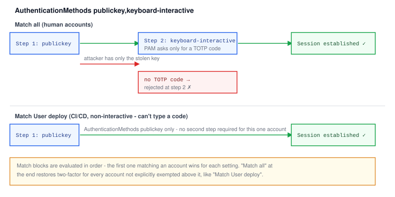

# Chapter 4 — Multi-Factor SSH and Limiting Who Can Even Try

> **Course:** Linux Server Security & Secrets · **Chapter:** 4 of 8
> Read on the website: [learn.bazardev.com/linux-security/04-mfa-and-limiting-who-logs-in](https://learn.bazardev.com/linux-security/04-mfa-and-limiting-who-logs-in)
>
> 🇧🇩 **Prefer Bangla?** [Read this chapter in Bangla →](https://learn.bazardev.com/linux-security/04-mfa-and-limiting-who-logs-in?lang=bn)

> **Honesty note:** not run on the writing server, for the same reason as every chapter so far — this one changes `sshd_config` and the PAM auth stack together, which is a bigger blast radius than Chapter 1's edits alone. It is also the one topic in this course that genuinely needs interactive setup (scanning a QR code with a phone app), which can't be demonstrated non-interactively anyway. Every directive and command below is sourced from OpenSSH's `sshd_config(5)`, the Google Authenticator PAM module's own documentation, and Ubuntu/DigitalOcean's written MFA guides, all linked at the end. Follow Chapter 1's "keep a working session open" rule even more carefully here than before — Section 3 explains exactly why this chapter is riskier to get wrong.

Chapter 1 made SSH key-only. A key is "something you have" — but if that one file is ever stolen (a compromised laptop, a careless backup), it's enough on its own to log in. This chapter adds a second, independent factor, and goes one step further than Chapter 1's `AllowUsers` in controlling exactly who can even attempt to authenticate.

## 1. What "multi-factor" actually buys you here

Authentication factors are usually grouped into three kinds: something you **know** (a password, a PIN), something you **have** (a key, a phone, a hardware token), and something you **are** (a fingerprint). Chapter 1's key login is "something you have." Real multi-factor means combining **two different kinds**, so that stealing one factor alone isn't enough — this chapter adds "something you know": a 6-digit code from a TOTP (Time-based One-Time Password) app, changing every 30 seconds, generated from a secret shared only between your phone and the server.

## 2. Installing and enrolling: Google Authenticator's PAM module

```bash
sudo apt install libpam-google-authenticator
```

Each user who needs MFA runs this **once, interactively, as themselves** (not as root, not for someone else):

```bash
google-authenticator
```

It asks a series of yes/no questions (time-based tokens: yes; rate-limiting: yes are the standard recommended answers) and then shows a QR code and a secret key, plus **five emergency scratch codes**. Scan the QR code with an authenticator app (Google Authenticator, Authy, or any standard TOTP app), and **write the scratch codes down somewhere other than the server itself** — they're each usable exactly once, specifically for the scenario where you've lost your phone and still need to get in.

## 3. Why this chapter is the riskiest configuration change so far

Every previous chapter's worst case was "I get disconnected and can't log back in with a key or password." This chapter's worst case is the same, **plus** a new failure mode: a correctly-entered key *and* a correctly-typed TOTP code still rejected, because the PAM stack and `sshd_config` disagree with each other. Read Sections 4–5 fully before touching a real server, and test from a brand-new session exactly as in Chapter 1, Section 4 — never close your original session until a fresh login, with both factors, has actually succeeded.

## 4. Wiring PAM and sshd together, carefully

Two files have to agree, and the subtlety that trips people up is directly below.

**`/etc/pam.d/sshd`** — find the line `@include common-auth` (this is what pulls in `pam_unix.so`, the module that checks a Unix password) and comment it out, replacing it with the Google Authenticator module:

```
# @include common-auth
auth required pam_google_authenticator.so
```

**`/etc/ssh/sshd_config`** — two directives, read together:

```
KbdInteractiveAuthentication yes
AuthenticationMethods publickey,keyboard-interactive
```

Here is the subtlety: **Chapter 1 told you to set `KbdInteractiveAuthentication no`**, specifically to close a path that could let a password through. This chapter turns it back **on** — but that does not reopen password login, because of the PAM edit above. "Keyboard-interactive" is just a *transport* for whatever PAM asks; by commenting out `common-auth`, the only thing PAM now asks for on that path is a TOTP code, never a Unix password. `AuthenticationMethods publickey,keyboard-interactive` is what actually enforces "both, in that order": OpenSSH requires the publickey step to succeed first, and only then offers the keyboard-interactive (now TOTP-only) step — a stolen key alone gets an attacker through step one and stops dead at step two.



Restart the same way as Chapter 1: `sudo sshd -t`, then `sudo systemctl restart ssh`, then a fresh login from a new session, both factors required, before closing anything.

## 5. The practical problem this creates for automation — and `Match`

A deploy key used by CI/CD (the GitHub Actions pipeline from the CI/CD course) can't type a 6-digit code — it's a non-interactive script, not a human with a phone. Requiring `AuthenticationMethods publickey,keyboard-interactive` for every account would break every automated deploy the moment it's turned on.

`sshd_config` solves this with a **`Match`** block — the same mechanism Chapter 6 (least privilege) uses for per-account policy, applied here to make MFA conditional:

```
Match User deploy
    AuthenticationMethods publickey

Match all
    AuthenticationMethods publickey,keyboard-interactive
```

`Match User deploy` applies only to that one account and overrides `AuthenticationMethods` to key-only for it; `Match all` (which must come last — `Match` blocks apply in order, and the first one whose condition matches wins for each setting) restores the two-factor requirement for every other, human-operated account. The deploy key stays exactly as strong as Chapter 1 left it — a stolen deploy key is still a real risk, just not one this chapter claims to solve; Chapter 6 (least privilege) is what limits how much that one account can actually do if it is ever misused.

## 6. One honest dependency: the server's clock

A TOTP code is only valid because the server and your phone compute the same 30-second time window from the same shared secret — if the server's clock has drifted, a correctly-typed code from your phone can be rejected as "wrong" even though nothing about the code itself is wrong. Ubuntu runs `systemd-timesyncd` by default, keeping the clock close enough that this is rarely an issue in practice, but it's worth a quick check if TOTP logins ever start failing for no apparent reason:

```bash
timedatectl
```

```
               Local time: ...
           NTP service: active
```

`NTP service: active` is what you want to see; if it says `inactive`, that's a very plausible, honest explanation for codes that "should" work but don't.

## 7. Restricting source IPs: the strongest control, and its real-world limit

The strictest version of "limiting who can even try" is restricting *where* an attempt can come from at all, not just which account or which factors. `sshd_config` can do this with a `Match Address` block (similarly, Chapter 2's firewall can do the same with `ufw allow from <ip> to any port 22`, enforced one layer earlier):

```
Match Address 203.0.113.50
    PasswordAuthentication no
```

Being honest about this one: it's the strongest possible control — an attempt from any other IP is rejected before any authentication method is even considered — but it only works for a **fixed, known source**: an office IP, a VPN exit node, a bastion host. A solo developer connecting from home, a co-working space, and their phone's hotspot across a week has no single IP to restrict to, which is exactly why this course presents it as an available tool for a specific situation, not a universal recommendation the way Chapters 1–3 are.

## 8. Key takeaways

- Multi-factor means combining two *different kinds* of factor — Chapter 1's key ("have") plus a TOTP code ("know") here — so that stealing one alone isn't enough.
- `google-authenticator` enrolls one user interactively, producing a QR code and one-time-use scratch codes that must be stored safely off the server.
- Turning `KbdInteractiveAuthentication` back **on** does not reopen password login, as long as `/etc/pam.d/sshd`'s `common-auth` (which checks Unix passwords) is replaced by `pam_google_authenticator.so` — the keyboard-interactive path becomes TOTP-only.
- `AuthenticationMethods publickey,keyboard-interactive` enforces both factors, in that order — a stolen key alone is stopped at the second step.
- A `Match User` block can exempt a non-interactive automation account (a CI/CD deploy key) from MFA without weakening the requirement for every human account.
- TOTP depends on the server's clock being correct (`timedatectl`) — drift is a genuine, non-obvious cause of "correct codes rejected."
- `Match Address` is the strongest "who can even try" control, but only practical with a fixed, known source IP — not a universal recommendation.

## 9. Test yourself (exam prep)

<details>
<summary><strong>Q1. Why does adding a TOTP code count as genuine multi-factor, rather than just a second password?</strong></summary>

It's a different kind of factor — "something you know" (the TOTP code, time-based and app-generated) combined with "something you have" (the SSH key) — rather than two instances of the same kind. Stealing the key alone no longer authenticates a session.
</details>

<details>
<summary><strong>Q2. Why does turning KbdInteractiveAuthentication back to "yes" not reopen password-based login, given that Chapter 1 set it to "no" specifically to close that path?</strong></summary>

Because /etc/pam.d/sshd's common-auth line (which checks Unix passwords) is commented out and replaced with pam_google_authenticator.so — the keyboard-interactive path now only ever asks for a TOTP code, never a password, regardless of the sshd_config setting being "yes" again.
</details>

<details>
<summary><strong>Q3. What does AuthenticationMethods publickey,keyboard-interactive actually enforce?</strong></summary>

That both factors succeed, in that specific order: the publickey check must pass first, and only then is the keyboard-interactive (TOTP) step offered. A stolen key alone passes step one but is stopped at step two.
</details>

<details>
<summary><strong>Q4. Why can't a CI/CD deploy key simply use the same AuthenticationMethods as a human account?</strong></summary>

An automated script can't type a time-based code from a phone app — it's non-interactive. Requiring keyboard-interactive for every account would break every automated deploy the moment MFA is enabled.
</details>

<details>
<summary><strong>Q5. How does a Match User block solve the deploy-key problem without weakening MFA for everyone else?</strong></summary>

A Match User deploy block overrides AuthenticationMethods to publickey-only for just that account, while a later Match all block keeps the two-factor requirement for every other account — the exemption is scoped to exactly the one account that needs it.
</details>

<details>
<summary><strong>Q6. A user enters a TOTP code that looks correct on their phone, but the server rejects it. Name one honest, non-obvious cause.</strong></summary>

The server's system clock has drifted (timedatectl showing NTP service as inactive) - TOTP codes are only valid because server and phone compute the same time window from the same secret, so a clock mismatch rejects an otherwise-correct code.
</details>

<details>
<summary><strong>Q7. What are the scratch codes from google-authenticator for, and where should they be stored?</strong></summary>

They're one-time-use emergency codes for when you've lost access to your TOTP app/phone but still need to log in. They should be written down and stored somewhere other than the server itself, since the point is recovering access when the server's own MFA can't be satisfied normally.
</details>

<details>
<summary><strong>Q8. Why is Match Address described as the strongest control in this chapter, but not a universal recommendation?</strong></summary>

It rejects any attempt from outside a specific, known source IP before any authentication method is even tried - stronger than any factor-based check. But it only works for a fixed source (an office, a VPN exit, a bastion host); it doesn't fit someone connecting from different networks day to day.
</details>

## 10. Free resources

- Google Authenticator PAM module: [official GitHub repository](https://github.com/google/google-authenticator-libpam)
- OpenSSH: [`sshd_config(5)` manual page](https://man.openbsd.org/sshd_config) (see `AuthenticationMethods`, `Match`, `KbdInteractiveAuthentication`)
- DigitalOcean: [How To Set Up Multi-Factor Authentication for SSH on Ubuntu](https://www.digitalocean.com/community/tutorials/how-to-set-up-multi-factor-authentication-for-ssh-on-ubuntu-20-04)
- Ubuntu Server Documentation: [Time synchronisation](https://ubuntu.com/server/docs/network-ntp)
- `man sshd_config`, `man pam.d`, `man timedatectl`

---

**Next:** [Chapter 5 — Secrets management: never in git, always rotatable](05-secrets-management.md)
