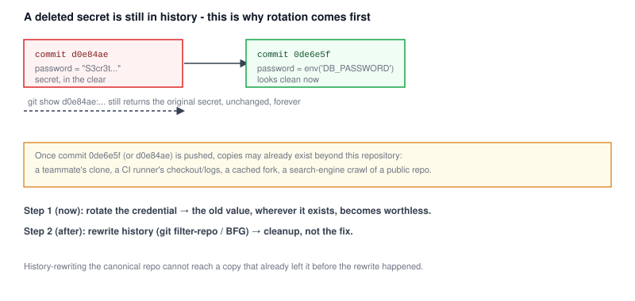

# Chapter 5 — Secrets Management: Never in Git, Always Rotatable

> **Course:** Linux Server Security & Secrets · **Chapter:** 5 of 8
> Read on the website: [learn.bazardev.com/linux-security/05-secrets-management](https://learn.bazardev.com/linux-security/05-secrets-management)
>
> 🇧🇩 **Prefer Bangla?** [Read this chapter in Bangla →](https://learn.bazardev.com/linux-security/05-secrets-management?lang=bn)

> **Honesty note:** the git-history example in Section 1 was actually run, on a disposable throwaway repository created solely to demonstrate it (with a fake, clearly-fake password, never a real credential) — never against this project's own repositories. `gitleaks` itself is not installed on the writing server, so its commands below are documented from its own official repository, not executed. The Laravel-specific pitfalls in Sections 6–7 are drawn directly from Laravel's own official documentation, which states them explicitly.

A "secret" is anything that, if someone else got it, lets them do something you didn't authorize: a database password, an API key, an SSH private key, a `.env` file's contents, a webhook signing secret, an SSL certificate's private key. This chapter isn't about any one tool — it's about the handful of habits that keep secrets from leaking, and what to actually do when one does anyway.

## 1. Why Git is uniquely dangerous for secrets

Deleting a secret from a file and committing that change does **not** remove the secret from the repository. Git stores every version of every file it has ever tracked; the commit that *added* the secret still exists, and anyone with access to the repository's history can retrieve it:

```bash
git log --oneline -- config/database.php
```

```
0de6e5f Move password to env var
d0e84ae Add database config
```

```bash
git show d0e84ae:config/database.php
```

```
<?php
return ['password' => 'S3cr3t-Fake-Demo-Value-Not-Real'];
```

That's a real run against a disposable test repository: the current file only has `env('DB_PASSWORD')` — clean — but the old commit still hands back the original fake secret, byte for byte, exactly as if it were still there today. This is true even years later, even if the current file looks completely clean. A secret that was ever committed must be treated as **permanently exposed from the moment of that commit**, regardless of what later commits do to the file.

## 2. Prevention: the file should never be stageable in the first place

The first, cheapest line of defense is a `.gitignore` entry for anything holding real secrets — `.env`, `*.pem`, `*.key` — so the file is never even a candidate for `git add`. This project's own repositories follow exactly this rule (`.env` is gitignored in every course project you've seen so far).

`.gitignore` only stops an *accident* with an already-ignored file, though — it does nothing if someone pastes a live API key directly into a line of application code. A **pre-commit secret scanner** catches that case too, by scanning the actual diff being committed for patterns that look like credentials (long hex/base64 strings next to words like `key`, `secret`, `password`, and known provider token formats). `gitleaks` is a well-documented, widely used open-source example:

```bash
gitleaks detect --source . --no-git  # scan the working tree once
gitleaks protect --staged            # as a pre-commit hook: scan only what's about to be committed
```

Wiring the second form into a pre-commit hook means a secret is flagged **before** it ever becomes a commit — the cheapest possible point to catch it, because at that point nothing has to be undone.

## 3. If a secret leaks anyway: rotate first, clean up second

Despite prevention, a secret sometimes does end up in a pushed commit. The honest, correct order of operations surprises people who haven't dealt with this before:

1. **Rotate the credential immediately** — generate a new database password, revoke and reissue the API key, generate a new SSH key pair. This is the only step that actually neutralizes the exposure, and it should happen within minutes of discovery, not after a cleanup is finished.
2. **Only then, clean up the repository history** (`git filter-repo` or the BFG Repo-Cleaner are the standard tools, rewriting every commit that ever touched the secret) — and even this is a courtesy, not a fix, for the reason in Section 4.

Rotating first and cleaning up second — never the other order — is the one rule in this chapter worth remembering even if nothing else is.

## 4. Why history cleanup alone is never enough



The moment a commit containing a secret is **pushed** to a shared remote (GitHub, GitLab, a teammate's clone), it may already exist in places history-rewriting on the main repository can't reach: a developer's own local clone made before the cleanup, a CI runner's checkout and its logs, a cached fork, a search-engine or security-scanner crawl of a public repository. Rewriting history on the canonical repo is still worth doing, as cleanup — but it cannot guarantee the secret is gone everywhere it may have already traveled. This is exactly why Section 3 puts rotation first: rotation makes the *old* secret worthless regardless of how many copies of it exist anywhere.

## 5. Where secrets belong instead

- **Environment variables**, read by the application at runtime rather than written into any file that's part of the codebase. Laravel's `.env`, read by `vlucas/phpdotenv`, is this pattern; a systemd service can get the same effect with an `EnvironmentFile=` directive pointing at a file outside the repository entirely.
- **File permissions matching Chapter 1's `authorized_keys` pattern**: a secrets file should be owned by the application's own user, mode `600`, unreadable by anyone else on the machine:
  ```bash
  chmod 600 .env
  ```
- **A dedicated secrets manager**, for anything beyond a single server: this course's own IaC course (Chapter 4, "Ansible roles, templates, and Vault for secrets") already covers **Ansible Vault** for exactly this — encrypting secret values so they can live safely in a provisioning repository without ever being plaintext in git. Cloud-hosted equivalents (a cloud provider's own secrets manager, or HashiCorp Vault self-hosted) solve the same problem at larger scale: secrets are fetched at deploy or boot time, never stored in any repository, plaintext or not.

## 6. The Laravel-specific pitfall this course has to name directly

Laravel's own official documentation states this explicitly, because it is a genuinely common real-world incident, not a hypothetical: **`APP_DEBUG=true` in production is itself a secrets leak**, independent of anything in git. With debug mode on, an unhandled exception renders a detailed error page showing the full stack trace, the request's data, and — critically — **the resolved values of environment variables available to the request**, including database credentials and API keys, to whoever triggered the error. An attacker doesn't need to find a secret in your code at all if they can simply trigger any unhandled error on a debug-mode production site. Laravel's own setup explicitly calls out `APP_DEBUG=false` as required for production for exactly this reason.

## 7. A quieter Laravel gotcha: cached config hides a `.env` change

```bash
php artisan config:cache
```

This command (commonly run as part of a production deploy, for a real performance gain) reads every config file **and the current `.env` values**, and bakes the result into a single cached PHP file. After that point, **Laravel stops reading `.env` at all** — it reads only the cache. If you then rotate a secret by editing `.env` directly on a production server (Section 3's urgent first step), the application keeps using the *old*, cached value until you explicitly clear and rebuild the cache:

```bash
php artisan config:clear
php artisan config:cache
```

Skipping this means a secret you believed was rotated minutes ago is, in practice, still the one the running application is using — a dangerous gap to discover during an actual incident rather than before one.

## 8. Secrets in CI/CD

The CI/CD course (Chapter 4, "environment variables, secrets, and matrix builds") already covers this from the automation side; the secrets-specific point is worth repeating here: GitHub Actions' own **encrypted secrets** (`Settings → Secrets and variables → Actions`) are stored encrypted at rest and automatically **masked** in workflow logs (printed as `***` if a step happens to echo one). A secret written directly into a workflow YAML file as plaintext gets none of that — it's committed to git with the same permanence as Section 1, visible to anyone who can read the repository, and never masked in logs because GitHub never knew it was a secret in the first place.

## 9. Key takeaways

- A secret committed to git is **permanently exposed from that commit onward**, regardless of what later commits do to the file — deleting it later does not remove it from history.
- Prevent first: `.gitignore` for known secret files, plus a pre-commit scanner (`gitleaks` or similar) to catch a secret pasted directly into code.
- If one leaks anyway: **rotate the credential immediately**, then clean up git history as a courtesy — rotation is what actually neutralizes the exposure.
- History cleanup can't guarantee removal from every clone, fork, CI log, or crawl that already copied the secret before cleanup — another reason rotation comes first.
- Secrets belong in environment variables with restrictive file permissions (`chmod 600`), or a dedicated secrets manager (Ansible Vault, a cloud secrets manager) for anything beyond a single server.
- **`APP_DEBUG=true` in production is itself a secrets leak** — Laravel's debug error page can expose environment variable values to whoever triggers an unhandled exception.
- `php artisan config:cache` freezes `.env` values into a cache file; rotating a secret by editing `.env` alone does nothing on a server with a stale config cache until it's cleared and rebuilt.
- GitHub Actions' encrypted, auto-masked secrets exist specifically so CI secrets never need to be plaintext in a workflow file.

## 10. Test yourself (exam prep)

<details>
<summary><strong>Q1. Why doesn't deleting a secret from a file and committing that change remove it from the repository?</strong></summary>

Git stores every historical version of every tracked file. The commit that originally added the secret still exists and remains retrievable (e.g. with git show), regardless of what later commits do to the current version of the file.
</details>

<details>
<summary><strong>Q2. What is the correct order of operations when a secret is found committed and pushed to a shared repository?</strong></summary>

Rotate the credential immediately first - this is what actually neutralizes the exposure. Cleaning up git history comes second, as a courtesy, not as the fix.
</details>

<details>
<summary><strong>Q3. Why can't rewriting git history guarantee a leaked secret is fully removed?</strong></summary>

Once a commit is pushed, it may already exist in places the rewrite on the main repository can't reach - another developer's local clone, a CI runner's checkout and logs, a cached fork, or a crawl of a public repository.
</details>

<details>
<summary><strong>Q4. What does a pre-commit secret scanner like gitleaks catch that .gitignore alone does not?</strong></summary>

.gitignore only prevents an already-ignored file from being staged. A pre-commit scanner also catches a live credential pasted directly into a line of application code that isn't in any ignored file, by pattern-matching the diff before it becomes a commit.
</details>

<details>
<summary><strong>Q5. Why is APP_DEBUG=true in production considered a secrets leak on its own, with no git involvement at all?</strong></summary>

With debug mode on, an unhandled exception renders a detailed error page that can expose the resolved values of environment variables - including database credentials and API keys - to whoever triggers the error, with no need to find anything in the codebase.
</details>

<details>
<summary><strong>Q6. After running php artisan config:cache, why might rotating a secret by editing .env alone not actually take effect?</strong></summary>

config:cache bakes the current .env values into a single cached file, and Laravel then reads only that cache, not .env, until config:clear and config:cache are run again - so the application keeps using the old cached value.
</details>

<details>
<summary><strong>Q7. What does GitHub Actions do differently for a secret stored in its encrypted Secrets settings, versus one written directly into workflow YAML?</strong></summary>

An encrypted secret is stored encrypted at rest and automatically masked (printed as ***) if a workflow step happens to log it. A plaintext value in the YAML file is committed to git permanently and is never masked, since GitHub has no way to know it was meant to be secret.
</details>

<details>
<summary><strong>Q8. Name one tool mentioned in this course (from a different chapter) that solves secrets management for a provisioning/IaC workflow specifically.</strong></summary>

Ansible Vault (covered in the IaC course, Chapter 4) - it encrypts secret values so they can live in a provisioning repository without ever being plaintext in git.
</details>

## 11. Free resources

- Git Documentation: [git-filter-repo](https://github.com/newren/git-filter-repo) and the [BFG Repo-Cleaner](https://rtyley.github.io/bfg-repo-cleaner/)
- `gitleaks`: [official GitHub repository](https://github.com/gitleaks/gitleaks)
- Laravel Documentation: [Configuration — Debug Mode](https://laravel.com/docs/configuration#debug-mode) and [Configuration Caching](https://laravel.com/docs/configuration#configuration-caching)
- GitHub Documentation: [Using secrets in GitHub Actions](https://docs.github.com/en/actions/security-guides/using-secrets-in-github-actions)

---

**Next:** [Chapter 6 — Least privilege: sudo policy, service accounts, and file permissions](06-least-privilege-and-sudo.md)
