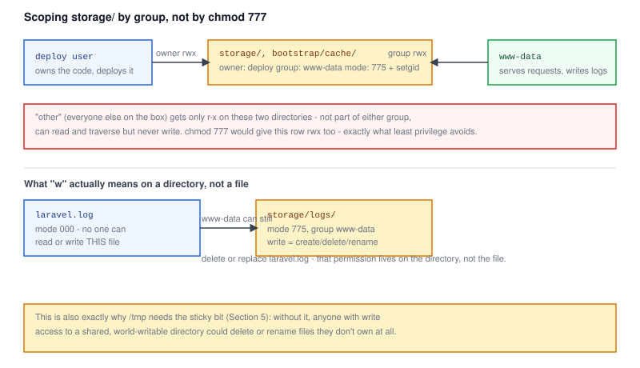

# Chapter 6 — Least Privilege: sudo Policy, Service Accounts, and File Permissions

> **Course:** Linux Server Security & Secrets · **Chapter:** 6 of 8
> Read on the website: [learn.bazardev.com/linux-security/06-least-privilege-and-sudo](https://learn.bazardev.com/linux-security/06-least-privilege-and-sudo)
>
> 🇧🇩 **Prefer Bangla?** [Read this chapter in Bangla →](https://learn.bazardev.com/linux-security/06-least-privilege-and-sudo?lang=bn)

> **Honesty note:** `ls -la` and `umask` in Sections 2 and 6 were actually run, read-only, against this course's own writing server — that output is real. The deploy-focused worked examples (a `deploy` user, a `laravel.log` permission error, the `sudoers.d` snippet) are illustrative scenarios written from official documentation, not a transcript of a real incident. No `chmod`/`chown`/`sudoers` *write* commands were applied to the writing server, for the same reason as every `sudo`-related change so far: a broken sudo rule can be as disruptive as a broken SSH config. Sourced from the `chmod(1)`, `chown(1)`, `umask(1p)`, `sudoers(5)`, and `visudo(8)` manual pages, plus Ubuntu and Laravel's own documentation, all linked at the end.

Every chapter so far has removed or restricted *access* — who can log in, from where, with what factors. This chapter restricts something different: **once someone or something is already on the server, exactly what can it touch.** This is the single most-used skill in this entire course — permission errors are something you will run into constantly, usually at the worst possible moment (mid-deploy, mid-demo), so this chapter goes deeper than most.

## 1. The principle: least privilege, and why it matters even when nothing is "wrong" yet

**Least privilege** means giving a person, a process, or an account exactly the access it needs to do its job — no more. The payoff isn't about trusting people less; it's about **blast radius**: if a web app has a bug, if a deploy script has a typo, if an account's credentials are ever stolen (Chapter 5), the damage is limited to whatever that *specific* account could already touch. A web server process that can only read application code and write to two specific folders can't accidentally (or maliciously) overwrite `/etc/passwd`, no matter what goes wrong in the application running under it.

## 2. File permissions, properly: the three groups, the three bits

Every file and directory on a Linux system has an owner, a group, and three sets of permission bits — for the **owner**, for the **group**, and for **everyone else**:

```bash
ls -la /var/www/dev/projects/
```

```
drwxr-xr-x  5 dev dev  4096 Nov 18 10:02 learn.bazardev.com
-rw-r--r--  1 dev dev   220 Sep 30 19:56 .editorconfig
```

Read the ten characters left to right: the first is the file type (`d` = directory, `-` = regular file), then three groups of three: **owner**, **group**, **other** — each group is `r` (read), `w` (write), `x` (execute), or `-` (not granted).

| | owner | group | other |
|---|---|---|---|
| `drwxr-xr-x` | `rwx` | `r-x` | `r-x` |

The same thing, as a number (**octal notation**), is what you'll actually type most of the time: `r=4, w=2, x=1`, added together per group.

| Digit | Meaning | Common use |
|---|---|---|
| `7` (4+2+1) | read, write, execute | rarely needed on its own |
| `6` (4+2) | read, write | a file the owner edits directly |
| `5` (4+1) | read, execute | a script or a directory to browse |
| `4` | read only | a config file others should only read |
| `0` | nothing | no access at all |

```bash
chmod 755 deploy.sh    # owner: rwx, group: r-x, other: r-x
chmod 644 config.php   # owner: rw-, group: r--, other: r--
```

## 3. Directories are not files: the confusion that catches almost everyone

This is the single most common misunderstanding about Linux permissions, and it matters directly for the deploy scenario in Section 7. On a **directory**, the three bits mean something different from what they mean on a file:

| Bit | On a file | On a directory |
|---|---|---|
| `r` | read the file's contents | **list** the names of entries inside it |
| `w` | modify the file's contents | **create, delete, or rename** entries inside it |
| `x` | execute it as a program | **enter** it (`cd` into it) or access anything by its full path |

The critical, non-obvious consequence: **whether you can delete a file is a property of the *directory* it's in, not the file itself.** A file with permissions `000` (nothing, for anyone) can still be deleted by anyone with write access to the directory containing it — deleting a directory entry is a write to the *directory's* listing, not an edit of the file's own content. This is why `/tmp` needs the sticky bit (Section 5) to stop users from deleting each other's files despite everyone having write access to `/tmp` itself.

## 4. Ownership: who the three groups actually refer to

```bash
sudo chown deploy:www-data storage/
sudo chgrp www-data storage/
```

`chown user:group` sets both at once; `chgrp` changes only the group. The **owner** is usually the account that created the file or should primarily manage it; the **group** is the mechanism for sharing access among several accounts without making a file world-writable — add both your deploy user and your web server's user to the same group, and group permissions alone control what each can do, without ever touching "other."

## 5. Special bits: setgid and the sticky bit

Two bits beyond the basic nine solve two very common real problems:

- **setgid on a directory** (`chmod g+s`, shown as `s` in the group execute position, e.g. `drwxrwsr-x`): every new file created inside automatically belongs to the *directory's* group, not the creating user's own default group. Without this, a shared deploy directory slowly fills with files owned by whichever user's deploy script happened to create them, breaking group-based access for everyone else.
  ```bash
  chmod g+s /var/www/shared-uploads
  ```
- **The sticky bit** (`chmod +t`, shown as `t` in the other-execute position, e.g. `drwxrwxrwt` — exactly what `/tmp` looks like): inside a directory with this bit, a user can only delete or rename *their own* files, even though the directory itself is writable by everyone. This is precisely the fix for Section 3's "anyone with write access can delete anything" problem, scoped to shared, world-writable directories specifically.

## 6. umask: why new files default to 644 and new directories to 755

```bash
umask
```

```
0002
```

`umask` is a *subtraction mask* applied to the maximum (`666` for files, `777` for directories — files never get a default execute bit, since most newly created files aren't programs) every time something is created. That `0002` is a real value, read directly from this course's own writing server: `666 - 002 = 664`, `777 - 002 = 775` — new files end up group-writable, not just owner-writable. This is Ubuntu's default for a normal user specifically *because* Ubuntu gives each user their own private group of the same name (Section 4) — group-writable is safe when the only member of that group is the file's own owner. A server set up differently might show `0022` instead (`666 - 022 = 644`, `777 - 022 = 755` — writable only by the owner), which is just as common elsewhere; either way, the number is a server-wide default, usually set once in a shell profile or systemd service definition and rarely touched afterward.

## 7. The real Laravel gotcha: a `storage/` permission error, and the wrong way to fix it



A very common real error during a Laravel deploy:

```
Illuminate\Contracts\Container\BindingResolutionException: ...
file_put_contents(.../storage/logs/laravel.log): Failed to open stream: Permission denied
```

The code is deployed by one account (a `deploy` user, or your own login) but **served** by a different one (`www-data`, or whatever user PHP-FPM runs as) — and Laravel's own documentation is explicit that `storage/` and `bootstrap/cache/` must be writable by whichever user runs the web server, because the framework writes logs, compiled views, and cached config there at runtime.

The fix that actually follows least privilege is ownership and group-sharing (Sections 4–5), not loosening permissions for everyone:

```bash
sudo chown -R deploy:www-data storage bootstrap/cache
sudo chmod -R 775 storage bootstrap/cache
sudo chmod g+s storage bootstrap/cache
```

`775` gives the owner (`deploy`) and group (`www-data`) full read/write/execute, and *other* only read/execute — the web server can write because it's in the group, but a stranger on the box still can't. `chmod -R 777` (seen in some outdated tutorials) technically also fixes the error, but makes those two directories writable by **every account and every process on the machine**, defeating the entire purpose of this chapter for a problem Sections 4–5 already solve correctly.

## 8. Beyond owner/group/other: ACLs

The owner/group/other model has exactly one group slot — sometimes that's not enough: two genuinely unrelated accounts (say, a backup script and a monitoring agent) each need their own, different access to the same directory, and forcing them into one shared Unix group is clumsy. **Access Control Lists (ACLs)** extend permissions per-user or per-group beyond the basic three:

```bash
setfacl -m u:backup-agent:rx /var/www/dev/projects/shop.bazardev.com
getfacl /var/www/dev/projects/shop.bazardev.com
```

This grants `backup-agent` read+execute specifically, without changing the directory's existing owner, group, or affecting any other account — worth knowing this exists, even though the simpler owner/group/other model (Sections 2–5) is enough for the overwhelming majority of cases in this course.

## 9. Service accounts: a dedicated, unprivileged identity per service

MySQL doesn't run as `root`, and it doesn't run as your own login either — it runs as its own dedicated `mysql` system user, created specifically to own MySQL's files and process, with no login shell and no password. Create the same pattern for your own long-running services:

```bash
sudo useradd --system --no-create-home --shell /usr/sbin/nologin svc_myapp
```

- **`--system`** — a system account (low, non-human UID range), excluded from normal user listings and login prompts.
- **`--no-create-home`** — a service doesn't need a home directory with shell dotfiles.
- **`--shell /usr/sbin/nologin`** — even if someone tries to `ssh svc_myapp@server` or `su svc_myapp`, there's no interactive shell to drop into.

This directly extends Chapter 1's `AllowUsers` principle: that chapter restricted which accounts can authenticate over SSH *at all*; this one ensures a service's own account couldn't be used that way even if it tried, and owns nothing beyond exactly what that one service needs.

## 10. sudo, done narrowly

```bash
sudo visudo
```

**Always edit sudo policy with `visudo`, never by opening `/etc/sudoers` in a plain text editor.** `visudo` checks the file's syntax before saving and refuses to save a broken file — the sudo equivalent of Chapter 1's `sshd -t`, and for the same reason: a syntax error in `/etc/sudoers` can lock out `sudo` for everyone on the machine, including you.

Drop-in files in `/etc/sudoers.d/` follow the same convention as `jail.local` in Chapter 3 — one small file per concern, never touched by a package upgrade, instead of one giant edited `/etc/sudoers`:

```bash
sudo visudo -f /etc/sudoers.d/deploy
```

```
deploy ALL=(ALL) NOPASSWD: /usr/bin/systemctl restart php8.5-fpm, /usr/bin/systemctl restart laravel-queue
```

This grants the `deploy` account the ability to restart exactly two named services as root, nothing else — not a shell, not arbitrary commands, not even other `systemctl` subcommands against other services. Compare that to the much weaker, common shortcut `deploy ALL=(ALL) NOPASSWD: ALL`, which grants unrestricted, no-password root — convenient for a deploy script, but means a compromised `deploy` account (Chapter 5's whole point about credentials) is equivalent to a compromised root account, with no second check at all. `NOPASSWD` itself is a real trade-off worth naming honestly: it's necessary for non-interactive automation (nothing is present to type a password, the same problem Chapter 4 solved for TOTP with `Match User`), but it means anyone who already has that account's SSH key can act as root immediately — which is exactly why the command list next to it should be as narrow as this example, not `ALL`.

Every `sudo` invocation is logged with the real account that ran it, not "root" — the same accountability argument from Chapter 1:

```bash
sudo journalctl _COMM=sudo --since "1 hour ago"
```

## 11. Putting it together: a realistic deploy pipeline

- Each human admin has their **own** named account (Chapter 1) with a **narrow, named sudo rule** (this chapter) for exactly the root-level actions their role needs — never a shared or generic account.
- The application code is owned by a dedicated **`deploy`** account (Section 9's pattern, not a human's personal login), with a **narrow `sudoers.d` rule** (Section 10) to restart only the specific services a deploy needs to restart.
- The running web server process uses its own **service account** (`www-data` or similar), sharing group access to exactly `storage/` and `bootstrap/cache/` (Sections 4, 5, 7) — nothing more.
- A CI/CD pipeline's deploy key (Chapter 4's `Match User` exemption) authenticates as the `deploy` account specifically — never as a human's own account, and never as root.

No single compromised account in this picture is equivalent to full root access to everything — which is the entire point of this chapter.

## 12. Key takeaways

- **Least privilege** limits blast radius: whatever goes wrong with one account or process, the damage is bounded by what that specific account could already touch.
- On a **directory**, `r`/`w`/`x` mean list/create-delete-rename/enter — not the same as on a file. Whether a file can be deleted depends on the *directory's* write permission, not the file's own.
- **setgid** on a shared directory makes new files inherit the directory's group automatically; the **sticky bit** (as on `/tmp`) stops users deleting each other's files in a shared, world-writable directory.
- **`umask`** (commonly `0002` on Ubuntu, or `0022` elsewhere) is why new files default to `644`/`664` and directories to `755`/`775`, without any command setting that explicitly.
- Laravel's `storage/` and `bootstrap/cache/` permission errors are fixed correctly with **group ownership + setgid** (Section 7), not `chmod 777`.
- **ACLs** (`setfacl`/`getfacl`) extend permissions per-user or per-group beyond the basic owner/group/other model, for the rarer case where that's genuinely not enough.
- A **service account** (`--system --no-create-home --shell /usr/sbin/nologin`) gives each long-running service its own identity, owning nothing it doesn't need and unable to log in even if someone tries.
- **Always edit sudo policy with `visudo`**, and scope rules to specific commands in `/etc/sudoers.d/`, never a blanket `NOPASSWD: ALL` — the narrower the rule, the smaller the damage from one compromised account.

## 13. Test yourself (exam prep)

<details>
<summary><strong>Q1. What does the "w" permission bit mean on a directory, and how is that different from what it means on a file?</strong></summary>

On a directory, "w" means being able to create, delete, or rename entries inside it. On a file, "w" means being able to modify the file's own contents - these are genuinely different operations, which is why a file's own permissions don't determine whether it can be deleted.
</details>

<details>
<summary><strong>Q2. A file has permissions 000 (no access for anyone). Can it still be deleted, and by whom?</strong></summary>

Yes - by anyone with write permission on the directory containing it. Deleting a file is a modification to the directory's listing, not an edit of the file's own content, so the file's own permission bits don't control whether it can be removed.
</details>

<details>
<summary><strong>Q3. What does setgid on a shared directory actually change?</strong></summary>

New files created inside automatically belong to the directory's group rather than the creating user's own default group, which keeps group-based access working consistently for everyone sharing that directory.
</details>

<details>
<summary><strong>Q4. With umask 0022, what permissions does a newly created file get, and why?</strong></summary>

644 (rw-r--r--). The default maximum for a file is 666; umask 022 is subtracted from it (666 - 022 = 644), which is why new files are writable only by their owner by default.
</details>

<details>
<summary><strong>Q5. Why is chmod -R 777 on storage/ and bootstrap/cache/ the wrong fix for a Laravel permission error, even though it technically works?</strong></summary>

It makes those directories writable by every account and process on the machine, not just the web server user that actually needs write access - it fixes the symptom while abandoning least privilege entirely, when group ownership plus setgid fixes the same error correctly.
</details>

<details>
<summary><strong>Q6. Why should a long-running service use a dedicated system account rather than a developer's own login?</strong></summary>

A service account owns only what that service needs, has no login shell (so it can't be used interactively even if compromised), and keeps the service's access cleanly separate from a human's own account and permissions.
</details>

<details>
<summary><strong>Q7. Why must sudo policy always be edited with visudo instead of a plain text editor on /etc/sudoers directly?</strong></summary>

visudo checks the file's syntax before saving and refuses to save a broken file, preventing a typo from locking sudo access for everyone on the machine - the same safety role sshd -t plays for SSH config in Chapter 1.
</details>

<details>
<summary><strong>Q8. What is the practical risk of a rule like "deploy ALL=(ALL) NOPASSWD: ALL", compared to naming specific commands?</strong></summary>

It grants unrestricted, password-free root to that account - if the deploy account's credentials are ever compromised, that's immediately equivalent to a compromised root account, with no second check at all. Naming specific commands (e.g. only two systemctl restarts) bounds the damage to exactly those actions.
</details>

## 14. Free resources

- `man chmod`, `man chown`, `man umask`, `man sudoers`, `man visudo`
- Ubuntu Server Documentation: [File permissions](https://ubuntu.com/server/docs) and [sudo](https://ubuntu.com/server/docs)
- Laravel Documentation: [Installation — Directory Permissions](https://laravel.com/docs/installation#directory-permissions)
- Red Hat: [An introduction to Linux ACLs](https://www.redhat.com/sysadmin/linux-access-control-lists)
- DigitalOcean: [An Introduction to Linux Permissions](https://www.digitalocean.com/community/tutorials/an-introduction-to-linux-permissions)

---

**Next:** [Chapter 7 — Security auditing: Lynis, unattended-upgrades, and a hardening checklist](07-security-auditing-and-hardening-checklists.md)
