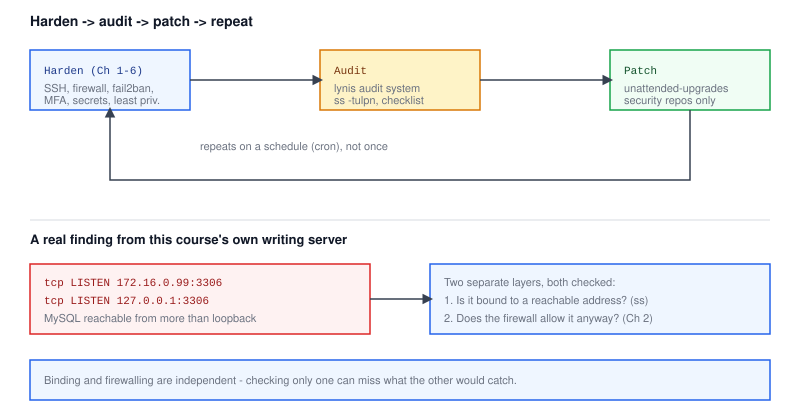

# Chapter 7 — Security Auditing: Lynis, unattended-upgrades, and a Hardening Checklist

> **Course:** Linux Server Security & Secrets · **Chapter:** 7 of 8
> Read on the website: [learn.bazardev.com/linux-security/07-security-auditing-and-hardening-checklists](https://learn.bazardev.com/linux-security/07-security-auditing-and-hardening-checklists)
>
> 🇧🇩 **Prefer Bangla?** [Read this chapter in Bangla →](https://learn.bazardev.com/linux-security/07-security-auditing-and-hardening-checklists?lang=bn)

> **Honesty note:** The `unattended-upgrades` configuration, service status, and log lines in Section 3, and the `ss -tulpn` output in Section 4, were actually run, read-only, against this course's own writing server — that output is real, including a genuine finding (Section 4) about MySQL listening on more than just loopback. Lynis was **not** installed on this server at the time of writing, so its commands and sample output in Section 2 are documented from Lynis's own official documentation, not a real run here — clearly marked as such. No packages were installed and no configuration was changed to write this chapter.

Chapters 1–6 each *hardened* something — SSH, the firewall, repeat offenders, login factors, secrets, and file permissions. This chapter asks a different question: **how do you know your hardening actually holds, today, and will keep holding next month without you remembering to check?** Auditing and automatic patching are what turn a one-time hardening effort into something that survives time, new packages, and new mistakes.

## 1. Why a one-time hardening pass isn't enough

A server configured correctly on day one doesn't stay that way automatically. New packages get installed and open new ports. A config file gets edited for an unrelated reason and quietly reverts a setting from Chapter 1. A security patch for the kernel or OpenSSH ships upstream, and if nothing applies it, the server sits vulnerable to a now-public issue indefinitely. Auditing is the practice of periodically re-checking the state Chapters 1–6 established; automatic patching is what closes the gap between "a fix exists" and "this server has it," without a human needing to remember.

## 2. Lynis: an automated hardening audit tool

**Lynis** is a well-known open-source security auditing tool for Linux, maintained by CISOfy, that inspects a system against hundreds of checks — SSH config, firewall state, installed packages, kernel parameters, file permissions — and reports findings with suggestions. Its install and run commands, from Lynis's own documentation:

```bash
sudo apt install lynis
sudo lynis audit system
```

Lynis groups its findings into **warnings** (likely real problems), **suggestions** (worth considering, not necessarily wrong), and a final **hardening index** — a 0–100 score summarizing overall posture. A typical finding for a server that's been through Chapters 1–4 of this course might look like:

```
[+] SSH Support
------------------------------------
    - OpenSSH option: PermitRootLogin                          [ SUGGESTION ]
      Set PermitRootLogin to 'without-password' or 'no'

Hardening index : 72 [###############     ]
```

That specific suggestion would already be satisfied by Chapter 1's `PermitRootLogin no` — which is the point: Lynis doesn't replace understanding *why* each setting matters (Chapters 1–6), it re-checks that what you already set up is still actually in place, and surfaces things this course hasn't covered yet (kernel hardening parameters, less-common services, package-level checks).

## 3. unattended-upgrades: patching without having to remember

Rather than manually running `apt upgrade` on a schedule and hoping to remember, Ubuntu ships a package specifically for automatic security patching. On this course's own writing server, it's already installed and active — a real, current check, not a hypothetical:

```bash
systemctl is-enabled unattended-upgrades
systemctl is-active unattended-upgrades
```

```
enabled
active
```

Its behavior is controlled by two files. First, whether it runs at all:

```bash
cat /etc/apt/apt.conf.d/20auto-upgrades
```

```
APT::Periodic::Update-Package-Lists "1";
APT::Periodic::Unattended-Upgrade "1";
```

Second, *what* it's allowed to upgrade — by default, security updates only, not every available package update:

```
Unattended-Upgrade::Allowed-Origins {
    "${distro_id}:${distro_codename}";
    "${distro_id}:${distro_codename}-security";
    "${distro_id}ESMApps:${distro_codename}-apps-security";
    "${distro_id}ESM:${distro_codename}-infra-security";
};
```

That scoping matters: it patches known security issues automatically, without silently pulling in a major version bump of something your application depends on. And this isn't theoretical — this course's own writing server's real log shows it running on its own, this morning:

```bash
tail -5 /var/log/unattended-upgrades/unattended-upgrades.log
```

```
2026-11-20 06:02:09,559 INFO Initial blacklist:
2026-11-20 06:02:09,560 INFO Initial whitelist (not strict):
2026-11-20 06:02:25,248 INFO Packages that will be upgraded: cloud-init cloud-init-base libgstreamer1.0-0 openjdk-17-jdk-headless openjdk-17-jre-headless
2026-11-20 06:02:25,248 INFO Writing dpkg log to /var/log/unattended-upgrades/unattended-upgrades-dpkg.log
2026-11-20 06:03:43,242 INFO All upgrades installed
```

No one had to log in and run `apt upgrade` for that to happen. The one gap worth knowing about: a kernel upgrade usually needs a reboot to take effect, and `unattended-upgrades` doesn't reboot the server for you by default — a separate setting (`Unattended-Upgrade::Automatic-Reboot`) controls that, and it's an explicit choice to opt into, not a default, because an unattended reboot of a production server has its own risk.

## 4. Auditing what's actually listening: ss, and a real finding

Lynis and unattended-upgrades handle config and patches; it's just as important to periodically ask a simpler question yourself: **what's actually reachable right now?** `ss` (socket statistics) lists every listening socket on the machine:

```bash
ss -tulpn
```

Running that against this course's own writing server surfaces a real, worth-noticing line:

```
tcp   LISTEN 0   300   172.16.0.99:3306   0.0.0.0:*
tcp   LISTEN 0   300   127.0.0.1:3306     0.0.0.0:*
```

MySQL (port 3306) is listening on **two** addresses here: `127.0.0.1` (loopback — only reachable from this same machine, the safe default) *and* `172.16.0.99`, a private network interface address. That second line means MySQL is reachable from other machines on that private network, not just from this one — not necessarily wrong on a server that genuinely needs database access from another host, but exactly the kind of fact an audit should surface explicitly rather than leave assumed. This is where Chapter 2's firewall comes back in: even a service bound to a non-loopback address is only as reachable as the firewall allows, which is why `ufw status verbose` or `nft list ruleset` belongs right next to `ss -tulpn` in a real audit — binding and firewalling are two separate layers, and an audit should check both rather than trusting either alone.

## 5. A consolidated hardening checklist



Pulling Chapters 1–6 together into one re-checkable list — this is what an audit is really re-verifying, chapter by chapter:

- [ ] **SSH (Ch 1):** `PasswordAuthentication no`, `PermitRootLogin no`, `sshd -t` passes, `AllowUsers`/`AllowGroups` still matches who should actually have access.
- [ ] **Firewall (Ch 2):** `ufw status verbose` shows default-deny incoming; no Docker-published port bypasses it unexpectedly; `nft list ruleset` matches what you expect.
- [ ] **fail2ban (Ch 3):** `fail2ban-client status sshd` shows the jail active; `jail.local` (not `jail.conf`) holds your overrides; the `recidive` jail is enabled for repeat offenders.
- [ ] **MFA (Ch 4):** `AuthenticationMethods publickey,keyboard-interactive` still set for interactive users; the CI/CD `Match User` exemption is scoped to exactly the deploy key it needs, nothing wider.
- [ ] **Secrets (Ch 5):** no secret has ever been committed to this repo (spot-check with `git log -p | grep`-style searches or a tool like `gitleaks`); `APP_DEBUG=false` in production; `config:cache` re-run after any `.env` rotation.
- [ ] **Least privilege (Ch 6):** no directory fixed with `chmod 777`; `sudoers.d` rules are narrowly scoped, no stray `NOPASSWD: ALL`; service accounts have `/usr/sbin/nologin`.
- [ ] **This chapter:** `lynis audit system` run recently, with warnings reviewed (not necessarily all "fixed" — see Section 6); `unattended-upgrades` enabled and active; `ss -tulpn` reviewed against what's actually supposed to be reachable.

## 6. Reading audit output: don't chase a perfect score

A Lynis hardening index of 100 is not the goal, and chasing one can actively hurt a real server. Some suggestions trade security for something else you may genuinely need — disabling a service Lynis flags as unused might break a feature someone relies on; a suggestion assumes a generic server, not *your* server's actual constraints. The right habit is to read every warning and suggestion, understand *why* Lynis raised it (its report explains the reasoning, and links to further reading per finding), and make a deliberate decision — fix it, or explicitly accept the risk and move on — rather than applying every suggestion mechanically. This is the same judgment call as Chapter 6's `NOPASSWD` trade-off: a checklist is a tool for thinking, not a replacement for it.

## 7. Putting audits on a schedule

A security audit only catches drift if it actually runs again later, not just once while writing this chapter. `cron` (Chapter 1's `linux-shell` prerequisite covers it) is the simplest way to schedule a recurring Lynis run:

```bash
# /etc/cron.d/lynis-weekly
0 3 * * 1 root lynis audit system --cronjob > /var/log/lynis-report.log 2>&1
```

`--cronjob` suppresses Lynis's interactive prompts, since nothing is there to answer them. Pairing that with this course's own Monitoring & Logging course (`07-monitoring`) closes the loop: ship `/var/log/lynis-report.log` to wherever Chapter 6 of that course sends logs, and alert (Chapter 6 of that course again) if the hardening index drops compared to last week — turning a manual "remember to check" into something that pages someone automatically if posture regresses.

## 8. Key takeaways

- **Lynis** (`lynis audit system`) re-checks hundreds of hardening points automatically and scores overall posture with a hardening index — a tool for re-verifying Chapters 1–6, not a replacement for understanding them.
- **unattended-upgrades** patches security updates automatically on a schedule, scoped by `Allowed-Origins` to security-relevant repos only — verified live on this course's own server as enabled, active, and genuinely running.
- A kernel security update still needs a **reboot** to take effect; `unattended-upgrades` doesn't reboot automatically unless explicitly configured to.
- `ss -tulpn` shows what's actually listening, and binding plus firewalling are two separate layers that both need checking — a service on a non-loopback address is only as reachable as the firewall (Chapter 2) allows.
- A hardening **checklist** that re-visits every earlier chapter (SSH, firewall, fail2ban, MFA, secrets, least privilege) turns six chapters of one-time work into something re-checkable in minutes.
- Don't chase a perfect audit score — read *why* each finding was raised and make a deliberate call; some suggestions trade away something your specific server genuinely needs.
- Schedule the audit itself (`cron`), and ideally feed its output into the alerting this course's Monitoring & Logging course already covers, so drift gets caught automatically instead of only "whenever someone remembers."

## 9. Test yourself (exam prep)

<details>
<summary><strong>Q1. What does a Lynis "hardening index" actually measure, and should the goal always be 100?</strong></summary>

It's a 0-100 score summarizing how many of Lynis's hundreds of checks pass. It shouldn't always be chased to 100 - some suggestions trade away functionality a specific server genuinely needs, so each finding deserves a deliberate decision rather than blind compliance.
</details>

<details>
<summary><strong>Q2. What's the practical difference between Lynis and unattended-upgrades?</strong></summary>

Lynis audits and reports on current configuration and posture (it doesn't change anything by itself); unattended-upgrades actually installs security patches automatically on a schedule. One finds problems, the other fixes a specific category of them (missing patches) without a human needing to act.
</details>

<details>
<summary><strong>Q3. By default, does unattended-upgrades install every available package update?</strong></summary>

No - its Allowed-Origins setting scopes it to security-relevant repositories by default, so it patches known security issues without silently pulling in unrelated version bumps that could break something.
</details>

<details>
<summary><strong>Q4. A kernel security patch was installed by unattended-upgrades. Is the server now protected?</strong></summary>

Not necessarily immediately - a kernel upgrade typically needs a reboot to actually take effect, and unattended-upgrades doesn't reboot automatically unless explicitly configured to, since an unattended reboot has its own risk.
</details>

<details>
<summary><strong>Q5. ss -tulpn shows a database listening on both 127.0.0.1 and a private network address. Is that automatically a security problem?</strong></summary>

Not automatically - it depends on whether that reachability is intended and whether the firewall (Chapter 2) actually restricts who on that network can reach it. The point of the audit is to surface the fact explicitly, not to assume either way.
</details>

<details>
<summary><strong>Q6. Why check both the firewall and what's listening (ss), rather than just one of the two?</strong></summary>

They're separate layers: a service can be bound to a reachable address but still blocked by the firewall, or the firewall could allow a port that nothing is actually listening on. Checking only one can miss what the other would catch.
</details>

<details>
<summary><strong>Q7. Why does a hardening checklist explicitly re-list items from Chapters 1-6 instead of only covering what's new in this chapter?</strong></summary>

Because configuration drifts over time - a setting correct on day one can be reverted by an unrelated change later. A checklist's value is in being re-checkable, catching regressions in earlier hardening work, not just documenting this chapter's new material.
</details>

<details>
<summary><strong>Q8. Why schedule Lynis with cron instead of just running it manually "when you remember"?</strong></summary>

A security audit only catches configuration drift if it actually runs again later. A manual "remember to check" habit is unreliable over months; a scheduled run (ideally feeding alerting) catches regressions automatically instead of depending on someone's memory.
</details>

## 10. Free resources

- Lynis official documentation: [cisofy.com/lynis](https://cisofy.com/lynis/) and the [Lynis GitHub repository](https://github.com/CISOfy/lynis)
- Ubuntu Documentation: [Automatic updates](https://ubuntu.com/server/docs/about-automatic-updates)
- `man ss`, `man cron`, `man crontab`
- DigitalOcean: [How To Keep Ubuntu Server Updated](https://www.digitalocean.com/community/tutorials/how-to-keep-ubuntu-22-04-updated)

---

**Next:** [Chapter 8 — Real project: hardening a Laravel production server end to end](08-real-project-hardening-a-laravel-server.md)
