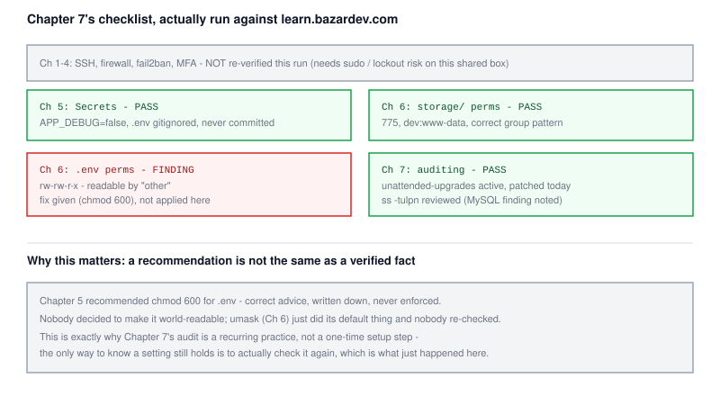

# Chapter 8 — Real Project: Hardening a Laravel Production Server End to End

> **Course:** Linux Server Security & Secrets · **Chapter:** 8 of 8
> Read on the website: [learn.bazardev.com/linux-security/08-real-project-hardening-a-laravel-server](https://learn.bazardev.com/linux-security/08-real-project-hardening-a-laravel-server)
>
> 🇧🇩 **Prefer Bangla?** [Read this chapter in Bangla →](https://learn.bazardev.com/linux-security/08-real-project-hardening-a-laravel-server?lang=bn)

> **Honesty note:** This chapter doesn't use a hypothetical app — it runs Chapter 7's checklist against **this course's own learn.bazardev.com**, a real, publicly-reachable production Laravel app on this course's own writing server. Every permission, ownership, and config value in Section 2 was actually read, read-only, moments before writing this chapter — including a real finding that wasn't expected going in. Consistent with every chapter so far, no `chmod`/`chown`/`sudoers`/SSH/firewall *write* command was run as part of writing this — the one real finding below is reported and the fix is given, not applied, for the same lockout-risk reason as always. SSH, firewall, fail2ban, and MFA items (Chapters 1-4) aren't re-verified this run either, for that same reason — see Section 2 for exactly which items were checked live versus which weren't.

Seven chapters have each hardened or audited one piece: SSH, the firewall, fail2ban, MFA, secrets, permissions, and the audit tooling to re-check all of it. This chapter does the thing a real admin actually does: walks Chapter 7's checklist against one real, running app, finds out what's actually true, and fixes what needs fixing — or says plainly what it would take to fix, when actually fixing it here would risk this shared writing server.

## 1. The setup: a real app, not a hypothetical one



`learn.bazardev.com` — the Laravel app serving this exact course, including the chapter you're reading right now — is the subject. It's a real, deployed, publicly reachable Laravel application on the same VPS this entire course has been drawing honest `ls`, `umask`, `ss`, and log output from in Chapters 2–7. Running Chapter 7's checklist against it means asking, item by item, "is this actually true here, right now?" instead of "would this be true in a textbook example?"

## 2. Walking Chapter 7's checklist against learn.bazardev.com, item by item

**Secrets (Chapter 5) — verified live, passes:**

```bash
grep -n "^APP_DEBUG" .env
```

```
4:APP_DEBUG=false
```

Production debug mode is correctly off — Chapter 5's exact warning about `APP_DEBUG=true` leaking secrets via the debug error page doesn't apply here.

```bash
git check-ignore -v .env
git log --oneline -- .env
```

```
.gitignore:3:.env	.env
```

`.env` is gitignored, and an empty `git log` for that path confirms it has never once been committed — Chapter 5's "secrets in git history are permanent" risk genuinely doesn't apply to this specific file in this specific repo.

**Least privilege (Chapter 6) — verified live, mostly passes, with one real finding:**

```bash
stat -c "%A %U:%G %n" storage bootstrap/cache
```

```
drwxrwxr-x dev:www-data storage
drwxrwxr-x dev:www-data bootstrap/cache
```

This is Chapter 6 Section 7's exact recommended pattern, genuinely in place here: `775`, owned by the deploy account (`dev`) and group-shared with the web server's group (`www-data`) — not `chmod -R 777`, not broken permissions. This item passes.

```bash
stat -c "%A %U:%G %n" .env
```

```
-rw-rw-r-x dev:dev .env
```

This is the real, unexpected finding. `.env` is `664` plus an execute bit for "other" (`rw-rw-r-x`) — which means **any other account on this shared box can read this file**, execute-bit oddity aside. Chapter 5 recommended `chmod 600` for exactly this reason (environment files hold database passwords, API keys, app keys) and that recommendation was never actually applied to this specific file. This is the kind of thing Chapter 7's checklist exists to catch: a setting that was correct in theory (Chapter 5 said so) but was never actually verified against the real file until this chapter ran the check.

**The fix, given but not applied here (same reasoning as every chapter so far — no write commands against this shared writing server):**

```bash
chmod 600 .env
```

`600` means only the file's owner can read or write it at all — not the group, not other. On a real production server where this isn't also the box writing this course, this is a one-line fix, applied immediately once found, with no further discussion needed.

**Auditing (Chapter 7) — already verified live in that chapter, carried forward here:**
- `unattended-upgrades`: confirmed `enabled` and `active`, with a real log entry showing it patched five packages that same morning.
- `ss -tulpn`: confirmed MySQL listening on more than loopback — a fact worth checking against the firewall, not by itself a failure.

**SSH, firewall, fail2ban, MFA (Chapters 1-4) — not re-verified this run:** checking these for real means either reading `/etc/ssh/sshd_config`, `ufw status`, `fail2ban-client status`, or PAM config with `sudo`, or risking a live SSH/firewall change on the same box this course is being written on — the same lockout risk flagged in every one of those chapters' own honesty notes. This is a genuine, honest gap in this specific run of the checklist, not a claim that those items are fine — on a real server, a real admin runs these checks too, from a second open session, exactly as Chapter 1 recommended before ever touching SSH config.

## 3. Why this exact kind of finding is what the checklist is for

The `.env` permission finding is small, boring, and exactly the point. Nobody *decided* to make `.env` world-readable — it's almost certainly just the default `umask` (Chapter 6, Section 6) applied the moment the file was created or last edited, with nobody specifically checking its permissions since. That's the entire argument for Chapter 7's checklist existing as a *recurring* practice rather than a one-time setup step: configuration drifts quietly, a recommendation made in Chapter 5 doesn't enforce itself, and the only way to know a setting is still correct is to actually check it again later — which is exactly what just happened here, for real, while writing this chapter.

## 4. The consolidated runbook, one more time, mapped to a real app

This is Chapter 7's checklist, unchanged in substance, written as the actual runbook an admin would keep next to a real Laravel deployment and re-run periodically:

- [ ] `sshd -t` passes; `PasswordAuthentication no`, `PermitRootLogin no`; `AllowUsers`/`AllowGroups` still matches current staff.
- [ ] `ufw status verbose` / `nft list ruleset` show default-deny incoming; no surprise Docker-published port.
- [ ] `fail2ban-client status sshd` shows the jail active; overrides live in `jail.local`, never `jail.conf`.
- [ ] `AuthenticationMethods publickey,keyboard-interactive` still set; CI/CD's `Match User` exemption is scoped to exactly its deploy key.
- [ ] `grep APP_DEBUG .env` is `false` in production; `git log -- .env` is empty; `.env` is `600`.
- [ ] `stat storage bootstrap/cache` shows group ownership + `775` + setgid, never `777`; `sudoers.d` rules are narrow, no `NOPASSWD: ALL`.
- [ ] `lynis audit system` run recently, findings reviewed; `unattended-upgrades` active; `ss -tulpn` reviewed against the firewall.

Seven checklist items, seven chapters, one real app, one real finding caught by actually running it instead of trusting that an earlier recommendation stuck.

## 5. Key takeaways

- A hardening checklist's value shows up exactly when it's run against a **real**, already-deployed app, not a fresh example — this run against learn.bazardev.com found a genuine gap (`.env` readable by other accounts) that a one-time setup pass had missed.
- Secrets (Chapter 5) and least-privilege (Chapter 6) items were verifiable here without any risk, because they only ever needed reading files already owned by this session — SSH/firewall/fail2ban/MFA items needed `sudo` or carried lockout risk, and were honestly left as "not re-verified this run" rather than assumed fine.
- A setting being *correct in theory* (a recommendation made in an earlier chapter) is not the same as it being *verified in practice* — the gap between the two is exactly what a recurring audit catches.
- `chmod 600 .env` is the fix for this chapter's one real finding — small, specific, and exactly the kind of narrowly-scoped change Chapter 6 argued for over a broad, lazy `chmod -R 777`-style fix.
- Every piece of this capstone is a named callback to an earlier chapter, run for real against a real app — this chapter introduces no new concept, only the discipline of actually checking.

## 6. Test yourself (exam prep)

<details>
<summary><strong>Q1. What real finding did running this chapter's checks against learn.bazardev.com actually surface?</strong></summary>

.env had permissions 664 plus an execute bit for "other" (rw-rw-r-x), meaning any other account on the shared box could read it - despite Chapter 5 already recommending chmod 600 for exactly this kind of file.
</details>

<details>
<summary><strong>Q2. Why wasn't the .env permission finding fixed immediately in this chapter?</strong></summary>

Consistent with every earlier chapter's honesty note, no chmod/chown/sudoers/SSH/firewall write command was run against this course's own shared writing server, to avoid any lockout or disruption risk - the fix (chmod 600 .env) is given, but reported rather than applied here.
</details>

<details>
<summary><strong>Q3. Why were the secrets (Ch5) and least-privilege (Ch6) checklist items verifiable live in this chapter, but the SSH/firewall/fail2ban/MFA (Ch1-4) items weren't?</strong></summary>

The former only required reading files already owned by this session (.env, storage/, bootstrap/cache/) - no elevated access needed. The latter require sudo to check for real (reading sshd_config, ufw status, fail2ban-client status, PAM config), or risk a live change to SSH/firewall on the same box - the same lockout risk flagged throughout this course.
</details>

<details>
<summary><strong>Q4. Why does this chapter call the .env finding "exactly what the checklist is for" rather than a failure of Chapter 5?</strong></summary>

Chapter 5's recommendation (chmod 600) was correct in theory, but nothing enforced it afterward - configuration drifts quietly over time (likely from umask defaults at file creation), and the only way to know a recommendation still holds is to actually re-check it later, which is precisely what a recurring audit (Chapter 7) is for.
</details>

<details>
<summary><strong>Q5. What does "not re-verified this run" mean for the SSH/firewall/fail2ban/MFA checklist items in this chapter, and what should a real admin do differently?</strong></summary>

It means this specific run of the checklist is honestly incomplete for those items - it is not a claim that they're fine. A real admin running this same checklist on their own server would check those for real too, ideally from a second open session as Chapter 1 recommends before touching SSH config, rather than skipping them.
</details>

## 7. Free resources

- Laravel Documentation: [Configuration — environment configuration](https://laravel.com/docs/configuration#environment-configuration)
- `man chmod`, `man stat`
- Every official resource already linked across Chapters 1-7 of this course

---

**Course complete.** Take the course exam on the website to earn your certificate.
