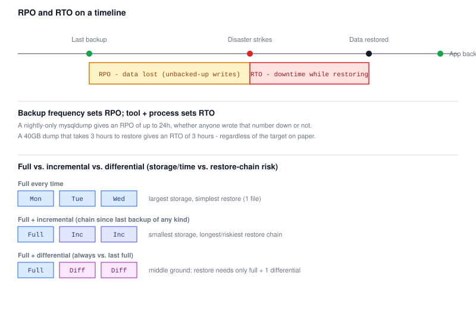

# Chapter 1 — Why Backups: RPO, RTO, and Choosing a Strategy

> **Course:** Database Backup & Recovery · **Chapter:** 1 of 8
> Read on the website: [learn.bazardev.com/database-backup/01-why-backups-rpo-and-rto](https://learn.bazardev.com/database-backup/01-why-backups-rpo-and-rto)
>
> 🇧🇩 **Prefer Bangla?** [Read this chapter in Bangla →](https://learn.bazardev.com/database-backup/01-why-backups-rpo-and-rto?lang=bn)

> **Honesty note:** this chapter is concepts, not commands — nothing to run yet. From Chapter 2 onward, this course runs real `mysqldump` and restore commands against Percona MySQL 8.4, genuinely installed on this course's own writing server. Every one of those commands targets a **throwaway demo database created and dropped inside that chapter**, never the real `learn.bazardev.com` application database — the owner has an existing, explicit decision on record not to stand up a real backup system on that production database as a side effect of writing this course, and this course respects that by design, not by accident.

The Cloud course (Chapter 7) already introduced RPO and RTO at the level of "RDS has automated backups, click a button." This course goes one level deeper: you're not always on managed cloud infrastructure, and a self-managed MySQL/Percona install on a plain Linux VPS gives you none of that for free. Nobody schedules `mysqldump` for you. Nobody tests your restore. This chapter starts by being precise about what a backup actually protects against, before Chapter 2 touches a single command.

## 1. What a backup protects against — and what it doesn't

A surprising number of "we have backups" setups are actually protecting against the wrong thing. Four separate failure modes, each needing a different answer:

- **Hardware failure** — a disk dies, a VPS host has an outage. Multi-AZ, RAID, and your cloud provider's underlying storage replication all help here. **None of them are a backup.**
- **Human error** — someone runs the wrong `UPDATE` with no `WHERE` clause, drops the wrong table, or a deploy script truncates a table it shouldn't have touched. This is the single most common reason real backups get used.
- **Application or deploy bugs** — a migration that silently corrupts data, a bug that overwrites good rows with bad ones. Caught too late, this can already be baked into every replica.
- **Compromise or ransomware** — an attacker (or a compromised account) deletes or encrypts data on purpose. A backup only helps here if it's **stored somewhere the attacker's access can't also reach and delete** — more on this in Chapter 6 (offsite storage).

The reason Multi-AZ and RAID don't count: in all three of the non-hardware cases above, the *bad write itself* gets faithfully copied to every replica and every disk in the RAID array. Redundancy protects against a disk failing; it does nothing against a mistake, because a mistake isn't a hardware fault — it's data, written correctly to spec, that just happens to be wrong.

## 2. RPO and RTO, made concrete

These two numbers are the entire design conversation for a backup strategy — everything else (which tool, how often, where to store it) is just the implementation detail that satisfies them.

- **RPO (Recovery Point Objective) — how much data can you afford to lose?** If your RPO is "1 hour," your most recent usable backup (or combination of backup + logs, Chapter 5) must never be more than 1 hour old at the moment disaster strikes. A nightly-only backup gives you an RPO of up to 24 hours, whether you intended that or not.
- **RTO (Recovery Time Objective) — how long can you afford to be down while restoring?** If your RTO is "30 minutes," the actual restore process — finding the right backup, running it, verifying the app works — must complete inside 30 minutes. A 40 GB `mysqldump` that takes 3 hours to restore gives you an RTO of 3 hours, whether that number was ever written down or not.

Neither number is really a technical choice — they're a business/product answer dressed as an infrastructure requirement. "We can lose up to a day of orders" and "we can't lose a minute of orders" produce completely different backup strategies for the exact same database engine.

## 3. Logical vs. physical backups — the first real decision

Every MySQL backup tool is really just a variation on one of these two approaches, and the difference matters for both RPO and RTO:

- **Logical backups** (Chapter 2's `mysqldump` is the classic example) export data as SQL statements (`CREATE TABLE`, `INSERT`) — human-readable, portable across MySQL versions and even to other engines, and easy to restore a single table from. The cost: exporting and re-running SQL statement-by-statement is slow on large databases, so RTO gets worse as data grows.
- **Physical backups** (Chapter 4's XtraBackup is the classic example) copy the actual data files MySQL stores on disk. Much faster for both backup and restore on large databases, because there's no row-by-row SQL to generate or replay — but the backup is tied to the same MySQL version and storage engine, and you can't easily pull out "just one table."

Neither is strictly better — they trade off differently against size. A 50 MB database restores from a logical dump in seconds either way, so the distinction barely matters. A 500 GB database can turn a logical restore's RTO into "overnight," which is exactly the kind of gap a number on paper hides until you actually test it (Chapter 2's whole point).

## 4. Full, incremental, and differential — trading storage for RTO

Beyond logical-vs-physical, backups also differ in *how much* they capture each time:

- **Full backup** — everything, every time. Simplest to restore (one file, one step) but the most storage and time to produce.
- **Incremental backup** — only what changed since the *last backup of any kind*. Smallest and fastest to produce, but restoring means replaying the full backup plus every incremental since, in order — more moving parts, more ways for RTO to balloon if one link in that chain is missing.
- **Differential backup** — only what changed since the *last full backup*. A middle ground: bigger than an incremental but restoring only ever needs the full backup plus one differential, not a whole chain.

A common real pattern: one full backup weekly, daily incrementals between them. This keeps storage and backup time low while keeping the restore chain short enough to actually trust.

## 5. The 3-2-1 rule

A simple, memorable rule that catches most of the ways a backup strategy quietly fails: keep **3** copies of your data, on **2** different types of storage media, with **1** copy stored offsite (somewhere a local disaster — fire, theft, a single compromised VPS — can't also destroy).

Applied to a typical self-managed MySQL setup: the live database is copy 1; a `mysqldump` written to the same server's disk is copy 2 but **fails the "offsite" test on its own** — if the VPS disk fails or the whole VPS is compromised, that backup dies with it. Chapter 6 covers actually shipping a copy off the server, which is what turns "I have a backup" into "I have a backup that survives the disaster I'm actually worried about."

## 6. What this course covers, chapter by chapter

- **Chapter 2** — `mysqldump` for real: syntax, options that matter, and restoring into a scratch database to actually prove the backup works.
- **Chapter 3** — automating it: cron, retention policy, rotating out old backups without quietly running out of disk.
- **Chapter 4** — physical backups with XtraBackup, and when they're worth the extra setup over `mysqldump`.
- **Chapter 5** — point-in-time recovery: combining a base backup with binary logs to restore to the *exact second* before a bad query ran, not just to last night.
- **Chapter 6** — offsite storage: encrypting a dump and actually getting it off the server, satisfying the "1" in 3-2-1.
- **Chapter 7** — replication basics, and the precise reason a replica is not a substitute for a backup (Section 1's "bad writes get copied faithfully" applies to replicas too).
- **Chapter 8** — a real project: an end-to-end backup-and-restore drill against a throwaway copy of a Laravel app's database, start to finish, with the restore actually timed.

## 7. Key takeaways

- A backup protects against human error, application bugs, and compromise — not against hardware failure alone. Multi-AZ, RAID, and replication don't count as backups, because they faithfully copy bad writes too.
- **RPO** is how much data loss you can tolerate (sets backup frequency); **RTO** is how long you can tolerate being down (shapes which tool and process you use). Both should be a deliberate answer, not an accident of whatever schedule you happened to set up.
- **Logical** backups (`mysqldump`) are portable and table-restorable but slower at scale; **physical** backups (XtraBackup) are fast at scale but tied to the same MySQL version.
- **Full / incremental / differential** trade backup storage and time against how many pieces a restore has to correctly chain together.
- **3-2-1**: three copies, two storage types, one offsite — a backup that never leaves the server it protects fails the rule that actually matters most.

## 8. Test yourself (exam prep)

<strong>Q1. Why doesn't RAID or Multi-AZ count as a backup?</strong>

They protect against hardware failure by keeping redundant copies in sync, but a bad write — a wrong `UPDATE`, a dropped table, a malicious deletion — gets faithfully copied to every redundant copy too. Redundancy survives a disk dying; it does nothing against a mistake, because the mistake is correctly-written data that happens to be wrong.

<strong>Q2. Define RPO and RTO in your own words, with the backup decision each one drives.</strong>

RPO (Recovery Point Objective) is how much data loss is acceptable — it drives how *often* you must back up. RTO (Recovery Time Objective) is how much downtime is acceptable while restoring — it drives *which tool and process* you use, since a correct-but-slow restore can still miss its target.

<strong>Q3. What's the practical difference between a logical and a physical backup, and when does the difference start to matter?</strong>

A logical backup (e.g. `mysqldump`) exports data as replayable SQL — portable and table-restorable, but slow to generate and restore at scale. A physical backup (e.g. XtraBackup) copies MySQL's actual data files — fast at any scale, but tied to the same MySQL version and storage engine. The difference barely matters on a small database and can dominate RTO on a large one.

<strong>Q4. Why can an incremental backup chain be riskier to restore from than a differential chain, even though it's cheaper to produce?</strong>

Restoring from incrementals means replaying the full backup plus every incremental since, in order — a single missing or corrupt link breaks the whole chain. A differential backup only ever needs the full backup plus one differential, so there are fewer places for the restore to fail.

<strong>Q5. A team backs up nightly with <code>mysqldump</code> and stores the dump on the same server's disk. Which part(s) of the 3-2-1 rule does this fail, and why?</strong>

It fails the "1 offsite" requirement (and arguably the "2 storage types" requirement, depending on setup) — the backup lives on the exact same disk as the live database, so a disk failure, VPS loss, or a compromise of that one server destroys both the data and the backup meant to recover it.

<strong>Q6. A nightly-only backup schedule gives what RPO, even if nobody wrote that number down anywhere?</strong>

Up to 24 hours — if disaster strikes right before the next scheduled backup, everything written since the last one is lost. RPO is a property of the actual schedule, not of someone's intention.

<strong>Q7. Why is "we have backups" not actually a complete claim without also answering what they protect against?</strong>

Backups that only guard against hardware failure (e.g. relying on RAID or Multi-AZ alone) leave human error, bad deploys, and compromise completely uncovered — the same four failure modes from Section 1 need to each be considered, and a strategy that only defends one of them can still lose everything to another.

<strong>Q8. Why does this course deliberately avoid running any of its real backup commands against learn.bazardev.com's actual application database?</strong>

The owner has an existing decision on record not to stand up a real backup system on that production database; every hands-on command in this course runs against a throwaway demo database created and dropped within the chapter, so the course teaches the real mechanics without quietly changing production as a side effect.

## 9. Free resources

- MySQL 8.4 Reference Manual: [Backup and Recovery](https://dev.mysql.com/doc/refman/8.4/en/backup-and-recovery.html)
- Percona: [A Brief Guide to MySQL Backups](https://www.percona.com/blog/a-brief-guide-to-mysql-backups/)
- AWS: [Recovery Point Objective and Recovery Time Objective](https://aws.amazon.com/what-is/recovery-time-objective/)

---

**Next:** [Chapter 2 — `mysqldump` for real: logical backups and proving a restore works](02-mysqldump-logical-backups.md)
