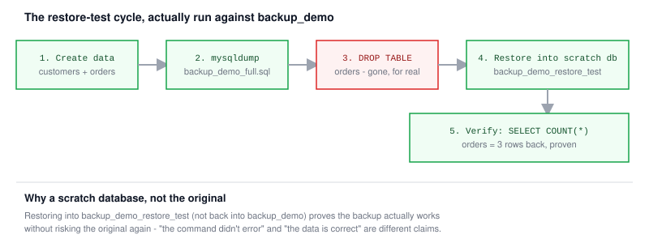

# Chapter 2 — `mysqldump` for Real: Logical Backups and Proving a Restore Works

> **Course:** Database Backup & Recovery · **Chapter:** 2 of 8
> Read on the website: [learn.bazardev.com/database-backup/02-mysqldump-logical-backups](https://learn.bazardev.com/database-backup/02-mysqldump-logical-backups)
>
> 🇧🇩 **Prefer Bangla?** [Read this chapter in Bangla →](https://learn.bazardev.com/database-backup/02-mysqldump-logical-backups?lang=bn)

> **Honesty note:** every command and output in this chapter was genuinely run, on this course's own writing server, against Percona MySQL 8.4.11. All of it targets `backup_demo` — a throwaway database created specifically for this course, with its own scoped MySQL user (`backup_demo`, privileges limited to `backup_demo.*` only, credentials kept in a private `--defaults-extra-file` outside any git repo). Nothing here ever touches `learn_bazardev`, the real application database behind this site — consistent with the owner's standing decision (Chapter 1) not to let this course change production as a side effect of teaching it.

Chapter 1 ended on a specific line: *"a backup you have never restored is only a hope."* This chapter makes that literal — create real data, back it up with `mysqldump`, genuinely destroy part of it, then restore from the backup and prove, with a row count, that it actually came back.

## 1. Setting up something worth backing up

Two small, related tables — exactly the shape of a real app, minus the scale:

```sql
CREATE TABLE customers (
  id INT AUTO_INCREMENT PRIMARY KEY,
  name VARCHAR(100) NOT NULL,
  email VARCHAR(150) NOT NULL,
  created_at DATETIME DEFAULT CURRENT_TIMESTAMP
);

CREATE TABLE orders (
  id INT AUTO_INCREMENT PRIMARY KEY,
  customer_id INT NOT NULL,
  amount DECIMAL(10,2) NOT NULL,
  placed_at DATETIME DEFAULT CURRENT_TIMESTAMP,
  FOREIGN KEY (customer_id) REFERENCES customers(id)
);
```

3 rows in `customers`, 3 rows in `orders` (two orders for one customer, matching a real one-to-many relationship). This is the data Section 3 is about to "accidentally" destroy.

## 2. The first real dump, and a lesson in not trusting the exit code alone

```bash
mysqldump --defaults-extra-file=~/.my-cnf.d/backup_demo.cnf --databases backup_demo > backup_demo_full.sql
```

```
mysqldump: Error: 'Access denied; you need (at least one of) the PROCESS privilege(s) for this operation' when trying to dump tablespaces
```

```bash
echo "exit code: $?"
```

```
exit code: 0
```

This is a genuinely useful, real gotcha, not a staged one: `mysqldump --databases` tries to capture tablespace metadata, which needs the `PROCESS` privilege — something a properly scoped, least-privilege backup user (Chapter 6 of the *Security* course) normally does **not** have, on purpose. The dump still completed and exited `0` (success), with the error only on stderr. **A cron job that only checks the exit code would miss this entirely.** The actual, reliable way to confirm a dump is complete is the trailer line every successful `mysqldump` writes at the very end of the file:

```bash
tail -1 backup_demo_full.sql
```

```
-- Dump completed on 2026-11-20 11:21:06
```

Chapter 3 builds a real automation script around checking for exactly this line — not just `$?`.

## 3. `--databases` vs. a plain dump: a choice that decides how you can restore

```bash
grep -n "CREATE DATABASE\|^USE" backup_demo_full.sql
```

```
31:CREATE DATABASE /*!32312 IF NOT EXISTS*/ `backup_demo` /*!40100 DEFAULT CHARACTER SET utf8mb4 COLLATE utf8mb4_0900_ai_ci */ /*!80016 DEFAULT ENCRYPTION='N' */;
33:USE `backup_demo`;
```

`mysqldump --databases backup_demo` bakes a `CREATE DATABASE` and `USE` statement into the file — restoring it (`mysql < backup_demo_full.sql`) always recreates and targets a database named exactly `backup_demo`, wherever you run it. That's convenient for disaster recovery (restore to an identically-named fresh server) but it means you **cannot** easily point the same file at a differently-named database to test the restore safely alongside the original — which is exactly what Section 4 needs to do.

Dropping `--databases` removes those two lines entirely — the file becomes a portable set of `CREATE TABLE` / `INSERT` statements with no database name baked in, restorable into **any** target you name on the command line:

```bash
mysqldump --defaults-extra-file=~/.my-cnf.d/backup_demo.cnf backup_demo > backup_demo_tables.sql
grep -c "CREATE DATABASE\|^USE" backup_demo_tables.sql
```

```
0
```

## 4. Simulating the disaster, for real

```bash
mysql --defaults-extra-file=~/.my-cnf.d/backup_demo.cnf backup_demo -e "DROP TABLE orders;"
mysql --defaults-extra-file=~/.my-cnf.d/backup_demo.cnf backup_demo -e "SHOW TABLES;"
```

```
Tables_in_backup_demo
customers
```

`orders` is genuinely gone from `backup_demo` right now. This is Chapter 1 Section 1's "human error" category made real: no `WHERE` clause typo needed, just a direct `DROP TABLE` — the single most common reason a real backup actually gets used.



## 5. Restoring into a separate scratch database — and proving it actually worked

The entire point of a *restore test* is to recover into somewhere that isn't the live database, so you can verify correctness without further risking the original. A second, equally scoped database for exactly this:

```bash
sudo mysql -e "CREATE DATABASE backup_demo_restore_test; GRANT ALL PRIVILEGES ON backup_demo_restore_test.* TO 'backup_demo'@'localhost'; FLUSH PRIVILEGES;"
```

Now restore the **pre-disaster** dump — taken in Section 2, before `orders` was dropped — into that scratch database, naming the target explicitly (only possible because Section 3 used a plain dump, without `--databases`):

```bash
mysql --defaults-extra-file=~/.my-cnf.d/backup_demo.cnf backup_demo_restore_test < backup_demo_full_notarget.sql
```

```bash
mysql --defaults-extra-file=~/.my-cnf.d/backup_demo.cnf backup_demo_restore_test -e "SHOW TABLES; SELECT COUNT(*) AS customers FROM customers; SELECT COUNT(*) AS orders FROM orders;"
```

```
Tables_in_backup_demo_restore_test
customers
orders
customers
3
orders
3
```

`orders` — dropped moments ago from the original `backup_demo` — is back, with all 3 rows, in the scratch database. This is not a claim; it's a row count that didn't exist a few commands ago. The backup worked, and now there's proof instead of a hope.

```bash
mysql --defaults-extra-file=~/.my-cnf.d/backup_demo.cnf backup_demo_restore_test -e "SELECT * FROM orders;"
```

```
id	customer_id	amount	placed_at
1	1	499.00	2026-11-20 11:20:32
2	2	1250.50	2026-11-20 11:20:32
3	1	75.00	2026-11-20 11:20:32
```

Exact amounts, exact timestamps, exact foreign keys to `customer_id` — a real restore, not a reconstruction.

## 6. The options that matter in practice

A few `mysqldump` flags worth knowing deliberately, beyond the defaults used above:

- **`--single-transaction`** — wraps the dump in one transaction on InnoDB tables, so a dump of a database still receiving writes is consistent as of one point in time, instead of mixing rows from before and after a concurrent write. Essential for any database that isn't sitting idle, which in practice means almost every production database.
- **`--routines --triggers --events`** — plain `mysqldump` does **not** capture stored procedures, triggers, or scheduled events by default; add these explicitly if your schema uses any.
- **`--no-data`** — dumps only table structure (`CREATE TABLE` statements), no rows at all — useful for capturing just a schema to set up a fresh environment.
- **Compressing the output** — `mysqldump ... | gzip > backup.sql.gz` pipes the dump straight into `gzip`, shrinking a text-heavy SQL file considerably without an extra disk round-trip for the uncompressed version.

## 7. Key takeaways

- A `mysqldump` export can exit `0` while stderr reports a real problem (here, a `PROCESS` privilege error on tablespace metadata) — check for the `-- Dump completed on ...` trailer line, not just the exit code, to confirm a dump genuinely finished.
- `mysqldump --databases` bakes in `CREATE DATABASE`/`USE`, always restoring to that exact database name; a plain `mysqldump dbname` dump has no database name baked in and can be restored into any target you specify.
- A restore **test** means restoring into a separate database, not the original — that's what actually proves a backup works without further risking the live data.
- `--single-transaction` is close to mandatory on any database still receiving writes, to avoid a dump that mixes data from before and after a concurrent change.
- Plain `mysqldump` skips routines, triggers, and events by default — add `--routines --triggers --events` explicitly if your schema uses them.

## 8. Test yourself (exam prep)

<details>
<summary><strong>Q1. This chapter's first mysqldump run exited 0 despite printing an error to stderr. What was the error, and why does it matter?</strong></summary>

A "PROCESS privilege" error while trying to dump tablespace metadata, because the scoped backup_demo user intentionally lacks that elevated privilege. It matters because a script that only checks the exit code would treat this as a fully successful backup and miss the warning entirely.
</details>

<details>
<summary><strong>Q2. What's the reliable way to confirm a mysqldump actually completed, beyond its exit code?</strong></summary>

Check for the "-- Dump completed on ..." trailer line that mysqldump writes at the very end of a successful dump file — its presence (or absence, on a truncated/failed dump) is a better signal than the exit code alone.
</details>

<details>
<summary><strong>Q3. What does mysqldump --databases add to the output that a plain mysqldump dbname dump doesn't?</strong></summary>

A CREATE DATABASE statement and a USE statement naming the exact database the dump came from, so restoring it always recreates and targets a database with that same name.
</details>

<details>
<summary><strong>Q4. Why did this chapter use a plain dump (no --databases) to demonstrate the restore test?</strong></summary>

A plain dump has no database name baked in, so it can be restored into any target database named on the command line — here, a separate backup_demo_restore_test scratch database, instead of being forced back into the original backup_demo name.
</details>

<details>
<summary><strong>Q5. Why does restoring into a separate scratch database prove more than just running the restore command successfully?</strong></summary>

Restoring into a different database lets you verify the actual data (row counts, specific values) without touching or re-risking the original — "the command didn't error" and "the data is actually correct and complete" are different claims, and only the second one is a real proof the backup works.
</details>

<details>
<summary><strong>Q6. What problem does --single-transaction solve, and for which tables does it apply?</strong></summary>

On InnoDB tables, it wraps the dump in a single transaction so the backup is consistent as of one point in time, even if the database keeps receiving writes during the dump — without it, a long-running dump against a live database could mix rows from before and after a concurrent write.
</details>

<details>
<summary><strong>Q7. Does plain mysqldump capture stored procedures and triggers by default?</strong></summary>

No — routines, triggers, and events are all skipped unless you explicitly add --routines, --triggers, and --events. A schema that uses any of these needs those flags, or a restore will be silently missing them.
</details>

<details>
<summary><strong>Q8. Why does every command in this chapter target a database called backup_demo instead of learn_bazardev, the real application database behind this site?</strong></summary>

The owner has a standing decision not to let this course change production as a side effect of teaching it. backup_demo is a throwaway database created specifically for this course, with its own scoped MySQL user limited to backup_demo.* only, so every demo here is real without any risk to the live site.
</details>

## 9. Free resources

- MySQL 8.4 Reference Manual: [`mysqldump` — A Database Backup Program](https://dev.mysql.com/doc/refman/8.4/en/mysqldump.html)
- MySQL 8.4 Reference Manual: [`mysqldump` Command-Line Options](https://dev.mysql.com/doc/refman/8.4/en/mysqldump-option-summary.html)
- Percona: [A Brief Guide to MySQL Backups](https://www.percona.com/blog/a-brief-guide-to-mysql-backups/)

---

**Next:** [Chapter 3 — Automating backups: cron, retention, and rotation](03-automating-backups-cron-and-retention.md)
