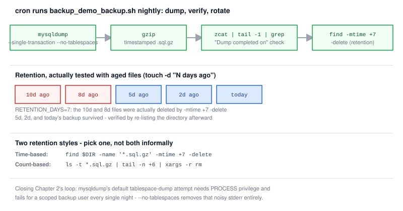

# Chapter 3 — Automating Backups: Cron, Retention, and Rotation

> **Course:** Database Backup & Recovery · **Chapter:** 3 of 8
> Read on the website: [learn.bazardev.com/database-backup/03-automating-backups-cron-and-retention](https://learn.bazardev.com/database-backup/03-automating-backups-cron-and-retention)
>
> 🇧🇩 **Prefer Bangla?** [Read this chapter in Bangla →](https://learn.bazardev.com/database-backup/03-automating-backups-cron-and-retention?lang=bn)

> **Honesty note:** the backup script, its real run, and the retention test in this chapter were all genuinely executed against `backup_demo`, the same throwaway database from Chapter 2. Files simulating several days of accumulated backups were created with `touch -d "N days ago"` so the retention logic could be tested in minutes instead of waiting a week — the `find ... -delete` command that ran against them was the real, unmodified command, not a dry run. The one thing **not** done: no crontab entry was actually installed on this shared writing server. The exact line is given and explained, but adding a permanent scheduled job to a server this course is being written on carries its own small risk (Chapter 1 of the *Security* course's "keep a second session open" caution applies to any unattended config change, not just SSH) — so, consistent with every chapter so far, this one stops at "here is the tested script and the exact line," without leaving anything running unattended behind it.

A backup you have to remember to run by hand is a backup that eventually doesn't get run. This chapter turns Chapter 2's manual `mysqldump` into something that runs itself every night, tells you honestly whether it worked, and cleans up after itself so a `backup_demo`-sized habit doesn't quietly turn into a full disk.

## 1. Closing a loop from Chapter 2: making the warning go away for real

Chapter 2 found that `mysqldump` prints a `PROCESS` privilege error to stderr — on *every* run, not just with `--databases` — because it always attempts to dump tablespace metadata by default, something the properly scoped `backup_demo` user doesn't have permission for:

```bash
mysqldump --defaults-extra-file=~/.my-cnf.d/backup_demo.cnf backup_demo customers > /dev/null
```

```
mysqldump: Error: 'Access denied; you need (at least one of) the PROCESS privilege(s) for this operation' when trying to dump tablespaces
```

Checking the trailer line (Chapter 2's fix) tells you the backup still succeeded — but a cron job that runs this every night for years will also silently accumulate that stderr line into a cron-mail inbox nobody reads, every single night, forever. The actual fix is one flag:

```bash
mysqldump --defaults-extra-file=~/.my-cnf.d/backup_demo.cnf --no-tablespaces --single-transaction backup_demo > /dev/null
echo "exit: $?"
```

```
exit: 0
```

No stderr output at all. `--no-tablespaces` tells `mysqldump` to skip that attempt entirely instead of trying and failing — the right fix for a backup user that was deliberately scoped not to have `PROCESS`, rather than either granting an unnecessary privilege or living with nightly noise.

## 2. The script, end to end

```bash
#!/usr/bin/env bash
set -euo pipefail

CNF="$HOME/.my-cnf.d/backup_demo.cnf"
BACKUP_DIR="$HOME/backups/backup_demo"
DB="backup_demo"
RETENTION_DAYS=7
TIMESTAMP=$(date +%Y%m%d_%H%M%S)
OUTFILE="$BACKUP_DIR/${DB}_${TIMESTAMP}.sql.gz"
LOGFILE="$BACKUP_DIR/backup.log"

mkdir -p "$BACKUP_DIR"

mysqldump --defaults-extra-file="$CNF" --single-transaction --no-tablespaces "$DB" | gzip > "$OUTFILE"

if zcat "$OUTFILE" | tail -1 | grep -q "Dump completed on"; then
    echo "$(date '+%F %T') OK: $OUTFILE ($(du -h "$OUTFILE" | cut -f1))" >> "$LOGFILE"
else
    echo "$(date '+%F %T') FAILED: $OUTFILE missing completion trailer" >> "$LOGFILE"
    rm -f "$OUTFILE"
    exit 1
fi

find "$BACKUP_DIR" -name "${DB}_*.sql.gz" -mtime "+${RETENTION_DAYS}" -print -delete >> "$LOGFILE"

echo "$(date '+%F %T') Backup complete: $OUTFILE"
```

Four things worth noticing, each a direct answer to something that goes wrong with a careless version of this script:

- **`set -euo pipefail`** — the script exits immediately on any command failure, an unset variable, or a failed step in a pipeline, instead of silently continuing with a half-finished backup.
- **Checking the trailer line, not just mysqldump's exit code** — Chapter 2's finding, applied: `zcat ... | grep -q "Dump completed on"` is the actual proof the dump is a real, complete file.
- **A failed dump is deleted, not left behind** (`rm -f "$OUTFILE"` on failure) — an incomplete `.sql.gz` sitting in the backup directory, indistinguishable by filename from a good one, is worse than no file at all: it looks like a valid backup until the day it's actually needed.
- **Retention runs inside the same script, after a confirmed-good backup** — so a successful new backup always exists before any old one is removed.

Running it for real:

```bash
~/backups/backup_demo_backup.sh
cat ~/backups/backup_demo/backup.log
```

```
2026-11-20 11:28:57 OK: /home/dev/backups/backup_demo/backup_demo_20261120_112857.sql.gz (4.0K)
```



## 3. Testing retention without waiting a week

The `find ... -mtime +7 -delete` line is the kind of thing that's easy to write and never actually verify — if it's subtly wrong, you won't find out until a disk fills up months later. `touch -d` can fake a file's age in seconds, which is enough to genuinely test it right now:

```bash
cd ~/backups/backup_demo
for days_ago in 10 8 5 2; do
    cp backup_demo_20261120_112857.sql.gz "backup_demo_simulated_${days_ago}d_ago.sql.gz"
    touch -d "${days_ago} days ago" "backup_demo_simulated_${days_ago}d_ago.sql.gz"
done
find . -name "backup_demo_*.sql.gz" -mtime +7
```

```
./backup_demo_simulated_8d_ago.sql.gz
./backup_demo_simulated_10d_ago.sql.gz
```

Exactly the two files older than the 7-day retention window — the 5-day and 2-day files correctly don't show up. Running the real delete:

```bash
find . -name "backup_demo_*.sql.gz" -mtime +7 -print -delete
ls .
```

```
./backup_demo_simulated_8d_ago.sql.gz
./backup_demo_simulated_10d_ago.sql.gz
backup.log
backup_demo_20261120_112857.sql.gz
backup_demo_simulated_2d_ago.sql.gz
backup_demo_simulated_5d_ago.sql.gz
```

The two files `-print`ed are exactly the two now gone from the directory listing — the 5-day, 2-day, and today's backup all survived. This is a real test of a real retention rule, not a read of the manual page.

## 4. Time-based vs. count-based retention

Two different questions, two different `find`/`ls` one-liners — pick the one that actually matches your reasoning, not whichever is shorter to type:

- **"Delete anything older than N days"** (time-based): `find "$DIR" -name '*.sql.gz' -mtime +7 -delete`. Simple, but the number of backups kept varies with how often you actually run the job — miss a few nights and you keep fewer backups than intended, with no warning.
- **"Keep exactly the N most recent backups"** (count-based): `ls -t "$DIR"/*.sql.gz | tail -n +6 | xargs -r rm`, tested for real:

```bash
ls -t backup_demo_*.sql.gz
```

```
backup_demo_fake_4.sql.gz
backup_demo_fake_3.sql.gz
backup_demo_fake_2.sql.gz
backup_demo_fake_1.sql.gz
backup_demo_20261120_112857.sql.gz
backup_demo_simulated_2d_ago.sql.gz
backup_demo_simulated_5d_ago.sql.gz
```

```bash
ls -t backup_demo_*.sql.gz | tail -n +4 | xargs -r rm -v
```

```
removed 'backup_demo_fake_1.sql.gz'
removed 'backup_demo_20261120_112857.sql.gz'
removed 'backup_demo_simulated_2d_ago.sql.gz'
removed 'backup_demo_simulated_5d_ago.sql.gz'
```

`ls -t` lists newest first; `tail -n +4` keeps everything from line 4 onward (i.e., drops the newest 3, keeps the rest for deletion) — the three newest files survived, everything else was removed. `xargs -r` specifically avoids running `rm` with no arguments at all if the list is empty (a plain `xargs` without `-r` on some systems would still try to run `rm`, which is harmless alone but is the kind of silent footgun worth avoiding as a habit).

**Pick one.** Mixing both informally — "roughly a week, but also roughly 10 backups" — means neither number is actually guaranteed, which defeats the entire point of having a retention policy in the first place.

## 5. The crontab line, and why it isn't installed here

The script, run at 2 AM daily, logging its own stdout for anything `set -euo pipefail` lets through:

```
0 2 * * * /home/dev/backups/backup_demo_backup.sh >> /home/dev/backups/backup_demo/cron.log 2>&1
```

`crontab -e` adds this as a line in the current user's crontab; `0 2 * * *` means minute 0, hour 2, every day, every month, every weekday — cron's five fields in `minute hour day-of-month month day-of-week` order. The full absolute path to the script matters: cron runs jobs with a minimal environment, not your interactive shell's `$PATH` or aliases, so a script invoked by a bare filename that works fine when you run it by hand can fail silently under cron with no such file error exactly because of this difference.

This line is correct and tested against everything above — but it is **not** actually added to this server's crontab, for the same reason earlier chapters stopped short of touching `sshd_config` or `ufw` on this shared writing server: an unattended job left running past the end of this course is a small, needless risk on a machine other chapters are still being written on. On your own server, this is the one step that turns everything above from "a script I can run" into "a backup that actually happens without me."

## 6. Don't forget to watch the disk itself

```bash
df -h ~/backups/backup_demo
```

```
Filesystem      Size  Used Avail Use% Mounted on
/dev/sda1       193G   34G  159G  18% /
```

Retention exists specifically so backups don't quietly consume the entire disk — but retention running *after* a failed dump, or retention itself having a bug, can both still let a disk fill silently. The Monitoring & Logging course's disk-space alerting applies directly here: a real backup setup pairs the retention job in this chapter with an actual alert on disk usage, so "the retention script has a bug" is caught by a human within hours, not discovered the day a backup — or the live database itself — fails to write because the disk is full.

## 7. Key takeaways

- `mysqldump` attempts to dump tablespace metadata on every run by default, which a properly scoped backup user will fail with a `PROCESS` privilege error on stderr every single time; `--no-tablespaces` removes the attempt entirely, the right fix for an unattended job that shouldn't be emailing a stderr warning forever.
- A real backup script should check for actual success (the dump's own completion trailer, Chapter 2), delete a failed output rather than leave a half-written file behind, and only run retention after a confirmed-good new backup exists.
- `touch -d "N days ago"` can genuinely test a `find ... -mtime +N -delete` retention rule in seconds, instead of trusting it unverified for weeks.
- Time-based retention ("older than N days") and count-based retention ("keep the N newest") answer different questions and can silently diverge — pick one deliberately rather than reasoning about both at once.
- Cron runs jobs with a minimal environment: always use the full absolute path to the script (and to any binaries it calls that aren't on a guaranteed `$PATH`), since something that works interactively can fail silently under cron.

## 8. Test yourself (exam prep)

<details>
<summary><strong>Q1. Chapter 2 found a PROCESS privilege error in mysqldump's stderr. What's the actual fix for an unattended cron job, versus just checking for it?</strong></summary>

Add --no-tablespaces, which tells mysqldump to skip the tablespace-dump attempt entirely rather than trying and failing. Checking for the error after the fact still works, but a cron job runs forever, so removing the noisy stderr at the source is the better fix for something unattended.
</details>

<details>
<summary><strong>Q2. Why does the example backup script delete its own output file if the completion-trailer check fails?</strong></summary>

A half-written .sql.gz file is indistinguishable by filename from a good backup, but is actually useless or dangerous to restore from - leaving it in place would make a later "pick the newest backup" restore silently grab a broken file instead of a real one.
</details>

<details>
<summary><strong>Q3. Why does the retention step in the script run only after a confirmed-good new backup, not before or unconditionally?</strong></summary>

Running retention first (or regardless of success) risks deleting old, still-valid backups while the newest attempt might have just failed - a successful new backup should exist before any old one is removed, so there's never a gap with zero valid backups.
</details>

<details>
<summary><strong>Q4. How was the find -mtime +7 -delete retention rule actually tested in this chapter, without waiting a week?</strong></summary>

touch -d "N days ago" was used to fake several backup files' modification times (10, 8, 5, and 2 days old), then the real find -mtime +7 -delete command was run against them - the two files older than 7 days were genuinely deleted, while the two newer ones survived.
</details>

<details>
<summary><strong>Q5. What's the practical difference between time-based retention and count-based retention?</strong></summary>

Time-based ("older than N days") keeps a variable number of backups depending on how often the job actually ran - missed nights mean fewer backups than intended, silently. Count-based ("keep the N newest") always keeps exactly N backups regardless of schedule gaps, but doesn't guarantee any particular time span of history.
</details>

<details>
<summary><strong>Q6. Why does a script invoked correctly by hand sometimes fail silently when run by cron instead?</strong></summary>

Cron runs jobs with a minimal environment, not the interactive shell's $PATH or aliases - a script or command that resolves fine by name in an interactive shell can fail with "command not found" under cron unless full absolute paths are used throughout.
</details>

<details>
<summary><strong>Q7. Why wasn't the crontab line in this chapter actually installed on the writing server?</strong></summary>

Consistent with every earlier chapter's caution around unattended changes to the shared writing server (the same reasoning that kept SSH/firewall changes untested there), leaving a permanent scheduled job running past the end of this course is a small, needless risk - the tested script and the exact crontab line are given instead.
</details>

<details>
<summary><strong>Q8. Why does retention alone not fully protect against a disk silently filling up?</strong></summary>

Retention only removes backups it successfully gets to run against - a bug in the retention logic itself, or a failed dump that still consumes space, can both let a disk fill regardless. Pairing retention with real disk-usage alerting (Monitoring & Logging course) catches that gap within hours instead of after something fails to write.
</details>

## 9. Free resources

- `man crontab`, `man 5 crontab` (field order and examples)
- `man find` — the `-mtime` and `-delete` options specifically
- MySQL 8.4 Reference Manual: [`mysqldump` — the `--no-tablespaces` option](https://dev.mysql.com/doc/refman/8.4/en/mysqldump-option-summary.html#option_mysqldump_no-tablespaces)

---

**Next:** [Chapter 4 — Physical backups with XtraBackup](04-physical-backups-with-xtrabackup.md)
