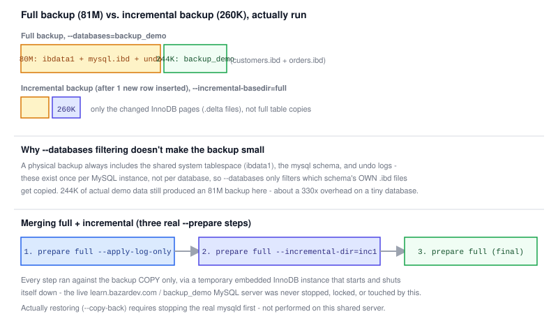

# Chapter 4 — Physical Backups with XtraBackup

> **Course:** Database Backup & Recovery · **Chapter:** 4 of 8
> Read on the website: [learn.bazardev.com/database-backup/04-physical-backups-with-xtrabackup](https://learn.bazardev.com/database-backup/04-physical-backups-with-xtrabackup)
>
> 🇧🇩 **Prefer Bangla?** [Read this chapter in Bangla →](https://learn.bazardev.com/database-backup/04-physical-backups-with-xtrabackup?lang=bn)

> **Honesty note:** Percona XtraBackup 8.4.0 was genuinely installed on this course's own writing server for this chapter (`sudo apt install percona-xtrabackup`, from the Percona APT repo already configured there). Every backup, incremental, and prepare/merge step below was actually run against `backup_demo`. Two things worth being explicit about: first, unlike Chapters 2–3, this chapter's backup user (`xtrabackup_demo`) necessarily holds **instance-wide** privileges (`BACKUP_ADMIN`, `RELOAD`, `PROCESS`, `LOCK TABLES`, `REPLICATION CLIENT`) — XtraBackup copies raw files directly, so these privileges can't be scoped to one schema the way a logical-backup user's grants can be; it holds **no `SELECT`/data-reading privilege on any table**, verified with `SHOW GRANTS` below. Second, restoring a physical backup for real (`--copy-back`) requires stopping the live `mysqld` process entirely — not performed here, for the same reason this course never touches live services on its own shared writing server.

Chapter 2 asked `mysqldump` to export rows as SQL. This chapter asks a completely different question: what if, instead of asking the database to describe its own data, you just copy the actual files MySQL already has on disk? That's a physical backup, and XtraBackup is the standard open-source tool for taking one from a live, running MySQL server without locking out writes for the whole operation.

## 1. A backup user that can't read a single row

```bash
sudo mysql -e "CREATE USER 'xtrabackup_demo'@'localhost' IDENTIFIED BY '...'; GRANT BACKUP_ADMIN, RELOAD, PROCESS, LOCK TABLES, REPLICATION CLIENT ON *.* TO 'xtrabackup_demo'@'localhost';"
```

```bash
sudo mysql -e "SHOW GRANTS FOR 'xtrabackup_demo'@'localhost';"
```

```
GRANT RELOAD, PROCESS, LOCK TABLES, REPLICATION CLIENT ON *.* TO `xtrabackup_demo`@`localhost`
GRANT BACKUP_ADMIN ON *.* TO `xtrabackup_demo`@`localhost`
```

No `SELECT`, no `INSERT`, no access to any table's actual data through SQL at all — this account exists purely to coordinate the backup mechanics (briefly locking for consistency, flushing logs, reading redo-log metadata). The actual data copying happens at the filesystem level, which is why `sudo` is separately required: MySQL's datadir (`/var/lib/mysql`) is owned by the `mysql` system user with no read access for anyone else, by design, regardless of any MySQL-level grant.

## 2. The first real backup, and where the filter actually applies

```bash
sudo xtrabackup --defaults-extra-file=/home/dev/.my-cnf.d/xtrabackup_demo.cnf \
  --backup \
  --target-dir=/home/dev/backups/xtrabackup_demo/full \
  --databases="backup_demo"
```

```
...
2026-11-20T17:53:22.870679+06:00 0 [Note] [MY-011825] [Xtrabackup] Backup created in directory '/home/dev/backups/xtrabackup_demo/full/'
...
2026-11-20T17:53:24.213366+06:00 0 [Note] [MY-011825] [Xtrabackup] completed OK!
```

```bash
sudo du -sh /home/dev/backups/xtrabackup_demo/full/
sudo du -sh /home/dev/backups/xtrabackup_demo/full/backup_demo/
```

```
81M	/home/dev/backups/xtrabackup_demo/full/
244K	/home/dev/backups/xtrabackup_demo/full/backup_demo/
```

This is the single most important real number in this chapter: `backup_demo`'s own two tables are **244 KB**. The full backup directory is **81 MB** — roughly 330 times larger. The rest:

```bash
sudo du -sh .../ibdata1 .../mysql.ibd .../undo_001 .../undo_002
```

```
12M	ibdata1
36M	mysql.ibd
16M	undo_001
16M	undo_002
```

`ibdata1` (the shared system tablespace), `mysql.ibd` (MySQL's own internal schema), and the undo logs all exist **once per MySQL instance**, not once per database — `--databases="backup_demo"` only filters which schema's *own* `.ibd` table files get copied into the backup directory. It cannot filter out the instance-wide files a physical backup fundamentally needs for consistency, because those files aren't "part of" any one database to begin with. On a real server hosting one 500 GB database, this overhead is negligible; on this course's tiny demo, it completely dominates the number.



## 3. Incremental backups: the thing `mysqldump` genuinely cannot do

`mysqldump` has no concept of "only what changed" — every run reads and exports every row, every time. XtraBackup tracks a log sequence number (LSN) and can back up only the InnoDB pages modified since a previous backup's checkpoint. After inserting one real new row:

```bash
mysql ... backup_demo -e "INSERT INTO orders (customer_id, amount) VALUES (3, 899.99);"
```

```bash
sudo xtrabackup --defaults-extra-file=... --backup \
  --target-dir=/home/dev/backups/xtrabackup_demo/inc1 \
  --incremental-basedir=/home/dev/backups/xtrabackup_demo/full \
  --databases="backup_demo"
```

```
... completed OK!
```

```bash
sudo du -sh /home/dev/backups/xtrabackup_demo/inc1/
sudo ls -la /home/dev/backups/xtrabackup_demo/inc1/backup_demo/
```

```
260K	/home/dev/backups/xtrabackup_demo/inc1/
-rw-r----- 1 root root 16384 customers.ibd.delta
-rw-r----- 1 root root    67 customers.ibd.meta
-rw-r----- 1 root root 49152 orders.ibd.delta
-rw-r----- 1 root root    67 orders.ibd.meta
```

**81 MB for the full backup, 260 KB for the incremental** — for one inserted row, that ratio is almost entirely fixed overhead either way, but the principle is real and scales: a `.delta` file contains only the InnoDB pages that changed, not a full copy of `orders.ibd`. This is exactly Chapter 1's incremental-vs-full tradeoff (storage and time saved, at the cost of a longer, more fragile restore chain) made concrete with actual file sizes.

## 4. Merging a full and an incremental — three real `--prepare` steps

A fresh XtraBackup directory isn't restorable as-is: it contains raw, not-yet-consistent data files plus a redo log that still needs replaying. `--prepare` does that replay — and merging an incremental in requires doing it in a specific three-step order, all genuinely run here:

```bash
# 1. Prepare the full backup, but keep it "mergeable" (apply-log-only)
sudo xtrabackup --prepare --apply-log-only --target-dir=/home/dev/backups/xtrabackup_demo/full

# 2. Merge the incremental's changed pages into the full backup, still apply-log-only
sudo xtrabackup --prepare --apply-log-only \
  --target-dir=/home/dev/backups/xtrabackup_demo/full \
  --incremental-dir=/home/dev/backups/xtrabackup_demo/inc1

# 3. Final prepare - this is the step that makes it actually restorable
sudo xtrabackup --prepare --target-dir=/home/dev/backups/xtrabackup_demo/full
```

All three printed `completed OK!`. `--apply-log-only` on the first two steps is the detail that's easy to get wrong: skip it (run a normal, final `--prepare` too early) and the full backup becomes consistent *before* the incremental's changes are merged in — a second, later prepare on top of that can corrupt the data instead of extending it. The three-step order exists specifically so the full backup only becomes "finished" once every incremental has already been folded in.

Each of these three commands ran against the **backup copy only** — XtraBackup's `--prepare` works by briefly starting its own embedded InnoDB engine against the files in `--target-dir`, replaying the log, then shutting that embedded instance down. The real `mysqld` serving `backup_demo` (and every other database on this server) was never stopped, locked, or even contacted during any of these three steps:

```bash
mysql --defaults-extra-file=~/.my-cnf.d/backup_demo.cnf backup_demo -e "SELECT COUNT(*) FROM orders;"
```

```
COUNT(*)
4
```

The live table still has all 4 rows, completely undisturbed — proof the entire merge happened off to the side, on a copy.

## 5. Why the actual restore step isn't performed here

Restoring a physical backup for real means `xtrabackup --copy-back --target-dir=... --datadir=/var/lib/mysql` — but this only works against an **empty** datadir, which means the real `mysqld` process has to be fully stopped first. On a server running one MySQL instance for every database this course (and this entire site) depends on, that's not a line this course will cross, for the same reason earlier chapters stopped short of touching live `sshd_config` or installing a crontab here: there is no way to "undo" stopping the production database server if something goes wrong immediately after. On your own server — or ideally, a dedicated replica or staging box, never the primary live server — this is the step that turns a prepared backup directory into a running database again.

## 6. Logical vs. physical, now with real numbers to weigh

Chapter 1 described this tradeoff; this chapter can finally attach honest numbers to it, from the exact same `backup_demo` database:

| | `mysqldump` (Chapter 2) | XtraBackup (this chapter) |
|---|---|---|
| Output size, full backup | A few KB of SQL text | 81 MB (almost entirely fixed per-instance overhead on this tiny demo) |
| Incremental support | None — every run is a full export | Yes — 260 KB for one changed row |
| Restore mechanism | Replay SQL statements (`mysql < dump.sql`) | Copy files back into an **empty, stopped** datadir |
| Privileges needed | Scoped to the schema being backed up | Instance-wide (`BACKUP_ADMIN`, `PROCESS`, `RELOAD`, ...), but zero data-read access |
| Restore into a different DB name | Trivial (plain dump, no `--databases`) | Not supported this way — physical files are tied to the instance's own structure |

Neither column is "better" — a small-to-medium database with infrequent backups and a need for table-level flexibility fits `mysqldump`'s column; a large, fast-changing database where backup/restore *time* at scale matters fits XtraBackup's.

## 7. Key takeaways

- A physical backup copies MySQL's actual on-disk files instead of exporting SQL — fundamentally faster at scale, because there's no row-by-row export or replay, but it needs direct filesystem access to the datadir and an instance-wide-privileged (though not necessarily data-reading) MySQL account.
- `--databases` filtering on XtraBackup only controls which schema's own table files get copied — the shared system tablespace, the `mysql` schema, and undo logs are instance-wide and always included, which is why a backup of a 244 KB database still came out to 81 MB here.
- XtraBackup's incremental backups capture only the InnoDB pages changed since a previous backup's LSN checkpoint — something `mysqldump` has no equivalent for at all.
- Merging a full and an incremental backup requires a specific three-step `--prepare` sequence (`--apply-log-only` on the full, then on the full with `--incremental-dir`, then a final plain `--prepare`) — getting the order or the flag wrong can corrupt the merge instead of completing it.
- `--prepare` operates entirely on the backup copy via a temporary embedded InnoDB instance; the real, live `mysqld` is untouched by it. Actually restoring (`--copy-back`) is the one step that requires stopping the live server, which is why it wasn't performed on this shared writing server.

## 8. Test yourself (exam prep)

<details>
<summary><strong>Q1. Why does the xtrabackup_demo MySQL user need instance-wide privileges instead of scoped-to-one-schema privileges like Chapter 2's backup_demo user?</strong></summary>

XtraBackup copies raw data files directly rather than reading data through SQL - its coordination privileges (BACKUP_ADMIN, RELOAD, PROCESS, LOCK TABLES) are inherently instance-level in MySQL and cannot be limited to a single schema's grant, even though the account still has zero SELECT/data-reading privilege on any table.
</details>

<details>
<summary><strong>Q2. The backup_demo database's own tables were 244KB, but the full XtraBackup output was 81MB. Where did the other ~80MB come from?</strong></summary>

The shared system tablespace (ibdata1), the mysql schema's own data (mysql.ibd), and undo logs - all of which exist once per MySQL instance, not once per database, so they're always included in a physical backup regardless of the --databases filter.
</details>

<details>
<summary><strong>Q3. What does the --databases flag actually filter when taking an XtraBackup backup?</strong></summary>

Only which schema's own .ibd table files get copied into the backup directory - it cannot exclude instance-wide files like the system tablespace or undo logs, since those aren't part of any single database to begin with.
</details>

<details>
<summary><strong>Q4. What capability does XtraBackup's incremental backup have that mysqldump has no equivalent for?</strong></summary>

Backing up only the InnoDB pages changed since a previous backup's LSN checkpoint - mysqldump has no concept of "only what changed" at all; every run exports every row from scratch.
</details>

<details>
<summary><strong>Q5. Why must the full backup be prepared with --apply-log-only before merging an incremental into it, rather than with a plain --prepare?</strong></summary>

A plain --prepare makes the backup fully consistent and "finished" - if that happens before the incremental is merged in, a later prepare on top of it can corrupt the data instead of correctly extending it. --apply-log-only keeps the full backup in a mergeable state until every incremental has been folded in.
</details>

<details>
<summary><strong>Q6. Why didn't preparing and merging the backups in this chapter affect the live backup_demo database at all?</strong></summary>

xtrabackup --prepare works by starting a temporary, embedded InnoDB instance against the files in the backup's own target directory, replaying the redo log there, then shutting that instance down - the real, live mysqld process serving backup_demo was never stopped, locked, or contacted.
</details>

<details>
<summary><strong>Q7. Why wasn't xtrabackup --copy-back actually run in this chapter?</strong></summary>

Restoring a physical backup for real requires copying files into an empty datadir, which means the live mysqld process must be fully stopped first - on a shared server running the actual database behind this entire site, that's not reversible if something goes wrong, so it wasn't performed here, consistent with this course never touching live services on its own writing server.
</details>

<details>
<summary><strong>Q8. Give one scenario that favors mysqldump and one that favors XtraBackup, based on this chapter's real numbers.</strong></summary>

mysqldump fits a small-to-medium database needing table-level restore flexibility or portability across versions (Chapter 2). XtraBackup fits a large, frequently-changing database where backup/restore time at scale and incremental backups materially matter, despite its larger fixed per-instance overhead and more demanding privilege/restore requirements.
</details>

## 9. Free resources

- Percona XtraBackup 8.4 Documentation: [How XtraBackup Works](https://docs.percona.com/percona-xtrabackup/8.4/intro/how_xtrabackup_works.html)
- Percona XtraBackup 8.4 Documentation: [Incremental Backups](https://docs.percona.com/percona-xtrabackup/8.4/backup_scenarios/incremental_backup.html)
- Percona XtraBackup 8.4 Documentation: [The Backup Process — Permissions and Privileges](https://docs.percona.com/percona-xtrabackup/8.4/using_xtrabackup/privileges.html)

---

**Next:** [Chapter 5 — Point-in-time recovery: binary logs plus a base backup](05-point-in-time-recovery.md)
