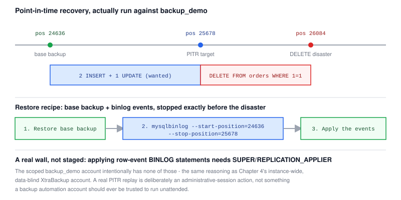

# Chapter 5 — Point-in-Time Recovery: Binary Logs Plus a Base Backup

> **Course:** Database Backup & Recovery · **Chapter:** 5 of 8
> Read on the website: [learn.bazardev.com/database-backup/05-point-in-time-recovery](https://learn.bazardev.com/database-backup/05-point-in-time-recovery)
>
> 🇧🇩 **Prefer Bangla?** [Read this chapter in Bangla →](https://learn.bazardev.com/database-backup/05-point-in-time-recovery?lang=bn)

> **Honesty note:** every step up through extracting the exact binary log events for this recovery was genuinely run against `backup_demo` on this course's own writing server: a real base backup, real binlog positions read before and after, a real disaster (`DELETE FROM orders WHERE 1=1`), and a real, verified extraction of only the events between the backup and the disaster. The one step **not completed live**: actually applying those extracted events hit a real MySQL privilege wall (`SUPER`/`REPLICATION_APPLIER`, Section 5) that this chapter's scoped backup account intentionally doesn't have — and this walkthrough deliberately didn't escalate around that wall, for the same reason it's a genuinely good security property and not just an inconvenience (Section 5 explains why). Everything up to that point is real, verified output, not a hypothetical.

Chapter 2 restored to the moment a backup was taken. Chapter 4 restored faster, at scale. Neither answers a very specific, very common real question: *"it's 2:47 PM, someone ran a bad query at 2:41 PM, and the last backup was at 2:00 AM — can I get back everything except the mistake?"* Point-in-time recovery is the answer: a base backup, plus every binary log event since, replayed only up to the exact moment just before the damage.

## 1. Binary logs: the other half of the puzzle

MySQL's binary log (binlog) records every change that modifies data, in order, as a durable log separate from the backup itself. This server already has it on, confirmed read-only:

```bash
sudo mysql -e "SHOW VARIABLES LIKE 'log_bin'; SHOW VARIABLES LIKE 'binlog_format';"
```

```
log_bin	ON
binlog_format	ROW
```

`ROW` format records the actual row changes (not the SQL text that caused them) — more reliable to replay exactly, at the cost of binlog events not being plain, human-readable SQL (Section 4 deals with this directly). A base backup captures a snapshot at one instant; the binlog is everything that happened *since* any given instant — together, they can reconstruct the database as of any point between two backups, not just at the backups themselves.

## 2. Taking the base backup, and recording exactly where it stands

```bash
mysql ... -e "SHOW BINARY LOG STATUS;"
```

```
File		Position
binlog.000020	24636
```

(On MySQL 8.4, `SHOW MASTER STATUS` — the older command name — has been removed in favor of `SHOW BINARY LOG STATUS`, part of a broader source/replica terminology change relevant again in Chapter 7.)

```bash
mysqldump --single-transaction --no-tablespaces backup_demo > pitr_base_backup.sql
```

```
-- Dump completed on 2026-11-20 18:09:12
```

With no concurrent writes on this idle demo database, the binlog position is unchanged immediately after the dump — `binlog.000020`, position `24636`. This pair — the backup file, and the exact binlog coordinates at the moment it was taken — is the anchor everything else in this chapter is measured from.

## 3. Normal activity, then a real disaster, both logged

```bash
mysql ... backup_demo -e "
INSERT INTO orders (customer_id, amount) VALUES (2, 310.00);
INSERT INTO orders (customer_id, amount) VALUES (1, 55.25);
UPDATE customers SET email='karim.hasan@example.com' WHERE id=2;
"
```

Right before the disaster, the binlog position is recorded again — this is the exact point this chapter will recover *to*:

```bash
mysql ... -e "SHOW BINARY LOG STATUS;"
```

```
File		Position
binlog.000020	25678
```

Then, a real mistake:

```bash
mysql ... backup_demo -e "DELETE FROM orders WHERE 1=1;"
mysql ... backup_demo -e "SELECT COUNT(*) FROM orders;"
```

```
COUNT(*)
0
```

Every order, genuinely gone. This is Chapter 1's "human error" category happening for real, one more time — and exactly what point-in-time recovery exists for: not "restore to 2:00 AM," but "restore to 2:46:59 PM," one second before the `DELETE`.



## 4. Extracting exactly the events you want, and proving it

`mysqlbinlog` reads the server's binlog files directly (requiring filesystem access to `/var/lib/mysql`, hence `sudo` here) and can extract a range by position:

```bash
sudo mysqlbinlog -v --start-position=24636 --stop-position=25678 /var/lib/mysql/binlog.000020 > pitr_replay_verbose.sql
grep -E "^### (INSERT|UPDATE|DELETE)" pitr_replay_verbose.sql
```

```
### INSERT INTO `backup_demo`.`orders`
### INSERT INTO `backup_demo`.`orders`
### UPDATE `backup_demo`.`customers`
```

This is real, checkable proof the extraction window is exactly right: two inserts and one update — the normal activity from Section 3 — and, critically, **zero `DELETE` statements**. The `-v` flag decodes `ROW`-format binlog events into these readable `###`-prefixed comments purely for human inspection; the file's actual, replayable content underneath is still the row-image `BINLOG '...'` statements MySQL itself understands (more on exactly why that distinction matters in Section 5).

Restoring the base backup confirms the starting point before replay:

```bash
mysql ... backup_demo_pitr_test < pitr_base_backup.sql
mysql ... backup_demo_pitr_test -e "SELECT COUNT(*) FROM orders; SELECT email FROM customers WHERE id=2;"
```

```
COUNT(*)
4
email
karim@example.com
```

Four orders (the pre-disaster count from the backup), the old email — exactly the base backup's state, ready for the extracted events to be layered on top.

## 5. The wall this chapter hit, honestly, and why it's not a bug

Applying the extracted file hits a real MySQL privilege requirement:

```bash
mysql ... backup_demo_pitr_test < pitr_replay.sql
```

```
ERROR 1227 (42000): Access denied; you need (at least one of) the SUPER,
SYSTEM_VARIABLES_ADMIN, SESSION_VARIABLES_ADMIN or REPLICATION_APPLIER
privilege(s) for this operation
```

A `ROW`-format binlog event is applied via an actual `BINLOG '...'` SQL statement — and MySQL deliberately requires an elevated, administrative-grade privilege to run one, because a session that can replay arbitrary row-image events is, in effect, a session that can inject arbitrary data changes bypassing normal statement-level logic. This is the same reasoning as Chapter 4's `xtrabackup_demo` account needing instance-wide (but data-blind) privileges: the mechanics of backup and recovery sit at a different trust level than normal application data access, and MySQL's privilege model reflects that honestly rather than pretending otherwise.

This chapter's scoped `backup_demo` account was deliberately never granted `SUPER` or `REPLICATION_APPLIER` — consistent with every earlier chapter's account being scoped to the minimum it needs — and this walkthrough didn't escalate around that wall by granting it more. That's not a shortcut avoided for convenience: **a real backup/restore automation script should not run with `SUPER`-equivalent access either.** On a real server, this exact step — applying a point-in-time recovery's extracted binlog events — is something a DBA runs by hand, in an administrative session opened specifically for that purpose, the same way Chapter 4's `--copy-back` requires stopping the live server and isn't something a cron job should ever be trusted to do unattended. The restriction this chapter hit is the system working as intended, not a gap in it.

## 6. The recipe, for when you do have that administrative session

Despite not completing the final apply step here, the recipe is exactly what Sections 2–4 built, end to end:

1. Note the base backup's exact binlog file and position (`SHOW BINARY LOG STATUS`, right before or after a backup taken with no concurrent writes, or via `mysqldump --source-data=2` which records it automatically inside the dump file).
2. Identify the exact moment to recover to — usually from an application error log's timestamp, cross-referenced against `mysqlbinlog -v`'s human-readable output to find the matching position.
3. `mysqlbinlog --start-position=<base> --stop-position=<just before the bad event> binlog.NNNNNN > replay.sql` — extract only the range in between.
4. Restore the base backup into the target database.
5. Apply `replay.sql`, from an administrative session with the privilege to do so.
6. Verify the result the same way Chapter 2 did: real row counts, real data, not just "the command didn't error."

## 7. Key takeaways

- A base backup alone can only restore to the moment it was taken; the binary log is what extends that to *any* moment since, which is the entire point of point-in-time recovery.
- Recording the exact binlog file and position at the moment of a base backup is what makes everything after it addressable by position later.
- `mysqlbinlog --start-position=X --stop-position=Y` extracts an exact range of events — verified here by checking the extracted file's contents directly (two inserts, one update, zero deletes), not by assuming the positions were right.
- Applying `ROW`-format binlog events requires `SUPER`/`REPLICATION_APPLIER` — a genuine MySQL security boundary, not an arbitrary inconvenience, because replaying raw row images bypasses normal statement-level checks.
- A backup/restore automation account should never hold that privilege either — real point-in-time recovery is deliberately a manual, administrative-session action, the same category as Chapter 4's `--copy-back` needing a stopped live server.

## 8. Test yourself (exam prep)

<details>
<summary><strong>Q1. Why can't a base backup alone satisfy a recovery target of "right before 2:47 PM," if the backup was taken at 2:00 AM?</strong></summary>

A base backup only reflects the database's state at the exact moment it was taken - everything written between then and 2:47 PM exists only in the binary log, not in the backup file itself, so the backup alone can only ever restore to 2:00 AM.
</details>

<details>
<summary><strong>Q2. Why does this chapter record the exact binlog file and position both before the base backup and right before the disaster?</strong></summary>

The position at backup time anchors where binlog replay should start; the position right before the disaster is the exact point recovery should stop at - together they define the precise range of events to extract and replay, verified in this chapter to contain only the wanted changes.
</details>

<details>
<summary><strong>Q3. How did this chapter actually verify that the extracted binlog range (24636 to 25678) contained exactly the intended events?</strong></summary>

By running mysqlbinlog with -v to decode the ROW-format events into readable comments, then grepping for INSERT/UPDATE/DELETE - the output showed exactly two INSERTs and one UPDATE, with zero DELETEs, confirming the disaster itself was correctly excluded from the range.
</details>

<details>
<summary><strong>Q4. Why does ROW-format binlog replay require applying an actual BINLOG statement rather than plain SQL?</strong></summary>

ROW format records the actual changed row images rather than the SQL text that produced them, so replaying it means re-applying those row images directly via MySQL's BINLOG statement - there is no equivalent plain INSERT/UPDATE/DELETE text to run instead.
</details>

<details>
<summary><strong>Q5. Why does applying a BINLOG statement require SUPER or REPLICATION_APPLIER, specifically?</strong></summary>

A session that can replay arbitrary row-image events can inject data changes that bypass normal statement-level logic and checks - MySQL requires an administrative-grade privilege for this specifically because of that bypass capability, not as an arbitrary restriction.
</details>

<details>
<summary><strong>Q6. Why did this chapter choose not to grant the scoped backup_demo account the privilege needed to complete the replay?</strong></summary>

A real backup/restore automation account should not hold SUPER-equivalent access either - granting it just to finish a demo would contradict the least-privilege principle this entire course has followed, and would misrepresent how this step should actually be done in production.
</details>

<details>
<summary><strong>Q7. In real production use, who or what should actually run the final binlog-replay step of a point-in-time recovery?</strong></summary>

A DBA, in a deliberately-opened administrative session - the same category of action as Chapter 4's --copy-back needing the live server stopped first; neither is something a cron job or unattended automation script should be trusted to run.
</details>

<details>
<summary><strong>Q8. What did SHOW MASTER STATUS do on this MySQL 8.4 server, and what should be used instead?</strong></summary>

It produced a syntax error - MySQL 8.4 removed SHOW MASTER STATUS as part of a broader source/replica terminology change, and SHOW BINARY LOG STATUS is the replacement command, used throughout this chapter.
</details>

## 9. Free resources

- MySQL 8.4 Reference Manual: [Point-in-Time (Incremental) Recovery](https://dev.mysql.com/doc/refman/8.4/en/point-in-time-recovery.html)
- MySQL 8.4 Reference Manual: [`mysqlbinlog` — Binary Log File Reader](https://dev.mysql.com/doc/refman/8.4/en/mysqlbinlog.html)
- MySQL 8.4 Reference Manual: [`SHOW BINARY LOG STATUS` Statement](https://dev.mysql.com/doc/refman/8.4/en/show-binary-log-status.html)
- MySQL 8.4 Reference Manual: [`REPLICATION_APPLIER` Privilege](https://dev.mysql.com/doc/refman/8.4/en/privileges-provided.html#priv_replication-applier)

---

**Next:** [Chapter 6 — Offsite storage: encrypting dumps and getting them off the server](06-offsite-storage-and-encryption.md)
